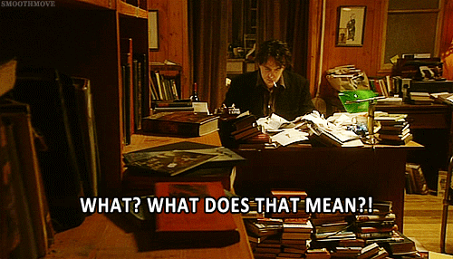
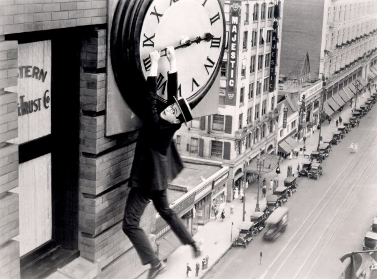

# **T**áticas psicológicas para matar seu procrastinador interno

Por muito tempo acreditei que era um robô**.** Não sei bem por quê**.** Faltava empatia, emoção e suavidade.

Eu não conversava numa voz robótica como o C-3PO**.** Mas, por algum motivo, esperava que minhas metas fossem a única coisa influenciando minhas decisões e que eu deveria buscá-las como quem executa um código de computador**.** A única coisa me separando de algo grandioso era o conjunto certo de metas**.** Infelizmente, eu sou humano, e não é assim que humanos funcionam**.**

O que está errado comigo? Eu pensei. Por que estou constantemente agindo contra meus próprios interesses**?** A resposta se esconde nos genes que herdei do meu ancestral, Bob**.**

### Introdução à preguiça

Bob era preguiçoso**.** Você não saberia isso apenas observando. Ele caçava, plantava, pescava, fugia e matava quase diariamente**.** Mas fazia isso por uma necessidade imediata. Ele adoraria ficar sentado o dia inteiro se isso não o levasse à morte certa**.** Necessidade o fez agir. Não é porque uma criança com uma arma na cabeça está seguindo ordens que isso signifique que ela não é preguiçosa**.**

Mas o motivo que faz Bob preguiçoso é que ação – toda ação – consome muita caloria**.** E uma vez que a vida depende de manter um saldo positivo de energia armazenada em relação ao que se gasta, gastar calorias com atividades não essenciais seria ridículo**.**

Nossos genes carregam a seguinte mensagem:

> “Faça o suficiente para sobreviver, não mais que isso**.**”

**Não é a sobrevivência do mais forte, é a sobrevivência do forte o suficiente**.****

Sim, vivemos em um mundo diferente agora**.** Caloria é um elemento fácil de se conseguir e, se você elogiar uma mulher pelo seu superávit calórico, provavelmente vai ganhar um tapa**.** Não existe necessidade de ser protecionista com nossos movimentos**.** Mais calorias estão apenas a um BigMac de distância**.**

### O Aspecto Mental

Este instinto reverbera em todos os pontos da nossa vida**.** Como sabemos, preguiça é algo que vai além do movimento corporal**.** Somos mentalmente preguiçosos também. O problema com atividades mentais é que raramente enxergamos uma recompensa imediata vinda delas**.**

À medida que o corpo evoluiu, criou mecanismos para nos encorajar a levantar e correr quando uma ameaça aparece**.** A habilidade de sentar e trabalhar não representa para nós um benefício genético**.**

Nossa mente é mesquinha, nada boa em calcular valor futuro**.**

### Existe saída**?**

Felizmente, psicólogos passam tanto tempo estudando nosso cérebro que aprendemos a burlar nossos instintos para alcançar nossos objetivos**.**

Quando você estrutura suas metas de uma forma que a mente vê como cruciais e imediatamente valiosas (alinha seu cérebro para estar no estado de controlá-las), você se torna capaz de direcionar sua capacidade natural para conquistar qualquer tarefa que tenha pela frente**.** Não importa quão enfadonho isso pareça.

Vou mostrar minhas técnicas favoritas para aproveitar toda essa capacidade: empregar dissonância cognitiva para forçar seu comportamento a se alinhar aos seus objetivos**.**

### Dissonância cognitiva

Palavras chiques da psicologia assustam um pouco, vamos simplificar**.** Dissonância cognitiva é a sensação desconfortável de quando a versão da realidade dentro da sua cabeça não combina com o mundo externo**.**

A reação mais comum quando sentimos isso é o auto-engano**.** Mais confortável do que compreender o problema e fazer algo quanto a ele, é mais confortável nos convencer de que o problema não existe**.**

> “Ela não pode estar ignorando minhas ligações, ela deve ter perdido o telefone**.**”

Certo, amigão.

“Será que eu atendo**?**”

Mas, melhor que se afastar da realidade eliminando a dissonância cognitiva, você vai aprender duas técnicas para amplificar sua dose de realidade**.** Você vai escancarar essa diferença entre a realidade e sua mente**.**

Primeiro, como exemplo de como funciona**.** Estimular a dissonância cognitiva tem sido amplamente utilizado como técnica de manipulação por profissionais de marketing**.** Para testar sua influência, [pesquisadores executaram um famoso experimento](http://psycnet.apa.org/journals/psp/69/2/318/)  no qual pediam para um pequeno grupo de pessoas selecionadas aleatoriamente para colocar uma plaquinha em seu gramado dizendo *“Dirija com Segurança”***.** Praticamente todos concordaram.

Semanas depois, pesquisadores passaram de porta em porta perguntando se poderiam colocar uma grande placa horrível, encorajando direção segura**.** Os estudos mostraram que as pessoas que anteriormente tinham aceitado colocar as placas pequenas, eram quatro vezes mais inclinadas a aceitar as placas grandes**.** Colocar uma placa pequena subconscientemente afirma sua percepção própria como uma pessoa contra direção perigosa**.** Um pequeno lembrete foi o suficiente para influenciar suas ações semanas depois**.**

E, como muitas técnicas de observação que podem ser utilizadas por nós e por outras pessoas, podemos usar dissonância cognitiva para mudar nossos próprios hábitos**.** Existem duas formas de conquistar isso:

- Pela afirmação da nossa identidade, nos encorajando a agir em acordo com ela;
- Registrando nosso comportamento para tornar mais evidente a distância entre o que acreditamos e nossas ações**.**

Essencialmente, são dois lados da mesma moeda**.** O objetivo é nos forçar a enxergar a realidade da forma mais plana possível, de forma que esse desconforto causado pela dissonância cognitiva consiga fazer sua mágica**.**

### Afirme sua identidade com comprometimento

Como no exemplo do “Seja um motorista prudente”, você pode encorajar seu comportamento reafirmando desejos que estejam alinhados com ele**.** Buscando a lembrança de nossas crenças mais abrangentes, tendemos a agir de acordo com elas**.**

Isso soa vago, então aqui vai a parte mais importante: **coloque seus objetivos no papel****.**

Escrevendo nossos objetivos, não existe onde se esconder**.** Se concluí-los, você vence**.** Caso contrário sabe que falhou. Não permitir que o cérebro se sabote é crucial para se manter motivado**.** Essa é uma prática que pode ser feita de forma privada, mas é infinitamente mais poderosa se tornar isso público**.**

Quando executei as [2011 flexões no desafio relatado aqui no PdH](http://papodehomem.com.br/3800-flexoes-testando-os-limites-do-fisico-perto-do-sofa/) , se eu não tivesse tornado a meta publica, me comprometendo de uma forma tão extrema, eu provavelmente não teria conseguido chegar nem na metade do que acabei fazendo**.**

Já está passando da hora de usar isso a seu favor

Anunciar seus planos, metas e crenças para o mundo funciona maravilhosamente para nos motivar a agir no sentido que queremos**.**

Em um estudo onde um grupo de pessoas de dieta fizeram seus planos públicos no facebook, seu policiamento com a dieta foi altíssimo**.** A hipótese é que eles não podiam mais se enganar não escolhendo sua comida cuidadosamente nos seus momentos de fraqueza**.** O capetinha nos seus ombros, sussurrando, “você nunca ligou para essa dieta mesmo”, foi calado**.**

Os objetos da pesquisa declararam em público a importância de sua dieta**.** Não segui-la seria como reconhecer sua fraqueza e destruir sua identidade**.**

### Medindo o buraco da realidade

> “O que pode ser medido pode ser gerenciado” –[Peter Drucker](http://pt.wikipedia.org/wiki/Peter_Drucker)

Registrar nossas ações é outra forma de revelar o buraco entre nossa auto-percepção e a realidade**.** Como discutimos acima, é fácil nos enganar com noções vagas**.** Traduzir essas crenças em medições concretas cria uma enorme mudança de comportamento com quase nenhum esforço**.**

Constantemente mantemos ideias vagas como “eu sou um homem trabalhador” ou “eu me alimento de forma saudável” sem realmente examinar nosso comportamento e ver o que sustenta essas ideias**.** Nos forçando a ver que os fatos alinham com nossa percepção pode ser bem doloroso**.**

Continuando com os exemplos da dieta, existe um estudo no qual pesquisadores utilizaram um grupo de voluntários para seguir diferentes planos de dietas**.** O grupo que se saiu melhor não recebeu instrução alguma**.** Ao invés disso, pediram que fotografassem toda refeição e besteira que consumissem**.**

A dissonância cognitiva entre a autopercepção dos praticantes e a realidade do arquivo repleto de fotos modelaram seu comportamento melhor do que qualquer planejamento alimentar faria**.**

Então, como podemos observar esse comportamento com uma perspectiva de produtividade**?** Medindo nosso tempo.

Medir nosso tempo é um dos maiores amplificadores de produtividade que já experimentei**.** Como [Sebastian Marshall](http://sebastianmarshall.com)  escreveu uma vez:

> “Se você nunca se mediu, não sabe o tamanho do poder que esse hábito tem**.** Eu não conseguiria explicar isso adequadamente, você não acreditaria em mim**.** Pensaria que estou exagerando.”

Admita, depois disso, você está pensando em dar uma chance**.**

### Princípios de medição de Tempo

Como o nome da atividade já diz, medir o tempo se baseia basicamente em registrar o que faz com seu tempo**.** Não existe muito mais o que fazer.

Se é escrever detalhadamente um diário todas as noites, tudo bem**.** Se significa preencher uma planilha, está bom também**.** O simples ato de detalhar seu comportamento vai forçar a examiná-lo e aprender com isso**.** Essencialmente, todos os conselhos a seguir servem a dois propósitos: permitir que você registre as informações mais úteis com o menor esforço possível**.**

Seguem quatro princípios de medição de tempo que se mostraram bem sucedidos para mim e para pessoas que tenho ajudado**.**

### 1. Foque nas coisas certas

Se você não se importa com sua dieta, não escreva o que fez para o café da manhã**.** Se não se importa com seu sono, não registre quantas horas dormiu**.** Parece óbvio, mas o impulso de registrar tudo rapidamente se torna esmagador**.** Mantenha o foco nos hábitos que você quer desenvolver e comportamentos que quer continuar diariamente**.**

### 2. Comece pequeno e vá crescendo

Apesar do objetivo de medir seu tempo ser o desenvolvimento de hábitos melhores, medir o tempo por si só é um hábito**.** E como todos outros, é importante começar pequeno e ir aumentando com o tempo**.**

Por mais tentador que seja registrar tudo, não se sufoque com 20 páginas complicadas para preencher toda noite**.** Juro que, **se sua planilha for como fazer uma pequena monografia, você não dura uma semana**.****

Torne isso o mais simples e fácil possível, para virar algo automático na sua vida**.** Só assim, se você ainda quiser, adicione mais variáveis**.**

### 3**.** Nunca pule um dia

O embalo é uma coisa mágica**.** Se perder um dia, você se prejudica de duas maneiras**.** Primeiro, você torna a justificativa mais fácil para as próximas vezes**.** Segundo, você se sabota e torna o processo bem menos eficiente, assim os benefícios começam a não valer o custo**.**

O método utilizado por [Jerry Seinfield](http://pt.wikipedia.org/wiki/Jerry_Seinfeld)  para escrever comédia parte desses dois princípios**.** Não importa se o que ele produz é bom ou ruim, curto ou longo**.** Se ele escreve alguma coisa, ele consegue cortar um dia do seu calendário**.**

Seinfield afirma que o embalo é a chave para não sair da linha**.**

Siga esse conselho. Nunca pule um dia**.**

### 4. Torne as coisas fáceis

Da mesma forma que é importante manter o registro do seu tempo curto**.** Como mencionado acima, é bem melhor se você preencher seu caderninho com respostas de uma página, do que escrevendo uma monografia**.**

Tente manter o maior número de perguntas de Sim/Não que for possível**.** Preencher com números é bom também.

Faça tudo o mais direto e objetivo que conseguir**.** Faça de forma tão simples que quando estiver muito cansado e for pra cama, não queira deixar de fazer**.**

Práticas de comprometimento e medição de tempo são técnicas incríveis para promover a dissonância cognitiva e alcançar suas atividades**.** Em todo caso, elas são apenas peças do quebra-cabeça**.** Para entender melhor o panorama dos princípios psicológicos e as táticas de produtividade correspondentes, criamos um curso chamado [Matando Bob: Táticas psicológicas para matar seu procrastinador interno](http://matandobob.com/) **.**

***Nota do autor:** Este texto foi um trabalho conjunto com meu parceiro [Zach Obront](http://zachobront.com) **.***
