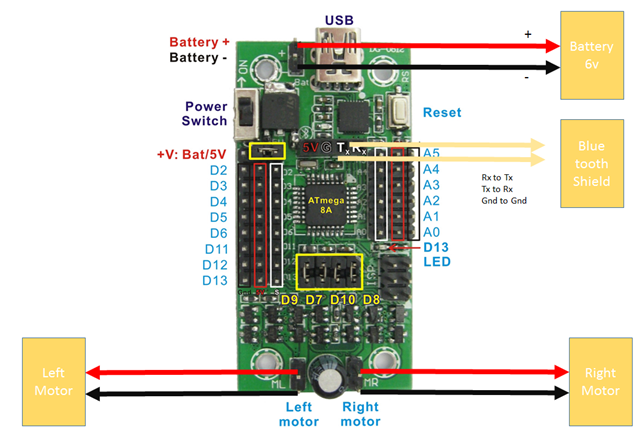
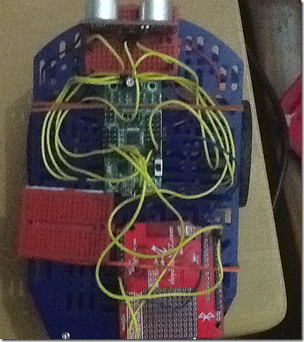

# **C**akeRobot - A Gesture Driven Robot That Follows Your Hand Movements Using Arduino, C# and Kinect

---

Tuesday, October 22, 2013
| Tags:
[.NET](http://www.amazedsaint.com/search/label/.NET) ,
[Arduino](http://www.amazedsaint.com/search/label/Arduino) ,
[Kinect](http://www.amazedsaint.com/search/label/Kinect) ,
[Robotics](http://www.amazedsaint.com/search/label/Robotics) ,
[Weekend Hacks](http://www.amazedsaint.com/search/label/Weekend%20Hacks)

Over the last few weekends I’ve spend some time building a simple robot that can be controlled using Kinect**.** You can see it in action below**.**

Ever since I [read this Cisco paper that mentions Internet Of Things will crate a whooping 14**.**4 Trillion $ at stake](http://www.cisco.com/web/about/ac79/docs/innov/IoE_Economy.pdf) , I revamped my interests in hobby electronics and started hacking with DIY boards like Arduino and Raspberry Pi**.** That turned out to be fun, and ended up with the robot**.** This post provides you the general steps, and the github code may help you build your own**.**

Even if you don’t have a Kinect for the controller, you can easily put together a controller using your phone (Windows Phone/Android/iOS) as we are using blue tooth to communicate with the controller and the robot**.** Thanks to my younger kid for the background screaming audio effect in the below video, she was running behind the bot to kick it**.**

Now, here is a quick start guide to build your own**.** We’ve an app running in the laptop that is communicating to the Robot via blue tooth in this case that pumps the commands based on input from Kinect, you could easily build a phone UI as well**.**

And if you already got the idea, [here is the code](https://github.com/amazedsaint/cakerobot)  – You may read further to build the hardware part**.**

## 1 – Build familiarity

You need to build some familiarity with [Arduino](http://www.arduino.cc/)  and/or [Netduino](http://netduino.com/)  – In this example I’ll be using Arduino**.**

#### Arduino

Explore Arduino**.** The best way is to

- Download and install the Arduino IDE [http://arduino**.**cc/en/Main/Software](http://arduino.cc/en/Main/Software)
- Go through Arduino Tutorial - <https://learn.sparkfun.com/tutorials/what-is-an-arduino>
- Buy an Arduino board to play with –You may try <https://www.sparkfun.com/> if you are in US, [Rhydolabz](http://www.rhydolabz.com/index.php?main_page=index&cPath=152_123&zenid=6e145c90a7f1a036e923ef9a4f5c22a1)  if you are in India, Google if you are in any other country**.**

Mainly you need to understand the Pins in the Arduino board**.** You can write simple programs with the Arduino IDE (try the Blink sample to blink an LED in IDE File->Samples)**.** PFB the pins description, from SparkFun website**.**

- **GND (3)**: Short for ‘Ground’**.** There are several GND pins on the Arduino, any of which can be used to ground your circuit**.**
- **5V (4) & 3.3V (5)**: The 5V pin supplies 5 volts of power, and the 3**.**3V pin supplies 3.3 volts of power**.** Most of the simple components used with the Arduino run happily off of 5 or 3**.**3 volts**.** If you’re not sure, take a look at Spark Fun’s [datasheet tutorial](http://learn.sparkfun.com/tutorials/not-yet-written)  then look up the datasheet for your part**.**
- **Analog (6)**: The area of pins under the ‘Analog In’ label (A0 through A5 on the UNO) are Analog In pins**.** These pins can read the signal from an analog sensor (like a [temperature sensor](https://www.sparkfun.com/products/10988) ) and convert it into a digital value that we can read**.**
- **Digital (7)**: Across from the analog pins are the digital pins (0 through 13 on the UNO)**.** These pins can be used for both digital input (like telling if a button is pushed) and digital output (like powering an LED)**.**
- **PWM (8)**: You may have noticed the tilde (~) next to some of the digital pins (3, 5, 6, 9, 10, and 11 on the UNO)**.** These pins act as normal digital pins, but can also be used for something called Pulse-Width Modulation (PWM)**.** We have [a tutorial on PWM](https://learn.sparkfun.com/tutorials/pulse-width-modulation) , but for now, think of these pins as being able to simulate analog output (like fading an LED in and out)**.**
- **AREF (9)**: Stands for Analog Reference**.** Most of the time you can leave this pin alone**.** It is sometimes used to set an external reference voltage (between 0 and 5 Volts) as the upper limit for the analog input pins**.**

#### Kinect

- If you are planning to use Kinect as the controller, download and install Kinect SDK - <http://www.microsoft.com/en-us/kinectforwindowsdev/default.aspx> – I’m using SDK 1**.**7
- Kinect [How To Videos Here](http://www.microsoft.com/en-us/kinectforwindowsdev/Build.aspx)

#### Protocols

- Get some familiarity about Bluetooth Protocols - <http://en.wikipedia.org/wiki/Bluetooth>

## 2 – Get The Components

Again, you could find an online store to buy these components**.** Also, you could try the nearby local electronic store and buy some bread boards, jumper wires (get some mail to mail & female to female wires) etc as well**.** Here is the list of components you need to build CakeRobot**.**

- A Chassis – I used Dagu Magician Chassis  – From [Spark Fun](https://www.sparkfun.com/products/10825) , [Rhydolabz](http://www.rhydolabz.com/index.php?main_page=product_info&products_id=1260)  – it comes with two stepper motors that can be controlled by our driver board**.**
- A Arduino board with Motor Driver – I used Dagu [Mini Motor Driver](http://robosavvy.com/RoboSavvyPages/Dagu/MiniDriverControlBoard/DAGU_MiniDriverControlBoard_Manual.pdf)  – bought from [Rhydolabz](http://www.rhydolabz.com/index.php?main_page=product_info&products_id=1270)  in India**.** For other countries you need to search and find**.** Some description about the board [can be found here](http://robosavvy.com/store/product_info.php/manufacturers_id/35/products_id/3347)  – It also has a special slot to plug in dagu blue tooth shield**.** You could also use [Micro Magician](http://www.instructables.com/id/Step-by-Step-guide-to-Micro-Magician-robot-control/) 
  - You also need a Micro USB cable to connect your PC to the motor driver to upload code**.**
- A Bluetooth Shield – Get the Dagu blue tooth module if you can find it**.** I’ve purchased a [Class 2 Rn 42 blue tooth shield From Rhydolabz](http://www.rhydolabz.com/index.php?main_page=product_info&products_id=1181)
- Few [mini modular bread boards](https://www.sparkfun.com/products/12043)
- Jumper wires – Get a mixed pack with M/M, F/F, M/F – [like this one](https://www.sparkfun.com/products/9194)
- A Tiny blue tooth dongle for your PC/Laptop, [like this one](http://www.rhydolabz.com/index.php?main_page=product_info&products_id=426) , to communicate with the blue tooth shield in the robot (if you don’t have built in blue tooth)
- Few sensors if you want to have more fun – I had an [ultra sonic distance sensor](http://www.rhydolabz.com/index.php?main_page=product_info&products_id=426)  to avoid collisions in my final version**.** A better alternative [is Ping sensor](http://arduino.cc/en/Tutorial/Ping?from=Tutorial.UltrasoundSensor) **.**
- A battery pack and battery holder that should supply around 6V to the Mini Motor Driver
- Other components for your later creativity/exploration
  - Resistors
  - More Sensors
- Tools
  - Few star screw drivers
  - Duct tapes/rubber bands (yea, we are prototyping so no soldering as of now)

And I found these reads pretty useful

## 3 – Programming the components

You need to spend some hours figuring out how to program each of the components**.**

- To start with, play with Arduino a bit, connecting LEDs, switches etc**.** Then, understand a bit about programming the Digital and Analog pins**.** Play [with the examples](http://arduino.cc/en/Tutorial/HomePage)
- Try programming the ultrasonic sensor if you’ve one using your Arduino, using serial sockets**.** If you are using Ping sensor, [check out this](http://arduino.cc/en/Tutorial/Ping?from=Tutorial.UltrasoundSensor)
- Try programming the blue tooth module (Code I used for the distance sensor and blue tooth module are in my examples below, but it’ll be cool if you can figure things out yourself)**.**

## 4 – Put the components together

Assemble the Dagu Magician Chassis, and place/screw/mount the mini motor driver and Bluetooth module on top of the same**.** Connect the components using jumper wires/plugin as required**.** A high level schematic below.

[](http://lh5.ggpht.com/-kMPeGTYixek/UmWATCBrw0I/AAAAAAAACG8/IKVGDBZsvIM/s1600-h/image%25255B4%25255D.png)

Here is a low resolution snap of mine, from top**.**

[](http://lh6.ggpht.com/-i7Lu3a8zyfM/UmWAjnoGrTI/AAAAAAAACHM/23Vt_1Olrd4/s1600-h/image%25255B8%25255D.png)

## 5 – Coding the Arduino Mini Driver

You can explore the full code in the [Github repo](https://github.com/amazedsaint/cakerobot)   - How ever, here are few pointers**.** According to the Dagu Arduino Mini driver spec, the following digital pins can be used to control the motors

- D9 is left motor speed
- D7 is left motor direction
- D10 is right motor speed
- D8 is right motor direction

To make a motor move, first we need to set the direction by doing a `digitalWrite` of HIGH or LOW (for Forward/Reverse) to the direction pin**.** Next set the motor speed by doing an `analogWrite` of 0~255 to the speed pin**.** 0 is stopped and 255 is full throttle.

In the Arduino code, we are initiating communication via blue tooth, to accept commands as strings**.** For example, speedl 100 will set the left motor speed to 100, and speedr 100 will set the right motor speed to 100**.** Relevant code below.

```
        //Setting up the communication with Bluetooth shield over serial 

        Serial.begin(115200);  // rn42 bt

       .......more

      //Read the input In getSerialLine (shortened for brevity)

      while(serialIn != '\n')
	{
		if (!(Serial.available() > 0)) 
		{
			return;
		}

		serialIn = Serial.read();
		if (serialIn!='\n') {
			char a = char(serialIn);
			strReceived += a;
		}
	}

        ....more

        //Process the command (shortened for brevity)
        ....
      
	else if (command=="speedl")
	{
		val=getValue(input,' ',1).toInt();
		analogWrite(leftMotorSpeed,val);
	} 
	else if (command=="speedr")
	{
		val=getValue(input,' ',1).toInt();
		analogWrite(rightMotorSpeed,val);
	} 

        ......more
```

Have a look at the full code of the quick [Arduino client here](https://github.com/amazedsaint/cakerobot/blob/master/src/CakeRobot.Arduino/CakeRobot.Arduino.ino) **.** Then, compile and upload the code to your mini driver board**.**

## 6 – Coding the Controller & Kinect

Essentially, what we are doing is just tracking the Skeletal frame, and calculating the distance of your hand from your hip to provide the direction and speed for the motors**.** Skeletal tracking [details here](http://msdn.microsoft.com/en-us/library/jj131025.aspx)

We are leveraging <http://32feet.codeplex.com/> for identifying the Blue tooth shield to send the commands**.** Please ensure your blue tooth shield is paired with your PC/Laptop/Phone – you can normally do that by clicking the blue tooth icon in system tray in Windows, and clicking Add Device**.**

```
       //For each 600 ms, send a new command
       //_btCon is our instance variable for a blue tooth connection, built over the cool 32Feet library
      
       internal void ProcessCommand(Skeleton skeleton)
        {

            var now = DateTime.Now;
            if (now.Subtract(_prevTime).TotalMilliseconds < 600)
                return;

            _prevTime = DateTime.Now;

            Joint handRight = skeleton.Joints[JointType.HandRight];
            Joint handLeft = skeleton.Joints[JointType.HandLeft];
            Joint shoulderRight = skeleton.Joints[JointType.ShoulderRight];
            Joint shoulderLeft = skeleton.Joints[JointType.ShoulderLeft];
            Joint hipLeft = skeleton.Joints[JointType.HipLeft];
            Joint hipRight = skeleton.Joints[JointType.HipRight];
            Joint kneeLeft = skeleton.Joints[JointType.KneeLeft];

            if (handRight.Position.Y < hipRight.Position.Y)
            {
                _btCon.SetSpeed(Motor.Left, 0);
            }

            if (handLeft.Position.Y < hipLeft.Position.Y)
            {
                _btCon.SetSpeed(Motor.Right, 0);
            }

            if (handRight.Position.Y > hipRight.Position.Y)
            {
                var speed = (handRight.Position.Y - hipRight.Position.Y) * 200;
                if (speed > 230) speed = 230;
                _btCon.SetSpeed(Motor.Left, (int)speed);
            }

            if (handLeft.Position.Y > hipLeft.Position.Y)
            {
                var speed = (handLeft.Position.Y - hipLeft.Position.Y) * 200;
                if (speed > 230) speed = 230;
                _btCon.SetSpeed(Motor.Right, (int)speed);
            }

        }
```

And so, it sets the speed based on your hand movements**.** Explore the [ConnectionHelper](https://github.com/amazedsaint/cakerobot/blob/master/src/CakeRobot.Controllers.Kinect/Helpers/ConnectionHelper.cs)  and [BluetoothConnector](https://github.com/amazedsaint/cakerobot/blob/master/src/CakeRobot.Controllers.Kinect/Helpers/BluetoothConnector.cs)  classes I wrote**.**

## Conclusion

The code is here in Github**.** [Fork it](https://github.com/amazedsaint/cakerobot)  and play with it, and expand it**.**
