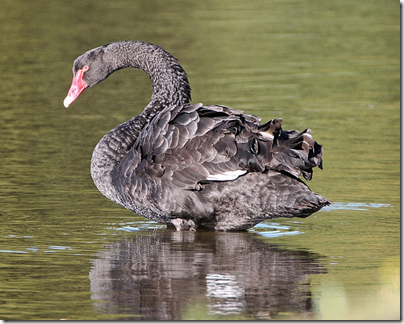
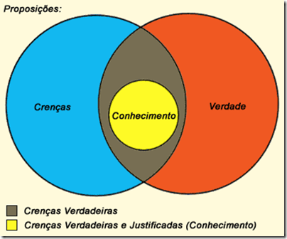

# **C**isnes negros e a verdade: você buscou a melhor forma de trabalhar**?**

Tivemos um [brown bag](http://en.wikipedia.org/wiki/Brown_bag_seminar)  na Lambda3 sobre [Management 3**.**0](http://www.management30.com/)  recentemente, logo após o [Agile Trends](http://agiletrendsbr.com/2013/) **.** Durante o brown bag alguém sugeriu o livro “[Black Swan](http://www.goodreads.com/book/show/242472.The_Black_Swan) ”, que nesse momento estou ativamente devorando**.** Estou a 20% do livro, e está sendo um livro delicioso**.** Até esse momento o livro tem sido sobre filosofia, complexidade e [epistemologia](http://pt.wikipedia.org/wiki/Epistemologia) , que em poucas palavras e simplificando muito é o estudo da verdade, do que é verdade e do que não é**.**

Eu gosto de discutir sobre o que eu leio com alguém, eu “ensino” o que aprendi, como uma forma de fixar o conhecimento em mim mesmo**.** E meu interlocutor normalmente também gosta muito, porque aprende junto**.** Ter uma namorada inteligente ajuda muito, já que é ela quem tem me ouvido, com muito interesse, e com muitas perguntas interessantes**.** A última que ela me jogou foi: “e como você vai usar isso no seu trabalho, você vê alguma conexão**?**” Sim, vejo, e nasceu esse post.

O livro se chama “Cisne negro” não à toa**.** Imagine que você sempre tenha visto, a vida toda, somente cisnes brancos**.** Você pode inferir que não existem cisnes de outra cor**.** Até que um dia você vê um cisne negro. Uma única aparicão deste animal negro é suficiente para acabar com a sua crença de que todos os cisnes são brancos**.**

Nós temos, geneticamente, a tendência a generalizar, a projetar o nosso conhecimento além dele mesmo**.** É natural que tenhamos a crença de que todos os cisnes são brancos se todos os cisnes que vimos até hoje foram brancos**.** Mas isso não quer dizer que é verdade. Se o seu interesse é descobrir a verdade, há algumas maneiras de prosseguir**.**

A mais comum é justamente essa projeção**.** Você pode afirmar: “se todos os cisnes que vi são brancos, então não existem cisnes de outra cor”**.** Podemos deduzir a partir dessa afirmação que toda coisa que não é branca não pode ser um cisne**.** Assim, ao ver um carro vermelho, você pode dizer: “Está vendo**!** Um carro vermelho! Isso prova que todos os cisnes são brancos**!**”. Olhando por essa forma fica óbvio que essa abordagem tem problemas**.**

A outra forma é entender que nunca ter visto um cisne negro não significa que ele não existe**.** É diferente dizer “não há evidências de cisnes negros” de “há evidências de que não há cisnes negros”**.** No primeiro, você está dizendo que nunca viu um cisne negro, mas ele pode existir ainda assim, sem você ter visto**.** Na segunda, fica claro que você buscou o mundo todo, você já viu todos os cisnes, e nenhum era negro**.** A segunda é mais difícil de ser provada, mas é a única que vai realmente provar se cisnes negros existem ou não**.**

Evoluindo esse raciocínio podemos concluir que é muito mais fácil provar que uma afirmação é falsa do que provar que é verdadeira**.** É mais fácil provar que a afirmação “todos os cisnes são brancos” é falsa – basta encontrar um único cisne negro – do que provar que ela é verdadeira – você teria que ter vistos todos os cisnes do planeta**.**

Outro problema que vem desse é que temos uma forte tendência a tentar confirmar o que já acreditamos, e jogar toda evidência em contrário no lixo, ou simplesmente ignorá-la**.** Se você passar a vida toda procurando cisnes brancos, sempre encontrará novos animais para comprovar sua hipótese**.** A cada novo cisne branco você estará mais certo de que existem somente cisnes brancos**.** E vai estar errado. Isso se chama “viés de confirmação” (prefiro o termo em inglês, *confirmation bias*)**.** Em vez de procurar evidências de que está errado, você procura evidências de que está certo, nunca se aproximando da verdade**.** Todo seu estudo, toda sua busca, só te afasta mais da verdade, e não serve pra nada**.** Seria mais inteligente e mais produtivo se, ao crer que cisnes brancos são os únicos a existir, começasse a buscar os de outra cor**.** Ao encontrar o primeiro você saberia que estava errado, e se nunca encontrar, ainda que não tenha certeza que está certo, terá uma chance menor de estar errado**.**

Vamos voltar para o mundo real e parar de falar de cisnes**.** Vamos voltar à pergunta da minha namorada: “e o que isso tem a ver com o seu trabalho**?**”

Olhei para como trabalhamos na Lambda3**.** Nós nunca aceitamos a primeira maneira de fazer as coisas como a melhor**.** Quando buscamos uma ferramenta para resolver um problema nunca paramos na primeira ferramenta**.** Imagine que ao encontrar uma excelente ferramenta eu afirmasse: “essa é a melhor ferramenta para resolver esse problema**.**” Eu estaria certo? Não é possível dizer, enquanto eu não tiver analisado **todas** as ferramentas que resolvem o mesmo problema**.** Como isso normalmente é impossível, ou no mínimo muito difícil, eu iria analisar algumas outras até ficar satisfeito**.** E estaria sempre aberto para uma nova, caso me deparasse com ela**.** A melhor maneira de garantir que aquela ferramenta é a melhor é tentar me provar errado: vou procurar ferramentas que se mostrem melhores que a que encontrei**.**

Esse é um dos motivos que a Lambda3 trabalha com Linux, Windows e Macs**.** Porque usamos Java, C#, Ruby, Groovy, Node e outras linguagens e plataformas**.** Porque nesse momento temos um time trabalhando com fluxo contínuo e outro com iterações**.** Porque essas ferramentas e técnicas resolvem os problemas de forma diferente, e são adequadas ou não dependendo do contexto**.** Não aceitamos a primeira coisa com a qual entramos em contato, e por entrar em contato com muitas diferentes somos capazes de escolher a mais adequada para cada cenário com uma margem de erro menor**.**

Esse é o motivo que eu comecei a programar no Linux: eu queria saber se de fato o Windows era a melhor plataforma para programar**.** Esse é o motivo que [me fez procurar programar com VIM](http://blog.lambda3.com.br/2013/09/isso-nao-e-intuitivo/)  corretamente**.** Para não parar na primeira. Para não me fixar no que eu já sei, mas sim no que eu não sei**.** Lembro que no começo da carreira eu sempre buscava informações que confirmassem que o Visual Studio era o melhor, que tudo que a Microsoft faz era melhor, em uma clara evidência de viés de confirmação, nunca buscando algo que me desmentisse do outro lado**.** Da mesma forma que muita gente que trabalha com Linux e ferramentas open source faz, dizendo que tudo que há no Windows ou feito pela Microsoft é ruim**.** Em ambos os casos há viés de confirmação e há uma busca desonesta da verdade, além de muita imaturidade**.** Na verdade, a única busca que há, na realidade, é a de confirmação de que você está certo, algo que não vai ajudar em nada o teu conhecimento, ainda que temporariamente faça você se sentir bem**.**

Foi daí também que saiu [a ideia de pedalar em São Paulo](http://blog.lambda3.com.br/2011/12/duas-semanas-de-bicicleta/) **.** Muita gente sabe que eu praticamente só me locomovo por aqui de bicleta**.** Até 20 kms eu nem penso em sair de moto, de carro eu só saio quando tenho certeza que não vou pegar trânsito e se realmente o momento demandar**.** Até uma certa idade a minha crença era de que eu precisava de um carro para me locomover, até que eu resolvi desafiar essa crença, e mudar radicalmente minha relação com o trânsito dessa cidade – pra melhor**.**

A parte chata de viver no conforto da ignorância é que a todo momento alguém aponta pra você evidências de que você pode estar errado**.** Ainda que se feche na sua concha, você ainda vai ver essas evidências**.** E elas vão ser irritantes. E esse sentimento de irritação e raiva vai fazer com que você se feche ainda mais, e tenha ainda menos contato com quem pensa diferente**.** É assim que nascem os radicais.

Não dá pra ficar o tempo todo desafiando toda a crença, isso seria muito improdutivo**.** Mas é possível não aceitar a primeira. É possível gastar um pouco de tempo avaliando se o que acreditamos ser verdade realmente é, olhar do outro lado do muro**.** Faço esse convite a você, meu amigo leitor: que crenças você ainda não desafiou**?** Tem coragem de sair do conforto e buscar fatos que podem apontar que está errado**?** Fica o convite, depois me contem como foi aqui nos comentários, façam outros posts, vamos debater**.**

Ainda estou no começo do livro. Muito ainda deve vir dele. Uma coisa é certa, estou aprendendo muito, e está valendo cada minuto de investimento**.** E vai gerar outro brown bag na Lambda3!
