# 32 Livros Que Realmente Mudarão A Sua Vida

E tudo que você precisa fazer é lê-los**!**
publicado 20 de Outubro de 2013, 7:45 GMT-5

## 1**.** O Escafandro e a Borboleta

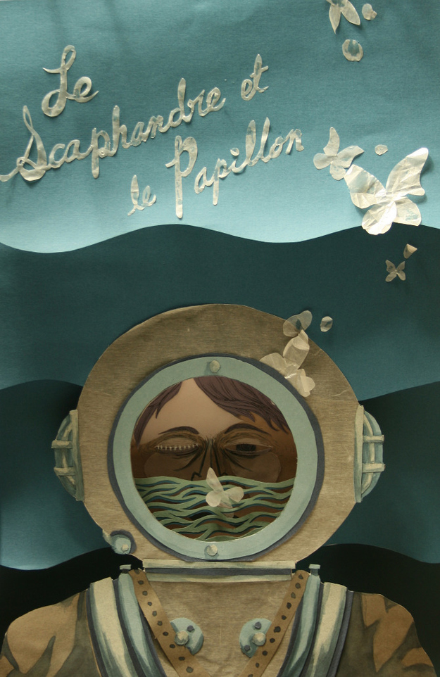

Via [andreamenendez.com](http://andreamenendez.com/Book-Covers)

Este comovente livro de memórias, escrito por Jean-Dominique Bauby, conta a vida de um editor narcisista que foi parar na enfermaria de um hospital depois que um repentino acidente vascular cerebral (AVC) o deixou paralisado e impossibilitado de se comunicar**.** Ele vai lhe fazer perceber quão importante são as pessoas na sua vida, e como cada momento é precioso**.** Eu mencionei que você pode chorar durante o livro inteiro**?**

## 2**.** Zen e a Arte da Manutenção de Motocicletas

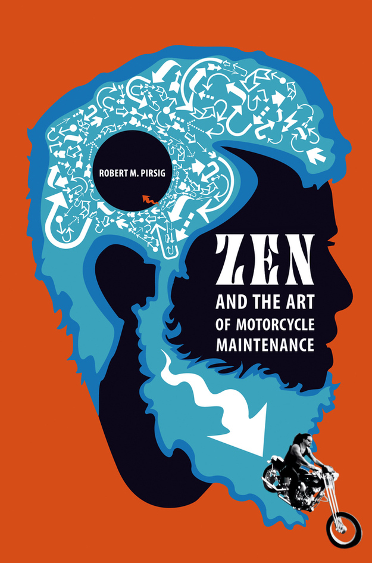

Via [designrelated.com](http://designrelated.com/portfolio/rawshock/entry/57210)

Precisa de um pouco mais de ímpeto na sua vida**?**

Leia esse romance filosófico, e Robert Pirsig vai te ajudar a perceber o quanto é importante importar-se com o que você está fazendo**.** Em outras palavras, se você esta consertando uma motocicleta, então a conserte de verdade**.** Não ouça música, ou faça qualquer outra coisa ao mesmo tempo**.** Faça o que você precisa fazer, e tenha orgulho disso**.**

## 3**.** Cama de Gato

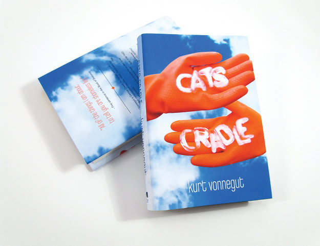

Via [cargocollective.com](http://cargocollective.com/whitneypeek/cat-s-cradle)

De todos os Vonnegut que você poderia ler, este é o que levantará mais questões - em um bom sentido**.** Jonah, nosso narrador, quer escrever um livro sobre o inventor da bomba atômica, Dr**.** Frank Hoenikker**.**

Este livro lhe fará questionar se deveria ou não haver um limite sobre a busca do conhecimento**.** E te fará pensar sobre o poder das armas, e como até mesmo as pessoas mais competentes podem cometer erros com elas**.** Além disso, com toda essa ciência vem a exploração da religião, ou a futilidade dela, de fato**.**

## 4**.** O Curioso Incidente do Cachorro no Anoitecer

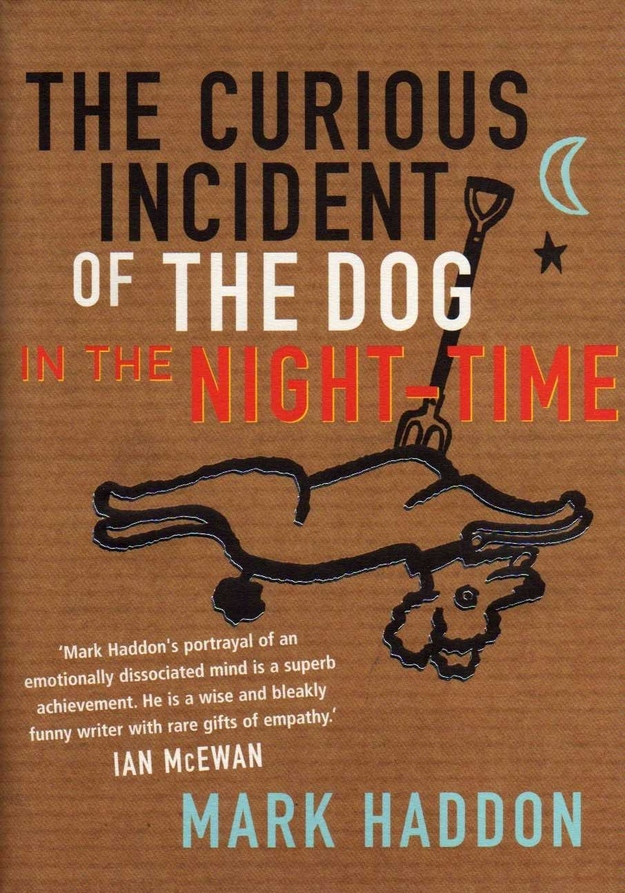

Via [billleonebookseller.com](http://www.billleonebookseller.com/)

Este livro é especial porque dá voz a um tipo de pessoa que normalmente não é explorada na ficção**.** O narrador é um garoto de 15 anos chamado Christopher John Francis Boone, e ele é um matemático brilhante que também por acaso sofre de um distúrbio comportamental**.** (Alguns dizem Asperger, outros sugerem autismo, mas o autor Mark Haddon é firme em não selecionar nenhum distúrbio específico**.**) De qualquer forma, isto ajudará você a pensar sobre preconceitos e noções pré-concebidas**.**

## 5**.** Cem Anos de Solitude

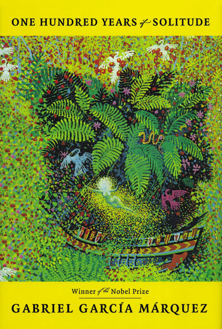

Via [chamberfour.com](http://chamberfour.com/tag/read-this-book-now/)

Pelo fato de ser tão maravilhoso ser levado para dentro do mundo de Macondo, é fácil esquecer que Cem Anos de Solitude não é apenas uma obra-prima de realismo mágico**.** É uma alegoria para o colonialismo, a condição humana, e o conflito político na América Latina**.**

## 6**.** Monstros Invisíveis

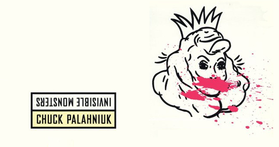

Via [whatculture.com](http://whatculture.com/)

Total honestidade: este livro é perturbador**.** Tipo, quando uma modelo leva um tiro na cara com um rifle e começa uma jornada para descobrir quem fez isso, é um pouco perturbador**.** Isso dito, a escrita e estrutura, como a história, prova que nada é sempre como parece**.** E por último, essa é uma lição e uma exploração sobre o que é realmente amar alguém**.**

## 7**.** Oleandro Branco

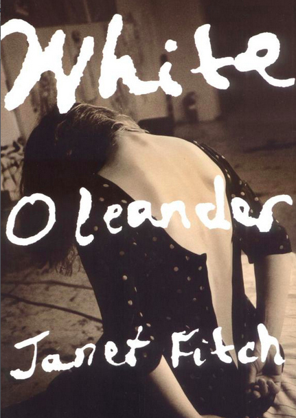

Via [offbeatmama.com](http://offbeatmama.com/)

A vida irá fazer ou quebrar você, e quando a mãe de Astrid é levada para prisão pelo assassinato do ex-amante, Astrid é colocada em um orfanato em Los Angeles**.** Isso é o suficiente para quebrar qualquer um, mas o que nós vemos é que ela consegue sobreviver, e busca sua força interior para fazer isso**.** (Muito inspirador**?****!**)

## 8**.** A Sangue Frio

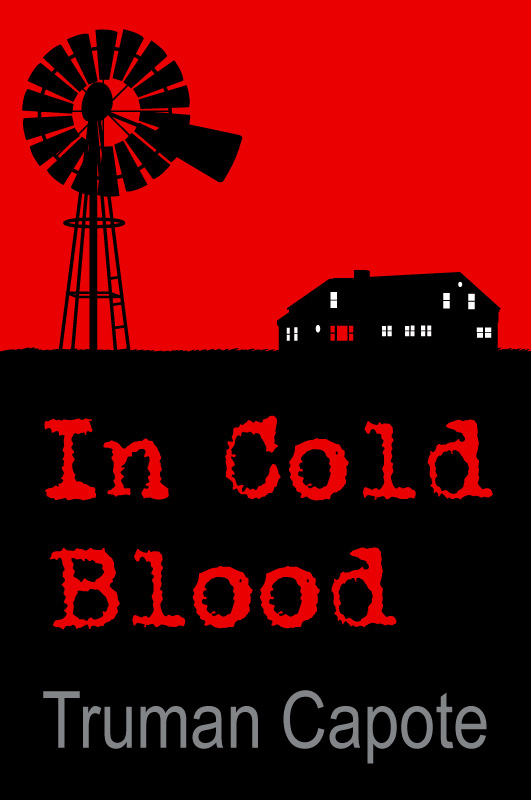

Via [dailyfoolishness.com](http://dailyfoolishness.com/2012/06/25/reading-in-cold-blood/)

Este romance de não ficção gira em torno do assassínato da família Clutter em 1959, e por que os assassínos, Perry e Dick, cometeram esses crimes**.** O autor Truman Capote nos conduz sem julgamentos, e ao fazer isso, deixa-nos chegar a nossas próprias conclusões sobre o sistema penal, a justiça, e a natureza de crimes violentos**.**

## 9**.** Middlesex

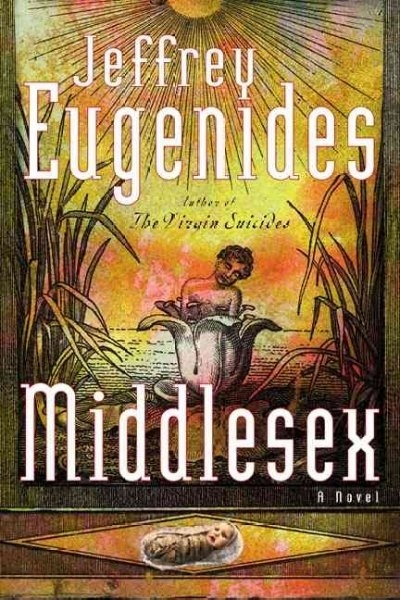

Via [forthesomedaybook.wordpress.com](http://forthesomedaybook.wordpress.com/2012/03/25/book-review-middlesex/)

Este romance atordoador gira em torno de Calliope Stephanide (ou Cal), e é uma excelente leitura para qualquer um interessado nos sexos e num olhar mais profundo sobre como a família e a biologia moldam sua identidade**.**

## 10**.** Play It As It Lays

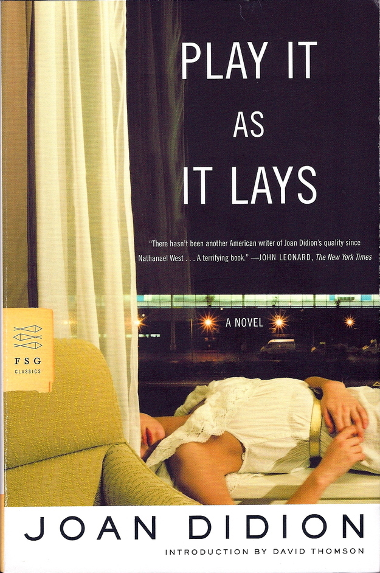

Via [martinanewhook.com](http://martinanewhook.com/2011/10/06/catharsis-like-no-other-didions-play-it-as-it-lays/)

Play It As It Lays é a história de Maria Wyeth, uma atriz de Hollywood que perdeu da sua vida e identidade**.** É uma leitura trágica que forçará um processo profundo de auto-reflexão, pois expõe o fato de que moramos em uma cultura onde nada é bom o suficiente**.**

## 11**.** Ada, ou Ardor

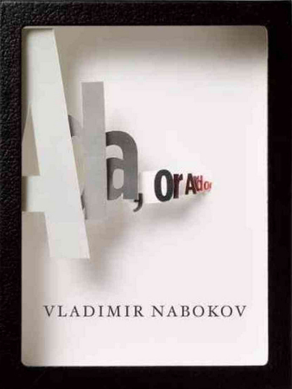

Via [billleonebookseller.com](http://www.billleonebookseller.com/)

Não me entenda mal, eu amo Lolita - o livro é absolutamente perfeito**.** Mas Ada, ou Ardor é muito mais complexo. No meio do enredo romântico de Van Veen e seu primo Ada existe um tema maior sobre a natureza do tempo - e como ele pode mudar tudo ou nada**.**

## 12**.** Beloved

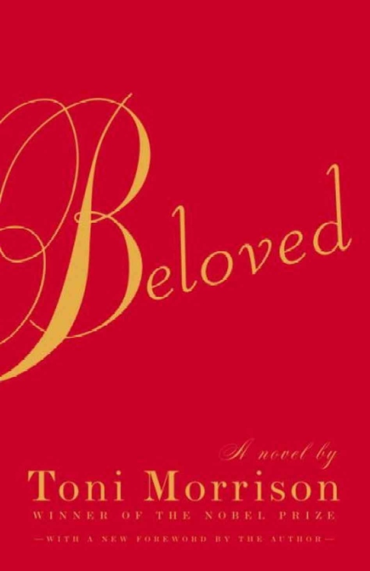

Via [npr.org](http://www.npr.org/templates/story/story.php?storyId=3912464)

Esse romance de suspense acompanha Sethe, que foi libertada da escravidão, porém nunca consegue escapar suas memórias**.** É um olhar impávido para os horrores da escravidão, porém ainda mais do que isso, vai enchê-lo de esperança**.**

## 13**.** Diário Absolutamente Verdadeiro de um Índio de Meio Expediente

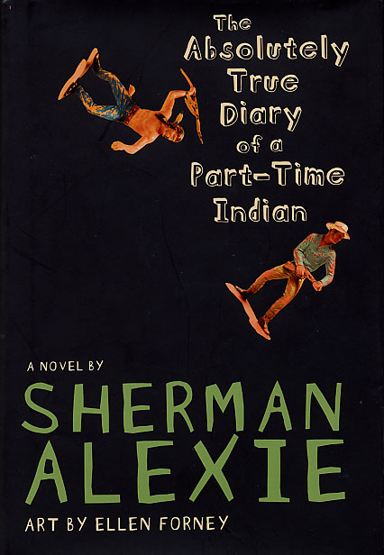

Via [education.wisc.edu](http://www.education.wisc.edu/ccbc/books/detailBook.asp?idBooks=2329)

Junior cresceu em uma Reserva Indígena em Spokane, mas ele também é um cartunista em ascensão que sonham em sair da reserva**.** Esse livro é engraçado, inteligente e de partir o coração, mas por todos esses motivos, fará você questionar o seu conceito de destino**.**

## 14**.** Push

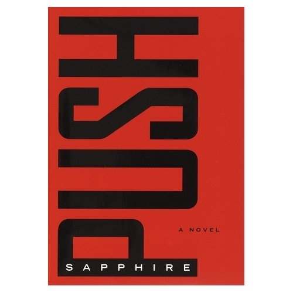

Via [tinkabellia.wordpress.com](http://tinkabellia.wordpress.com/page/2/)

Você não sabe nada sobre o poder da redenção até conhecer Precious Jones**.** Este livro é um soco no estômago e aterrorizador, mas ele consegue inspirar qualquer um a sentir que pode superar todas as probabilidades**.**

## 15**.** Coisa

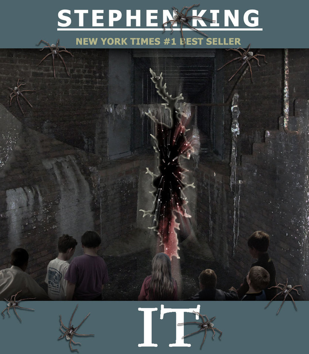

Via [shachza.deviantart.com](http://shachza.deviantart.com/art/Stephen-King-s-quot-It-quot-Book-Cover-277303683)

Dado que esse é um livro de Stephen King, a leitura dará medo**.** Dito isso, essa história sobre um grupo de crianças sendo aterrorizadas por uma entidade anônima ultrapassa o nível superficial de terror**.** Abre um diálogo sobre traumas infantis e o poder da memória, como também a feiura tácita escondida sob valores de pequenas cidades**.**

## 16**.** Pela Bandeira do Paraíso

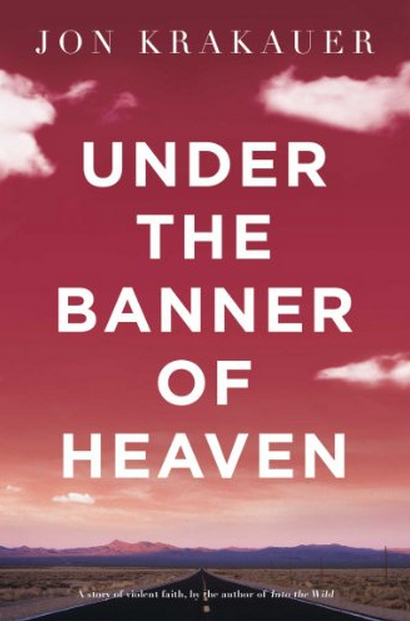

Via [laurahird.com](http://laurahird.com/showcase/mfriasmay4.html)

A parte mais incrível do romance de não ficção de Krakauer é que além de ser muito abrangente - compreendendo desde a fundação da igreja Mórmon até os escândalos da atualidade - também é um livro que se lê em um só fôlego**.** Esse livro fará você questionar sua própria conforme examina a fé de uma religião relativamente nova**.**

## 17**.** Eu Falar Bonito Um Dia

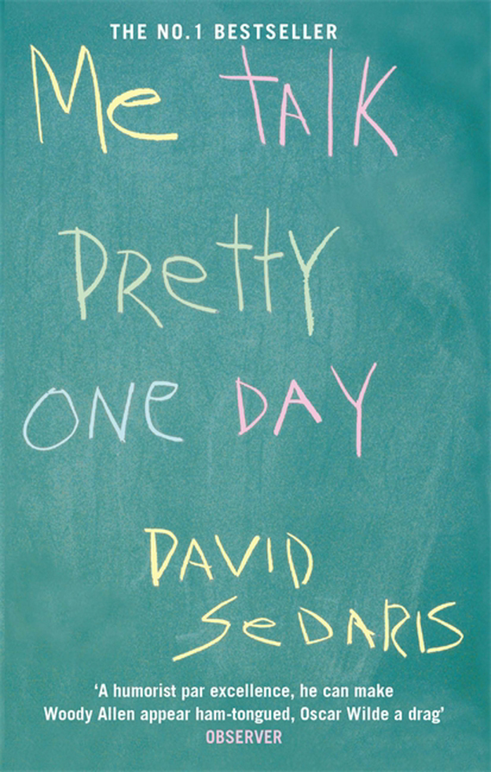

Via [library.astblogs.org](http://library.astblogs.org/2013/02/04/book-review-me-talk-pretty-one-day-david-sedaris/)

David Sedaris é hilário, ponto**.** Mas em Eu Falar Bonito Um Dia, ele consegue trançar todas suas histórias engraçadas e verdadeiras com a ideia de que humanos têm problemas de comunicação**.** Suas estranhas experiências com as pessoas fará você questionar como você comunica-se no dia-a-dia**.** (E ele consegue fazer isso sem que o leitor perceba**.** Quer melhor habilidades de comunicação do que isso**?** !)

## 18**.** Guerra Mundial Z

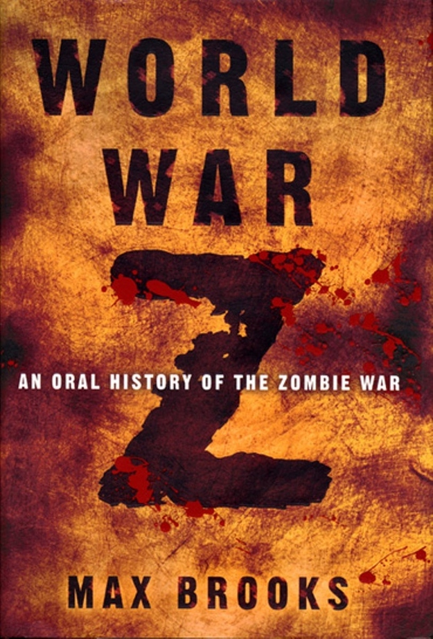

Via [blogofmanly.com](http://www.blogofmanly.com/2013/05/22/world-war-z-book-review/)

Sim, acredite ou não, um livro sobre zumbis pode mudar a sua vida**.** Isso porque não trata-se apenas de comer cérebros, ele aborda divisões culturais, política, guerra e conflitos que parecem banais quando o destino do mundo está em jogo**.** É um livro que abre os seus olhos e, por sorte, também conta com muitos zumbis incríveis**.**

## 19**.** O Doador

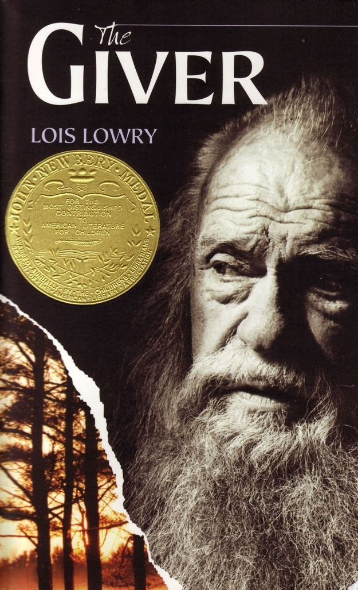

Via [literarytreats.wordpress.com](http://literarytreats.wordpress.com/2011/11/15/review-the-giver-the-gift-edition-lois-lowry-illustrated-by-bagram-ibatoulline/)

Esse livro nos transporta ao mundo de Jonas, onde não existe dor e tudo é controlado**.** Até completar 12 anos, que é quando ele descobre a dor, o medo, a paixão e emoções que ele nunca havia sentido antes**.**

Em última instância, esse livro tem o dom de recordá-lo que a vida é dolorosa, mas isso é o que faz da vida tão maravilhosa**.** Fazemos escolhas que podem ser erradas, mas que dão um propósito a nossa vida**.**

## 20**.** A Culpa É das Estrelas

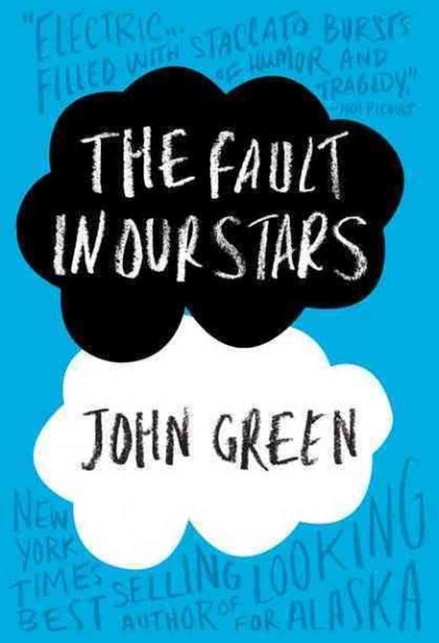

Via [npr.org](http://www.npr.org/2012/01/17/145343351/the-fault-in-our-stars-love-in-a-time-of-cancer)

Aviso: Esse livro fará você chorar e chorar, até que você não consiga chorar mais e tudo que lhe resta são os personagens, a história e a linguagem linda que inevitavelmente inspirará você a viver a vida e realmente aproveitar cada momento**.**

## 21**.** Uma Breve História do Tempo

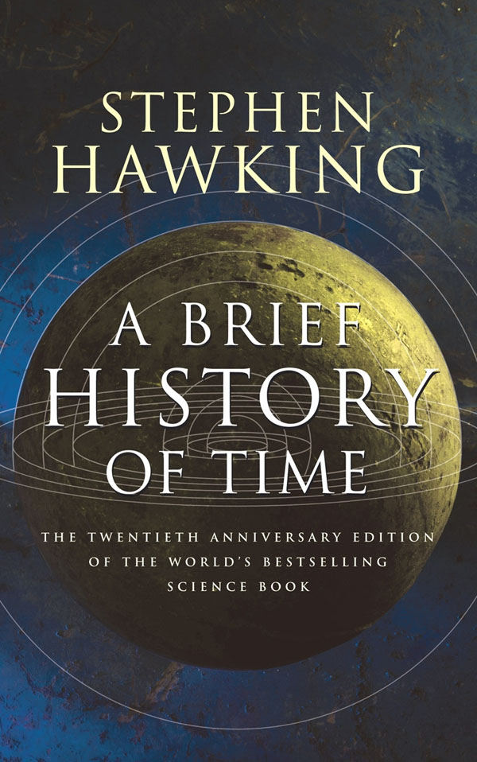

Via [randomhouse.com**.**au](http://www.randomhouse.com.au/)

Já que esse é um livro de Stephen Hawking, não é a obra mais fácil de se ler**.** Dito isso, é incrivelmente inteligente e se você conseguir passar dos primeiros capítulos, começará a perceber que a grande mensagem aqui é totalmente relacionada ao tempo, e que o mesmo tem uma direção clara**.** Na verdade, ler esse livro fará com que você se sinta um pouco mais próximo do entendimento do universo (i**.**e**.** você ficará mais inteligente!)

## 22**.** O Mundo de Sofia

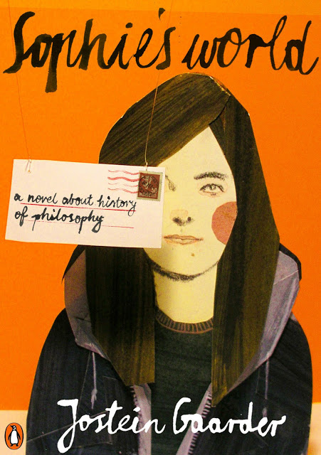

Via [martadlugolecka.blogspot.com](http://martadlugolecka.blogspot.com/2010/10/sophies-world_1662.html)

“Quem é você**?**” e “De onde vem esse mundo?” são duas perguntas que a pequena Sophie Amudsen de 14 anos enfrenta**.** Assim começa esse traçado da filosofia ocidental que ocorre em uma história fictícia**.** É um caminho extremamente acessível para começar a pensar sobre a filosofia e também esclarece a importância de certas descobertas e avanços na nossa sociedade**.**

## 23**.** Crime e Castigo

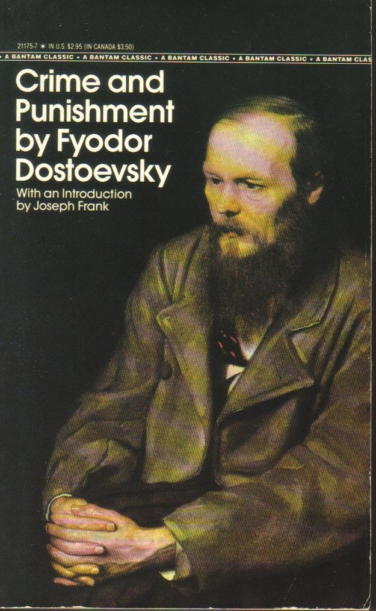

Via [newtonboothblog.wordpress.com](http://newtonboothblog.wordpress.com/2010/01/07/ooley-theatre-brings-dostoevsky-to-the-neighborhood/)

Esse livro é pesado, mas não deixa de ser um olhar extremamente detalhado de como funciona a mente humana e as repercussões de cometer um crime**.**

## 24**.** A Vida de Pi

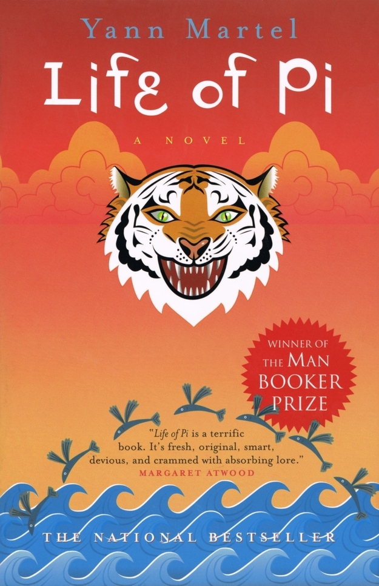

Via [saltmanz.com](http://www.saltmanz.com/pictures/Cover%20Scans/Book%20Covers/Life+of+Pi.jpg.php)

Conforme a capa do livro sugere, há um tigre, e essa é a história de um rapaz da Índia que está à deriva no mar sobre um bote salva-vidas com o dito cujo**.** Afe. Algumas pessoas podem pensar equivocadamente que o livro trata-se de religião, mas na verdade trata-se da importância da crença em algo - seja Deus, o mundo, bondade ou você mesmo**.** A mensagem final é que a vida é cheia de possibilidades, se você deixar**.**

## 25**.** Homem Invisível

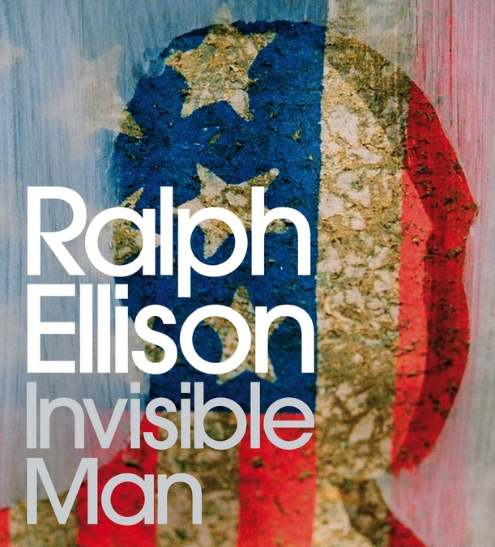

Via [penguin.com**.**au](http://www.penguin.com.au/)

Um ótimo aspecto desse livro é que ele aparenta ser sobre um protagonista sem nome que está lidando com questões raciais**.** Mas nas entrelinhas disso tudo, é sobre a humanidade e como estamos todos apenas tropeçando pelo caminho, tentando nos encontrar**.** Esse livro lhe ensinará que as ações realmente falam mais alto do que as palavras**.** E o que é verdadeiro para você, não é verdadeiro para mais ninguém**.**

## 26**.** A Alegria de Cozinhar

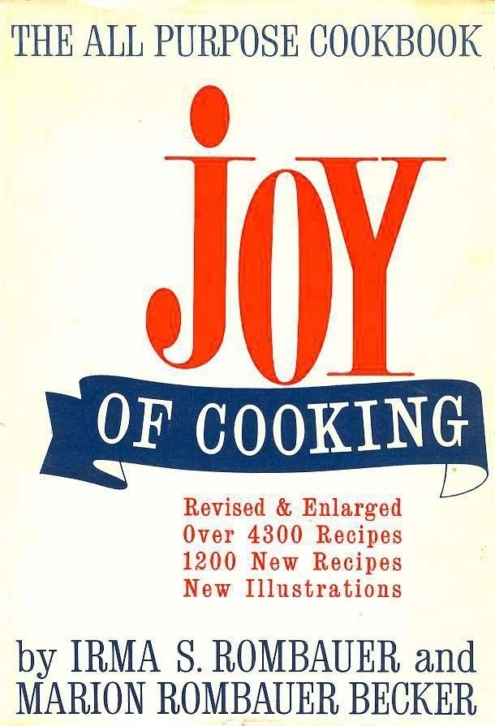

Vindo de alguém que vive seus melhores momentos na frente de microondas, posso dizer que esse livro é diferente da maioria dos livros de receitas**.** O tom é de uma conversa, e oferece muitas receitas, tutoriais e pequenos textos que realmente lhe convencem a provar coisas novas**.** Todo mundo deveria ler esse livro, porque ele realmente faz cozinhar ficar divertido**!**

## 27**.** Ardil-22

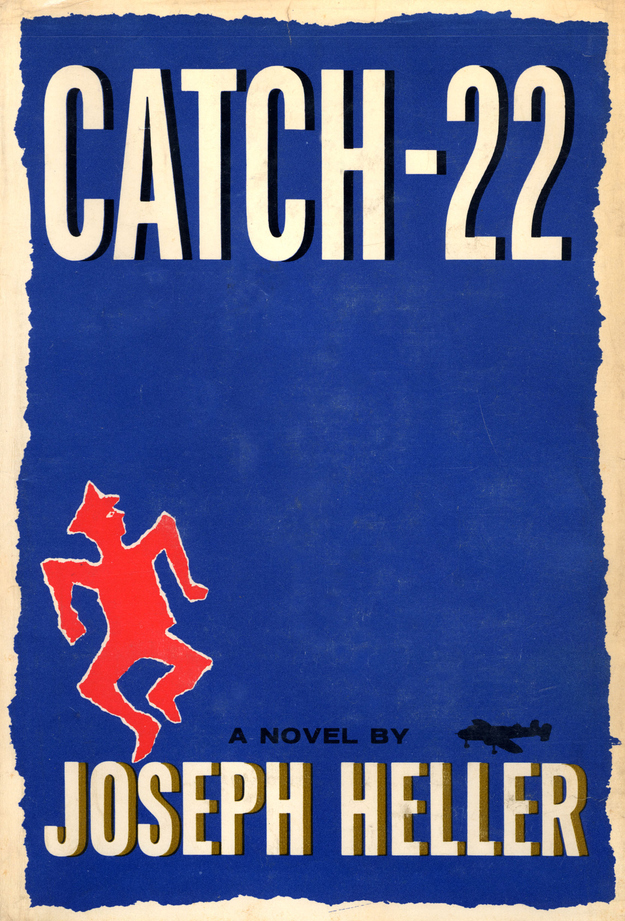

Via [heathcates.com](http://heathcates.com/2012/book-of-the-week-catch-22/)

Primeiro de tudo, Ardil-22 é simplesmente muito engraçado, e isso por si já torna o livro maravilhoso**.** Mas também é uma ótima leitura porque ele habilidosamente aponta os absurdos da guerra**.**

## 28**.** O Trem

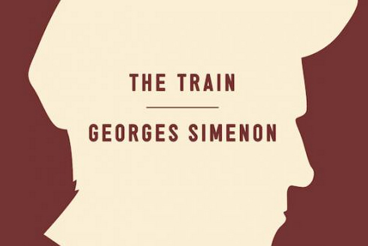

Via [timeoutchicago.com](http://www.timeoutchicago.com/)

Essa novela é breve, mas consegue abranger o terror e horror da invasão nazista em um subúrbio bucólico da França**.** Nosso herói improvável é Marcel Ferón, que teve um caso depois da invasão e separou-se de sua mulher grávida**.** Ele expressa a ideia de viver no momento e irá fazer você questionar se é ou não aceitável você se desassociar das suas responsabilidades**.**

## 29**.** O Caminho dos Artistas

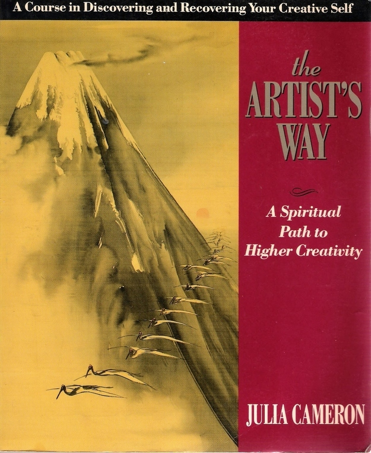

Via [fengshuidana.com](http://www.fengshuidana.com/2013/02/25/creative-lifestyle-must-have-the-artists-way/)

O Caminho do Artistas é quase mais que um livro de um curso do que um livro de verdade, mas se você precisa destrancar o seu lado criativo, então ele irá fazer exatamente isso**.** Se você seguir o livro, você está escolhendo ligar a sua criatividade**.**

## 30**.** Os Belos e Malditos

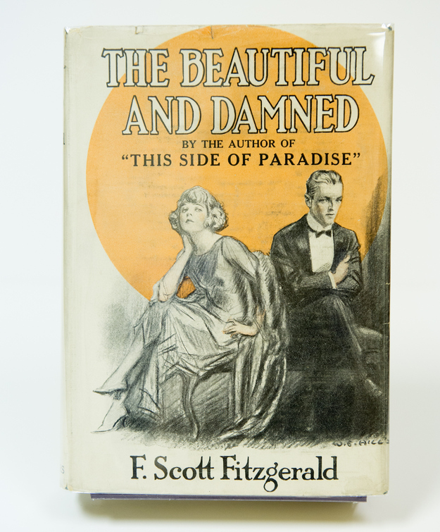

Via [sternrarebooks.com](http://www.sternrarebooks.com/)

Mais dinheiro, mais problemas**.** Assim é para o protagonista do romance, Anthony Patch, e a sua esposa, Gloria**.** Esse livro lida com os devastadores efeitos que a riqueza extrema e o alcoolismo podem ter**.**

## 31**.** Prodigal Summer

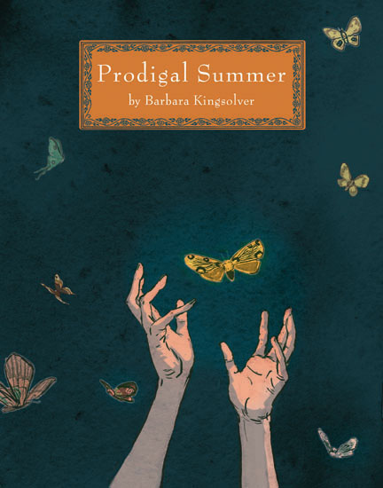

Via [hmcbrayer.blogspot.com](http://hmcbrayer.blogspot.com/2011/05/things-im-loving-lately.html)

Nesse livro, nós conhecemos três personagens diferentes cujas histórias eventualmente entrelaçam**.** Tudo acontece no sul do Appalachia e lida com os seus relacionamentos em relação ao equilibro da natureza a sua volta**.** Ele vai fazer você questionar a sua própria relação com a evolução e colocar em perspectiva que realmente somos apenas um pequeno fragmento disso tudo**.** O romance também explora ideias sobre a vida e a morte, amor, e a importância da comunidade ao seu redor**.**

## 32**.** Não Me Abandone Jamais

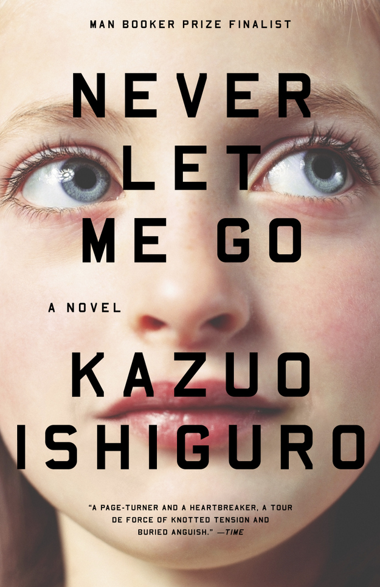

Via [read-irresponsibly.com](http://www.read-irresponsibly.com/2007/05/never-let-me-go-kazuo-ishiguro/)

Não tem nada fácil sobre ler Não Me Abandone Jamais porque o livro tem um honestidade que vai fazer você questionar muitas coisas**.** Por exemplo, a alienação social de grupos específicos de pessoas e o doloroso fato de que o amor pode ser perdido ou ignorado, tudo por conta do tempo**.** É lindo, assustador, e complexo. Eu mencionei que ele também é ciência científica**?** É, vá ler isso.
