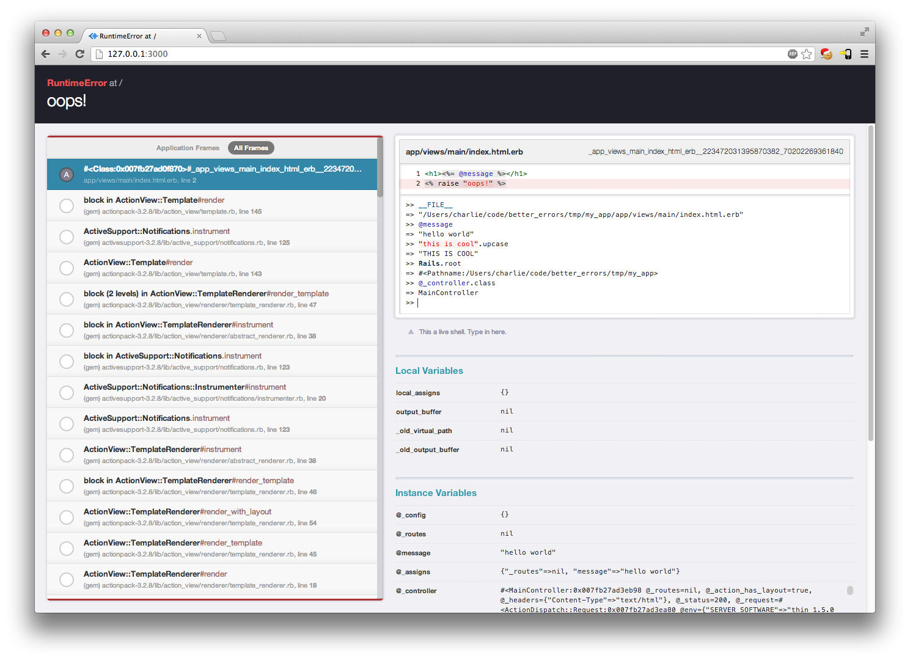
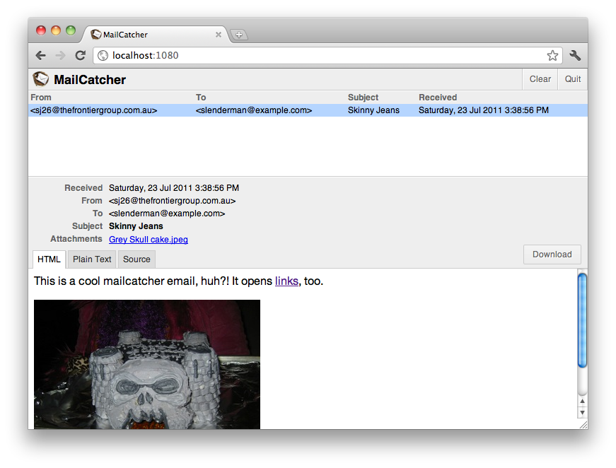
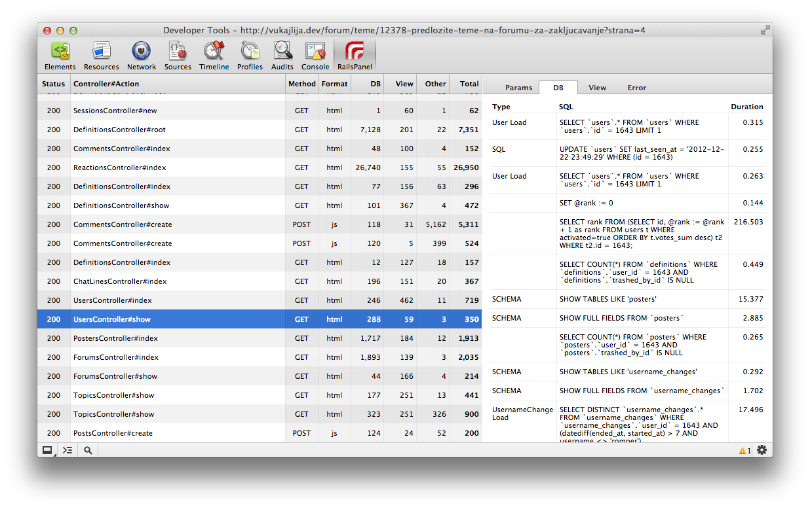
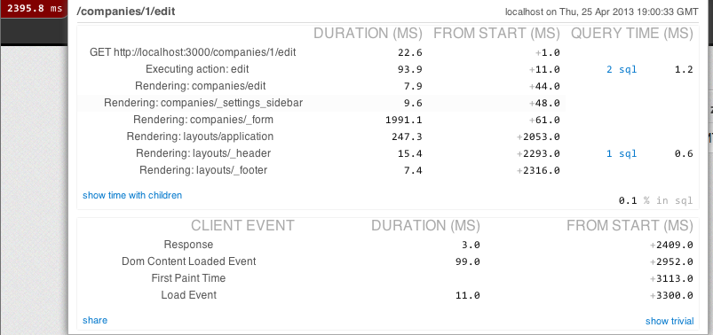
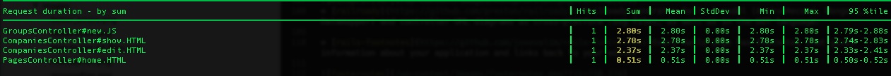

# [CodeBeerStartups](http://www.codebeerstartups.com/)

#### Coding, learning, being happy and doing a little good along the way**.**

## Must Have Gems for Development Machine in Ruby on Rails

Rubygems are best thing that happened in ruby on rails**.** So today here is my list of gems in development group that helps to make things faster or sometimes bring simplicity to the development process

```
    gem "better_errors"
    gem "binding_of_caller"
  gem 'annotate'
  gem 'bullet'
  gem 'debugger'
  gem 'flay'
  gem 'hirb'
  gem 'localtunnel'
  gem 'lol_dba'
  gem 'mailcatcher'
  gem 'meta_request','0.2.1'
  gem 'pry'
  gem 'pry-doc'
  gem 'quiet_assets'
  gem 'rack-mini-profiler'
  gem 'railroady'
  gem 'rails-footnotes', '>= 3.7.5.rc4'
  gem 'rails_best_practices'
  gem 'reek'
  gem 'request-log-analyzer'
  gem 'smusher'
  gem 'zeus' # don't add this in your gemfile.
```

### What they do:

- [better\_errors](https://github.com/charliesome/better_errors) : Better Errors replaces the standard Rails error page with a much better and more useful error page**.** It is also usable outside of Rails in any Rack app as Rack middleware**.**
  If you would like to use Better Errors’ advanced features (REPL, local/instance variable inspection, pretty stack frame names), you need to add the binding\_of\_caller



Better errors Screenshot

- [annotate](https://github.com/ctran/annotate_models)  Will generate a schema of the model on the top of the model**.** Something like this.

  ```
    # == Schema Info
    #
    # Table name: line_items
    #
    #  id                  :integer(11)    not null, primary key
    #  quantity            :integer(11)    not null
    #  product_id          :integer(11)    not null
    #  unit_price          :float
    #  order_id            :integer(11)
    #

     class LineItem < ActiveRecord::Base
       belongs_to :product
  ```
- [bullet](https://github.com/flyerhzm/bullet) : The Bullet gem is designed to help you increase your application’s performance by reducing the number of queries it makes**.** It will watch your queries while you develop your application and notify you when you should add eager loading (N+1 queries), when you’re using eager loading that isn’t necessary and when you should use counter cache**.**

Best practice is to use Bullet in development mode or custom mode (staging, profile, etc**.**). The last thing you want is your clients getting alerts about how lazy you are**.**

- [debugger](https://github.com/cldwalker/debugger)  Best debugger for your rails application**.**
- [flay](https://github.com/seattlerb/flay)  Flay analyzes code for structural similarities**.** Differences in literal
  values, variable, class, method names, whitespace, programming style,
  braces vs do/end, etc are all ignored**.** Making this totally rad**.**
- [hirb](https://github.com/cldwalker/hirb) :A mini view framework for console/irb that’s easy to use, even while under its influence**.** Console goodies include a no-wrap table, auto-pager, tree and menu**.** A console gem that will display your results something like this:

  ```
    >> Tag.last
    +-----+-------------------------+-------------+---------------+-----------+-----------+-------+
    | id  | created_at              | description | name          | namespace | predicate | value |
    +-----+-------------------------+-------------+---------------+-----------+-----------+-------+
    | 907 | 2009-03-06 21:10:41 UTC |             | gem:tags=yaml | gem       | tags      | yaml  |
    +-----+-------------------------+-------------+---------------+-----------+-----------+-------+
    1 row in set
  ```
- [localtunnel](https://github.com/progrium/localtunnel)

Localtunnel lets you expose a local web server to the public Internet**.**

For example, running a web server on port 8000 on your laptop can be made public with::

```
$ localtunnel-beta 8000
 Port 8000 is now accessible from http://8fde2c.v2.localtunnel.com ...
```

- [lol\_dba](https://github.com/plentz/lol_dba) : lol\_dba is a small package of rake tasks that scan your application models and displays a list of columns that probably should be indexed**.** Also, it can generate .sql migration scripts.
- [mailcatcher](https://github.com/sj26/mailcatcher) : MailCatcher runs a super simple SMTP server which catches any message sent to it to display in a web interface**.** Run mailcatcher, set your favourite app to deliver to smtp://127**.**0**.**0.1:1025 instead of your default SMTP server, then check out http://127**.**0.0**.**1:1080 to see the mail that’s arrived so far.



mailcatcher

- [meta\_request] RailsPanel is a Chrome extension for Rails development that will end your tailing of development.log**.** Have all information about your Rails app requests in the browser - in the Developer Tools panel**.** Provides insight to db/rendering/total times, parameter list, rendered views and more**.**



RailsPanel

- [pry](https://github.com/pry/pry)  :An IRB alternative and runtime developer console
- [quiet\_assets](https://github.com/evrone/quiet_assets) : Mutes assets pipeline log messages**.**
- [rack-mini-profiler](https://github.com/harleyttd/miniprofiler) : Middleware that displays speed badge for every html page**.** Designed to work both in production and in development**.**



miniprofiler
\* [railroady](https://github.com/preston/railroady) : RailRoady generates Rails 3 model (AcitveRecord, Mongoid, Datamapper) and controller UML diagrams as cross-platform .svg files, as well as in the DOT language**.**

- [rails-footnotes](https://github.com/josevalim/rails-footnotes) : Every Rails page has footnotes that gives information about your application and links back to your editor

footernotes

- [rails\_best\_practices](https://github.com/railsbp/rails_best_practices) : A code metric tool for rails projects
- [reek](https://github.com/troessner/reek) : Code smell detector for Ruby
- [request-log-analyzer](https://github.com/wvanbergen/request-log-analyzer)  A command line tool that analyzes request logfiles (e**.**g. Rails, Apache, MySQL, Delayed::Job) to produce a performance report

footernotes

- [smusher](https://github.com/grosser/smusher) : Ruby/CLI: Automatic lossless reduction of all your images**.** Must run for image assets.
- [zeus](https://github.com/burke/zeus)  Boot any rails app in under a second**.**

Please let me know if you have some other cool gems. It will great to know about some cool gems.
