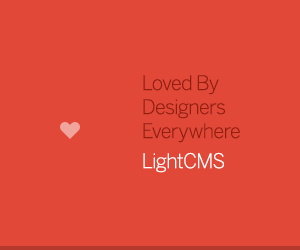
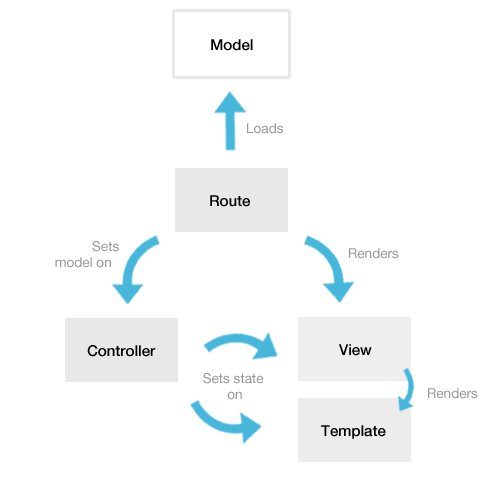
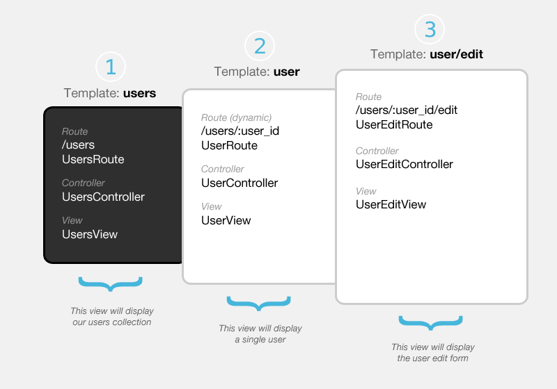
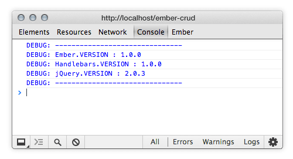
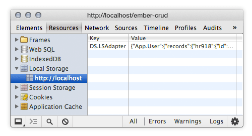
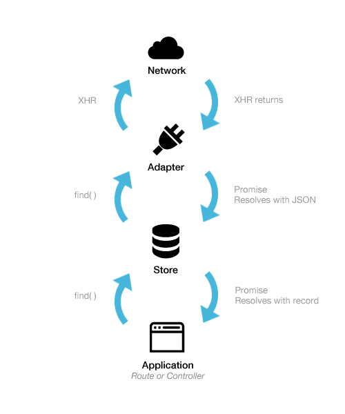
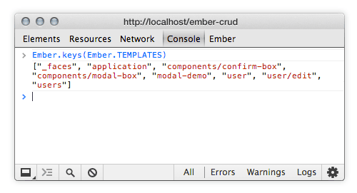
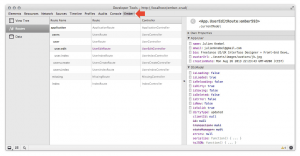

# [An In-Depth Introduction To Ember**.**js](http://coding.smashingmagazine.com/2013/11/07/an-in-depth-introduction-to-ember-js/ "Read 'An In-Depth Introduction To Ember.js'")

Advertisement



With the release of Ember**.**js 1**.**0, it’s just about time to consider giving it a try**.** This article aims to introduce Ember**.**js to newcomers who want to learn about this framework**.**

Users often say that the learning curve is steep, but once you’ve overcome the difficulties, then Ember**.**js is tremendous. This happened to me as well. While the [official guides](http://emberjs.com/guides/)  are more accurate and up to date than ever (for real**!**), this post is my attempt to make things even smoother for beginners**.**

First, we will clarify the main concepts of the framework**.** Next, we’ll go in depth with a step-by-step tutorial that teaches you how to build a simple Web app with Ember**.**js and Ember-Data, which is Ember’s data storage layer**.** Then, we will see how `views` and `components` help with handling user interactions**.** Finally, we will dig a little more into Ember-Data and template precompiling**.**


*Ember’s famous little mascot, Tomster**.** ([Image credits](http://emberjs.com/) )*

The **unstyled demo below** will help you follow each step of the tutorial**.** The **enhanced demo** is basically the same but with a lot more CSS and animations and a fully responsive UX when displayed on small screens**.**

[Unstyled demo](http://jkneb.github.io/ember-crud/unstyled)  [Source code](https://github.com/jkneb/ember-crud)  [Enhanced demo](http://jkneb.github.io/ember-crud)

#### Table of Contents

### Definitions Of Main Concepts

The diagram below illustrates how routes, controllers, views, templates and models interact with each other**.**

[](http://media.smashingmagazine.com/wp-content/uploads/2013/09/ember-sketch.png)

Let’s define these concepts**.** And if you’d like to learn more, check the relevant section of the official guides:

#### Models

Suppose our application handles a collection of users**.** Well, those users and their informations would be the model**.** Think of them as the database data. Models may be retrieved and updated by implementing AJAX callbacks inside your routes, or you can rely on Ember-Data (a data-storage abstraction layer) to greatly simplify the retrieval, updating and persistence of models over a REST API**.**

#### The Router

There is the `Router`, and then there are routes**.** The `Router` is just a synopsis of all of your routes**.** Routes are the URL representations of your application’s objects (for example, a route’s `posts` will render a collections of posts)**.** The goal of routes is to query the model, from their `model` hook, to make it available in the controller and in the template**.** Routes can also be used to set properties in controllers, to execute events and actions, and to connect a particular template to a particular controller**.** Last but not least, the `model` hook can return promises so that you can implement a `LoadingRoute`, which will wait for the model to resolve asynchronously over the network**.**

#### Controllers

At first, a `controller` gets a model from a `route`**.** Then, it makes the bridge between the model and the view or template**.** Let’s say you need a convenient method or function for switching between editing mode to normal mode**.** A method such as `goIntoEditMode()` and `closeEditMode()` would be perfect, and that’s exactly what controllers can be used for**.**

Controllers are auto-generated by Ember**.**js if you don’t declare them**.** For example, you can create a `user` template with a `UserRoute`; and, if you don’t create a `UserController` (because you have nothing special to do with it), then Ember**.**js will generate one for you internally (in memory)**.** The [Ember Inspector](https://chrome.google.com/webstore/detail/ember-inspector/bmdblncegkenkacieihfhpjfppoconhi)  extension for Chrome can help you track those magic controllers**.**

#### Views

Views represent particular parts of your application (the visual parts that the user can see in the browser)**.** A `View` is associated with a `Controller`, a Handlebars `template` and a `Route`**.** The difference between views and templates can be tricky**.** You will find yourself dealing with views when you want to handle events or handle some custom interactions that are impossible to manage from templates**.** They have a very convenient `didInsertElement` hook, through which you can play with jQuery very easily**.** Furthermore, they become extremely useful when you need to build reusable views, such as modals, popovers, date-pickers and autocomplete fields**.**

#### Components

A `Component` is a completely isolated `View` that has no access to the surrounding context**.** It’s a great way to build reusable components for your apps**.** A [Twitter Button](http://jsbin.com/OMOgUzo/1/edit?html,js,output) , a custom [select box](http://pixelhandler.com/blog/2013/08/25/create-a-custom-select-box-using-ember-component/)  and those [reusable charts](http://jsbin.com/odosoy/132/edit?html,js,output)  are all great examples of components**.** In fact, they’re such a great idea that the W3C is actually working with the Ember team on a [custom element](https://dvcs.w3.org/hg/webcomponents/raw-file/tip/spec/custom/index.html)  specification**.**

#### Templates

Simply put, a template is the view’s HTML markup**.** It prints the model data and automatically updates itself when the model changes**.** Ember**.**js uses [Handlebars](http://handlebarsjs.com) , a lightweight templating engine also maintained by the Ember team**.** It has the usual templating logic, like `if` and `else`, loops and formatting `helpers`, that kind of stuff**.** Templates may be precompiled (if you want to cleanly organize them as separate `.hbs` or `.handlebars` files) or directly written in `<script type="text/x-handlebars"><script>` tags in your HTML page**.** Jump to the section on [templates precompiling](#what_is_handlebars_template_precompiling) to dig into the subject**.**

#### Helpers

Handlebars helpers are functions that modify data before it is rendered on the screen — for example, to format dates better than `Mon Jul 29 2013 13:37:39 GMT+0200 (CEST)`**.** In your template, the date could be written as `{{date}}`**.** Let’s say you have a `formateDate` helper (which converts dates into something more elegant, like “One month ago” or “29 July 2013”)**.** In this case, you could use it like so: `{{formateDate date}}`**.**

#### Components? Helpers? Views? HELP**!**

The Ember.js forum [has an answer](http://discuss.emberjs.com/t/whats-the-difference-between-ember-helpers-components-and-views/2201/2)  and StackOverflow [has a response](http://stackoverflow.com/questions/18593424/views-vs-components-in-ember-js)  that should alleviate your headache**.**

### Let’s Build An App

In this section, we’ll build a real app, a simple interface for managing a group of users (a [CRUD](http://en.wikipedia.org/wiki/Create,_read,_update_and_delete)  app)**.** Here’s what we’ll do:

- look at the architecture we’re aiming for;
- get you started with the dependencies, files structure, etc**.**;
- set up the model with Ember-Data’s `FixtureAdapter`;
- see how routes, controllers, views and templates interact with each other;
- finally, replace the `FixtureAdapter` with the `LSAdapter` to persist data in the browser’s local storage**.**

#### Sketch Our App

We need a basic view to render a group of users (see 1 below)**.** We need a single-user view to see its data (2). We need to be able to edit and delete a given user’s data (3)**.** Finally, we need a way to create a new user; for this, we will reuse the edit form**.**

[](http://media.smashingmagazine.com/wp-content/uploads/2013/09/app-sketch.png)

Ember**.**js strongly relies on naming conventions. So, if you want the page `/foo` in your app, you will have the following:

- a `foo` template,
- a `FooRoute`,
- a `FooController`,
- and a `FooView`**.**

Learn more about [Ember’s naming conventions](http://emberjs.com/guides/concepts/naming-conventions)  in the guides**.**

#### What You’ll Need to Get Started

You will need:

- jQuery,
- Ember**.**js itself (obviously),
- Handlebars (i**.**e. Ember’s templating engine),
- Ember-Data (i**.**e. Ember’s data-persistence abstraction layer).

```
/* /index.html
*/
 …
 <script src="//code.jquery.com/jquery-2.0.3.min.js"></script>
 <script src="//builds.emberjs.com/handlebars-1.0.0.js"></script>
 <script src="//builds.emberjs.com/tags/v1.1.2/ember.js"></script>
 <script src="//builds.emberjs.com/tags/v1.0.0-beta.3/ember-data.js"></script>
 <script>
   // your code
 </script>
</body>
</html>
```

Ember’s website has a [builds section](http://emberjs.com/builds) , where you can find all of the links for Ember**.**js and Ember-Data**.** Currently, Handlebars is not there; you will find it on the [official Handlebars](http://handlebarsjs.com)  website**.**

Once we have loaded the required dependencies, we can get started building our app**.** First, we create a file named `app.js`, and then we initialize Ember:

```
/* /app.js 
*/
window.App = Ember.Application.create();
```

Just to be sure everything is OK, you should see Ember’s debugging logs in the browser’s console**.**



#### Our Files Directory Structure

There’s not much of a convention on how to organize files and folders**.** The [Ember App Kit](https://github.com/stefanpenner/ember-app-kit)  (a Grunt-based environment to scaffold Ember apps) provides a kind of standard for this because it is maintained by the Ember team**.** Even simpler, you could put everything in a single `app.js` file. In the end, it’s really up to you**.**

For this tutorial, we will simply put controllers in a `controller` folder, views in a `view` folder and so on**.**

```
components/
controllers/
helpers/
models/
routes/
templates/
views/
app.js
router.js
store.js
```

#### Precompile Templates or Not**?**

There are two ways to declare templates**.** The easiest way is to add special `script` tags to your `index.html` file**.**

```
<script type="text/x-handlebars" id="templatename">
  <div>I'm a template</div>
</script>
```

Each time you need a template, you’d add another script tag for it**.** It’s fast and easy but can become a real mess if you have too many templates**.**

The other way is to create an `.hbs` (or `.handlebars`) file for each of your templates**.** This is called “template precompiling,” and a [complete section](#what_is_handlebars_template_precompiling) is dedicated to it later in this article**.**

Our [unstyled demo](http://jkneb.github.io/ember-crud/unstyled)  uses `<script type="text/x-handlebars">` tags, and all of the templates for our [enhanced demo](http://jkneb.github.io/ember-crud)  are stored in `.hbs` files, which are precompiled with a [Grunt](http://gruntjs.com)  task**.** This way, you can compare the two techniques.

#### Set Up the Model With Ember-Data’s FixtureAdapter

Ember-Data is a library that lets you retrieve records from a server, hold them in a `Store`, update them in the browser and, finally, save them back to the server**.** The `Store` can be configured with various adapters (for example, the `RESTAdapter` interacts with a JSON API, and the `LSAdapter` persists your data in the browser’s local storage)**.** An [entire section](#what_is_ember_data) is dedicated to Ember-Data later in this article**.**

Here, we are going to use the `FixtureAdapter`**.** So, let’s instantiate it:

```
/* /store.js 
*/
App.ApplicationAdapter = DS.FixtureAdapter;
```

In previous versions of Ember, you had to subclass the `DS.Store`**.** We don’t need to do that anymore to instantiate adapters**.**

The `FixtureAdapter` is a great way to start with Ember**.**js and Ember-Data**.** It lets you work with sample data in the development stage**.** At the end, we will switch to the [LocalStorage adapter](https://github.com/rpflorence/ember-localstorage-adapter)  (or `LSAdapter`)**.**

Let’s define our model. A user would have a `name`, an `email` address, a short `bio`, an `avatarUrl` and a `creationDate`**.**

```
/* /models/user.js 
*/
App.User = DS.Model.extend({
  name         : DS.attr(),
  email        : DS.attr(),
  bio          : DS.attr(),
  avatarUrl    : DS.attr(),
  creationDate : DS.attr()
});
```

Now, let’s feed our `Store` with the sample data**.** Feel free to add as many users as you need:

```
/* /models/user.js 
*/
App.User.FIXTURES = [{
  id: 1,
  name: 'Sponge Bob',
  email: 'bob@sponge.com',
  bio: 'Lorem ispum dolor sit amet in voluptate fugiat nulla pariatur.',
  avatarUrl: 'http://jkneb.github.io/ember-crud/assets/images/avatars/sb.jpg',
  creationDate: 'Mon, 26 Aug 2013 20:23:43 GMT'
}, {
  id: 2,
  name: 'John David',
  email: 'john@david.com',
  bio: 'Lorem ispum dolor sit amet in voluptate fugiat nulla pariatur.',
  avatarUrl: 'http://jkneb.github.io/ember-crud/assets/images/avatars/jk.jpg',
  creationDate: 'Fri, 07 Aug 2013 10:10:10 GMT'
}
…
];
```

Learn more about [models in the documentation](http://emberjs.com/guides/models/) **.**

#### Instantiate the Router

Let’s define our `Router` with the routes we want (based on the [diagram we made earlier](#sketch_our_app))**.**

```
/* /router.js 
*/
App.Router.map(function(){
  this.resource('users', function(){
    this.resource('user', { path:'/:user_id' }, function(){
      this.route('edit');
    });
    this.route('create');
  });
});
```

This `Router` will generate exactly this:

| URL | Route Name | Controller | Route | Template |
| --- | --- | --- | --- | --- |
| N/A | N/A | `ApplicationController` | `ApplicationRoute` | `application` |
| `/` | `index` | `IndexController` | `IndexRoute` | `index` |
| N/A | `users` | `UsersController` | `UsersRoute` | `users` |
| `/users` | `users.index` | `UsersIndexController` | `UsersIndexRoute` | `users/index` |
| N/A | `user` | `UserController` | `UserRoute` | `user` |
| `/users/:user_id` | `user.index` | `UserIndexController` | `UserIndexRoute` | `user/index` |
| `/users/:user_id/edit` | `user.edit` | `UserEditController` | `UserEditRoute` | `user/edit` |
| `/users/create` | `users.create` | `UsersCreateController` | `UsersCreateRoute` | `users/create` |

The `:user_id` part is called a dynamic segment because the corresponding user ID will be injected into the URL**.** So, it will look like `/users/3/edit`, where `3` is the user with the ID of 3**.**

You can define either a `route` or a `resource`**.** Keep in mind that a `resource` is a group of routes and that it allows routes to be nested**.**

A `resource` also resets the nested naming convention to the last resource name, which means that, instead of having `UsersUserEditRoute`, you would have `UserEditRoute`**.** In other words, in case this confuses you, if you have a resource nested inside another resource, then your files name would be:

- `UserEditRoute` instead of `UsersUserEditRoute`;
- `UserEditControler` instead of `UsersUserEditController`;
- `UserEditView` instead of `UsersUserEditView`;
- for templates, `user/edit` instead of `users/user/edit`**.**

Learn more about [how to define routes](http://emberjs.com/guides/routing/defining-your-routes)  in the guides**.**

#### The Application Template

Each Ember**.**js app needs an `Application` template, with an `{{outlet}}` tag that holds all other templates**.**

```
/* /templates/application.hbs 
*/
<div class="main">
  <h1>Hello World</h1>
  {{outlet}}
</div>
```

If you’ve decided to follow this tutorial without precompiling templates, here’s what your `index.html` should look like:

```
/* /index.html 
*/
  …
  <script type="text/x-handlebars" id="application">
    <div class="main">
      <h1>Hello World</h1>
      {{outlet}}
    </div>
  </script>

  <script src="dependencies.js"></script>
  <script src="your-app.js"></script>
</body>
</html>
```

#### The Users Route

This route deals with our group of users**.** Remember we saw [earlier](#router), in the definitions, that a route is responsible for querying the model**.** Well, routes have a `model` hook through which you can perform AJAX requests (for retrieving your models, if you don’t use Ember-Data) or for querying your `Store` (if you do use Ember-Data)**.** If you’re interested in retrieving models without Ember-Data, you can [jump to the section](#what_about_not_using_emberdata) in which I briefly explain how to do it**.**

Now, let’s create our `UsersRoute`:

```
/* /routes/usersRoute.js 
*/
App.UsersRoute = Ember.Route.extend({
  model: function(){
    return this.store.find('user');
  }
});
```

Learn more about [how to specify the routes `model` hook](http://emberjs.com/guides/routing/specifying-a-routes-model)  in the guides**.**

If you visit your app at the URL `http://localhost/#/users`, nothing will happen, because we need a `users` template**.** Here it is:

```
/* /templates/users.hbs 
*/
<ul class="users-listing">
  {{#each user in controller}}
    <li>{{user.name}}</li>
  {{else}}
    <li>no users… :-(</li>
  {{/each}}
</ul>
```

The `each` loop iterates over the users collection; here, `controller` equals `UsersController`**.** Notice that the `{{#each}}` loop has an `{{else}}` statement; so, if the model is empty, then `no users… :-(` will be printed**.**

Because we’ve followed Ember’s naming conventions, we can omit the declaration of the `UsersController`**.** Ember will guess that we are dealing with a collection because we’ve used the plural of “user**.**”

#### Object vs. Array Controller

An `ObjectController` deals with a single object, and an `ArrayController` deals with multiple objects (such as a collection)**.** We just saw that, in our case, we don’t need to declare the `ArrayController`**.** But for the purpose of this tutorial, let’s declare it, so that we can set some sorting properties on it:

```
/* /controllers/usersController.js 
*/
App.UsersController = Ember.ArrayController.extend({
  sortProperties: ['name'],
  sortAscending: true // false = descending
});
```

Here, we’ve simply sorted our users alphabetically**.** Learn more about [controllers in the guides](http://emberjs.com/guides/controllers/) **.**

#### Displaying the Number of Users

Let’s use `UsersController` to create our first [computed property](http://emberjs.com/guides/object-model/computed-properties/) **.** This will display the number of users, so that we can see changes when adding or deleting users**.**

In the template, we just need something as simple as this:

```
/* /templates/users.hbs 
*/
…
<div>Users: {{usersCount}}</div>
…
```

In `UsersController`, let’s declare the `usersCount` property — but not like a regular property, because this one will be a function that returns the model’s length**.**

```
/* /controllers/usersController.js 
*/
App.UsersController = Em.ArrayController.extend({
  …
  usersCount: function(){
    return this.get('model.length');
  }.property('@each')
});
```

Basically, `usersCount` takes the `.property('@each')` method, which tells Ember**.**js that this function is in fact a property that is watching for any changes to one of the models in the collection (i**.**e. the users). Later, we will see `usersCount` incrementing and decrementing as we create and delete users**.**

#### Computed Properties

Computed properties are powerful**.** They let you declare functions as properties. Let’s see how they work**.**

```
App.Person = Ember.Object.extend({
  firstName: null,
  lastName: null,

  fullName: function() {
    return this.get('firstName') + ' ' + this.get('lastName');
  }.property('firstName', 'lastName')
});

var ironMan = App.Person.create({
  firstName: "Tony",
  lastName:  "Stark"
});

ironMan.get('fullName') // "Tony Stark"
```

In this example, the `Person` object has two static properties, which are `firstName` and `lastName`**.** It also has a `fullName` computed property, which concatenates a full name by retrieving the value of the two static properties**.** Note that the `.property('firstName', 'lastName')` method tells the function to re-execute if either `firsName` or `lastName` changes**.**

Properties (whether static or computed) are retrieved with `.get('property')` and can be set with `.set('property', newValue)`**.**

If you find yourself setting multiple properties consecutively, a better way to do it is with one single `.setProperties({})`, rather than with multiple instances of `.set()`**.** So, instead of doing this…

```
this.set('propertyA', 'valueA');
this.set('propertyB', valueB);
this.set('propertyC', 0);
this.set('propertyD', false);
```

… you would do this:

```
this.setProperties({
  'propertyA': 'valueA',
  'propertyB': valueB,
  'propertyC': 0,
  'propertyD': false
});
```

The documentation has so much more information about how to bind data with [computed properties](http://emberjs.com/guides/object-model/computed-properties/) , [observers](http://emberjs.com/guides/object-model/observers)  and [bindings](http://emberjs.com/guides/object-model/bindings) **.**

#### Redirecting From the Index Page

If you go to the home page of your app (`http://localhost/`), you might be asking yourself why nothing is happening**.** That’s because you are viewing the index page, and we don’t have an `index` template**.** Let’s add one, then. We’ll call it `index.hbs`**.**

Ember.js will notice that you are creating the `index` template for `IndexRoute`; so, no need to tell it anything else about the index in the `Router`**.** This is called an initial route. Three of them are available: `ApplicationRoute`, `IndexRoute` and `LoadingRoute`**.** Learn more about them [in the guides](http://emberjs.com/guides/routing/defining-your-routes/#toc_initial-routes)**.**

Now, let’s add a link to the user’s page with the `{{#link-to}}…{{/link-to}}` block helper**.** Why a block helper? Because you’re able to write text between the opening and closing tags, as if it were a real custom HTML element**.**

```
/* /templates/index.hbs 
*/
{{#link-to "users"}} Go to the users page {{/link-to}}
```

This takes the route’s name that you want to link to as the first argument (the second optional argument is a model)**.** Under the hood, it’s just a regular `<a>` element, although Ember also handles for us the `active` class name when reaching the matching route**.** Those `link-to`’s are perfect for navigation menus**.** Learn more about them [in the guides](http://emberjs.com/guides/templates/links) **.**

Another approach would be to tell `IndexRoute` to redirect to `UsersRoute`**.** Again, pretty easy:

```
/* /routes/indexRoute.js 
*/
App.IndexRoute = Ember.Route.extend({
  redirect: function(){
    this.transitionTo('users');
  }
});
```

Now, when you visit the home page, your will immediately be redirected to the `/#/users` URL**.**

#### Single User Route

Before getting our hands dirty with building the dynamic segment, we need a way to link to each user from the `users` template**.** Let’s use the `{{#link-to}}` block helper inside the user’s `each` loop**.**

```
/* /templates/users.hbs 
*/
…
{{#each user in controller}}
  <li>
    {{#link-to "user" user}}
      {{user.name}}
    {{/link-to}}
  </li>
{{/each}}
```

The second argument of `link-to` is the model that will be passed to `UserRoute`**.**

OK, let’s get back to our single user template**.** It looks like this:

```
/* /templates/user.hbs 
*/
<div class="user-profile">
  
  <h2>{{name}}</h2>
  <span>{{email}}</span>
  <p>{{bio}}</p>
  <span>Created {{creationDate}}</span>
</div>
```

Note that you can’t use ``, because data inside attributes are bound with the `bind-attr` helper**.** For instance, you could do something like ``, where `imgHeight` is a computed property in the current controller**.**

You’ll find all you need to know about binding [attributes](http://emberjs.com/guides/templates/binding-element-attributes/)  and [class names](http://emberjs.com/guides/templates/binding-element-class-names/)  in the guides**.**

So far, so good. But nothing happens when you click on the user’s links, because we told the `Router` that we want `UserRoute` to be nested in `UsersRoute`**.** So, we need an `{{outlet}}` in which to render the user template**.**

```
/* /templates/users.hbs 
*/
…
{{#each user in controller}}
…
{{/each}}

{{outlet}}
```

An `{{outlet}}` is like a dynamic placeholder into which other templates can be injected when `{{#link-to}}` tags are clicked**.** It allows for views to be nested.

Now, you should be able to view the user template injected in the page when visiting the page at the URL `/#/users/1`**.**

Hey, wait a minute! We have declared neither `UserRoute` nor `UserController`, but it’s still working**!** Why is that? Well, `UserRoute` is the singular of `UsersRoute`, so Ember has generated the route and the controller for us (in memory)**.** Thank goodness for naming conventions!

For the sake of consistency, let’s declare them anyway, so that we can see how they look:

```
/* /routes/userRoute.js 
*/
App.UserRoute = Ember.Route.extend({
  model: function(params) { 
    return this.store.find('user', params.user_id);
  }
});
```

```
/* /controllers/userController.js 
*/
App.UserController = Ember.ObjectController.extend();
```

Learn more about [dynamic segments](http://emberjs.com/guides/routing/specifying-a-routes-model/#toc_dynamic-models) in the guides**.**

#### Edit a User

Moving on to the edit user form nested in the single user, the template looks like this:

```
/* /templates/user/edit.hbs 
*/
<div class="user-edit">
  <label>Choose user avatar</label>
  {{input value=avatarUrl}}

  <label>User name</label>
  {{input value=name}}

  <label>User email</label>
  {{input value=email}}

  <label>User short bio</label>
  {{textarea value=bio}}
</div>
```

Let’s talk about those `{{input}}` and `{{textarea}}` tags**.** This form’s goal is to enable us to edit the user’s data, and these custom `input` tags take the model’s properties as parameters to enable data-binding**.**

Note that it’s `value=model`, without the `" "`**.** The `{{input}}` helper is a shorthand for `{{Ember.TextField}}`**.** Ember.js has those [built-in views](http://emberjs.com/guides/views/built-in-views)  especially for form elements**.**

If you visit your app at the URL `/#/users/1/edit`, nothing will happen, because, again, we need an `{{outlet}}` to nest the edit template into the single user template**.**

```
/* /templates/user.hbs 
*/
…
{{outlet}}
```

Now, the template is correctly injected in the page**.** But the fields are still empty, because we need to tell the route which model to use**.**

```
/* /routes/userEditRoute.js 
*/
App.UserEditRoute = Ember.Route.extend({
  model: function(){ 
    return this.modelFor('user');
  }
});
```

The `modelFor` method lets you use the model of another route**.** Here, we’ve told `UserEditRoute` to get the model of `UserRoute`**.** The fields are now correctly populated with the model data**.** Try to edit them — you will see the changes occur in the parent templates as well**!**

#### Our First Action

OK, now we need a button to click that redirects us from `UserRoute` to `UserEditRoute`**.**

```
/* /templates/user.hbs 
*/
<div class="user-profile">
  <button {{action "edit"}}>Edit</button>
  …
```

We just added a simple `button` that triggers our first `{{action}}`**.** Actions are events that trigger associated methods in their current controller**.** If no method is found in the controller, then the action bubbles up through routes until it matches something**.** This is explained well [in the guides](http://emberjs.com/guides/templates/actions/#toc_action-bubbling)**.**

In other words, if we `click` on the `button`, then it will trigger the `edit` action found in the controller**.** So, let’s add it to `UserController`:

```
/* /controllers/userController.js 
*/
App.UserController = Ember.ObjectController.extend({
  actions: {
    edit: function(){
      this.transitionToRoute('user.edit');
    }
  }
});
```

Actions, whether in controllers or in routes, are stored in an `actions` hash**.** But this is not the case for default actions, such as `click`, `doubleClick`, `mouseLeave` and `dragStart`**.** The Ember**.**js website has a [complete list](http://emberjs.com/api/classes/Ember.View.html#toc_event-names).

Here, basically, our `edit` action says, “Go to the `user.edit` route**.**” That’s pretty much it.

#### TransitionTo or TransitionToRoute**?**

On a side note, transitioning from routes is slightly different from transitioning from controllers:

```
// from a route
this.transitionTo('your.route')
// from a controller
this.transitionToRoute('your.route')
```

#### Saving User Modifications

Let’s see how to save modifications after a user’s data has been edited**.** By saving, we mean persisting the changes**.** With Ember-Data, this means telling `Store` to `save()` the new `record` of the modified user**.** The `Store` will then tell the `adapter` to perform an AJAX PUT request (if our adapter is the `RESTAdapter`)**.**

From our application’s point of view, this would be an “OK” `button` that saves modifications and then transitions to the parent route**.** Again, we’ll use an `{{action}}`**.**

```
/* /templates/user/edit.hbs 
*/
<button {{action "save"}}> ok </button>
```

```
/* /controllers/userEditController.js 
*/
App.UserEditController = Ember.ObjectController.extend({
  actions: {
    save: function(){
      var user = this.get('model');
      // this will tell Ember-Data to save/persist the new record
      user.save();
      // then transition to the current user
      this.transitionToRoute('user', user);
    }
  }
});
```

Our edit mode is working well**.** Now, let’s see how to delete a user.

#### Delete a User

We can add a delete `button` beside the edit button in the `user` template — again, with a `delete` `{{action}}`, this time defined in `UserController`**.**

```
/* /templates/user.hbs 
*/
<button {{action "delete"}}>Delete</button>
```

```
/* /controllers/userController.js 
*/
…
actions: {
  delete: function(){
    // this tells Ember-Data to delete the current user
    this.get('model').deleteRecord();
    this.get('model').save();
    // then transition to the users route
    this.transitionToRoute('users');
  }
}
```

Now, when you click on the “Delete” button, the `user` is instantly trashed**.** A bit rough. We should add a confirm state, something like “Are you sure**?**” with “Yes” and “No” buttons. To do this, we need to change `{{action "delete"}}` to make it show `confirm-box` instead of immediately deleting the user**.** Then, we obviously need to put `confirm-box` in the user template**.**

```
/* /templates/user.hbs 
*/
{{#if deleteMode}}
<div class="confirm-box">
  <h4>Really?</h4>
  <button {{action "confirmDelete"}}> yes </button>
  <button {{action "cancelDelete"}}> no </button>
</div>
{{/if}}
```

We’ve just written our first Handlebars `{{if}}` statement**.** It prints `div.confirm-box` only if the `deleteMode` property is `true`**.** We need to define this `deleteMode` in the current controller and then change the `delete` action to make it toggle `deleteMode`’s value to `true` or `false`**.** Now, our `UserController` looks like this:

```
/* /controllers/userController.js 
*/
App.UserController = Ember.ObjectController.extend({
  // the deleteMode property is false by default
  deleteMode: false,

  actions: {
    delete: function(){
      // our delete method now only toggles deleteMode's value
      this.toggleProperty('deleteMode');
    },
    cancelDelete: function(){
      // set deleteMode back to false
      this.set('deleteMode', false);
    },
    confirmDelete: function(){
      // this tells Ember-Data to delete the current user
      this.get('model').deleteRecord();
      this.get('model').save();
      // and then go to the users route
      this.transitionToRoute('users');
      // set deleteMode back to false
      this.set('deleteMode', false);
    },
    // the edit method remains the same
    edit: function(){ 
      this.transitionToRoute('user.edit');
    }
  }
});
```

Deletion now works perfectly with the “Yes” and “No” buttons**.** Awesome! Finally, the last thing to build is the create route**.**

#### Create a User

To create a user, let’s do something fun: Let’s reuse the edit template, because the create form will be exactly the same as the edit user form**.** First, we declare the create route, which will return an empty object in its `model` hook:

```
/* /routes/usersCreateRoute.js 
*/
App.UsersCreateRoute = Ember.Route.extend({
  model: function(){
    // the model for this route is a new empty Ember.Object
    return Em.Object.create({});
  },

  // in this case (the create route), we can reuse the user/edit template
  // associated with the usersCreateController
  renderTemplate: function(){
    this.render('user.edit', {
      controller: 'usersCreate'
    });
  }
});
```

Note the `renderTemplate` method; it enables us to associate a particular template with a route**.** Here, we’re telling `UsersCreateRoute` to use the user and edit template with `UsersCreateController`**.** Learn more about renderTemplate [in the guides](http://emberjs.com/guides/routing/rendering-a-template/) **.**

Now, let’s define another `save` action, but this time in `UsersCreateController`**.** (Remember that an `action` first tries to match a corresponding method in the *current* controller**.**)

```
/* /controllers/usersCreateController.js 
*/
App.UsersCreateController = Ember.ObjectController.extend({
  actions: {
    save: function(){
      // just before saving, we set the creationDate
      this.get('model').set('creationDate', new Date());

      // create a record and save it to the store
      var newUser = this.store.createRecord('user', this.get('model'));
      newUser.save();

      // redirects to the user itself
      this.transitionToRoute('user', newUser);
    }
  }
});
```

Finally, let’s add the `{{#link-to}}` helper in the users templates, so that we can access the creation form:

```
/* /templates/users.hbs 
*/
{{#link-to "users.create" class="create-btn"}} Add user {{/link-to}}
…
```

That’s all there is to creating users**!**

#### Format Data With Helpers

We’ve [already defined](#helpers) what `helpers` are**.** Now, let’s see how to create one that will format an ugly date into a nice clean formatted one**.** The [Moment.js](http://momentjs.com)  library is awesome for this purpose**.**

Grab [Moment.js](http://momentjs.com)  and load it in the page**.** Then, we’ll define our first helper:

```
/* /helpers/helpers.js 
*/
Ember.Handlebars.helper('formatDate', function(date){
  return moment(date).fromNow();
});
```

Modify the user template so that it uses the `formatDate` helper on the `{{creationDate}}` property:

```
/* /templates/user.hbs 
*/
…
<span>Created {{formatDate creationDate}}</span>
…
```

That’s it**!** You should see the dates nicely formatted: “2 days ago,” “One month ago,” etc**.**

#### Format Data With Bound Helpers

In this case, our date is static data because it’s not going to change in the future**.** But if you have data that needs to be updated (for example, a formatted price), then you would have to use a `BoundHelper` instead of the regular helper**.**

```
/* /helpers/helpers.js 
*/
Ember.Handlebars.registerBoundHelper('formatDate', function(date){
  return moment(date).fromNow();
});
```

A bound helper is able to automatically update itself if the data changes**.** Learn more about bound helpers [in the guides](http://emberjs.com/api/classes/Ember.Handlebars.html#method_registerBoundHelper)**.**

#### Switch to the LocalStorage Adapter

Our app looks to be working fine, so we are ready to switch to the real thing**.** We could enable the `RESTAdapter`, but then we would need a REST server on which we could perform GET, PUT, POST and DELETE requests**.** Instead, let’s use `LSAdapter`, a third-party adapter that you can [download on GitHub](https://github.com/rpflorence/ember-localstorage-adapter/blob/master/localstorage_adapter.js) **.** Load it in your page (just after Ember-Data), comment out all of the `FIXTURE` data, and change `ApplicationAdapter` to `DS.LSAdapter`:

```
/* /store.js 
*/
App.ApplicationAdapter = DS.LSAdapter;
```

Now, your users’ data will persist in local storage**.** That’s all! Seriously, it’s that easy. Just to be sure, open the Developer Tools in your browser and go into the “Resource” panel**.** In the “Local Storage” tab, you should find an entry for `LSAdapter` with all of your users’ data**.**



### Playing With Views

So far, we haven’t declared any views in our simple CRUD, only templates**.** Why would we care about views? Well, they are powerful for events handling, animations and reusable components**.**

#### jQuery and the didInsertElement

How can we use jQuery the way we are used to for Ember**.**js’ views? Each view and component has a `didInsertElement` hook, which assures us that the view has indeed been inserted into the DOM**.** With that, you have secure jQuery access to elements in the page**.**

```
App.MyAwesomeComponent = Em.Component.extend({
  didInsertElement: function(){
    // this = the view
    // this.$() = $(the view)
    this.$().on('click', '.child .elem', function(){
      // do stuff with jQuery
    });
  }
});
```

If you’ve registered jQuery-like events from inside `didInsertElement`, then you can use `willDestroyElement` to clean them up after the view has been removed from the DOM, like so:

```
App.MyAwesomeComponent = Em.Component.extend({
  didInsertElement: function(){
    this.$().on('click', '.child .elem', function(){
      // do stuff with jQuery
    });
  },
  willDestroyElement: function(){
    this.$().off('click');
  }
});
```

#### Side Panel Components With className Bindings

The combination of computed property and `className` binding sounds like a scary technique, but it’s really not that bad**.** The idea is that we add or remove a CSS class on an element if a property is either `true` or `false`**.** Of course, the CSS class contains a CSS transition**.**

Suppose we have a hidden div in the DOM**.** When this div has a class of `opened`, it slides in**.** When it has a class of `closed`, it slides out**.** A side panel is a perfect example for this, so let’s build one**.**

Here’s a JS Bin so that you can test the code:

Let’s go through each tab in turn:

- **JavaScript tab**  
  First, we declare our `SidePanelComponent` with default `classNames`**.** Then, `classNameBindings` is used to test whether `isOpen` is `true` or `false`, so that it returns `closed` or `opened`**.** Finally, `component` has a `toggleSidepanel` action that simply toggles the `isOpen` boolean**.**
- **HTML tab**  
  This is the side panel’s markup**.** Note the `{{#side-panel}}…{{/side-panel}}` block tags; we can put whatever we want between them, which makes our side panel incredibly reusable**.** The `btn-toggle` button calls the `toggleSidepanel` action located in the component**.** The `{{#if isOpen}}` adds some logic by checking the value of the `isOpen` property**.**
- **CSS tab**  
  Here, we are basically putting the side panel off screen**.** The `opened` class slides it in, and `closed` slides it out**.** The animation is possible because we are listening for `translate2D` changes (`transition:transform .3s ease`).

The guides have a lot more examples on how to bind class names [from components](http://emberjs.com/guides/components/customizing-a-components-element)  and [from inside templates](http://emberjs.com/guides/templates/binding-element-class-names) **.**

#### Modals With Layout and Event Bubbling

This technique is way more complicated than the previous one, because a lot of Ember**.**js features are involved. The idea is to make an event bubble from a view to a route so that we can toggle a property located in a controller somewhere in the app**.** Also, here we are using a `View` instead of a `Component` (remember that, under the hood, a component is an isolated view)**.**

- **JavaScript tab**  
  The `modalView` is the default `layout` for all of our modals**.** It has two methods, `showModal` and `hideModal`**.** The `showModal` method is called with an `action` that bubbles up, first through controller, then through routes, until it finds a corresponding `showModal` action**.** We’ve stored `showModal` in the highest route possible, the `applicationRoute`**.** Its only goal is to set the `modalVisible` property inside the controller that was passed in the `action`’s second argument**.** And yes, creating a property at the same time as we set it is possible**.**
- **HTML tab**  
  Each modal has its own template, and we’ve used the convenient `{{#view App.ModalView}}…{{/view}}` block tags to encapsulate them in `modal_layout`**.** The modal’s controllers are not even declared because Ember**.**js has them in memory**.** Note that the `{{render}}` helper takes parameters, which are the template’s name and a generated controller for this template**.** So, here we are calling a `modal01` template and a `modal01` controller (auto-generated)**.**
- **CSS tab**  
  For the purpose of this example, modals need to be present in the DOM**.** This can feel like a constraint, but the main benefit is the reduced paint cost; otherwise, Ember has to inject and remove them every time we call them**.** The second benefit is CSS transitions. The `shown` class applies two transitions: first, the top position (because the modal is off screen by default), then, with a little delay, it transitions the opacity (which also has a [reduced](https://speakerdeck.com/ariya/fluid-user-interface-with-hardware-acceleration?slide=36)  12 paint [cost](http://css-tricks.com/w3conf-ariya-hidayat-fluid-user-interface-with-hardware-acceleration)  13 when transitioning)**.** The `hidden` class does the same in reverse**.** Obviously, you can apply a [lot of cool transitions](http://tympanus.net/Development/ModalWindowEffects)  14 to your modals if they stay in the DOM**.**

The guides have a lot more information about [events](http://emberjs.com/guides/views/handling-events) , [event bubbling](http://emberjs.com/guides/understanding-ember/the-view-layer/#toc_event-bubbling), [layouts](http://emberjs.com/guides/views/adding-layouts-to-views)  and the [{{render}}](http://emberjs.com/guides/templates/rendering-with-helpers/#toc_the-code-render-code-helper) helper tag**.**

### What Is Ember-Data?

Ember-Data is in beta as of the time of writing, so please use it with caution**.**

It is a library that lets you retrieve records from a server, hold them in a store, update them in the browser and, finally, save them back to the server**.** The store may be configured with various adapters, depending on your back end**.** Here’s a diagram of Ember-Data’s architecture.



#### The Store

The store holds data loaded from the server (i**.**e. records). Routes and controllers can query the store for records**.** If a given record is called for the first time, then the store tells the adapter to load it over the network**.** Then, the store caches it for the next time you ask for it**.**

#### Adapters

The application queries the store, and the adapter queries the back end**.** Each adapter is made for a particular back end**.** For example, the `RESTAdapter` deals with JSON APIs, and `LSAdapter` deals with local storage**.**

The idea behind Ember-Data is that, if you have to change the back end, then you simply plug another adapter, without having to touch a single line of your application’s code**.**

- `FixtureAdapter`  
  `FixtureAdapter` is perfect for testing Ember and Ember-Data**.** Fixtures are just sample data that you can work with until your app reaches the production phase**.** We went over how to configure it in an [earlier part of this article](#set_up_the_model_with_ember_data_fixtureadapter)**.**
- `RESTAdapter`  
  `RESTAdapter` is the default adapter in Ember-Data**.** It lets you perform GET, PUT, POST and DELETE requests over a REST API**.** It also requires some [specific JSON conventions](http://emberjs.com/guides/models/the-rest-adapter/#toc_json-conventions) 15 in return**.** Enabling `RESTAdapter` looks like this:

  ```
  App.ApplicationAdapter = DS.RESTAdapter.extend({
    host: 'https://your.api.com'
  });
  ```

  There’s a lot more to discover about `RESTAdapter` [in the guides](http://emberjs.com/guides/models/the-rest-adapter)  16**.**
- **Custom adapter**  
  You could use something other than the two default adapters (`FixtureAdapter` and `RESTAdapter`)**.** A [bunch of them are on GitHub](https://github.com/search?q=ember+adapter&ref=reposearch)  17**.** For instance, there’s the [LocalStorage Adapter](https://github.com/rpflorence/ember-localstorage-adapter)  18, which is demonstrated in the guides’ sample [Todos](http://emberjs.com/guides/getting-started/using-other-adapters)  19 app and is also the one I use in the [demo](http://jkneb.github.io/ember-crud)  20**.**

#### What About Not Using Ember-Data**?**

In this article, I’ve chosen to cover Ember-Data because it’s almost stable and is probably one of the coolest thing happening these days in the JavaScript world**.** But perhaps you’re wondering whether getting rid of it is possible**.** The answer is yes**!** In fact, using Ember.js without Ember-Data is pretty easy**.**

There are two ways to do it.

You could use another library for your model’s retrieval and persistence**.** [Ember-Model](https://github.com/ebryn/ember-model) , [Ember-Resource](https://github.com/zendesk/ember-resource) , [Ember-Restless](https://github.com/endlessinc/ember-restless)  and the recent [EPF](http://epf.io/)  are good alternatives**.** EmberWatch has written a great little article that sums up “[Alternatives to Ember Data](http://blog.emberwatch.com/2013/06/19/alternatives-ember-data.html) **.**”

The other way would be to not rely on a library, in which case you would have to implement methods to retrieve models with AJAX calls**.** “[Ember Without Ember Data](http://eviltrout.com/2013/03/23/ember-without-data.html) ,” by Robin Ward (the guy behind [Discourse](http://www.discourse.org/) ), is a great read**.** “[Getting Into Ember.js, Part 3](http://net.tutsplus.com/tutorials/javascript-ajax/getting-into-ember-js-part-3) ” by Rey Bango on Nettuts+ deals specifically with models**.**

For instance, here’s a static method with `reopenClass` on a model:

```
/* /models/user.js
*/
// our own findStuff method inside the User model
App.User.reopenClass({
  findStuff: function(){
    // use regular AJAX / Promises calls
    return $.getJSON("http://your.api.com/api").then(function(response) {
      var users = [];
      // creates new Ember objects and store them into the users Array
      response.users.forEach(function(user){
        users.push( App.User.create(user) );
      });
      // finally returns the array full of Ember Objects
      return users;
    });
  }
});
```

You would use your `findStuff` method in your routes’ `model` hook:

```
/* /routes/usersRoute.js
*/
App.UsersRoute = Em.Route.extend({
  model: function(){
    return App.User.findStuff();
  }
});
```

### What Is Handlebars Template Precompiling**?**

Basically, template precompiling entails grabbing all Handlebars templates, transposing them into JavaScript strings, and then storing them in `Ember.TEMPLATES`**.** It also entails an additional JavaScript file to load in your page, which will contain the JavaScript-compiled versions of all of your Handlebars templates**.**

For very simple apps, precompiling can be avoided**.** But if you have too many `<script type="text/x-handlebars">` templates in your main HTML file, then precompiling will help to organize your code**.**

Furthermore, precompiling your templates will enable you to use the runtime version of Handlebars, which is lighter than the regular one**.** You can find both the runtime and standard versions on the [Handlebars website](http://handlebarsjs.com/) **.**

#### Template Naming Conventions

`Partials`  have to begin with a `_`**.** So, you will have to declare a `_yourpartial.hbs` file or, if you don’t precompile your templates, a `<script type="text/x-handlebars" id="_yourpartial">` tag**.**

`Components`  have to begin with `components/`**.** So, you will have to store them in a `components/` folder or, if you don’t precompile templates, declare a `<script type="text/x-handlebars" id="components/your-component">` tag**.** Component names are hyphenated.

Otherwise, views have a `templateName` property in which you can specify which template to associate with the view**.** Take this declaration of a template:

```
<script type="text/x-handlebars" id="folder/some-template">
  Some template
</script>
```

You can associate it with a particular view:

```
App.SomeView = Em.View.extend({
  templateName: 'folder/some-template'
});
```

#### Precompiling With Grunt

If you use [Grunt](http://gruntjs.com) , then you probably use it for other building-related tasks (concatenation, compression, that kind of stuff), in which case you should be familiar with the `package.json` file, which comes with Node**.**js and Node Packaged Modules. I’ll assume you are already familiar with Grunt**.**

As of the time of writing, two plugins are available for Grunt to transpose your `.hbs` files to a `templates.js` file: `grunt-ember-handlebars`  and `grunt-ember-templates` **.** The latter seems a bit more up to date than the former**.**

I’ve made a Gist for each of them, in case you need help with configuration:

- `grunt-ember-handlebars` ([see the Gist](https://gist.github.com/jkneb/6072299)  21),
- `grunt-ember-templates` ([see the Gist](https://gist.github.com/jkneb/6599001)  22)**.**

Once it’s configured, you should be able to run `grunt` in a command-line editor, which should produce the `templates.js` file**.** Load it into `index.html` (after `ember.js`), and then go into the browser’s console and type `Em.TEMPLATES`**.** You should see a hash containing all of the compiled templates**.**

Be aware that Ember**.**js doesn’t need the template file’s complete path, nor the file’s extension**.** In other words, the template’s name should be `users/create`, not `/assets/js/templates/users/create.hbs`**.**

Both plugins have options to handle this**.** Simply refer to the respective guide, or look at the Gists linked to above**.** You should end up with something like this:



And this is exactly what we need to make everything work as intended**.** It’s all you need to know about precompiling with Grunt**.**

#### Precompiling With Rails

Precompiling with Rails is surely the easiest way to do it**.** The [Ember-Rails gem](https://github.com/emberjs/ember-rails)  handles pretty much everything for you**.** It *almost* works out of the box. Carefully follow the installation instructions in the `readme` file on GitHub, and you should be all good**.** Right now, in my humble opinion, Rails has the best Ember and Handlebars integration available**.**

### Tools, Tips And Resources

#### Chrome Ember Extension

[Ember Extension](https://chrome.google.com/webstore/detail/ember-inspector/bmdblncegkenkacieihfhpjfppoconhi)  is a very convenient Chrome extension**.** Once installed, an “Ember” tab will appear near the “Console” tab**.** Then, you can navigate through controllers, routes and views**.** And the “Data” tab will greatly help you to explore your records if you are using Ember-Data**.**

[](http://media.smashingmagazine.com/wp-content/uploads/2013/08/console-ember-extension1.png)   
*Exploring your app’s objects has never been so easy**.***

#### Ember App Kit

Maintained by the Ember team, the [Ember App Kit](http://iamstef.net/ember-app-kit/)  lets you easily scaffold Ember**.**js apps. It contains [Grunt](http://gruntjs.com/)  for compiling assets, [JSHint](http://www.jshint.com/) , [QUnit](http://qunitjs.com/) , the [Kharma](http://karma-runner.github.io/0.10/index.html)  test runner, [Bower](http://bower.io/)  and [ES6 Modules](http://wiki.ecmascript.org/doku.php?id=harmony:modules)  support**.**

#### Ember Tools

This GitHub project, [Ember Tools](https://github.com/rpflorence/ember-tools) , is a basic command-line interface for creating and scaffolding Ember apps**.** Take a minute to watch the animated GIF in the `readme` file, and you’ll see why it’s so cool**.**

#### Development and Minified Version

Always use the development build when developing because it contains a lot of comments, a unit-testing package and a ton of helpful error messages, all of which has been removed in the minified build**.** Find links to both in the builds section of the [Ember**.**js website](http://emberjs.com/builds) .

#### Debugging Tips

Ember**.**js usually gives you cool human-readable errors in the browser’s console (remember to use the development version)**.** Sometimes, though, figuring out what’s going on is tricky**.** Some convenient methods are `{{log something}}` and `{{controller}}`, which helpfully prints the current `controller` for the template to which you’ve added this helper**.**

Or you could log each `Router` transition like so:

```
window.App = Ember.Application.create({
  LOG_TRANSITIONS: true
});
```

The guides have an [exhaustive list](http://emberjs.com/guides/understanding-ember/debugging)  of these handy little methods**.**

#### Properly Comment Your Handlebars

This one can be frustrating**.** Never ever comment a Handlebars tag with a regular HTML comment**.** If you do, you’ll completely break the app, without getting a clue about what’s happening**.**

```
// never do this
<!-- {{foo}} -->

// instead do this
{{!foo}}
```

### Conclusion

I hope this *long* article has given you a better understanding of this awesome framework**.** But the truth is, we’ve only scratched the surface**.** There’s so much more to cover. For instance, we have the router and its asynchronous nature, which resolves model requests with promises (so that you can easily implement loading spinners)**.** There is also the object model, with its class and instances inheritance, mixins, observers, filters, macros, collectionViews, components, dependencies managed between controllers, and testing package**.** And so much more!

Obviously, I couldn’t cover everything**.** Fortunately, the guides will take you through all of these topics very well**.**

Happy Ember.js coding, folks**!**

#### Resources

- [Ember**.**js Guides](http://emberjs.com/guides/)  23  
  The best place to learn Ember
- [Ember**.**js Cookbook](http://emberjs.com/guides/cookbook/)  24  
  A new section of the guides that solves very specific use cases
- [EmberWatch](http://emberwatch.com)  25  
  Aggregates all important resources out there
- [Ember Weekly](http://emberweekly.com/issues.html)  26  
  Perfect for keeping up to date
- [Ember**.**js Discussion Forum](http://discuss.emberjs.com)  27  
  Where discussion happens (and it’s made with Ember**.**js)

#### Acknowledgments

Huge thanks to [Mathieu Breton](https://twitter.com/MatBreton)  and [Philippe Castelli](https://twitter.com/ficastelli) , who both taught me everything they know about Ember**.**js while I was learning it**.** Also, a big thank you to [Tom Dale](https://twitter.com/tomdale) , who helped me to revise this very long article**.**

*(al, il)*

**Hungry for more**?**** Over 60 thoroughly edited eBooks are waiting to be discovered in our [Smashing Library](http://auslieferung.commindo-media-ressourcen.de/www/delivery/ck.php?oaparams=2__bannerid=6638__zoneid=94__OXLCA=1__cb=ce3d253b00__oadest=http%3A%2F%2Fauslieferung.commindo-media-ressourcen.de%2Fwww%2Fdelivery%2Fck.php%3Foaparams%3D2__bannerid%3D6259__zoneid%3D68__OXLCA%3D1__cb%3Db41d5785bd__oadest%3Dhttp%3A%2F%2Fwww.smashingmagazine.com%2Febooks%2F%3Fpk_campaign%3Deditors-note-library)  — in PDF, ePUB and Kindle formats**.** And guess what**?** You can watch Smashing Conference talks there, too**!** [Learn more..**.**](http://auslieferung.commindo-media-ressourcen.de/www/delivery/ck.php?oaparams=2__bannerid=6638__zoneid=94__OXLCA=1__cb=ce3d253b00__oadest=http%3A%2F%2Fauslieferung.commindo-media-ressourcen.de%2Fwww%2Fdelivery%2Fck.php%3Foaparams%3D2__bannerid%3D6259__zoneid%3D68__OXLCA%3D1__cb%3Db41d5785bd__oadest%3Dhttp%3A%2F%2Fwww.smashingmagazine.com%2Febooks%2F%3Fpk_campaign%3Deditors-note-library)
