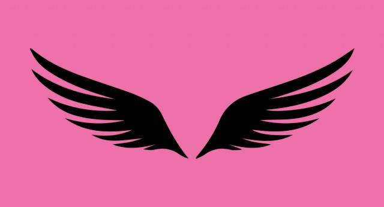

# **C**omo a Musa das Ideias vê você.

### *Texto do escritor convidado [Steven Pressfield](http://stevenpressfield.com) **.***

O que segue é meu modelo pessoal de experiência metafísica sobre como o processo de escrever (e fazer qualquer tipo de arte) funciona**.** Você talvez me ache maluco. Talvez eu seja mesmo maluco.

“[A Musa](http://ficcao.emtopicos.com/2010/07/os-desafios-do-processo-de-escrita-criativa-e-a-forca-libertadora-de-uma-mudanca-de-percepcao/) “, como eu a imagino, é a identidade coletiva de nove deusas irmãs, filhas de Zeus e de Mnemosyne (Memória), cuja responsabilidade é inspirar artistas**.** Outros nomes para essas forças misteriosas é Inconsciente, Ego, Sopa Quântica**.** O que quer que seja, isso representa a dimensão invisível do potencial que está dentro de nós ou além de nós**.** É de onde as ideias vêm.

A cena que você escreveu ontem entre o Príncipe Mordrapal e o Avatar dos Elfos: ela veio da Musa**.** Assim como a ideia para seu próximo álbum pós-cripto-punk de rap, e para seu bar-restaurante mangoliano**.**

A Musa funciona assim: a cada dia ela faz suas rondas (eu gosto de imaginar ela percorrendo o mundo em um veículo espacial pequeno de teto aberto, uma cruza entre os Jetsons e os seriados antigos do Flash Gordon), carregando sua sacola cheia de ideias**.**

Ela é um pouco como Papai Noel, mas ao invés de dar presentes para crianças, ela dá ideias para artistas**.** Para o Bethoven ela dá tãn-dãn-dãn-dãn. Para o [Stephen King](http://ficcao.emtopicos.com/2010/11/conselhos-de-stephen-king-para-quem-quer-ser-escritor/ "Conselhos de Stephen King para quem quer ser escritor.")  ela oferece Carrie**.**

> **Quando a Musa chega onde você está, ela olha para baixo do seu pequeno veículo espacial**.** Você está no estúdio? Em frente ao cavalete**?** Em frente ao teclado?**

Você não está**?** Tudo bem. A Deusa dá uma folga para você nesse dia ocioso**.** Ela volta amanhã.

O que? Você não está lá trabalhando novamente? Nem no dia seguinte**?** A testa da Musa começa a franzir. Você está a decepcionando**.** Ela está começando a ficar um pouco puta da cara. Será que você não quer a ajuda dela**?**

Seu nome agora está na lista negra da Deusa**.** Como ela vai punir você**?** Ela não vai fazer nada cruel ou violento. Ela é uma dama**.** A Musa vai simplesmente guardar seus favores. Aquele problema no Ato 2 que você está com dificuldades para resolver**?** Você está sozinho. Resolva você mesmo.

Mas vamos olhar pelo outro lado, o lado feliz**.** Vamos imaginar a Musa passando por onde você está na segunda-feira**.** Lá está você, trabalhando duro. O mesmo na Terça**.** Quarta também. Ah, agora você fez a Deusa sorrir! Ela gosta do seu [estilo](http://ficcao.emtopicos.com/voz-de-escritor/ "estilo") , ela curte a forma como você se esforça**.** (Aliás, a Musa não guarda rancor se você só pode dedicar a ela uma hora por dia, ou até mesmo se você não escreve por dias porque teve que trabalhar para sustentar sua família**.** A Deusa consegue ler sua mente).

Ela reconhece suas boas intenções**.** Contanto que você mostre respeito a ela, você permanecerá na sua lista de preferidos**.** Como ela recompensa você**?** Ela ajuda a desempacar aquele Ato 2. Ideias vem a sua mente enquanto você está no chuveiro, ou no metrô, ou caminhando seu doberman**.**

Você acha que a ideia é sua. Não é**.** É dela. Ela deu para você.

> **Isso é mágica? Um milagre**?** Não, é algo comum. É como a criatividade funciona. A gente se esforça. A gente dá o melhor de si**.** Boas coisas acontecem. Essa é a intersecção entre trabalho duro e [inspiração](http://ficcao.emtopicos.com/escrever/inspiracao/ "inspiração") **.****

Quando dizemos “coloque a bunda onde seu coração quer estar”, é isso o que queremos dizer**.** Isso é ser profissional. É a razão pela qual praticamos auto-disciplina, auto-validação, auto-motivação**.** É por isso que treinamos para superar Resistência.

Nos tornamos mestres em todas essas habilidades por um motivo: para que possamos estar sentado em nosso local de trabalho quando a nave da Musa passar**.** É assim que os dois lados trabalham juntos. Trabalho duro e disciplina.

Esforço disciplinado produz inspiração porque mostra o respeito à Deusa**.** Genialidade e brilhantismo não ganham seus favores**.** Ela prefere suor**.**

Vá para seu estúdio. Sente-se no piano**.** Reinicie seu computador. Se veja como a Musa vê você**.** Você saberá o que fazer.

***Sobre o autor:** Steven Pressfield é autor de bestsellers de ficção e não-ficção, entre eles [“The War of Art”](http://www.stevenpressfield.com/the-war-of-art/)  e [“The Legend of Bagger Vance”](http://www.stevenpressfield.com/the-legend-of-bagger-vance/) **.** Em seu livro mais recente, “[The Authentic Swig”](http://shop.blackirishbooks.com/products/the-authentic-swing) , ele compartilha em detalhes como conseguiu publicar sua primeira obra**.** O escritor autorizou a publicação da tradução de Diego Schutt do [texto original](http://www.stevenpressfield.com/2013/10/you-as-the-muse-sees-you/)  em inglês**.** É proibida a reprodução desse artigo sem autorização por escrito**.***
