# [Signing PowerShell Scripts](http://www.hanselman.com/blog/SigningPowerShellScripts.aspx)

Sponsored By

Geoff Bard at [Corillian](http://www.corillian.com/)  (we work together) wrote up a good tutorial on working/playing with ***Signed*** PowerShell scripts**.** He graciously agreed to let me reprint a linted version here:

**Signing PowerShell Scripts**

**Execution Policies**

PowerShell supports a concept called "execution policies" in order to help deliver a more secure command line administration experience**.**  Execution policies define the restrictions under which PowerShell loads files for execution and configuration**.**  The four execution policies are Restricted, AllSigned, RemoteSigned, and Unrestricted**.**

PowerShell is configured to run in its most secure mode by default**.**  This mode is the "Restricted" execution policy, in which PowerShell operates as an interactive shell only**.**  The modes are:  **Restricted** (default execution policy, does not run scripts, interactive only); **AllSigned** (runs scripts; all scripts and configuration files must be signed by a publisher that you trust; opens you to the risk of running signed (but malicious) scripts, after confirming that you trust the publisher); **RemoteSigned** (runs scripts; all scripts and configuration files downloaded from communication applications such as Microsoft Outlook, Internet Explorer, Outlook Express and Windows Messenger must be signed by a publisher that you trust; opens you to the risk of running malicious scripts not downloaded from these applications, without prompting); **Unrestricted** (runs scripts; all scripts and configuration files downloaded from communication applications such as Microsoft Outlook, Internet Explorer, Outlook Express and Windows Messenger run after confirming that you understand the file originated from the Internet; no digital signature is required; opens you to the risk of running unsigned, malicious scripts downloaded from these applications)**.**

**Changing Execution Policy**

Run the following from a PowerShell prompt (AllSigned is an example):

Set-ExecutionPolicy AllSigned

This command requires administrator privileges**.**  Changes to the execution policy are recognized immediately**.**

**Restricted Execution Policy**

If you're reading this for the first time, PowerShell may have just displayed the error message as you tried to run a script:

> The file C:\my\_script**.**ps1 cannot be loaded**.** The execution of scripts is disabled on this system**.** Please see "Get-Help about\_signing" for more details**.**

The default execution policy of PowerShell is called "Restricted**.**"  In this mode, PowerShell operates as an interactive shell only**.**  It does not run scripts, and loads only configuration files signed by a publisher that you trust**.**

**Environment**

The AllSigned execution policy is best for production since it forces the requirement for digital signatures on *all* scripts and configuration files**.**

**Script Signing Background**

Adding a digital signature to a script requires that it be signed with a code signing certificate**.**  Two types are suitable: those created by a certificate authority (such as Verisign etc**.**), and those created by a user (called a self-signed certificate)**.**

If your scripts are specific to your internal use, you maybe able to self-sign**.** You can also buy a code signing certificate from another certificate authority if you like**.**

For a self-signed certificate, a designated computer is the authority that creates the certificate**.**  The benefits of self-signing include its zero cost as well as creation speed and convenience**.**  The drawback is that the certificate must be installed on every computer that will be running the scripts, since other computers will not trust the computer used to create the certificate**.**

To create a self-signed certificate, the makecert.exe program is required**.**  This is available as part of the Microsoft .NET Framework SDK or Microsoft Windows Platform SDK**.**  The latest is the [.NET Framework 2.0 SDK](http://www.microsoft.com/downloads/details.aspx?familyid=fe6f2099-b7b4-4f47-a244-c96d69c35dec&displaylang=en)   – after installing, makecert.exe is found in the "C:\Program Files\Microsoft Visual Studio 8\SDK\v2**.**0\Bin\" directory.

**Viewing Certificates**

Set up to view the Certificates by running mmc.exe and adding the Certificates snap-in:

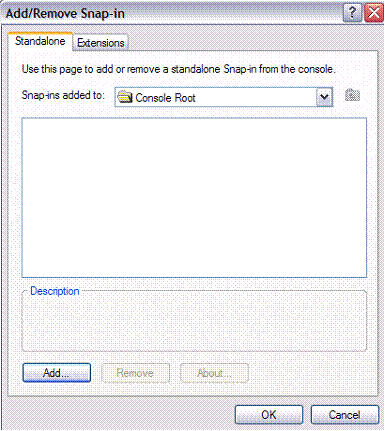

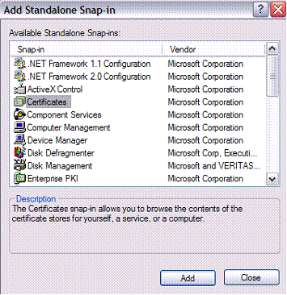

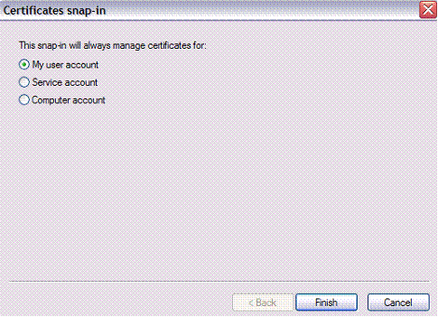

**Setting Up a Self-Signed Certificate**

Run the following from a Command Prompt**.**  It creates a local certificate authority for your computer:

> makecert -n "CN=PowerShell Local Certificate Root" -a sha1 -eku 1**.**3**.**6.1.5.5**.**7.3.3 -r -sv root.pvk root.cer -ss Root -sr localMachine

You will be prompted for the private key:

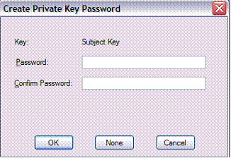

Next you’ll be prompted for the private key you entered above:

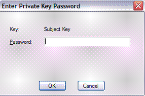

This will create the trusted root certificate authority:

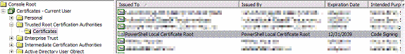

Now run the following from a Command Prompt**.**  It generates a personal certificate from the above certificate authority:

> makecert -pe -n "CN=PowerShell User" -ss MY -a sha1 -eku 1**.**3.6**.**1.5.5.7**.**3.3 -iv root.pvk -ic root.cer

You’ll be prompted for the private key:

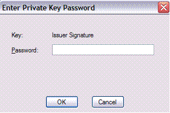

There will now be a certificate in the Personal store:

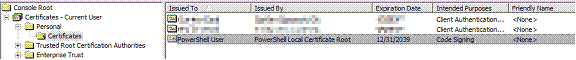

After the above steps, verify from Powershell that the certificate was generated correctly:

PS C:\ > Get-ChildItem cert:\CurrentUser\My -codesign

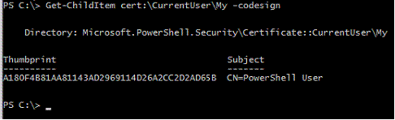

You can now delete the two temporary files root.pvk and root.cer in your working directory**.**  The certificate info is stored with that of others, in "C:\Documents and Settings\[username]\Application Data\Microsoft\SystemCertificates\My\"**.**

**Signing a Script**

To test the effectiveness of digitally signing a Powershell script, try it with a particular script “foo**.**ps1”:

PS C:\> *Set-ExecutionPolicy AllSigned*

PS C:\> ***.**\foo.ps1*

The file C:\foo.ps1 cannot be loaded**.** The file C:\foo.ps1 is not digitally signed. The script will not execute on the system. Please see "get-help about\_signing" for more details..

At line:1 char:9  
+ **.**\foo.ps1 <<<<

Now sign the script:

PS C:\> *Set-AuthenticodeSignature c:\foo**.**ps1 @(Get-ChildItem cert:\CurrentUser\My -codesigning)[0]*

Directory: C:\

SignerCertificate                         Status             Path  
-----------------                         ------             ----  
A180F4B81AA81143AD2969114D26A2CC2D2AD65B  Valid              foo**.**ps1

This actually modifies the end of the script with a signature block**.**  For example, if the script consisted of the following commands:

param ( [string] $You = $(read-host "Enter your first name") )  
write-host "$You so totally rocks"

After the script is signed, it looks like this:

param ( [string] $You = $(read-host "Enter your first name") )  
write-host "$You so totally rocks"

# SIG # Begin signature block  
# MIIEMwYJKoZIhvcNAQcCoIIEJDCCBCACAQExCzAJBgUrDgMCGgUAMGkGCisGAQQB  
# gjcCAQSgWzBZMDQGCisGAQQBgjcCAR4wJgIDAQAABBAfzDtgWUsITrck0sYpfvNR  
# AgEAAgEAAgEAAgEAAgEAMCEwCQYFKw4DAhoFAAQU6vQAn5sf2qIxQqwWUDwTZnJj  
...snip..**.**  
# m5ugggI9MIICOTCCAaagAwIBAgIQyLeyGZcGA4ZOGqK7VF45GDAJBgUrDgMCHQUA  
# Dxoj+2keS9sRR6XPl/ASs68LeF8o9cM=  
# SIG # End signature block

 Execute the script once again:

PS C:\> ***.**\foo.ps1*Do you want to run software from this untrusted publisher**?**

The file C:\foo.ps1 is published by CN=PowerShell User**.** This publisher is not trusted on your system. Only run scripts from trusted publishers**.**

[V] Never run  [D] Do not run  [R] Run once  [A] Always run  [**?**] Help (default is "D"):

Answer "A" and the script proceeds to run, and runs without prompting thereafter**.**  A new certificate is also created in the Trusted Publishers container:

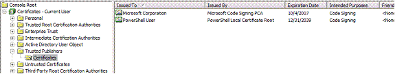

If the certificate is missing the script will fail**.**

**Running Signed Scripts Elsewhere**

PowerShell will be unable to validate a signed script on computers other than the one where it was signed**.**  Attempting to do so gives an error:

PS C:\ > ***.**\foo**.**ps1*The file C:\foo.ps1 cannot be loaded**.** The signature of the certificate can not be verified**.**  
At line:1 char:9  
+ .\foo.ps1 <<<<

Signed scripts can be transported by exporting (from original computer) and importing (to the new computer) the Powershell certificates found in the Trusted Root Certification Authorities container**.**  Optionally, the Trusted Publishers can also be moved to prevent the first-time prompt**.**

From the Current User certificate store, go to the Trusted Root Certification Authorities container and locate the PowerShell Local Certificate Root certificate**.**  Right-click on it and click All Tasks, Export:

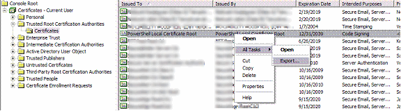

Click Next at the prompt:

Leave the format at the default DER and click Next:

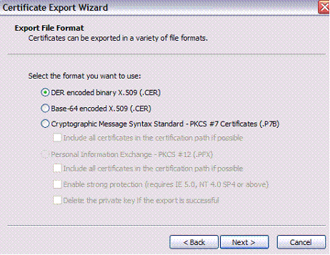

Enter your desired path and name of the exported certificate, and click Next:

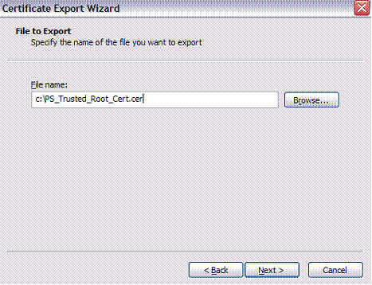

Click Finish and close out the wizard:

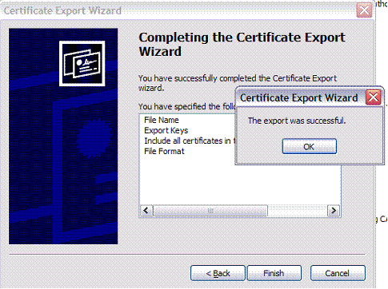

Login on the target machine as the user **under which scripts will be running****.**  Open MMC and add the Certificates snap-in for the current user, locating the Trusted Root Certification Authorities container**.**

Expand the container to find the Certificates store**.**  Right-click on it and select All Tasks, Import:

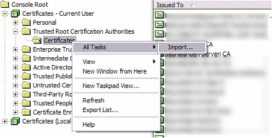

Click Next to continue:

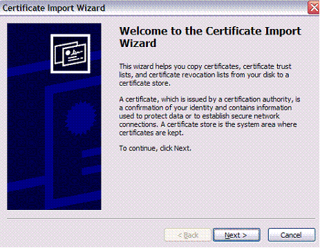

Locate the certificate you exported earlier and click Next:

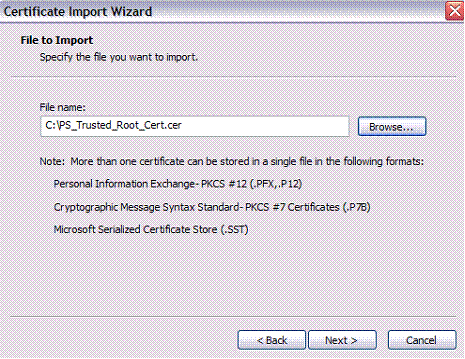

Leave the next step at its default and click Next:

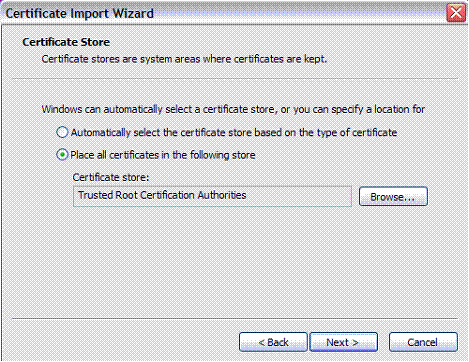

Read the security warning and click Yes to install the certificate:

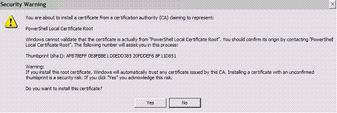

Your signed script should now run on the new computer**.**  Note that Powershell will prompt you the first time it’s run unless you also import the Trusted Publishers certificate**.**
