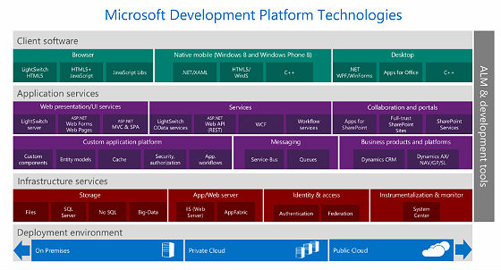
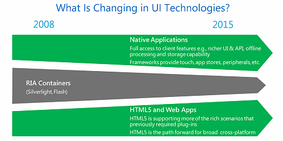
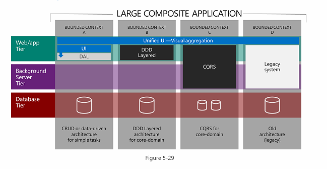

# **W**hat to Use on the Microsoft Stack

Posted by
[Jonathan Allen](http://www.infoq.com/author/Jonathan-Allen) 
on
Nov 11, 2013
*|*
[2
Discuss](#theCommentsSection)

Recently there has been a lot of flux in the Microsoft stack, leaving developers and leads wondering which technologies they should focus on**.** Microsoft's unwillingness to officially deprecate technologies such as Silverlight, instead allowing them to slowly fade away, only compounds the confusion**.** One way to find out is to review a little known document called the "[.NET Technology Guide for Business Applications](http://go.microsoft.com/?linkid=9832707) "**.** Released earlier this year, the Guide offers insight into where Microsoft intends to put its efforts and what technologies should be avoided**.**

This overview is a good place to start your exploration of Microsoft and related technologies**.**

(Click on the image to enlarge it)

## Try to Leave Silverlight and Flash Soon

While even old .NET staples like WinForms and Web Forms have found a place, RIA containers such as [Silverlight](https://en.wikipedia.org/wiki/Silverlight)  and Flash are definitely out**.** As you can see in figure 5-15 (below), Microsoft doesn't want to wait around for Silverlight 5's planned 10 year lifecycle**.** They intend to squeeze out RIA containers by the end of 2015**.**

(Click on the image to enlarge it)

For high-end applications, fully native technologies are preferred**.** On the low end, the capabilities of HTML5 are expected to continue to grow**.** While not pushing developers to go one way or the other, here is what they have to say about the transition:

> - If you are transitioning to native applications, you can leverage your existing skills and even code by targeting XAML/.NET natively on any Windows device**.** Portable libraries will also allow you to share your binaries between different platforms, including Silverlight**.**
> - For browser-based HTML5 apps, Microsoft provides leading tools and frameworks to help you create applications for any device based on the latest standards**.** Silverlight's interoperability with HTML also enables a gradual transition through hybrid applications**.**

## Mobile

### Three Equal but Different Options for Windows 8 Store

In the past Microsoft has been reluctant to push developers onto a specific stack when it comes to Windows 8 Store apps**.** This policy hasn't changed; the number one criteria for choosing between .NET/XAML, C++, and JavaScript/HTML5 is simply which one the developer is most familiar with**.**

Beyond that, they cite C++ for its performance advantages**.** Reusability isn't a high concern because all three platforms are capable of sharing code and resources across Windows Phone and Windows desktop**.**

### Native Options for Windows Phone

On Windows Phone the recommended technologies are .NET and C++**.** Again there is a nod to C++'s performance advantage, but mostly they are saying developers should use whatever they are more familiar with**.**

Though Windows Phone is compatible with [PhoneGap/Apache Cordova](https://en.wikipedia.org/wiki/PhoneGap) , it isn't mentioned at all**.** Presumably this is because they view PhoneGap as having poorer performance than .NET or C++ on small devices**.** At the 2013 Build conference performance was far and away the most important topic, pushing out other considerations such as general usability, visual design, and deep OS integration**.**

### Mobile Web: Anything but Web Forms

If choosing a web-based solution to work across all mobile devices the choices are numerous**.** ASP.NET MVC with [Modernizer](https://en.wikipedia.org/wiki/Modernizr)  is the base line recommendation, with the option of building a [Single Page Application](http://www.asp.net/single-page-application)  (ASP.NET SPA) where appropriate**.** Microsoft considers SPA to be more design pattern than technology, with [Knockout](http://knockoutjs.com/)  and [Breeze](http://www.breezejs.com/)  being highly recommended libraries**.**

For quickly putting together [CRUD](https://en.wikipedia.org/wiki/Create%2C_read%2C_update_and_delete)  style applications [LightSwitch](https://en.wikipedia.org/wiki/LightSwitch#Visual_Studio_LightSwitch) is on the table**.** This offers little control over the HTML rendering, but doesn't require the overhead of having developers build their own layouts for various screen sizes**.**

[ASP.NET Web Pages](http://www.asp.net/web-pages)  are the fourth option offered for mobile web**.** Based on the Razor syntax, this offers a development experience similar to scripting languages such as PHP or classic ASP**.**

Not mentioned is the older ASP.NET rendering toolkit, Web Forms. While still in active development and theoretically capable of rendering device-specific HTML, in practice Web Forms hasn't lived up to its potential**.** The HTML and JavaScript it renders tends to be inefficient and [view state](http://msdn.microsoft.com/en-us/library/ms972976.aspx) , which is integral for its more advanced features, can quickly overwhelm a phone's network connection**.**

## Services

Since most applications rely on external data storage and processing, server-side development continues to be an important consideration**.** There are currently 6 technology options Microsoft considers to be viable**.**

### First Choice: ASP.NET Web API

According to Microsoft, the default choice for new projects should be [ASP.NET Web API](http://www.asp.net/web-api) **.** This can be used when developing services that follow REST patterns and is meant to be compatible with Internet caches such as "Akamai, Windows Azure CDN, Level3, and so on"**.**

When using Web API developers should focus on [OData](http://www.odata.org/) , which standardizes the way REST endpoints are exposed, and JSON**.**

### Second Choice: WCF

Not being tied to any specific transport protocol or message format, WCF is considered to be a more flexible option than Web API**.** You can, for example, take advantage of TCP or named pipes with binary messages for improved performance**.** The downside is that WCF can difficult to work with, especially when you want to expose data in JSON or other non-SOAP based formats**.**

WCF was designed with enterprise-facing, RPC-style communication in mind**.** While public-facing REST-style design patterns are possible, it isn't the preferred option for that use**.**

### WCF with OData

If you are working on a mostly CRUD style service layer and want to use the WCF stack then [WCF Data Services](http://msdn.microsoft.com/en-us/data/odata.aspx)  is the way to go**.** This shares the OData libraries with ASP.NET Web API and is often used in conjunction with [Entity Framework](http://msdn.microsoft.com/en-us/data/ef.aspx) **.**

### Workflow Services

[Workflow Services](http://msdn.microsoft.com/en-us/library/dd456788.aspx)  are a marriage of [Windows Workflow](http://msdn.microsoft.com/en-us/vstudio/jj684582.aspx)  and WCF**.** The only reason to use this is if your services are already using Windows Workflow internally**.** Microsoft cites no other reason for choosing this option**.**

### SignalR for Two-Way Communication

If you are only using.NET based clients, WCF offers lots of options for fine tuning two-way communication**.** But if you want something that can support both .NET and web-based clients then [SignalR](http://signalr.net/)  is a tempting choice**.**

According to Microsoft, SignalR can scale to "even millions of users"**.** For web clients it prefers to use [WebSockets](https://en.wikipedia.org/wiki/WebSockets) , but can automatically fall back to older patterns like long polling if necessary**.**

SignalR also has a [library for .NET](http://blogs.microsoft.co.il/blogs/ranw/archive/2012/12/29/using-signalr-with-net-client.aspx)  clients, allowing web and native clients to share services**.**

### LightSwitch, Another OData Provider

It is hard to overstate how much Microsoft loves OData**.** We've already seen OData for both WCF and Web API, but it doesn't end there**.** Though normally used with LightSwitch clients, you could conceivably use LightSwitch's server side capabilities to quickly generate a service tier**.**

Microsoft claims LightSwitch requires no coding, but warns that it comes with a loss of flexibility**.**

## Guidance for Small and Medium Business Applications

Microsoft wrote its guidance for small and medium size businesses with these goals in mind:

> - Complete velocity and shorter time to market
> - Productivity and lower costs
> - Easy to get started
> - Collaboration and Integration with market products
> - Cloud agility and cost reductions opportunities

Translated to plain English, this means, "make it quickly and make it cheaply"**.** Their specific guidance depends on what presentation mode you prefer**.**

### Web Apps for Small/Medium Businesses

For quick and dirty CRUD style applications, Microsoft is continuing to push LightSwitch as the go-to platform**.** It was originally described as a tool for non-professional programmers to use**.** Many thought of it as a multi-tier replacement for Access**.** That vision seems to have faded as LightSwitch is now being offered more as a tool for IT departments that need to quickly push out applications**.**

Next up is [Web Forms](http://www.asp.net/web-forms) **.** Yes, the venerable Web Forms technology is still being recommended for use in new projects**.** Microsoft sees it as a middle ground between the easy to use but limited LightSwitch and the complexity of ASP.NET MVC**.** With features such as rich data grids, Web Forms are still well suited for a company's suite of internal applications**.**

ASP.NET Web Pages are mentioned, but only briefly**.** If you want more control over rendering than Web Forms offers, ASP.NET MVC is the tool of choice**.** However, Microsoft does warn about its longer learning curve**.**

### Building for Windows Desktop

While all the C++ based GUI toolkits such as MFC and ATL/WTL are off the list, the original .NET UI toolkit [WinForms](https://en.wikipedia.org/wiki/Windows_Forms)  is still considered a viable option along-side [WPF](https://en.wikipedia.org/wiki/Windows_Presentation_Foundation) **.** Both support modern concepts such as data binding, async/await, and two-way communication using WCF or SignalR**.**

The choice between WPF and WinForms involves several considerations:

First is difficulty**.** WinForms is much easier to understand than WPF, even for senior developers**.** WinForms uses very simple data binding and prefers a classic MVC or MVP approach**.** WPF, on the other hand, requires the user to learn a complex data binding framework in order to correctly use the MVVP pattern**.** Success with WPF also requires knowledge of resource dictionaries, converters, ICommands, and XAML's templating engine**.**

On the other hand, if you intend to also target Windows Phone or Windows 8 Store you are going to need to learn how to use XAML**.** In that case, starting with WPF will make it more likely you can share code across platforms.

The flexible rendering engine in WPF also allows for nicer looking applications than can generally be done with WinForms. This comes at a cost; WPF applications often run slower than comparable WinForms applications**.**

Mentioned in passing is the LightSwitch desktop client**.** Presumably, this can't offer anything that isn't available in the web client, so there doesn't seem to be much of a reason to choose this**.**

### Client-Server Should be Avoided

When Microsoft says "client-server" they specifically mean applications that directly communicat with the database**.** Though they acknowledge it is still a very common pattern, they want new projects to use a 3-tier design with a service layer sitting between the client and database**.** This provides better scalability over direct database access and a way to bypass firewalls and other obstacles**.** Plus, it allows the application to be ported to platforms where database drivers simply are not available**.**

### "Modernization" - Leaving the Windows Desktop

Microsoft offers a lot of advice on how to "modernize" desktop applications**.** This advice is mostly about getting the application ready to be ported to other platforms, but there is some useful guidance even if you don't plan on leaving the Windows desktop**.** Here is their summary:

> - Use the Model-View-ViewModel design pattern (MVVM): Microsoft client platforms (including WPF) make it easy to build applications using the MVVM pattern**.** With this pattern you will get a strong separation of display from state and behavior, which will help you to create clean and maintainable code that can be easily shared between multiple devices**.**
> - Use portable class libraries for the client logic: .NET portable libraries allow binaries to be shared between multiple platforms such as the desktop, Windows Store apps, Windows Phone apps, and others**.** Implementing your client logic with .NET portable libraries will greatly simplify the creation of multiple experiences on multiple platforms.
> - Modernize your user experience: Concepts that are demanded by today's end users can be implemented with the latest innovations on .NET for the desktop**.** Design principles such as "fast and fluid," "authentically digital," and "do more with less" can be applied to your existing desktop application by employing a modern UI for your XAML design, carefully using animations, and implementing .NET asynchronous programming extensively**.**
> - Move the business logic to the server: Two-tier applications (client/server) are significantly harder to extend to new devices**.** The recommended approach is to clearly separate the business logic into services that can be reused later on other devices and form factors**.**
> - Extend to the cloud: Once separated from the client, Windows Azure provides multiple solutions to move the business logic to the cloud**.** Transforming that logic into cloud services greatly improves the elasticity and scalability of existing solutions, making them ready to embrace multi-device approaches**.**

### .NET on Android and iOS

Microsoft is working with several partners to help with the modernization effort**.** Here is what they have to say about each:

> - [Xamarin](http://xamarin.com/)  provides a means to share C# code from your applications targeting Windows or Windows Phone with iOS and Android devices**.** It provides access to the underlying API to create tailored views while reusing the client logic code between devices**.**
> - ITR-Mobility [iFactr](http://ifactr.com/)  and [MonoCross](http://monocross.net/)  offers a solution for building enterprise mobile applications in C# for delivery on the major mobile platforms. It provides services such as Abstract UI and Enterprise Data Synchronization to enable business applications across a range of devices**.**
> - [Mobilize.NET](http://mobilize.net/home-0/)  by Art in Soft provides solutions and services for migrating legacy applications to modern platforms-including the web, mobile, and the cloud-by transforming the existing source code into new code without runtimes for the output application**.**
> - [Citrix Mobile SDK](https://www.citrix.com/go/mobile-sdk-for-windows-apps.html)  for Windows Applications provides a rich tool kit for developers to mobilize LOB Windows applications or write new touch-friendly applications executing on central servers (Citrix XenApp/XenDesktop) and accessed from any mobile device with Citrix Receiver**.**

Side note: The fact that Microsoft is actively promoting Xamarin and MonoCross should finally put to rest the long running rumors that Microsoft intends to sue the makers of Mono**.**

## Guidance for Large, Mission Critical Business Applications

When it comes to larger companies and their mission critical applications the focus shifts from cost and productivity to complexity management and quality of service**.** These guidelines are not meant for data driven or CRUD applications, developers working on those should use the small/medium business guidelines**.** These guidelines are for systems with many interconnected parts and sub-systems with varying amounts of independence**.**

### Web Applications in the Enterprise

Microsoft is unequivocal on this point, for mission critical web sites you should be using ASP.NET MVC**.** The only architectural question is whether or not to layer Single Page Application design patterns on top of it**.**

Other web technologies such as Web Forms or Web Pages should not be used**.** They simply don't offer the control and testability of the MVC stack, which in turn limits the Quality of Service that can be obtained**.**

### Desktop Applications in the Enterprise

As with smaller applications, Microsoft is including WPF and WinForms on its recommended list**.** To this they add C++ with either Win32 or [MFC](https://en.wikipedia.org/wiki/Microsoft_Foundation_Class_Library) **.** The use of C++ is recommended for very large, long term projects comparable in scale to Microsoft Office**.** One presumes they are thinking about the difference between AutoCAD and Paint.NET in terms of scale**.**

### Windows Store/Windows Phone in the Enterprise

Microsoft doesn't really have anything to say in this section besides stating the recommendations are "similar to the recommendations available in the ‘Emerging application patterns' section"**.** This doesn't instill much confidence but they aren't outright dismissing the platforms either**.**

## Patterns and Practices

For roughly the last 20 pages of the Guide, Microsoft sets aside the discussion of products and turns their attention to patterns and practices**.**

### Inversion of Control

Microsoft spends a surprising amount of time discussing dependency injection and inversion of control containers**.** They list nine separate Inversion of Control Containers, the majority of which are community run projects unaffiliated with Microsoft**.** It should be noted many of the frameworks they list are not actually IoC Containers but rather Dependency Injection frameworks**.**

The confusion between to two continues throughout the section with no clear indication if Microsoft prefers composite roots (a DI pattern) or service locators (an IoC Container pattern), which is rather frustrating because, as Mark Seemann argues, [they are essentially opposites](http://www.infoq.com/articles/Succeeding-Dependency-Injection) **.**

Microsoft uses the "Single Responsibility Principle" to justify the use of dependency injection**.** They say SRP can result in classes that could, for example, have 15 dependencies listed in its constructor**.** In order to "decouple" these dependencies they suggest they be removed from the constructor and instead injected using an Inversion of Control Container**.**

Microsoft also mentions using [Aspect Orientated Programming](https://en.wikipedia.org/wiki/Aspect-oriented_programming)  to add another layer of indirection and to further inject dependencies**.**

### Bounded Context and Complexity Management

In order to control complexity, Microsoft spends a few pages discussing the concept of a "bounded context"**.** Based on the work by Eric Evans, the basic idea is to silo your applications into smaller parts with limited sharing**.** In the example below, there are four separate stacks with different back ends and a common UI**.**

(Click on the image to enlarge it)

Their recommendations in this area make a lot of sense**.** For bounded contexts you identify as mission critical you can use the more expensive Command and Query Responsibility Separation (CQRS) or Domain Driven Design (DDD) patterns with fully automated tests**.** Meanwhile ancillary bounded contexts can use a lightweight, CRUD style architecture**.** Legacy code will of course get its own silo where it can be isolated and slowly replaced**.**

### Communication and Anti-Corruption

For sharing information between bounded contexts Microsoft recommends using asynchronous messaging wherever possible**.** This allows each silo to work independently even when other silos fail**.** For simple scenarios, named pipes and Microsoft Message Queues are easy options, while more complex systems need a service bus**.** Microsoft mentions Windows Server Service Bus, Windows Azure Service Bus, and NServiceBus without preferring one to another**.**

Any services exposed by a bounded context should be protected by an anti-corruption layer**.** Much like the parameter checks protecting public functions, a bounded context's anti-corruption layer protects the underlying data store from malformed messages**.** This layer verifies the incoming message, performs any necessary translations, and ensures bad data is processed and stored**.** This can be done using normal .NET code, but for complex scenarios with lots of frequently changed business rules, Microsoft recommends a rules engine and integration platform such as BizTalk**.**

### Mitigating Legacy Code

The first step in dealing with legacy code is to create a facade over it**.** This facade should use modern techniques such as persistent, scalable caches and hide whatever patterns the old code used**.** Over time, the legacy code will be swapped out and the facades redirected to new service layers**.**

## Conclusions

Microsoft is standing behind all native, web, and communication frameworks for .NET except Silverlight in the browser and .NET Remoting**.** They are also recommending C++ and JavaScript in several scenarios**.** Older platforms such as VB 6 and classic ASP are no longer being mentioned so companies still using need to migrate to newer technologies as soon as possible**.**

Expect to see a continued emphasis on dependency injection, especially with ASP.NET MVC and Entity Framework**.** BizTalk, once thought to be a dead technology, is seeing new life as companies try to integrate on-site and cloud architectures**.**

## About the Author

**Jonathan Allen** has been writing news report for InfoQ since 2006 and is currently the lead editor for the .NET queue**.** If you are interested in writing news or educational articles for InfoQ please contact him at jonathan@infoq.com**.**

### Tell us what you think
