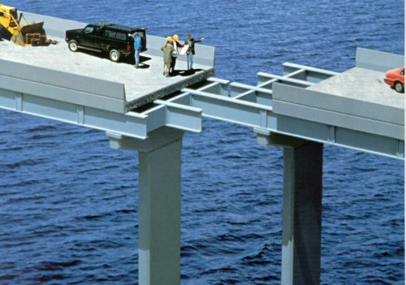

# **I**t's Not A Bug, It's....

11**.**04**.**2013

|
13235 views
|

[inShare](#) 23

When does a bug become a bug**?**

Who decides that it is a bug**?**

How many **legs** does a lamb have if I say the **tail** is a leg**?**  The answer is 4, just because I say the tail is a leg does not make it a leg**!**   
  
Bugs should be obvious, but we say**It's not a bug, it's a feature** because often it isn't obvious**.**  [Watson Humphrey](http://en.wikipedia.org/wiki/Watts_Humphrey "Wikipedia Watts Humphrey")  felt that we should use the term **defect**and not bug because most people don't take bugs seriously, so let's use the term defect instead**.**   
  
So when does a **defect** become a **defect****?**

- When **quality assurance** tells you that you have a defect**?**
- When **product management** says that it is a defect**?**
- When the **customer** says that it is a defect**?**

The answer is: **none of the above****.** Now it might turn out that there is a problem and that code needs to change, but a defect only exists if **code behaves differently than the requirements specification**

This is important because most systems are **under specified** (if they are specified at all :-) )**.** Code can only be considered a defect if it differs from the specification**.**  We call defects **undocumented features** because we know that the problem is that the requirements were never written**.**

# Incomplete and Inconsistent Requirements

Many organizations do not create sufficiently complete requirements **before** starting development, either because they don't know how to capture requirements properly or because they don't have resources capable of capturing complete requirements**.**   
  
Incomplete (and inconsistent) requirements and **unrealistic deadlines** often force developers into making decisions about how to implement features**.**  The end result is that developers are regularly told that they have defects in their code**.**  
  
While this process is **common**, it is **destructive****.**  When requirements are under specified and inconsistent developers end up needing to perform serious rework**.** The rework will can require dramatic changes that will impact the architecture of the code**.**  
  
The time required to find a work around (if it is possible) is rarely included in the project plan**.** Complicating matters is that the organizations that are reluctant to spend time creating requirements also tend to underestimate their projects**.**  This puts tremendous pressure on the engineering department to deliver; this promotes the 5 worst practices in software development (see [Stop It**!** No… really stop it**.**](http://accelerateddevelopment.blogspot.ca/2013/01/stop-it-no-really-stop-it.html "Stop It! No... really stop it") )   
  
When poorly or undocumented systems require changes that are not specified we should  call them **change requests**rather than defects**.**

# Only 54% of Issues are Resolved by Engineers

The attitude that all defects must be resolved by the engineering department is severely misguided**.**  Analysis by [Capers Jones](http://en.wikipedia.org/wiki/Capers_Jones "Wikipedia Capers Jones")  of over 18,000+ projects shows that only about 54% of all defects can be resolved by the engineers**!** (only the 3 highlighted rows below)

| Defect Role Category | Frequency | Role |
| --- | --- | --- |
| Requirements defect | 9**.**58% | [BA](http://en.wikipedia.org/wiki/Business_analyst "Business Analyst") /Product Management |
| **Architecture or design defect** | **14**.**58%** | **Architect** |
| **Code defect** | **16**.**67%** | **Developer** |
| Testing defect | 15**.**42% | Quality Assurance |
| Documentation defect | 6**.**25% | Technical Writer |
| **Database defect** | **22**.**92%** | [**Data base administrator**](http://en.wikipedia.org/wiki/Database_administrator "Database Administrator") |
| Website defect | 14**.**58% | Operations/Webmaster |

This means that precious time will be wasted assigning issues to developers that they can not resolve**.**  The time necessary to redirect the issue to the correct person is a major contributing factor to fire-fighting

# Getting Control of the Defect Process

For most organizations fixing the defect process involves understanding and categorizing defects correctly**.** Organizations that are not tracking the different sources of defects probably have a bug tracker that has gone to hell**.**  Here is how you can fix that problem, see [Bug Tracker Hell and How to Get Out](http://accelerateddevelopment.blogspot.ca/2012/09/bug-tracker-hell-and-how-to-get-out.html)

At a minimum you need to implement the **requirements defect**, once you identify issues that are caused by poor requirements it will shine the **white hot light of shame** onto the resources that are capturing your requirements**.**   
  
Once you realize how many requirements defects exist in your system you can begin to inform senior management about the requirements problem**.**

# Reducing Fire-Fighting

The best way to reduce fire fighting is to start writing better requirements (or writing requirements :-) )**.**  To do so you need to figure out which of the following are broken:

1. Not enough time is allocated to the requirements phase
2. Unskilled people are capturing your requirements

In all likelihood both of these issues need to be fixed in your organization**.**  When requirements are incomplete and inconsistent you will have endless fire-fighting meetings involving everyone (see [Root cause of 'Fire-Fighting' in Software Projects](http://accelerateddevelopment.blogspot.com/2011/11/root-causes-of-fire-fighting-in.html "Root cause of 'Fire-Fighting' in Software Projects") )

Stand your ground if someone tells you that you have coded a defect when there is no documentation for the requirement**.**
