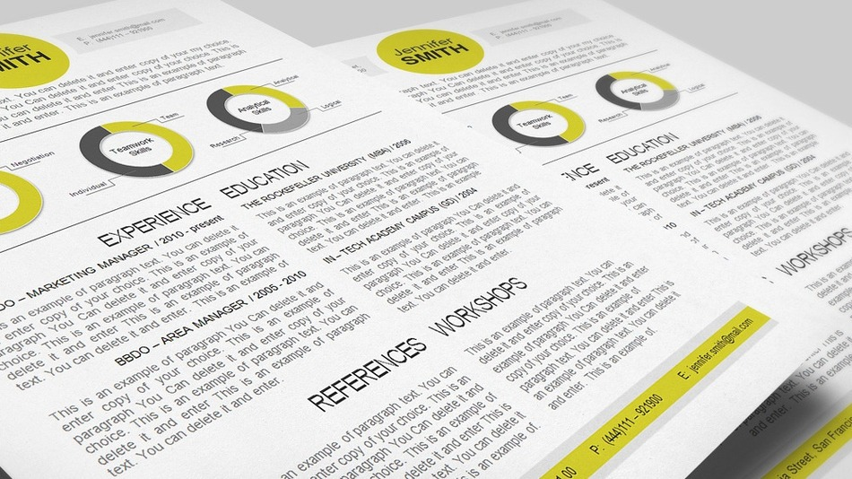

# **W**hy You Should Remove Half the Stuff on Your Resume Right Now

*22**.**6k*

Shares

Share
on Facebook
Share
on Twitter

What's This**?**

By Elli SharefNov 10, 2013

There's tons of advice out there about how exactly to answer interview questions, what to wear to that interview and how to follow-up afterwards, but what if you're having trouble even getting your foot in the door**?** For many people, it isn't a lack of experience, education or training that is keeping them from getting a call back — or these days, an e-mail back**.** Instead, it often comes down to how you're presenting yourself via your resume**.**

As Co-Founder of [HireArt](https://www.hireart.com/) , I see hundreds of resumes a day**.** The biggest mistake I see is people overstuffing their resumes, trying to cram every single activity, skill or job they have ever had onto one page instead of focusing on creating a coherent story**.** Just recently I was reviewing a 12-page resume that started out with the following:

"My skills include marketing, social media, project management, accounting, tax law, labor law, financial management, sales strategy, 6 Sigma, operational effectiveness, ad operations and software sales**.** I've also published two novels and took a few months off to write a poetry book last spring**.**"

While it might seem tempting to list every skill you have ever acquired, there are actually a few profound disadvantages to this approach**.**

**Employers won't remember anything if you try to focus on everything**.**** If you write out a long list of skills, an employer likely won't recall any of them**.** It's simply impossible to form a mental image if you present yourself as a lawyer, marketer and venture capitalist all in one**.** Which is it**?** Pick the one that is most important to you and emphasize it throughout your resume**.**

**Having a clear narrative is a huge advantage**.**** I recently interviewed a candidate for a sales position**.** Within the first three minutes of the conversation he said, "I live and breathe sales**.** I love everything about selling." He spent the next 15 minutes telling me about his different sales roles and why he had excelled at them**.** As a hiring manager, this really appealed to me — he had a neat narrative that made me believe that he'd excel at the sales job I was hiring for**.** I later learned that he'd actually done a lot of things other than sales in his life, but he hadn't focused on those things initially**.** His resume was sparse and though he didn't skip his other roles, they just weren't emphasized**.** The moral of the story is this: Why do I need to know you're a great tax accountant if I'm hiring a sales person**?** It dilutes your narrative and makes me nervous about the sincerity of your passion for sales**.**

**Resumes that exceed two pages are considered unprofessional**.****There is a lot of advice about resumes out there**.** If you're applying for a job at a technology company or corporation, it's very clear: employers really dislike long resumes**.** From Facebook to General Assembly down to tiny start-ups, not a single company would want you to submit a long resume**.** Being succinct is among the most important skills for a job applicant**.**

**If you want to impress an employer, it's much better to show than tell**.****The most underused trick of the trade is simply to show the employer why you're good instead of writing an endless resume**.** One candidate I worked with created a product management portfolio with wireframes and product ideas for each company he was truly interested in**.** Another candidate, who ultimately got hired, helped the VP of Business Development get a meeting at Stanford Hospital before she was even hired**.** Seeing someone do excellent work is worth 1000x more than seeing a 12-page resume claiming excellence with no proof**.**

**Finally, a lengthy or unfocused resume smells of desperation**.****Remember that guy you went on a date with who couldn't stop telling you how good he was at everything**?** You probably only went on one date with him. Being "good at everything" seems like a lie (even if it's true**!**) and it's unattractive. Don't forget that landing a job is not that different from landing a date**.** You want to say just enough to get the hiring manager interested, but not so much that they become overwhelmed**.**

Before you apply for your next job ask yourself: who am I**?** Or rather, who am I in the context of this job application**?** Tailor your resume to tell a story that is so compelling that they'll want to meet you to hear more**.**

*Have something to add to this story**?** Share it in the comments.*

### Mashable Job Board Listings

The [Mashable Job Board](http://jobs.mashable.com)  connects job seekers across the U.S. with unique career opportunities in the digital space**.** While we publish a wide range of job listings, we have selected a few job opportunities from the past two weeks to help get you started**.** Happy hunting**!**

- [Social Media Associate](http://jobs.mashable.com/jobs/social-media-associate-chicago-illinois-60602-60103052-d)  at GrubHub Seamless in Chicago, Ill**.**
- [Software Architect](http://jobs.mashable.com/jobs/software-architect-san-francisco-california-94107-60147313-d)  at Al Jazeera America in San Francisco, Calif**.**
- [Senior Software Engineer — Date Science](http://jobs.mashable.com/jobs/senior-software-engineer-data-science-san-francisco-california-94107-60042038-d)  at Klout in San Francisco, Calif**.**

*Image: [flickr](http://www.flickr.com) , [CV Special](http://www.flickr.com/people/cvspecial/)* 

[Elli Sharef](http://mashable.com/author/elli-sharef/) 

Elli Sharef is Co-Founder at [HireArt](http://hireart.com) , a YCombinator funded start-up that helps companies make great hires more easily**.**
