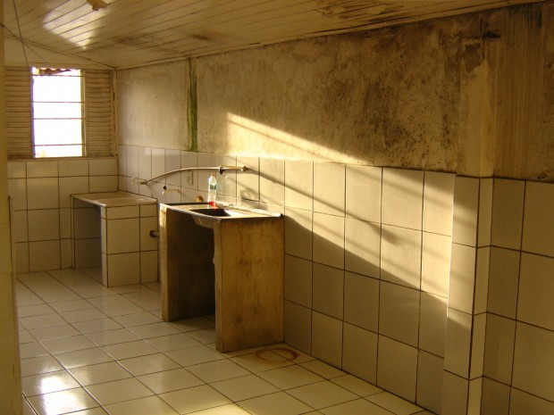
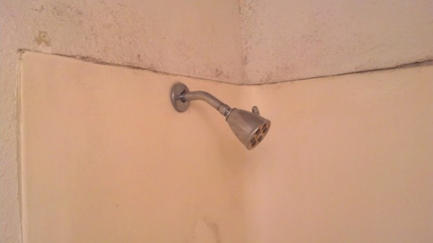
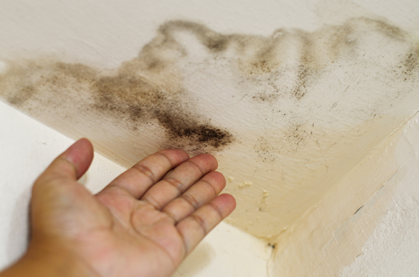

# **C**omo acabar com mofo

Imagina só a cena: você tem um porão em casa e num belo dia, depois de meses, resolve dar uma passada lá**.** O que poderia ser pior que encontrar as paredes totalmente tomadas por camadas de mofo, daqueles bem nojentos e esverdeados**?**

Cenário de filme de terror.

Provavelmente, você preferiria encontrar uma alma penada**.** Melhor pensar duas vezes, pois, apesar de requerer um pouco de esforço, se livrar do mofo é mais fácil que dos espíritos inoportunos**.**

Deixando esse papo do além pra lá, separei algumas dicas que podem ajudar na hora de se livrar do mofo que está acabando com sua paz**.**

Para começar a conversa, é importante conhecer melhor seu inimigo, o mofo**.** Ele é um tipo de fungo que cresce em áreas mal ventiladas e úmidas, como os banheiros, porões e até nas saídas de ar de uma casa**.** Pode ser bastante prejudicial à saúde, dependendo da quantidade de mofo e de quão grande é a área que cobre**.** Por isso, é muito importante detectar e se livrar do mofo para manter você e sua família saudável, uma vez que pode desencadear reações alérgicas e prejudicar seus pulmões se for inalado diretamente**.**

Enquanto alguns tipos de mofo vão exigir um tratamento especial para serem removidos da sua casa, alguns problemas menores podem ser tratados com produtos e métodos domésticos**.** Vamos a eles!

### 1. Encontrando o mofo

Este pode ser um trabalho fácil, mas é bom ficar bastante atento, pois algumas vezes pode ser complicado identificar onde o mofo cresce, principalmente porque ele tende a crescer em áreas escondidas**.** Então, antes que você possa remover todo o mofo da sua casa, você vai ter que encontrá-lo**.**

Inspecione cada cômodo da sua casa, como o banheiro e o porão, se você tiver um**.** É importante dar atenção a esses tipos de ambientes, pois o mofo costuma prosperar em áreas úmidas e com pouco acesso à luz natural, o que coloca no topo da lista as lavanderias e banheiros**.** Procure em sua casa quais são os ambientes mal ventilados e que tendem a ficar úmidos ou ainda, que têm altos níveis de umidade**.**

Verifique com atenção as paredes para ver se encontra mofo e preste atenção em como o ar cheira**.** O cheiro de umidade intensa pode indicar que você tem um problema de mofo**.** Também é imprescindível que você verifique os espaços onde tiver encanamento em sua casa, como embaixo da pia, em torno do vaso sanitário e na área do chuveiro**.** Se estes equipamentos estão vazando, podem estar contribuindo para tornar seu banheiro um terreno fértil para o mofo**.**

Se sua casa é forrada com carpete, tente levantar uma pequena parte dele e veja se há indícios do crescimento de mofo sob o tapete**.**

Outra parte que você deve examinar são as janelas**.** Elas costumam acumular umidade e, por isso, podem ser um excelente lugar para o mofo se proliferar**.** Olhe cuidadosamente ao longo das bordas da moldura da janela e em todo o parapeito**.**

Preste muita atenção às áreas de sua casa que parecem estar se deteriorando**.** Você pode encontrar pintura descascando em suas paredes, peitoris e guarnição, ou áreas apodrecendo em seu revestimento, janelas ou teto**.** Estes são os sinais possíveis de que você tem um problema de mofo**.**

Depois que você localizar o mofo em sua casa, deve eliminá-lo o mais rápido possível para acabar de vez com o risco dele se espalhar e causar problemas de saúde**.** Finalmente, vamos às dicas de como removê-lo.

### Como remover mofo de tecido

A notícia boa é que você consegue remover o mofo da maior parte dos tecidos**.** A ruim é que muitas técnicas podem arruinar ou remover a cor da peça, pois pode ser necessário usar alvejante**.** Por isso, só vale a pena o trabalho de fazer o procedimento abaixo em tecidos de algodão branco**.**

Você vai precisar de:

- bicarbonato de sódio;
- alvejante;
- um frasco de spray vazio;
- uma tigela;
- uma escova de dentes velha;
- uma escova macia e luvas de proteção**.**

**Como fazer:**

**1**.**** Comece com o método mais fácil: Misture uma parte de alvejante para uma parte de água já dentro do frasco spray**.** Agite e pulverize sobre o mofo. Deixe agir por um tempo e depois enxágue. Se isso não funcionar, será preciso usar armas mais pesadas**.**

**2.** A mistura mais pesada é a de uma parte de alvejante para três partes de bicarbonato de sódio até formar uma pasta dentro da tigela**.** Coloque as luvas de proteção e use uma escova de dentes para aplicar a mistura sobre o mofo**.** Esfregue levemente, deixe que aja por cerca de 30 minutos e ,em seguida, enxague**.** Se isso não funcionar, prepare-se para usar uma artilharia ainda mais potente**.**

**3.** Misture partes iguais de água sanitária e bicarbonato de sódio em uma tigela**.** Vista as luvas e use uma escova macia para aplicar a pasta**.** Ponha um pouco de força ao esfregar a mancha. Deixe a pasta agir por cerca de 30 minutos e depois enxágue**.** Se ela ainda estiver lá, chame os navios de guerra**.**

**4**.**** Misture 3 partes de alvejante para uma parte de bicarbonato de sódio**.** Vista as luvas e aplique com a escova**.** Deixar solidificar e enxágue.

### Removendo mofo do banheiro

O mofo é um incômodo frequente em chuveiros e outras partes do banheiro**.** Para removê-lo do seu banheiro:

Você vai precisar de:

- Escova de nylon;
- água;
- balde de plástico;
- e bastante bicarbonato de sódio**.**

**Como fazer:**

**1**.**** Aplique água quente no rejunte – ou  a parte que tenha sido afetada – e esfregue vigorosamente com uma escova de nylon com cerdas duras procurando remover o máximo de bolor superficial possível**.**

**2.** Encha um balde de plástico com um litro de água quente e incorpore cerca de 3/4 de xícara de bicarbonato de sódio**.**

**3.** Polvilhe bicarbonato de sódio diretamente sobre o mofo**.**

**4.** Molhe a escova de nylon na mistura de água e bicarbonato e esfregue vigorosamente para remover o mofo**.** Alterne os movimentos, variando na direção da esfregada e variando com círculos, para ajudar a remover o mofo**.** Permita que o bicarbonato de sódio fique sobre o mofo de duas a três horas antes de continuar**.**

**5.** Por fim, lave bem o bicarbonato de sódio da superfície com água quente**.** Utilize mais bicarbonato de sódio e esfregue novamente, se necessário**.**

### Como tirar mofo de madeira

O mofo cresce facilmente em madeira úmida**.** Isso pode incluir rodapés de madeira atrás de móveis, janelas e armários**.**

Se suas peças de madeira foram dominadas pelo mofo e você tem sede de vingança, vai precisar de:

- fosfato trissódico ou bicarbonato de sódio;
- água;
- escova de nylon;
- água sanitária;
- esponja;
- ácido oxálico;
- secador de cabelo (opcional)**.**

**Como fazer:**

**1**.**** Aumente a temperatura e a circulação de ar em torno da superfície da madeira**.** Madeira úmida é um terreno fértil para o mofo. Secar a madeira vai tornar o mofo mais fácil de ser removido e impedirá o crescimento futuro de bolor**.** Você pode usar um secado de cabelo para aquecer a madeira**.**

**2.** Misture de 8 a 10 colheres de sopa de fosfato trissódico (ou bicarbonato de sódio) em um balde com 1 litro de água**.** Molhe a escova na solução e esfregue o mofo da madeira**.** Para superfícies de madeira macia ou delicadas, use uma esponja para esfregar**.**

**3.** Lave a solução que ficou sobre a madeira com água fria e ponha a peça em uma zona aquecida e ventilada**.** Permita que a madeira seque completamente. É recomendado que você pinte a madeira com uma tinta resistente a mofo para evitar o crescimento futuro de bolor**.** Siga as instruções da tinta que se correlacionam com o tipo de madeira**.**

**4**.**** Remova o mofo que cresceu sob a pintura usando um removedor de tinta**.** Faça uma solução de 8 colheres de sopa de fosfato trissódico, 1 xícara de água sanitária e 1 litro de água em um balde e esfregue bem com uma esponja ou escova**.**

**5.** Elimine manchas de mofo extremamente difíceis com ácido oxálico**.** Misture três colheres de sopa de ácido com um litro de água em um balde limpo**.** Esfregue bastante a mancha e lave bem com água fria**.** Deixe secar em uma sala bem aquecida e ventilada antes de aplicar uma pintura ou revestimento**.**

### Como remover mofo de paredes

As preferidinhas do mofo, é preciso ter alguns truques na manga para quando ele surgir**.** Lembre-se de quando você for remover mofo da parede é importante cobrir o rosto com um pano ou máscara**.**

Você vai precisar de: água sanitária, frasco pulverizador, cloro em gel, esponja, balde e água**.**

**Como fazer:**

**1**.**** Proteja o piso na área que você está prestes a limpar, usando uma lona de plástico grosso no chão**.**

**2.** Use água sanitária com um pulverizador sobre a área da parede afetada e espere cerca de 10 minutos**.**

**3.** Usando um balde de água limpa, lave a parede para remover a mancha e toda a água sanitária**.** A maior parte da mancha deve sair neste ponto.

**4**.**** Use uma esponja para aplicar cloro em gel em todos os pontos de mofo restantes e deixe descansar de 15 a 20 minutos**.** Em seguida, lave a parede totalmente**.**

**5.** Você vai precisar pintar a parede em seguida**.** Não deixe de usar um produto selador que impeça que o mofo volte**.**

### Tirando de livros e papéis

O mofo faz a festa quando encontra papel, pois se prolifera muito bem com a matéria orgânica encontrada em livros e papéis**.**

Você vai precisar de: Água, sabão neutro, pano limpo, escova, toalha de papel, cloro e amido de milho**.**

**Como Fazer:**

**1**.**** Coloque os livros em um ambiente de umidade controlada**.**

**2.** Seque os livros se eles estiverem úmidos devido à formação de mofo**.** Remova com cuidado o mofo solto com uma escova ou um pedaço de pano limpo que foi embebido em água e sabão neutro**.** Seque a área afetada com uma toalha de papel e deixe repousar até ficar completamente seca**.**

**3.** Mergulhe um pedaço de pano numa solução de cloro e água**.** Aplique na área com manchas de mofo. Em seguida, use um pano para secar na área tratada**.**

**4.** Você também pode tentar polvilhar amido de milho entre as páginas do livro e ligar o ar condicionado ou ventilador**.** Deixe secar e depois raspe todo o resíduo do livro**.**

### Não deixe o mofo voltar

Depois que você viveu essa verdadeira batalha contra o mofo, claro que não vai querer passar por tudo isso de novo**.** Mas só é possível garantir isso se você impedir que ele volte**.** Portanto, é preciso diminuir a umidade nos ambientes que foram afetados por ele**.**

Se seu banheiro tem problemas frequentes com o crescimento de fungos, e você não tem um respiradouro, considere a instalação de um para quando estiver usando o chuveiro ou banheira e para ventilar adequadamente o cômodo**.** Também deixe a porta aberta ou semi-aberta. Isto ajudará a prevenir seu crescimento**.**

Para um quarto ou outro ambiente que parece estar constantemente úmido, use um desumidificador, eles costumam ser bastante eficazes nesses casos**.**

Se você já removeu o mofo, mas suas roupas estão com aquele cheiro de bolor, [veja essas dicas para eliminar o cheiro](http://www.comofazer.com.br/como-tirar-cheiro-de-mofo/) **.**

Lembre-se:

- Se você não conseguir encontrar o mofo na sua casa com precisão, entre em contato com um profissional, ele irá chegar a sua casa com ferramentas projetadas especialmente para localizar o mofo em áreas que você não pode ver;
- Nunca – nunca mesmo – toque no mofo sem usar luvas e proteção sobre a boca e o nariz**.** Se esporos de mofo forem liberados no ar e você os respirar, pode ficar muito doente;
- Sempre se certifique de que há ventilação adequada na sala onde você está trabalhando;
- Nunca misture cloro líquido com amônia ou produtos que contenham ácidos, tais como limpadores de banheiro, removedores de ferrugem ou vinagre, pois isso pode gerar gases perigosos;
- Não tente simplesmente pintar sobre o mofo**.** Ele fará com que a tinta descasque, e irá continuar a crescer e se espalhar**.**
- Tenha cuidado quando se tratam de livros velhos e antigos com soluções químicas**.**
- O ácido oxálico e fosfato trissódico podem ser comprados em lojas de limpeza**.** O bicarbonato de sódio pode ser usado em lugar de fosfato trissódico**.**
- Lave bem as mãos após o manuseio de produtos químicos**.**

Agora, digam, acharam as informações úteis**?**  Têm mais alguma técnica para remoção de mofo? O que já deu certo para vocês**?**
