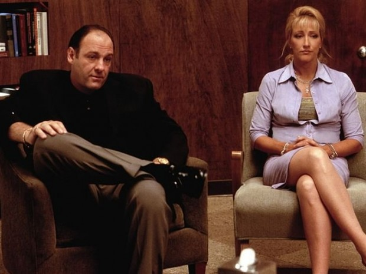
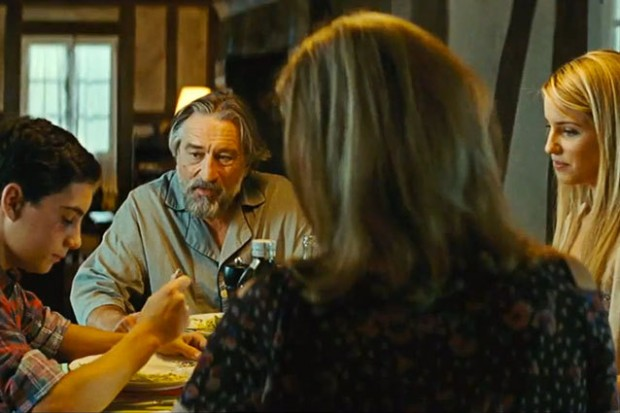

# **“**Esse problema não é meu!” (questões conjugais e os sintomas dos filhos)

Criança problema, aluno preguiçoso, aborrescência**.**

Olhar para os sintomas dos filhos como reflexos do que se passa na vida conjugal dos pais é desafiar essas visões tradicionais**.** A partir das experiências no trabalho clínico com queixas referentes aos problemas de aprendizagem, tive a oportunidade de aprender com meus jovens pacientes que, em muitos casos, **eles eram portadores de sintomas oriundos das dinâmicas conjugais dos pais****.**

Então, comecei a me interessar e investir esforços com os casais, com a visão de promover um melhor entendimento dos processos que envolvem a vida conjugal e seus reflexos no desenvolvimento dos filhos**.**

Tenho notado que, muitas vezes, as dificuldades manifestadas pelos filhos funcionam como uma cortina de fumaça para os conflitos familiares e conjugais**.** Isto é, quanto mais o comportamento de um filho se apresenta como problema, a atenção da família se volta para esse foco, fazendo com que os pais/casais não tenham que olhar para as próprias questões mal resolvidas**.**

É claro que o surgimento de sintomas comportamentais ou educacionais em uma criança não se limita a essa causa, mas vejo que esse fato, ainda desconhecido por muitas famílias, atua como força criadora/mantenedora das dificuldades de aprendizagem**.**

Quando isso é percebido no consultório, costumo fazer a seguinte pergunta para os pais:

> “Como está o casamento de vocês**?**”

Esse é um momento crucial no trabalho clínico, pois não é raro encontrar cônjuges que há tempos estão insatisfeitos em diversos aspectos do casamento; casais que utilizam a comunicação de forma rasa e burocrática, como ferramenta útil para resolver problemas do dia a dia, mas ineficiente para expor seus sentimentos; parceiros sem intimidade, portanto, sem conhecimento mútuo, entre outras questões**.**

Outro fenômeno que observo é a maior incidência de mulheres que procuram expor estas situações**.** Dizem, recorrentemente, que se sentem em conflito entre ter uma vida feliz e dar sentido aos seus desejos (já que os filhos estão crescendo) e ainda ter que suportar as tarefas de mãe-esposa-profissional impecável sem a ajuda e a admiração de seus maridos**.**

Quando questionados, muitos maridos relatam não entenderem a insatisfação das mulheres, já que elas têm os filhos — segundo eles, “se elas se realizam como mães, não precisam de mais nada na vida” –, uma casa confortável, um homem trabalhador e provedor, entre outros argumentos**.**

Nesse impasse, a comunicação do casal fica comprometida pela dificuldade de negociar as diferenças entre **o que se espera da relação e o que ela realmente pode proporcionar** a cada um dos cônjuges**.**

Não considerar e se aprofundar nessa questão (é isso mesmo… discutir a relação) empobrece um aspecto importante no desenvolvimento humano, do casal e da família: o auto-conhecimento**.** Sem essa consciência, surgem dificuldades em assumir, aceitar e lidar com as diferenças, fazendo com que, em muitas famílias, isso se torne um assunto, digamos, proibido, veladamente censurado**.**

Muitos pais/casais com quem converso são inteligentes, bem sucedidos profissionalmente, **mas inábeis em lidar com questões emocionais** por carecerem de auto-conhecimento**.** Resultado: o silêncio.

Aqui ocorre o que eu chamo de “não dito”, ou seja, o que existe nos relacionamentos mas fica camuflado, discretamente ignorado**.** Por exemplo: “sinto que o meu marido não me deseja mais” ou “queria que os meus pais se interessassem mais pelas coisas que eu gosto”**.**

Ignorar uma questão emocional significa deixá-la operar silenciosa e inconscientemente na própria vida e na família**.**

Seria como cultivar uma mensagem subliminar do tipo “aprenda, questione e comporte-se apenas dentro daquilo que suportamos, do que damos conta… o que está fora desse alcance, não serve, não pode, deixa pra lá**.**”

Oras, vivemos em um mundo de diversidades e a aprendizagem passa justamente pela análise crítica das diferentes formas de pensar, sentir, se comportar**.** Assim, o processo de aprendizagem fica seriamente comprometido pois reduz o aprender a uma série de memorizações de conteúdos para atingir resultados padronizados e análogos às limitações emocionais da família**.**

Digo questões emocionais pois se referem não somente ao que é avaliado pela educação formal, mas principalmente ao auto-conhecimento**.**

Nesse contexto, a riqueza interior do ser humano — que tem na diversidade uma de suas melhores qualidades — fica reprimida, censurada, oculta**.** A auto-estima não se fortalece, **pois não há uma construção do amor próprio**, mas sim a reprodução do que outro determina ser o amor correto, o afeto permitido**.**

O “não dito” funciona como peso morto, ancorando e dificultando o desenvolvimento; a aprendizagem, como fenômeno importante para a constituição de indivíduos (seres únicos, ímpares), não pode ser vivida de forma autônoma e autêntica, explicando as dificuldades de alguns jovens em assimilar, administrar e gerar conhecimentos sozinhos; a criatividade, como manifestação do ‘fazer diferente’, não vale, é censurada, nivelando a vida por baixo**.** E acaba por emburrecer, desinteressar, entristecer**.**

Para pedir ajuda, alguém na família tem que denunciar que algo está errado**.** Infelizmente, tenho constatado que isso ainda fica a cargo dos filhos**.**
