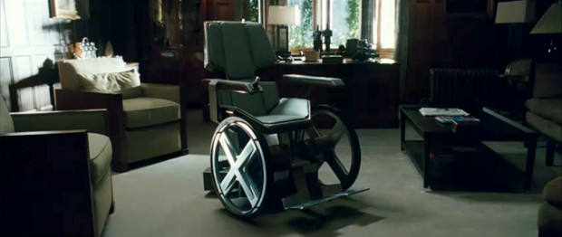
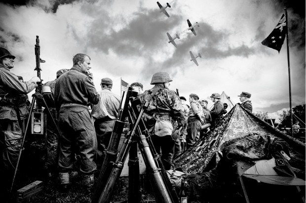

# **S**exo, dinheiro, força e poder: as prisões masculinas

Grande parte dos [pedidos de ajuda que chegam até a coluna ID](http://papodehomem.com.br/secoes/colunas/id/)  retratam homens que estão confessadamente desgastados, cansados de sustentar posições de força e sem liberdade perante impulsos mais emotivos e sua fragilidade**.** Na própria relação com amigos, homens se sentem desumanizados nessa [busca incessante pela vitória](http://papodehomem.com.br/quase-campeao-fui-derrotado/) , mesmo quando gostariam de [simplesmente relaxar](http://papodehomem.com.br/amor-saco-roxo/) **.**

Nunca nos perguntamos sobre as angústias de alguém que se fantasia de vencedor e depois não consegue se desgarrar dessa ilusão**.** Como você se sentiria em viver sem a liberdade de perder, fraquejar, descansar e errar**?**

Os homens nem sabem o quanto se torturam por realimentar uma cultura preconceituosa, prejudicial não só às mulheres (vítimas reais)**.** Mesmo tirando vantagens financeiras (homens ainda ganham mais que mulheres), sociais (privilégios e acordos favoritistas), físicas (ausência de sensação de ameaça numa rua solitária) e outras tantas, existe ainda um dever que perturba os homens**.**

Pode parecer um luxo de classe privilegiada falar do sofrimento em estar no topo**.** Porém, quero deixar claro um ponto**.** **O homem que tem a pretensão de **sempre**ser o Alpha está num processo silencioso de ameaça frente às condições de falência ao longo da existência**.****

Exatamente por tentar projetar para si e os outros uma força e capacidade imbatíveis, o homem fica exposto a múltiplas sobrecargas pessoais**.**

### 1. Sexualidade limitada

> “Homens vendem a ideia de uma hipersexualidade viril**.**”

[A sexualidade masculina é bastante falocêntrica e isso cria uma restrição pouco detectada](http://papodehomem.com.br/18-pornografia-o-conto-de-fadas-masculino/) **.** De modo geral, os homens foram enclausurados por si mesmos em desejos bem limitados**.**

Em tempos nos quais a liberdade sexual tem sido cada vez mais preconizada (e até superestimada), nos vemos presos a um passado ideológico asfixiante, machista e alienante**.** O olhar coletivo está condicionado a associar nudez com desejo sexual, sexo com penetração e prazer com finalização orgástica**.**

Até o desejo pelas mulheres é essencialmente visual e afobado**.** Essa escravidão do olhar binário do homem que categoriza as coisas num lugar ou outro é predatória para ele mesmo, que se vê impelido a comprovar sua virilidade**.**

Para administrar todas essas contradições, o homem precisaria de certa maturidade emocional de quem sabe lidar com seus desejos sem que sejam uma ordem, de quem pode apreciar a nudez sem que ela seja sexual ou [lidar com o sexo sem que se obrigue a ficar ereto](http://papodehomem.com.br/broxei-por-que-id-2/) **.**

### 2. Dívidas

> “Homens vendem a ideia de sucesso e provedor”

O que faz um homem se endividar não é ganhar pouco, mas ver os pedidos e desejos dos que o cercam serem barrados por sua “incapacidade” de prover**.** Para não deixar que os seus colegas arranquem em disparada com os carros de ponta na viagem para o point turístico enquanto ele naufraga nos centavos, prefere comprar a casa e o carro, mesmo sem reais condições**.**

Os bancos já perceberam isso e criaram toda a forma facilitada de crédito a juros altíssimos para que os homens vaidosos nadem nos mares do consumismo em busca de status**.**

O tropeço inevitável que se segue aos empréstimos e hipotecas é resultado dessa febre que não permite que o homem apenas diga não aos seus impulsos e às pessoas que estima agradar com bens materiais**.**

Nome sujo, para um homem, é como se tivessem arrancado sua perna e, mesmo assim, ele está sempre fazendo piquenique na beira do abismo**.**

### 3. Suicídio

> “Homens vendem a ideia de resistência ilimitada”

Para quem só tem opção vencer ou ser derrotado é tudo ou nada, sem chances de falha**.**

Os métodos usados para suicídio se distinguem entre os gêneros**.** Homens costumam ser mais efetivos.

Até para tirar a própria vida, não pode haver falha**.** Tiro, forca e queda do alto são os métodos favoritos para o tipo de pessoa que não pode ser associada com fraqueza, nem na hora de tirar a própria vida**.**

Meu bisavô materno se matou, segundo uma lenda familiar, por ter contraído sífilis**.** Diante da possibilidade de se ver incapaz numa cama ou de ser cuidado pela minha bisavó, preferiu estourar os tímpanos**.**

Infelizmente, a palavra desonra nunca pode ser associada a um homem num mundo dominado pelo machismo**.**

### 4. Doença, velhice e morte

> “Homens vendem a ideia de saúde e força inabalável**.**”

Com exceção do Professor Xavier (que não existe, vale lembrar), quando vemos um homem sentado numa cadeira de rodas, estranhamente tiramos a ideia de potência dele**.** A pergunta secreta, cabal e recheada de vergonha de si mesmo é: *“Será que o pinto dele sobe**?**”*

Entre médicos e enfermeiras, é senso comum atestar que os pacientes mais difíceis são do sexo masculino**.** A ideia de fazer um exame de rotina ou procurar um médico não passa na cabeça de muitos caras, que só vão se consultar com um médico em última hipótese, quase mortos**.**

Aliás, os homens morrem mais cedo do que as mulheres porque em média se cuidam menos e são menos atentos aos sinais corporais de disfunção**.** Prova disso é o trabalho realizado por proctologistas para convencer os quarentões a fazer o exame de próstata, que além de questionar sua força física ainda os expõe em sua vaidade de macho**.**

O ponto é que a velhice chega para todos e a quantidade de homens que entram num amargor pós-aposentadoria é muito alta, já que associaram força apenas com códigos sociais juvenis**.**

Homens não se aceitam morrer ou passar uma vida em vão, talvez por isso, muitos queiram se imortalizar numa árvore, num livro e num filho**.**

### 5. Solidão e distância afetiva

> “Homens vendem a ideia de autossuficiência”

Pedir ajuda, só em segredo**.** Expressar suas necessidades, nem sob tortura. É assim que opera a cabeça usual de quem foi ensinado a segurar o choro e mostrar os dentes para ser respeitado**.**

Enjaulado como uma fera, o homem [não costuma recorrer à sua rede de apoio para sair de uma fase difícil](http://papodehomem.com.br/solidao-masculina/) **.** Ele vai se blindando ao longo dos anos e endurecendo em convicções intelectuais que explicam qualquer fenômeno humano com meia dúzia de teses racionais**.** O máximo de ajuda que consegue obter é [uma rodada de bebida com os amigos](http://papodehomem.com.br/alcoolismo-id-6/) **.**

### 6. Bloqueio emocional

> “Homens vendem a ideia de que a vida prática e exterior é o que importa**.**”

Nada mais aterrorizante do que o pesadelo de se ver pelado diante do pátio do colégio, não é**?** Essa visão de extrema vulnerabilidade e passividade está no inconsciente mais primitivo de um homem**.**

Da mesma forma falar de amor, compromisso, medo e falência geraria frio na espinha do homem mais poderoso do mundo**.** Isso o colocaria numa posição de disponibilidade radical, completamente sem armas para lidar com os outros**.**

Essa impossibilidade de lidar com a fraqueza cria uma [reação contrafóbica](http://papodehomem.com.br/cao-que-morde-apenas-morde/)  de ter que se armar até os dentes**.** Como? Conquistando territórios, criando muralhas e se armando para defender seu espaço**.**

Homens matam e morrem pelo simples medo de encarar seu semelhante com a mesma dignidade e falência que ele tem**.** Diante de sua incapacidade psicológica de lidar com centenas de variações emocionais, o homem deixa escapar apenas raiva para manifestar tudo aquilo que sente**.**

### 7. Cegueira social

> “Homens vendem a ideia de que são inquestionáveis”

Estar sempre com a razão é motivo de vaidade para muitos homens, seja em diálogos pessoais ou comentários em site**.** A visão oposicionista – [eu e o outro, concordo e discordo, vencedor e perdedor](http://papodehomem.com.br/travo-quando-vejo-gente-melhor-que-eu-id-13/)  – turvam algum propósito mais profundo na vida e impede que os homens sigam transcendendo a necessidade de vitória**.**

Uma vida com significado é mais trabalhosa, mas é uma dedicação recompensada com brilho nos olhos, conversas enriquecedoras e [falas com conexão emocional](http://papodehomem.com.br/comunicacao-nao-violenta-o-que-e-e-como-praticar/) **.**

A obsessão por vencer na esgrima intelectual cria um tipo de glória solitária, já que as pessoas ao nosso redor se cansam, afastam e desistem de criar algum sentimento realmente significativo**.**

### 8. Tensão constante

> “Homens são ativos”

Como sempre assumimos a imponência e ação produtiva como resultado do esforço de macho, também nos trancafiamos num pragmatismo cego**.**

Qualquer dilema ou queixa que chegar até um ouvido masculino parece criar o dever de ser consertado ou solucionado**.**

Esse estado de mente sempre alerta do caçador pode parecer superficialmente uma vantagem nos negócios ou na vida social**.** Mas será que poderíamos obter algum tipo de aproveitamento em poder relaxar, contemplar, ou aceitar certas dissonâncias cognitivas sem converter tudo em tarefa**?**

### 9. Prisão amorosa

> “Homens devem ser assim”

Quando leio um pedido de “volta Dr**.** Love”, ouço menos por quem pede e mais o que pedem**.**

Eles pedem uma maneira mais simples, prática e objetiva de garantir resultados diante de impasses da vida amorosa**.**

Essa aparente sabedoria “máscula” revela uma limitação que nos impomos, a de ter que saber como agir diante de uma mulher**.** É como se houvesse um pedido de “não me faça pensar, me diga como ser” que é próprio de quem tem medo de suas próprias escolhas e seus fracassos**.**

Sem alguém para dizer o que temos que fazer, enfrentamos a condição ética de descobrir por experiência própria o que funciona de acordo com nosso temperamento, tipo físico, inteligência, traços de personalidade e visão de mundo**.**

Queria ouvir de vocês, reconhecem em suas vida algumas dessas prisões emocionais**?** Como lidam com elas?
