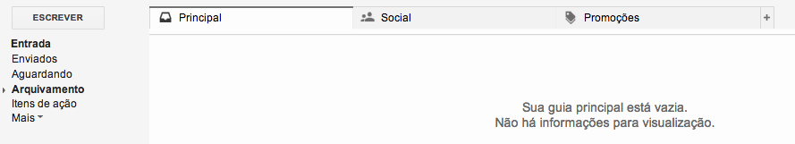

# **C**omo fazer a revisão semanal do GTD

Uma das técnicas que mais fazem o GTD dar certo é a revisão semanal**.** Você deve separar um par de horas em algum dia da semana para fazer isso**.** O David Allen recomenda que você faça na sexta-feira, pois sua mente ainda está fresquinha com os acontecimentos da semana**.** Eu costumava fazer nesse dia mas, no meu trabalho, sexta-feira é o dia mais corrido, então eu não estava conseguindo fazer a revisão com a cabeça tranquila**.** Por esse motivo, mudei o meu dia da revisão semanal para o domingo, pois estou descansada e pronta para me preparar para a semana**.**

Vejam como eu faço:

### 1**.** Coleto tudo na caixa de entrada do Evernote

Notas no meu caderno, e-mails com itens de ação, coisas que estão na minha cabeça: tudo isso vai para o caderno Inbox do meu Evernote**.**

As notas do meu caderno, depois de passadas para o Evernote, são riscadas**.** Se havia alguma informação sigilosa nelas (números de telefones ou documentos, por exemplo), eu risco bem forte para não correr o risco de deixar ali quando jogar o caderno fora**.** Essa ação é bem rápida e leva apenas alguns minutos, dependendo da quantidade de informações que anotei**.**

Os e-mails com itens de ação vão para a pasta “Itens de ação”, na própria caixa de entrada do e-mail**.** Também tenho uma pasta chamada “Aguardando”, com toda sorte de itens em espera**.** Demoro um pouco mais para coletar coisas de e-mails porque tenho quatro caixas de entrada e a ideia é deixá-las vazias**.** Como faço isso diariamente, na revisão semanal não demora tanto**.** Porém, há dias em que isso não é possível, então não deixo passar da revisão semanal**.**

No meu e-mail do blog, tenho uma pasta extra chamada “Responder”, para e-mails de contato de vocês**.** Isso facilita bastante porque, quando entro lá para responder esses e-mails, eles estão centralizados em um único lugar, tornando mais fácil a visualização**.**

É importante ter em mente que, ao longo da revisão, ideias surgirão**.** Você poderá estar revisando um projeto e lembrar de algo que poderia ser feito dentro dele**.** Basta inserir na sua caixa de entrada para processar**.** Não se prenda a este momento da coleta, pois muitas vezes não vem à nossa mente algo que poderíamos fazer a não ser que estejamos lendo sobre o projeto ou a área de foco em si**.**

Se você utiliza outras caixas de entrada, precisa coletá-las agora**.** Mensagens de voz no celular, SMSs, enfim, tudo o que você utilizar como recurso para coletar informações**.**

### 2**.** Verifico a minha agenda

Primeiro, vejo a minha agenda da semana anterior, para garantir que tudo foi realizado**.** Se algo ficou pendente, vai para a caixa de entrada para processar na sequência**.**

Segundo, vejo minha agenda para a semana seguinte**.** A ideia é verificar se há tarefas a serem feitas antes dos compromissos**.** Pautas para reuniões, algum preparativo adicional anterior, presentes para comprar (para aniversários), enfim, providências gerais que precisam ser tomadas**.** Tudo o que você precisar fazer, deve ser inserido na sua caixa de entrada**.** Jogue tudo lá!

O legal de ver o que vai fazer durante a semana também é saber quanto tempo você terá disponível em cada dia**.** Por exemplo, se você precisa entregar um relatório na quarta, mas na terça você tem muitos compromissos, então já pode se planejar para fazer o relatório na segunda**!**

Terceiro, verifico a minha agenda para as semanas seguintes**.** Isso ajuda bastante no caso de viagens, férias e outros compromissos que precisam ser planejados com uma antecedência maior**.**

Com a chegada do final do ano, então, eu já tenho tudo esquematizado até o início de 2014**.** Algumas coisas, para o ano seguinte também. No geral, o planejamento todo abrange de hoje a dois anos, pois são os projetos que tenho controle hoje**.** Mas vou falar sobre isso mais adiante.

### 3**.** Vejo a minha lista de objetivos

É importante ver o cenário macro antes de mergulhar nas tarefas e projetos cotidianos**.**

Eu separo meus objetivos (atualmente) em objetivos de vida, objetivos de longo prazo (de 5 anos para cima), objetivos de médio prazo (3 a 5 anos) e objetivos de curto prazo (de hoje a 2 anos)**.**

Objetivos não são projetos. Se você quer emagrecer 10kg, isso é um objetivo, não um projeto**.** Entrar em um programa de reeducação alimentar é um projeto relacionado a esse objetivo**.** Se você quer ser promovido na empresa, isso é um objetivo**.** Fazer a matrícula em um curso de francês é um projeto relacionado a essa objetivo**.** E por aí vai**.**

Portanto, é legal revisar esses objetivos, pois eles coordenam os projetos**.** Para ver como definir objetivos, leia [este post](http://vidaorganizada.com/organizacao/comece-a-se-organizar/analise-seus-objetivos-de-curto-medio-e-longo-prazo/ "Analise seus objetivos de curto, médio e longo prazo") **.**

A melhor coisa de revisar objetivos é vê-los realizados**.** Na minha última revisão, verifiquei que concluí mais três deles para este ano, e isso compensa todo o esforço**.** A hora de fazer isso é a revisão semanal.

Quando você define objetivos, automaticamente já consegue pensar em projetos que venham deles**.** E essa é a parte legal da revisão semanal: descobrir que tem algo que você pode fazer hoje para alcançar objetivos que pareciam mais distantes**.**

### 4. Reviso os meus projetos (nível macro)

Eu inicio a revisão pelos projetos em andamento**.** Também tenho projetos em espera e algum dia/talvez – ou seja, projetos que quero fazer, mas não agora**.** Ou porque não são prioridade, ou porque não tenho como encaixá-los mesmo, mas não quero perdê-los de vista**.**

Verifico se todos os projetos têm seu MPN (master project plan, ou plano mestre do projeto, que é uma nota com todas as informações do projeto, objetivo relacionado e organização da lista de tarefas)**.**

Verifico se todos os projetos têm tag própria funcionando**.**

Verifico se todos os projetos em andamento têm ao menos uma próxima ação**.** Se não tiverem, eu defino. Se não for possível definir, eles vão para “Algum dia/talvez” ou “Aguardando”**.** A diferença do “Aguardando” para o “Algum dia/talvez” é o que o “Aguardando” depende de condições externas ou terceiros para acontecer, enquanto que o “Algum dia/talvez” depende somente da minha disponibilidade**.**

Depois de revisar os projetos em andamento, eu reviso os projetos que estão “Aguardando” ou “Algum dia/talvez”**.** Vejo se algum deles já pode entrar na lista de “Em andamento”**.**

### 5**.** Processo a caixa de entrada

Tudo aquilo que eu joguei anteriormente na caixa de entrada deve ser processado e organizado nesse momento**.** Com as tags dos projetos em ordem, fica mais fácil de organizar para onde vai cada nota**.**

### 6. Reviso os meus projetos (nível micro)

Aqui é a parte onde a minha revisão demora mais tempo, porém considero uma das mais importantes: reviso as tarefas**.** Abro cada tag de projeto em andamento e vou revisando as tarefas para ver o que foi concluído, o que se tornou urgente, o que precisa ser feito essa semana, o que estava aguardando algo que já aconteceu etc**.**

Essa é a parte da revisão semanal onde eu priorizo as tarefas e as distribuo ao longo dos dias da semana, se for o caso**.**

Depois de revisar as tarefas dos projetos em andamento, dou uma olhada nos projetos concluídos, para verificar se não ficou nenhuma tarefa sem ser arquivada (e, consequentemente, atrapalhando a visualização das tarefas next action)**.**

Em seguida, verifico as tarefas dos projetos “Aguardando” e “Algum dia/talvez”, com a mesma finalidade**.** Também insiro novas notas para livros que gostaria de ler, filmes etc, da tag “Algum dia/talvez”, caso me tenha vindo à mente alguma dessas coisas**.**

### 7. Reviso as tarefas e projetos que foram delegados

Faço uma revisão para saber qual o status e se preciso tomar providências, como cobrar alguém, enviar um e-mail, fazer um telefonema etc**.**

É isso! A revisão semanal, se feita toda semana sempre, dura pouco tempo e te dá uma visão incrível de todos os projetos**.** A primeira pode ser mais dolorosa, pois você ainda estará pegando o jeito, mas com o passar do tempo ela durará muito menos tempo e será o suficiente para te deixar *on track***.**
