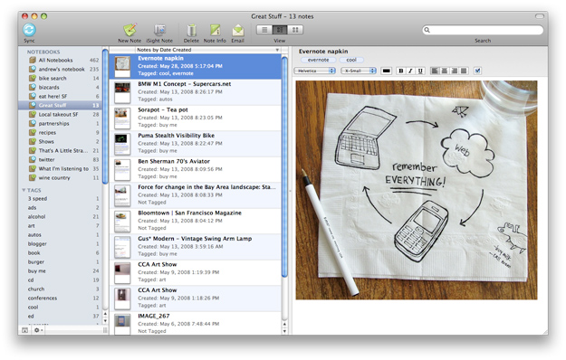
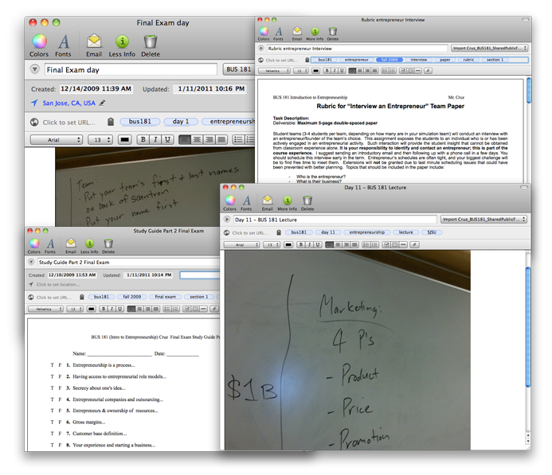

# **D**icas para professores: organizando suas aulas com o Evernote

Este ano foi a primeira vez que dei aulas**.** Era uma coisa que eu queria desde nova – cheguei até a entrar em uma faculdade de licenciatura, mas acabei saindo por não conseguir conciliar com o trabalho (já era formada e trabalhava na área)**.** Poder dar aulas em uma disciplina da pós-graduação tem sido muito gratificante, pois o foco é sempre na prática do mercado e é isso o que eu sempre espero de um curso, especialmente de gestão, como é o caso**.**

Como vocês sabem, tenho passado por uma imersão total no Evernote e estou utilizando a ferramenta para gerenciar absolutamente tudo na minha vida**.** Não poderia ter sido diferente com as aulas, então neste post eu vou explicar um pouco como venho fazendo e dando super certo, porque talvez possa ajudar outros professores que vivem por aí com seu monte de papéis**.**

Imagem: Theed Hub

Para começar, eu tenho uma tag de projeto com o nome da instituição e a turma**.** Assim: “! Instituição – Turma X”. Nessa tag, eu vou colocar absolutamente tudo relacionado a essa turma**.** Desde o início, quando estávamos no planejamento da disciplina, coloquei notas das minhas reuniões com as coordenadoras e informações diversas sobre as turmas, como por exemplo: em que pé está o TCC**?** que aulas já tiveram? Então, quando eu precisasse acessar algo relacionado a eles, bastava clicar nessa tag**.** Muito simples de administrar ao criar novas notas e mais fácil ainda de visualizar**.**

Também é extremamente útil para organizar trabalhos**.** Crio uma sub-tag dentro da tag principal da turma para cada trabalho**.** Em vez de pedir que me entreguem em formato de papel, peço que me enviem por e-mail**.** De lá, vai direto para o Evernote, onde eu tageio com a tag da turma e do trabalho em questão**.** No nome da nota, coloco o nome dos alunos, apenas para facilitar a visualização (mas, se eu tivesse um número enorme de turmas, ficaria inviável e deixaria o trabalho para a busca do Evernote mesmo)**.**

Para professores que recolhem trabalhos e provas em papel, não há muito o que fazer além de ter uma pasta por turma**.** Pelo menos é como eu faria se fosse o meu caso**.**

Imagem: Evernote.com

Dá para usar o arquivo de referência rápida (termo do GTD) para as aulas também**.** Quando preparo uma aula, suponhamos, para o dia 4, basta deixar todas as notas relacionadas a ela marcadas com o dia 4**.** Isso é legal porque facilita na hora de visualizar o que vou precisar para aquela aula específica**.** Quem tem muitas turmas pode se beneficiar com isso, especialmente se dá mais de uma aula por semana**.**

Outra coisa que eu faço é clipping de notícias e artigos interessantes que eu quero usar nas próximas aulas**.** Como nosso curso precisa de atualização o tempo todo, gosto de trazer os exemplos mais recentes para utilizar em sala de aula**.** Utilizo uma expansão do Google Chrome chamada Clearly que serve exatamente para isso – ela manda o artigo direto para o Evernote**.** A nota entra no meu caderno default (Inbox), e quando processo eu uso a tag da turma em questão e a da aula (também uso sub-tags para aulas)**.**

Tenho uma nota para cada aula e, nessa nota, eu faço um resumo de tudo**.** Primeiro ela é um brainstorm onde anoto o que o plano de ensino demanda e minhas ideias principais**.** À medida que vou montando a aula, vou adicionando mais informações ali**.** Coloco a agenda da aula, dizendo que fiz um exercício em sala, por exemplo, e faço um controle de quem entregou e quem ainda não entregou**.** Também subo o arquivo .ppt que usei em sala, além de linkar referências que utilizei para exemplificar (artigos, notícias, vídeos do YouTube)**.** Vira um verdadeiro roteiro para a aula**.** Ah, e deixo a nota marcada com o dia da aula, claro**.**

Quando as aulas acabarem para esta turma, eliminarei as sub-tags e deixarei somente a tag principal da turma em projetos finalizados (uso para isso uma tag chamada “Status – Concluídas”)**.**

Ainda lido com algumas coisas de papel, como o diário de sala**.** Como ele não fica comigo, mas sim na instituição (só pego na hora das aulas), não me atrapalha**.**

Também uso o Evernote para montar roteiros das aulas, salvar o plano de ensino e as apresentações de cada aula que eu dei**.**

### Outras dicas que podem ser úteis para professores usarem o Evernote

- Criar um caderno para cada turma e compartilhar com os alunos, para eles terem acesso a todos os documentos que você precisar disponibilizar**.** Não faço assim porque sou chata com a minha estrutura de cadernos mas, além disso, a instituição onde estou dando aulas possui um canal oficial para esse tipo de coisa, então não há necessidade**.**

- Faça diários de classe com um resumo do que aconteceu na aula em questão**.** Você pode tomar notas como “fulano participou bastante do exercício tal” ou “não esquecer que fulana pediu para sair mais cedo”**.** Você também pode usar esse pequeno resumo/diário para escrever sobre seus sentimentos com relação à aula, se estava nervoso(a), se acha que conseguiu passar o conteúdo, comentários dos alunos etc**.**

- Considere escanear trabalhos e provas e arquivar no Evernote, já com seus comentários**.** Você pode usar a câmera do seu celular para isso, enviando direto para a ferramenta, ou usar um scanner portátil**.** Pode dar trabalho, mas pelo menos você não precisa manter esse monte de papel com você quando as aulas terminarem**.** E também é bacana ter um arquivo do que foi feito, quando a gente entrega as provas e trabalhos para os alunos e acabamos ficando sem referência daquilo**.** Você pode querer mostrar algum trabalho ou resposta a uma pergunta que algum aluno tenha feito lindamente, e tendo isso arquivado no Evernote você encontrará muito rápido para apresentar em sala**.**

- Professores que orientam TCCs podem usar o Evernote para arquivar as diversas versões de trabalhos dos alunos juntamente com os comentários**.** Também podem gravar as reuniões de orientação, caso precisem de uma referência depois**.**

- Professores de educação infantil podem utilizar para guardar referências, desenhos para colorir e ideias no geral para cada faixa etária, tudo organizado com tags específicas para facilitar a visualização**.**

- Você pode incentivar os seus alunos a usarem o Evernote também, tirar fotos do quadro branco com o celular, arquivar trabalhos etc**.**

No geral, o Evernote é uma excelente ferramenta para todas as frentes e eu estou apaixonada, de verdade**!** Mas o que realmente faz a gente se organizar não é a ferramenta, mas a disciplina, a criatividade, o método**.** E isso a gente tem que ter quando é professor, especialmente se lida com mais de uma turma**!** Eu estou apenas começando, mas acredito que as dicas possam ajudar alguns professores com mais experiência também**.**

**Você é professora(a)**?** Utiliza o Evernote?**

Feliz Dia dos Professores para nós**!** Meu primeiro. <3
