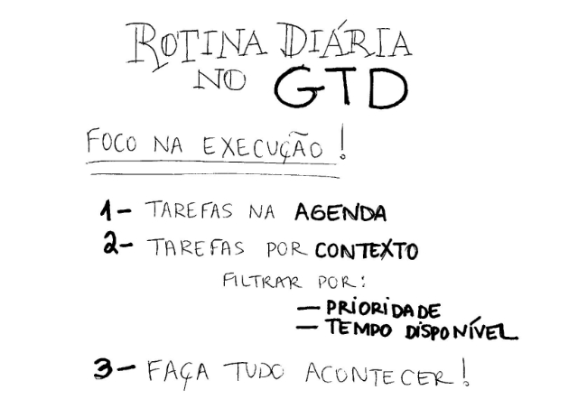

# **R**otina diária no GTD: foco na execução

Quando eu escrevi [aquele post \*nervoso\* sobre o ZTD](http://vidaorganizada.com/organizacao/referencias/gtd/ztd-x-gtd/ "ZTD x GTD") , recebi muitos comentários bacanas de retorno, o que me levou a aprender um pouco mais sobre as necessidades que as pessoas têm com relação ao GTD**.** Um equívoco comum é que “o GTD não tem foco na execução”, o que não está mais longe da verdade**.** O que acontece é que essa orientação não está muito clara no livro, ou então (acho mais provável) ela está tão lá na frente que a pessoa já está com a cabeça tão cheia de informações que acaba passando batido**.**

Basicamente, você precisa fazer uma revisão diária analisando dois pontos bastante simples, mas que orientarão a sua execução de tarefas**.** São os seguintes:

Chegou no trabalho**?** Verifique a sua agenda**.** Você já vê de cara a **quantidade de compromissos que tem no dia** e a **quantidade de tempo disponível** para outras tarefas**.**

A agenda também tem tarefas, lembretes e outras informações que você vai precisar naquele dia**.** É claro que tudo isso tem que ser organizado antes, quando você processa tal informação quando ela entra na sua caixa de entrada**.** Veja o fluxograma do GTD para entender como fazer isso**.**

Além dos compromissos, você verificará na sua agenda as **tarefas que precisam ser feitas naquele dia em questão****.** **Comece por elas****.** Tente não marcar mais de três por dia (por contexto), para não se sobrecarregar – mas isso só vale como recomendação, pois nem sempre temos essa opção quando lidamos com prazos de projetos**.**

Eu costumo fazer blocos de trabalho de 1h30, então paro um pouco, bebo água, descanso**.** Se eu “mato” as tarefas agendadas do dia nessa primeira 1h30, fico muito tranquila por ter resolvido o que era pendente e começo a trabalhar nas outras tarefas**.**

Depois de trabalhar nas tarefas agendadas, que precisavam ter sido feitas de qualquer forma no dia, você pode passar para as suas **listas de contextos****.** Ou seja, se você estiver no trabalho, acesse a lista @trabalho, ou a que você utilizar nessa ocasião**.** Dentro da lista do contexto, escolha a tarefa por **prioridade** (TOP primeiro, depois as de alta prioridade, média e baixa na sequência) e por **tempo disponível****.** Não adianta começar uma tarefa que demora 1h30 se você tem somente 25 minutos disponíveis**.**

Pronto, isso é o GTD**.** Com esse esquema simples, eu faço tanta, mas tanta coisa no meu dia a dia, que às vezes fico até impressionada**.** Com as tarefas bem esquematizadas, nada fica complicado ou pesado para fazer**.** Não tem nem como procrastinar, sabe?

Uma vez por semana, faço uma revisão geral dos projetos (a chamada revisão semanal do GTD), onde vejo se há brechas de tarefas que não tinha identificado antes, sem ver o cenário macro, se há tarefas que se tornaram obsoletas e por aí vai**.**

Para o dia a dia, no entanto, é somente o esquema acima**.** Não tem nada de complicado, gente. Nós que complicamos quando o sistema ainda não está implementado direitinho**.** =)

**Dúvidas, sugestões e comentários**?** Obrigada!**
