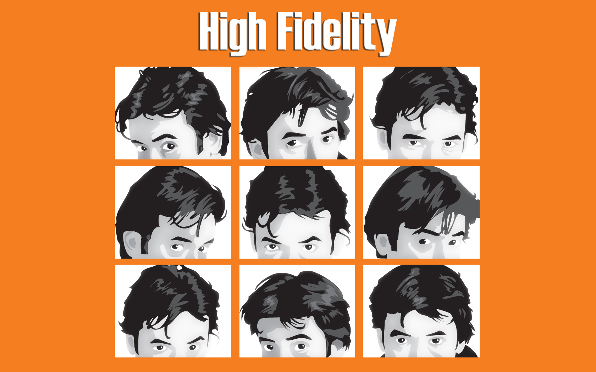
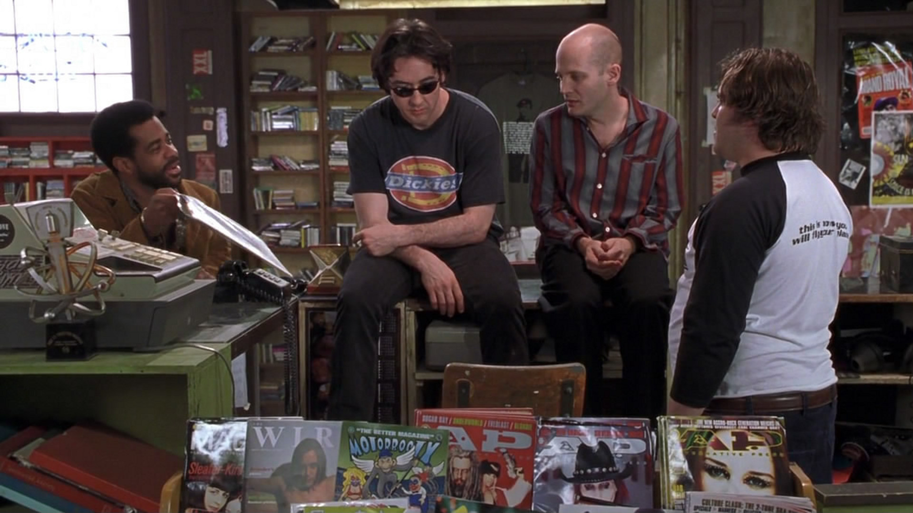
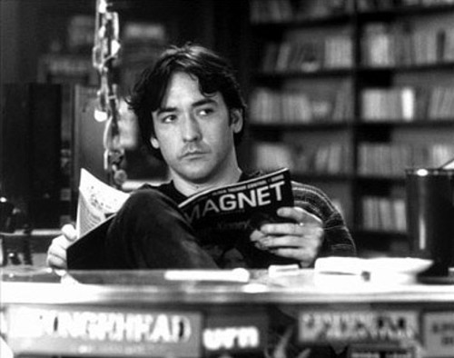

# [Crítica] Alta Fidelidade

Baseado na obra de [**Nick Hornby**, **Alta Fidelidade**](http://www.vortexcultural.com.br/literatura/resenha-alta-fidelidade-nick-hornby/)  é o 14° longa de **Stephen Frears** – de **Coisas Belas e Sujas** e **Terra de Paixões****.** Traz em seu conteúdo uma comédia intimista, pessimista e até conformista, dependendo é claro dos olhos que a analisam**.** Mais do que isso, **High Fidelity** é um filme sobre como as escolhas da vida são feitas e sobre o que se deve insistir**.**

**John Cusack** faz Rob Gordon, um rapaz já não tão jovem, com idade aproximada de três décadas, mas que guarda em seu estilo de vida algo de infanto-juvenil**.** Não é um *loser* completo por possuir uma loja de discos que mais se assemelha a um sebo nos moldes brasileiros, onde emprega dois desajustados que não saem de lá mesmo com os baixos salários que recebem, mas que ainda assim, se permitem acreditar que são melhores do que os clientes que por lá passam**.** Em uma fala, vinda de um amigo dos três, em que ele compra um disco raro e que o vendedor se recusara a vender para um cara “comum”, exemplifica bem essa máxima (que é também o resumo a auto-imagem que alguns blogs nerds brasileiros se encaixariam – entre eles, este Vortex Cultural):

**“- Por que o vendeu para mim e não para ele**?****  
**- Você não é tonto, Louis**.****  
**- Vocês são esnobes.**  
**- Não somos**.****  
**- É sério. São totalmente elitistas**.** Julgam-se os eruditos, depreciados e desprezam as pessoas que sabem menos que vocês, que é todo mundo**.****  
**- Sim**.****  
**- É muito triste, só isso.”**

Rob tem uma estranha tara por querer ranquear tudo, passando todo o seu tempo junto a Barry – **Jack Black** – fazendo listas *Top 5*, de setlists, bons filmes ou momentos marcantes da vida**.** Tais ações lembram muito os maneirismos do comportamento obsessivo, a ânsia por qualificar a tudo e a todos é reflexo de outra máxima dos personagens, de que o que faz uma pessoa importante é o que o indivíduo gosta, não o que ele é**.** A declaração soa superficial, e é, segundo o protagonista, mas corresponde a realidade daqueles que são mostrados em tela, e é obviamente crível visto a ótima construção dos personagens**.**

A estrutura narrativa que **Frears** escolheu não poderia ser melhor, a narração de Rob tratando de quase todos os assuntos diretamente com o público não soa estranho em momento algum, e deixa de ser estranha com poucos momentos de exibição**.** O modo como o conjunto de nerds é retratado é engraçado, pitoresco, mas não é super caricato**.** A falta de tato social dos personagens é mostrado de forma verossímil, e eles não precisam ser os estereótipos em todo o tempo, cada um deles é mostrado com nuances, complexidade e dimensionalidades múltiplas**.**

As relações mostradas constituem um dos pontos fortes do roteiro, que contempla na relação de Rob e Laura – **Iben Hjejle** – uma linha guia, mas que ramifica por cada um dos namoros que ele teve durante sua vida**.** O resgate aos momentos anteriores de sua vida representam em alguns momentos nostalgia e em outros pontos de puro terror,  mas tem em comum a interessante tarefa de análise do caráter e do comportamento de Rob diante das tão temíveis relações amorosas, explicitando as inseguranças e os medos do sujeito medíocre diante do temível gigante chamado solidão – que se solidifica com a decisão dele de parar de pular de galho em galho**.** Gordon não termina o filme como um sujeito perfeito, mas demonstra que seu personagem evoluiu, e aprendeu que deve tentar se arriscar mais, ousar e tentar ser algo mais além do ordinário**.**

Apesar da mensagem final ter um tom de auto-ajuda, a criatividade em como as coisas se desenrolam passam por cima de qualquer possibilidade de pieguismo barato, graças ao roteiro de **Cusack**, **Steve Pink**, **Scott Roserberg** e **D V DeVincentis**, além é claro, da portentosa lente de **Stepher Frears**, que soube condensar todo o humor cáustico e nonsense com toda a metalinguagem presente no script e tirando de seu elenco as melhores atuações possíveis**.**

Nota:
