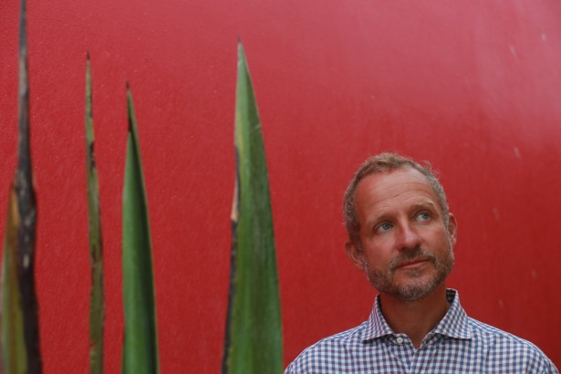
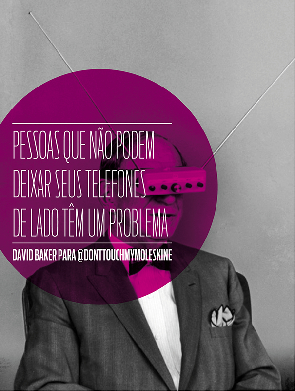
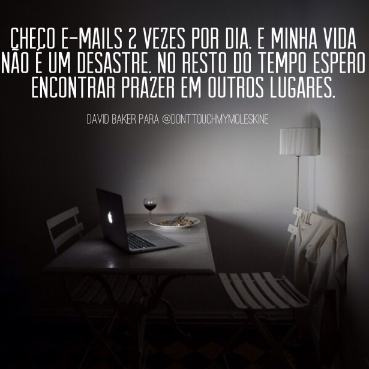
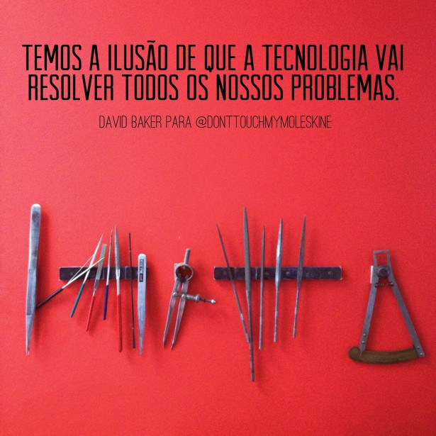
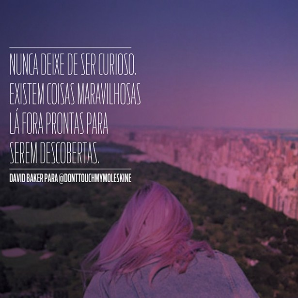

# **P**or uma vida mais off-line » don't touch my moleskine

[David Baker](http://davidbakeronline.com/)  checa email duas vezes por dia, acha extremamente rude manter uma conversa com alguém que não tira os olhos do celular e só conseguiu usar o Facebook por um mês (e odiou a experiência)**.** O comportamento frugal em relação à tecnologia vem da experiência que ele tem na área: há mais de três décadas ele pensa, escreve, faz consultorias e dá aulas sobre o assunto**.** Por anos foi editor-chefe da versão inglesa da [revista Wired](http://www.wired.co.uk/) , a bíblia da tecnologia, e hoje é professor na [The School of Life](http://www.theschooloflife.com/) , a escola criada por Alain de Botton e Roman Kznaric ([“Escola da vida” criada em Londres planeja versão brasileira](http://donttouchmymoleskine.com/alain-de-botton-para-a-serafina/)  + [Como encontrar o trabalho da sua vida](http://donttouchmymoleskine.com/como-encontrar-o-trabalho-da-sua-vida-uma-entrevista-com-roman-krznaric/) )

Nos anos 1980, Baker deixou o emprego em um escritório de relações públicas e teve que aprender duas coisas: como ganhar dinheiro sendo seu próprio empregador e como lidar com o tempo para tirar o melhor proveito dele**.** “Acredito muito que devemos trabalhar o mínimo possível, da maneira mais esperta que der**.** Acho que somos capazes de coisas maravilhosas, mas, especialmente no trabalho, fazemos com que ele dure muito mais que o necessário”, disse ele ao Don’t Touch**.**

Em uma época em que o lema era “work hard, play hard”, Baker decidiu não ser um yuppie**.** “Tomei uma decisão de trabalhar menos, ganhar menos e gastar menos**.** Vivo confortavelmente, não sou um milionário**.** Entre os meus amigos, provavelmente, sou o que ganha menos, mas sou o que tem mais tempo**.** E pra mim essa troca foi bonita**.**”

Viver com menos talvez tenha sido o primeiro passo para que Baker começasse a entender que esse comportamento também poderia ser levado para o mundo digital, que funciona em uma velocidade e com um volume de dados impossíveis de acompanhar**.** “Precisamos reconfigurar nossa relação com a tecnologia**.** Em vez de usar toda a tecnologia disponível pra viver nossas vidas, nós temos que viver as nossas vidas e usar a tecnologia como ferramentas extras para isso**.** Se nós não fizermos isso, nos tornaremos escravos”, diz ele**.**

Conversei com o David na última terça-feira, ao fim do intensivo que ele deu na versão brasileira da [The School of Life, em São Paulo](https://www.facebook.com/theschooloflifebrazil) **.** No próximo sábado, às 11h, ele fala sobre “Tecnologia e Humanidade” no sermão da escola, que acontece no Teatro Augusta**.** Ainda há ingressos, aproveitem > <http://www.theschooloflife.com/shop/david-baker-sobre/>

O papo foi daqueles demorados e deliciosos, em que a gente vai ouvindo cada frase com total atenção (e com o celular no modo avião, por favor**!**), aprendendo com a experiência de quem se dedica ao assunto há muito tempo e pegando dicas para incorporar na vida atitudes que levam a um comportamento digital mais saudável**.**

Espero que vocês gostem! ♥

**- Tem um livro que eu gosto que fala que nós esperamos mais da tecnologia do que uns dos outros**.** O que você acha disso?**

Meu tema para este ano, porque eu trabalho para a Wired e porque ensino na School of Life, é tentar investigar o que acontece quando seres humanos e tecnologia colidem**.** A tecnologia está se tornando cada vez melhor mais rapidamente e isso não vai parar**.** E isso nos traz problemas**.** O primeiro é que nós temos expectativas diante da tecnologia que são despropositadas, temos a ilusão de que a tecnologia vai resolver todos os nossos problemas**.** E não é verdade**.** Existe um “solucionismo”. Tenho um problema e penso que vai existir uma tecnologia para resolvê-lo**.** E não é o caso. Tecnologia é ferramenta**.** O que nós precisamos é reconfigurar nossa relação com a tecnologia**.** Em vez de usá-la para viver nossas vidas, nós temos que viver as nossas vidas e usá-la como ferramentas extras para isso**.** Se nós não fizermos isso, nos tornaremos escravos. Isso aconteceu na Revolução Industrial**.** Quando as indústrias de fábricas cresceram, as vidas de várias pessoas ficaram piores, mesmo com muita gente pensando que aquilo era sinônimo de progresso**.** Começamos a descobrir coisas como poluição, o som constante das máquinas**.** Aí mudamos essa relação. A nossa relação com a tecnologia hoje ainda é adolescente e agora estamos começando a nos tornar adultos**.**

**- Por que você acha que nós estamos tão viciados em likes e comentários**?****

Por duas razões**.** É realmente excitante quando as pessoas dão like em alguma coisa que nós postamos**.** É como ser um ator em um filme, é como se fôssemos famosos**.** Tem uma platéia ali, de maioria de pessoas desconhecidas**.** “Estranhos gostam do que eu digo**?** Que bom!”. E nós podemos ter números. Conheço pessoas no Twitter que entram em competições para ver quem tem mais seguidores**.** Existe uma idéia de que podemos ser melhores por causa dos números**.** E o que ferramentas como Twitter e Instagram fazem é o que os psicólogos chamam de reforço intermitente**.** É como um jogo de azar. Vencer é o like, que vem de maneira randômica**.** Continuo jogando roleta porque a próxima rodada pode me fazer ganhar**.** Continuo postando pra ver se vem um prêmio. Pessoas que não podem deixar seus telefones de lado têm um problema psicológico**.**

**- Há estudos que dizem que esse vício é químico também**.** Quando checamos email e tem uma mensagem nova, o cérebro libera dopamina**.** Ficamos animados e queremos de novo.**

Nós temos que entender onde está a dopamina em outras áreas da nossa vida**.** Não é certo sentir prazer em checar email. É ridículo. Email é uma coisa prática para comunicação**.** Nós precisamos pensar: por que estou procurando meu prazer aqui, se poderia fazer isso de uma maneira que me preenchesse mais**?** Eu checo emails duas vezes por dia, geralmente**.** E minha vida é ok, não é um desastre. No resto do tempo eu espero encontrar prazer em outros lugares**.**

**- E como você chegou a essa dinâmica de checar email duas vezes por dia**?****

Quando me tornei o editor-chefe da Wired em Londres, comecei a receber centenas de emails**.** Eu passava o dia lendo emails, e os projetos que eu precisava fazer, como criar uma edição digital, não iam pra frente, pois eu não tinha tempo**.** Daí decidi reduzir essa exposição. Sou velho o suficiente para lembrar que a comunicação era feita por correios**.** Quando comecei a trabalhar, a comunicação vinha duas vezes por dia**.** Recebíamos alguma coisa, pensávamos na resposta, escrevíamos, enviávamos**.** E o trabalho funcionava do mesmo jeito. Decidi checar email às 11h, depois às 16h. Também desliguei o voicemail do meu telefone, para que as pessoas não pudessem deixar mensagens**.** Desliguei as notificações do Outlook. Isso mudou a minha vida completamente**.**

**- Queria conseguir fazer isso**.****

O que falamos aqui na School of Life é de ir experimentando**.** Tente por um dia, veja o que acontece. Depois por dois e assim por diante**.**

**- Estamos sempre conectados, mas frequentemente nos sentimos sozinhos**.** Isso é um paradoxo ou é um sentimento que está se tornando real para cada vez mais pessoas**?** Qual é a importância de saber ficar sozinho?**

É irônico, né**?** Quanto mais conectados, mais nos sentimos sozinhos**.** O que acontece é a Fomo (fear of missing out), o medo de perder as coisas é um sentimento muito profundo, principalmente para quem vive em grandes cidades**.** O que acontece é que na internet vivemos em “megalópolis”**.** Não consigo lembrar quantos membros o Facebook tem, mas vivemos numa população de bilhões**.** O que a internet promete é conexão e compartilhamento, mas o que entrega é mais uma sensação do que estamos perdendo**.** Nós pensávamos que a internet iria aumentar a diversidade, mas, em vez disso, as pessoas tendem a se comunicar com quem já conhecem, a criar pequenos grupos**.** E também não existe fronteira de tempo. Preciso estar conectado**.** A idéia de estar sempre conectado é ainda mais jovem que a internet, veio com a conexão banda larga**.** Nós olhamos como um direito que sempre existiu, mas em 1990, 1992, você tinha que ligar para um número, se conectar na internet, fazer seus negócios, se desconectar**.** Tínhamos uma atitude diferente: vou me conectar, falar com as pessoas, me desconectar**.** Mas o “always on” nos dá a ilusão de que temos que estar conectados o tempo todo, o que é um problema, porque, quando a conexão cai, a gente enlouquece**.**

**- E qual é a importância de saber ficar sozinho**?****

Nós geralmente estamos sozinhos e é importante que a gente entenda que isso vem com coisas boas e ruins**.** No Brasil a palavra é uma só: solidão. Na Inglaterra, temos duas: loneliness e solitude**.** A primeira é ruim, a segunda é boa. Uma investigação que podemos fazer é como tornamos o sentimento de nos sentirmos solitários em solidão**.** Ficar sozinho não precisa ser uma coisa ruim. Porque a internet é baseada em conexão, quanto menos você tem parece que é pior**.** Mas esses momentos quando estamos sozinhos de uma maneira boa são momentos de pensamentos profundos que podem nos levar a descobertas maravilhosas sobre o que somos capazes de fazer**.** E pra mim estamos aqui na Terra para descobrir o potencial dentro da gente e crescer e aproveitar para fazer as coisas nas quais somos bons, que nos deixam animados e felizes**.** Algumas vezes a gente precisa ficar sozinho para descobrir isso**.** E o que acontece com a internet é que ela está sempre lá, nos chamando**.**

**- Tem um outro livro, “The Information Diet”, que diz que nós estamos ficando obesos não apenas nos nossos corpos, mas em nossos cérebros, devido ao lixo de informação que consumimos**.** O que você acha disso?**

Informação hoje na internet tem que gritar para ser ouvida**.** Acho que a quantidade de dados que trafega na internet em um mês é de 40 exabyte**.**

**- Eu nem sei o que é um exabyte**.****

Exatamente. O interessante é que 5 exabytes é número total de palavras ditas pelos seres humanos em toda a história**.** Oito vezes isso circula na internet todo mês. É astronômico. Para ser ouvido, as coisas precisam gritar**.** Não é diferente do mundo, onde tem milhões de pessoas que nunca vamos conhecer**.** O cérebro funciona como uma banda larga doméstica**.** Não temos como lidar com todos esses dados. Popularizam-se coisas como vídeos de gatos, que são brilhantes**.** Parece que tudo é muito efêmero. Como eu cultivo solidão na minha vida**?** A internet é incapaz de responder isso. A velocidade da internet nos desencoraja a pensar mais lentamente**.** Agora o relógio nos faz pensar em resultados instantâneos**.** O Google nos dá resultados em frações de segundos. Nós somos encorajados a consumir os dados ruins, mas também a não pausar e resistir e ir procurar outro tipo**.**

**- Me parece que estamos preguiçosos, vivemos numa época em que parece que tudo é o Buzzfeed**.** Amo o Buzzfeed, mas ninguém lê um texto grande na internet**.****

Quando lançamos a Wired em Londres, uma publicação impressa, decidimos escrever textos longos, com 4 mil palavras**.** Eu achava que não ia dar certo, mas se tornou muito popular**.** A gente queria que as pessoas parassem por 20, 30 minutos e contemplassem, aprendessem alguma coisa**.** A velocidade também nos deixa preguiçosos para a especulação**.** Conhecimento vem da especulação, da conversa. Se eu falo pra você que o Azerbaijão é maior que o Cazaquistão, e você diz que não, temos uma conversa**.** Hoje vamos ao Google e resolvemos a questão muito rapidamente**.** Paramos de trocar as informações que tínhamos. Podemos até não chegar na resposta, mas na jornada para a resposta, aumentamos nosso conhecimento**.** Com o Google a gente tem a resposta, mas vamos esquecer no outro dia ou não vamos ter aumentado nosso conhecimento**.** Sinto falta disso**.** Quero ser um evangelista da especulação. Quero que as pessoas deixem o Google de lado e investiguem o que têm em suas cabeças**.**

**- Como nós podemos tirar o máximo da internet, de uma boa maneira**?** Quais são os sites que você costuma checar diariamente**?****

Não tem nada que eu veja todo dia**.** O Google eu uso todo dia. Adoro todas as ferramentas deles. Fico muito feliz em dar todos os meus dados para eles em troca dessas ferramentas gratuitas**.** GDocs, Gmail são coisas incríveis. Eles me ajudaram a pensar melhor, a me organizar, a lidar com colegas**.** Obrigada, Google! Além disso, amo o Gawker, leio por entretenimento**.** Amo a Wikipédia, acredito muito nela. O que tento fazer é usar a internet sem usar a internet**.** Gosto de tirar tempo fora dela, me desconectar. De repente tenho esse tempo incrível em que leio um livro ou uso um pedaço de papel e lápis para colocar meus pensamentos**.** São sempre tempos melhores.

**- Você está no Facebook**?****

Não. Eu tentei por um mês e detestei**.** Em princípio não tenho nada contra. Mas velhas informações ficavam aparecendo pra mim, demandando minha atenção**.** Tenho muitos amigos que eu vejo no mundo real e essas conexões com eles, falando no telefone, indo na casa ou recebendo na minha, são conexões melhores**.** Eu fazia log in e ficava aterrorizado. Preferi me desconectar, ir pra fora, investigar algo nos meus termos**.** A ironia é que não fechei minha conta, um pouco tempo depois tive que escrever para um site que estava em beta e eu precisava logar pelo Facebook**.** Fiz uma página e hoje tenho 0 amigos. Eu sou o loser do Facebook e sou muito feliz com isso**.**

**- Será que temos que criar momentos específicos para usar a internet**?** Está em tempo de seguirmos uma etiqueta virtual**?****

Eu odeio quando as pessoas estão olhando para o telefone enquanto estão tendo uma conversa comigo**.** Eu realmente odeio isso**.** Parece não apenas rude, mas também meio idiota. Acho que uma das coisas mais bonitas que você pode fazer na vida é dar sua atenção completa a um ser humano, é um ato de amor**.** E é o que faz a conversa cara a cara tão melhor do que a pelo Skype**.** Quando estamos na presença de outra pessoa, podemos dar toda a nossa atenção a ela, e eles nos dão de volta**.** E nós chegamos a um lugar tão mais profundo, que nos preenche, do que quando temos conversas no mundo digital**.** O que prejudica isso é quando as pessoas são distraídas pelos seus telefones**.** Um amigo meu lançou uma acampanha em Tel Aviv para deixar os telefones virados pra baixo**.** Isso está começando a ficar popular por lá. É muito legal pensar: onde está meu telefone agora**?** O meu está no bolso. E prefiro que as pessoas deixem no bolso ou virado pra baixo, no silencioso**.** Se não a mensagem fica apitando e você vê os olhos da pessoa procurando**.** É rude. Sei que pareço um homem velho, mas acho que é rude pra todo mundo, inclusive para um menino de 14 anos**.** Quando estamos com outra pessoa essa é a pessoa mais importante, não as que estão online**.**

**- Como você organiza sua rotina para dar conta de fazer tudo**?****

Acredito muito que devemos trabalhar o mínimo possível, da maneira mais esperta que der**.** Acho que somos capazes de coisas maravilhosas, mas, especialmente no trabalho, fazemos com que ele dure muito mais**.** É o sistema. Nós pagamos as pessoas por hora, dia, mês**.** Elas não são encorajadas a trabalhar com rapidez, mas sim devagar**.** Eu trabalho pra mim. Se alguém me pede pra fazer uma coisa, é uma vantagem se eu fizer rapidamente**.** Quanto mais espaço você tem na sua vida, mais coisas boas acontecem**.** Eu tomei uma decisão há alguns anos de trabalhar menos, ganhar menos e gastar menos**.** Vivo confortavelmente, não sou um milionário. Entre os meus amigos, provavelmente, sou o que ganha menos, mas sou o que tem mais tempo**.** E pra mim essa troca foi bonita. Como resultado, quando trabalho, faço isso de maneira esperta e satisfatória para mim e para as outras pessoas**.**

Em casa, meu ritmo. Descobri recentemente que gosto de acodar cedo. Vou para cama às 22h30, acordo às 7h**.** Sou inglês, preparo um chá, levo meu laptop pra cama, passo umas duas horas, faço o primeiro turno de emails**.** Escrevo alguma coisa**.** Está tudo calmo lá fora, não tem ninguém por perto**.** Como resultado, a maioria das coisas que preciso fazer estão acabadas às 9h**.** Gosto de, todo dia, estar em um lugar analógico. Gosto de nadar em água fria num lugar aberto**.** Pego minha bicicleta. Tem água, floresta, pássaros, é o oposto da internet, é analógico**.** E gosto de passar tempo nesse mundo. Quando volto, faço o segundo turno de emails e o dia chega ao fim**.** Em escritórios nós perdemos tempo. Não precisamos ser escravos**.** Especialmente pessoas que todos os dias ficam até tarde no trabalho**.** Eu não acredito que elas tenham tanto para fazer todos os dias**.**

**- Quem são suas inspirações**?****

Eu me inspirei em mim mesmo**.** Trabalhei para duas empresas de relações públicas em Londres, nos anos 1980, numa época yuppie, de “work hard, play hard”**.** Saí da empresa, tive que entender como funcionava a vida de alguém que se emprega**.** E me dei conta de que o meu tempo era muito importante**.** Fiz um trabalho com uma consultoria sobre gerenciamento de tempo**.** Comecei a pensar em qual é o ponto de estarmos no mundo**.** E sempre fui atraído por pessoas que vivem de um jeito mais simples, que têm um propósito**.** Mais do que as pessoas que ostentam. Por necessidade, sem dinheiro, entendi que precisava fazer alguma coisa boa com o meu tempo**.** E depois se mostrou um valor viver assim. Sou religioso, judeu, tem um profeta que diz: você pergunta o que é ser bom**.** E eu digo: você deve procurar a justiça, amar a misericórdia e andar humildemente com o seu Deus**.** Gosto de andar humildemente**.**

**- Você tem um mantra de vida**?****

Nunca deixe de ser curioso**.** Existem coisas maravilhosas lá fora prontas para serem descobertas**.**

Créditos das imagens: 1) The School of Life; 2) do Pinterest; 3) Julien Mauve; 4) Daniela Arrais; 5) Tim Barber**.**

Agradecimentos especiais a Cris Naumovs, Carol Almeida, Júlia Veras, Raquel Ferraz e Luiza Voll**!** ♥

[anexo ausente]5891 [anexo ausente]104 [anexo ausente]43
