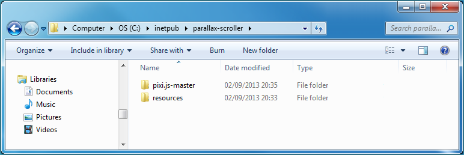
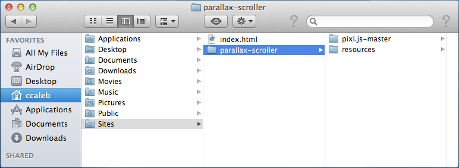
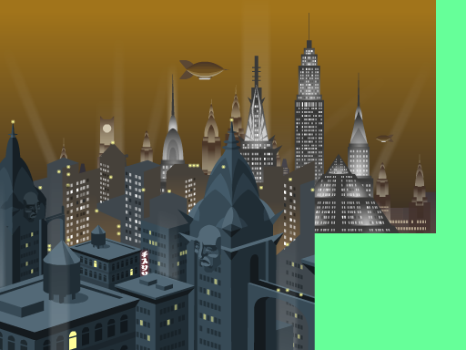

# **B**uilding a Parallax Scrolling Game with Pixi.js


*By [Christopher Caleb](http://flippinawesome.org/authors/christopher-caleb)*

Have you ever played endless runner games like [Canabalt](http://www.adamatomic.com/canabalt/)  and [Monster Dash](https://chrome.google.com/webstore/detail/monster-dash/cknghehebaconkajgiobncfleofebcog?hl=en)  and wondered how they build their scrolling game maps**?** In this tutorial we’ll take our first steps towards building a similar parallax scroller using JavaScript and the [Pixi**.**js 2D rendering engine](http://www.pixijs.com/) .

### What you will learn…

- The fundamentals of Pixi**.**js
- How to work with textures and tiling sprites
- How to implement simple parallax scrolling

### What you should know…

- A basic understanding of JavaScript

JavaScript is everywhere**.** Thanks to ever increasing browser maturity and the plethora of JavaScript libraries that are out there we’re really starting to see HTML5 games development flourish**.** But with so many libraries available, part of the challenge has become picking the right ones to work with**.**

This tutorial will introduce you to the basics of JavaScript game development and focus on the Pixi**.**js library. Pixi.js is a new 2D rendering framework which supports both WebGL and HTML5 Canvas**.** By the end you will have built the following horizontal parallax scrolling game map:

[](http://www.yeahbutisitflash.com/pixi-parallax-scroller/final/index.html)

Clicking on the image above will launch and run the final version of the scrolling map that you will be working towards**.** Notice that it contains three parallax layers: a far layer, a mid layer, and a foreground layer**.** In this first tutorial we’ll implement some basic parallax scrolling by concentrating on just the far and mid layers**.** And of course, to do that we’ll cover the basics of Pixi**.**js. Also, if you’re new to JavaScript then you should find that this is a good place to start learning the basics of HTML5 games programming**.**

Before we proceed, click on the image above to see a running demonstration of what you’ll actually build during this tutorial**.** You can also [download this tutorial’s source code](http://github.com/ccaleb/pixi-parallax-scroller)  from GitHub**.**

## Getting Started

For development you’ll need a suitable code editor or IDE**.** I’ll be using Sublime Text 2, a trial version of which can be downloaded [here](http://www.sublimetext.com/2) **.**

You’ll also obviously need a web browser to test your work**.** Any modern browser should do but I’ll be using Google Chrome and covering some of its developer tools during the course of these tutorials**.** If you don’t have Chrome installed then get it from [here](http://www.google.com/chrome) **.**

To test your work, you’ll also need to run a local web server on your development computer**.** Microsoft Windows users can [set-up IIS](http://www.yeahbutisitflash.com/www.howtogeek.com/howto/windows-vista/how-to-install-iis-on-windows-vista) , while Mac OS X users can [configure and run the built-in Apache web server](http://macdevcenter.com/pub/a/mac/2001/12/07/apache.html) **.** If you have OS X Mountain Lion installed then setting up your web server is a little less straightforward than it used to be**.** Check out [this resource](http://reviews.cnet.com/8301-13727_7-57481978-263/how-to-enable-web-sharing-in-os-x-mountain-lion/)  to get Apache up and running on Mountain Lion**.**

> If you have a web hosting package then you can simply upload your files and test them from there rather than setting up a local web sever**.** Alternatively if you have a [Dropbox](https://www.dropbox.com/)  account you can host the files there via a service like [DropPages](http://droppages.com/) **.**

Once your web server is set up, create a new folder within its root and name it `parallax-scroller`**.** If you’re using Windows then the path to your web server’s root folder will likely be `C:\inetpub\parallax-scroller`**.** If you’re using OS X then the path to your personal web folder will likely be `/Users/your_user_name/Sites`**.** Remember to replace `your_user_name` with your actual username**.**

Since we’ll be working with Pixi.js in this tutorial you’ll need to download it. Pixi**.**js is [hosted on GitHub](https://github.com/GoodBoyDigital/pixi.js) . Simply click the ”Download ZIP” button near the bottom-right corner of the screen to commence the download**.** Once downloaded, copy and extract Pixi.js to your `parallax-scroller` folder**.**

Within the `Pixi.js-master` folder is a sub-folder named `bin`**.** It contains two JavaScript files: `Pixi.js` and `pixi.dev.js`. Both files represent the Pixi.js rendering framework. The first represents the production version, which you should use once you are ready to release your game to the world**.** The second is designed to help during development and provides better error reporting at the cost of performance**.** We’ll be using `pixi.dev.js` throughout this and future tutorials.

Finally, we’ll be working with a couple of graphics assets during the course of this tutorial**.** Rather than have you create your own, I’ve provided a zip file for you to [download](http://www.yeahbutisitflash.com/pixi-parallax-scroller/tutorial-1/resources.zip) **.** Download this file and extract it within your `parallax-scroller`folder**.**

Here’s how your **parallax-scroller** folder should now look on Windows:

[](http://flippinawesome.org/wp-content/uploads/2013/11/pixi-folder-win.png)

If you’re a Mac OS X user then your folder structure should look like this:

[](http://flippinawesome.org/wp-content/uploads/2013/11/pixi-folder-mac.png)

Now we’re ready to begin coding**.** Launch Sublime Text 2 or your own favorite code editor**.**

## Setting up the Canvas

Every Pixi**.**js project starts from an HTML file. From here we’ll create an HTML5 Canvas element and also include the Pixi**.**js library. The canvas element represents the area on the HTML page where our scroller will be rendered**.**

Create a new file within Sublime Text 2 by selecting ”File | New File” from the drop-down menu**.** Now before we start, select ”File | Save As…” and save it within the root of your parallax-scroller folder as `index.html`**.**

Okay, let’s start with a minimal HTML page**.** Add the following to your `index.html` file:

```
<html>
  <head>
    <meta charset="UTF-8">
    <title>Parallax Scrolling Demo</title>
  </head>
  <body>
  </body>
</html>
```

It’s all fairly straight forward at the moment**.** We have a basic HTML page with a `<head>` and `<body>` element**.**

Now let’s add our HTML5 Canvas element to the page**.** Simply add the following lines between the `<body>` element and then save your file:

```
<body>
  <div align="center">
    <canvas id="game-canvas" width="512" height="384"></canvas>
  </div>
</body>
```

We’ve specified a canvas that’s 512 pixels wide and 384 pixels tall**.** It’s this region that the Pixi.js library will render our game’s visuals onto**.** Notice also that we assigned an ID to our canvas of `game-canvas`**.** This will let us easily access this particular canvas element, which is required when initializing Pixi**.**js.

Now go ahead and load your index.html page into your web browser**.** If you’re using Windows then the URL to your HTML page will be `http://localhost/parallax-scroller/index.html` while for Mac OS X enter `http://localhost/~your_user_name/parallax-scroller/index.html` into your browser’s address bar (remember to replace ”your\_user\_name” with your actual username)**.**

If you go ahead and load `index.html` into your web browser you’ll notice that you can’t actually see the canvas region**.** That’s because it’s currently the exact same color as the page**.** Let’s rectify that with a style sheet, which will specify different background colors for the page and its canvas**.** Add the following lines within your file’s `<head>` element:

```
<html>
  <head>
    <meta charset="UTF-8">
    <title>Endless Runner Game Demo</title>
    <style>
      body { background-color: #000000; }
      canvas { background-color: #222222; }
    </style>
  </head>
  <body>
  </body>
</html>
```

Save the current version of `index.html` and refresh your browser**.** This time you should clearly see your canvas region: it will appear grey on top of a black page and will sit in the horizontal center of the page**.**

## Including the Pixi.js JavaScript library

Now that our canvas is set up, let’s include the Pixi**.**js library. Simply add the following line near the end of the page’s body:

```
<body>
  <div align="center">
    <canvas id="game-canvas" width="512" height="384"></canvas>
  </div>
  <script src="pixi.js-master/bin/pixi.dev.js"></script>
</body>
```

We’ve used a relative path to specify the Pixi**.**js library file which you previously downloaded and copied to your project**.**

Save what we have and let’s check that everything runs as expected within Chrome**.** Chrome’s Developer Tools can come in handy here. Simply press F12 (or Cmd + Opt + i on Mac) to open the Developer Tools window then click the Console tab to open its JavaScript Console window**.**

If Chrome was unable to load the Pixi**.**js library due to a mistyped path in your page then you’d see an error similar to this within the console window:

```
x GET file:///Users/ccaleb/Documents/javascript/tutorial/part1/parallax-scroller/Pixi.js-master/bin/pixie.js index.html:14
```

Chrome’s developer tools are essential when trying to debug your own JavaScript or finding errors reported from Pixi**.**js. You can even send text to it from within your own JavaScript code**.** Keep the console window open during development and if you have enough screen real estate then I suggest docking the Developer Tools window to the bottom of your browser window**.** You can do this by simply clicking on the ”Dock to main window” icon at the bottom-left corner of the developer tools window**.**

## Adding a Main Entry Point

When the contents of the HTML page have completely loaded, its `<body>` element will dispatch an `onload` event**.** At this point we can be sure that our canvas has been initialized and that the Pixi**.**js library has been fully loaded. We can trigger JavaScript of our choosing in response to this event and start working directly with Pixi**.**js. Let’s do this by calling a function named `init()` when the `onload` event is triggered:

```
<body onload="init();">
  <div align="center">
    <canvas id="game-canvas" width="512" height="384"></canvas>
  </div>
  <script src="pixi.js-master/bin/pixi.dev.js"></script>
</body>
```

Now we need to write the actual `init()` function**.** Place the function at the bottom of the `<body>` element and within it simply output some text to the JavaScript console to satisfy yourself that the page’s `onload` event has been successfully captured:

```
<body onload="init();">
  <div align="center">
    <canvas id="game-canvas" width="512" height="384"></canvas>
  </div>
  <script src="Pixi.js-master/bin/pixi.dev.js"></script>
  <script>
    function init() {
      console.log("init() successfully called.");
    }
  </script>
</body>
```

Save your `index.html` page and refresh your browser**.** If all is well then you should see the following message written to your JavaScript Console window:

```
> init() successfully called.
```

While your `init()` function does very little at the moment it will eventually be responsible for initializing your scroller and kicking it off**.** Essentially everything will be run through this main entry point**.**

## Initialising Pixi**.**js

Now that we have an `init()` function to work from, let’s go ahead and initialize Pixi**.**js**.** It’s a simple two step process:

- Create your stage
- Select and instantiate a renderer

First we’ll create a stage object and then a renderer**.** Flash developers will be familiar with the concept of a stage**.** Basically the stage represents all your game’s graphical content**.** The renderer on the other hand takes the stage and draws it to your HTML page’s canvas so that you work is actually visible to the user**.**

Let’s create a stage instance and associated it with a global variable named `stage`**.** Also, while you’re at it, remove the log statement we added previously:

```
function init() {
  console.log("init() successfully called.");
  stage = new PIXI.Stage(0x66FF99);
}
```

The Pixi**.**js API consists of several classes and functions which exist within the PIXI module**.** The `PIXI.Stage` class is used to create a stage and its constructor takes a single argument which specifies the stage’s background color**.** We’ve opted for a lime green (`0x66FF99`) for our background**.** Notice that it doesn’t have to match the color of your canvas’ background**.** In fact, we only set our canvas’ background color earlier in this tutorial to let you actually see the canvas region you had just created**.**

Now that we’ve created a stage we need to select a renderer**.** Pixi**.**js supports two renderers: WebGL and HTML5 Canvas. You can instantiate a renderer with `PIXI.WebGLRenderer` or the `PIXI.CanvasRenderer` class respectively**.** However it’s better to let Pixi interrogate the browser and automatically detect the correct renderer on your behalf**.** By default Pixi will attempt to use WebGL and will fall back to its canvas render if WebGL isn’t available**.** Let’s go ahead and let Pixi select the appropriate renderer using its `PIXI.autoDetectRenderer()` function:

```
function init() {
  stage = new PIXI.Stage(0x66FF99);
  renderer = PIXI.autoDetectRenderer(
    512,
    384,
    document.getElementById("game-canvas")
  );
}
```

The `autoDetectRenderer()` function expects the width and height of the canvas that your stage is to be rendered to, plus a reference to the canvas itself**.** It returns either an instance of `PIXI.WebGLRenderer` or `PIXI.CanvasRenderer`, which we’ve stored in a global variable named `renderer`**.** Save your work.

> While we used hard coded values for the width and height we could just as easily obtain both directly from the canvas itself**.** Here’s how to obtain the width:
>
> ```
> var width = document.getElementById("game-canvas").width
> ```

## Rendering

Refresh your browser**.** You just set your stage’s background color to lime green and obtained a renderer object**.** So why isn’t your browser showing a lime green canvas area**?** Well you still have to instruct your renderer to actually draw the stage’s content to the canvas**.** That’s done by calling your renderer’s `render()` method and passing it a reference to your stage**.** Let’s go ahead and do that:

```
function init() {
  stage = new PIXI.Stage(0x66FF99);
  renderer = PIXI.autoDetectRenderer(
    512,
    384,
    document.getElementById("game-canvas")
  );
  renderer.render(stage);
}
```

Save your changes and try refreshing your browser again**.** This time you’ll see your lime green canvas. In other words, the contents of your stage have been successfully rendered**.**

## Adding Items to the Display List

Now that your stage is set up let’s go ahead and actually add some items to it**.** After all, we don’t want to be staring at a green background forever**.**

Items are added to a tree-like structure known as the display list**.** Your stage acts as the root of that display list meaning everything added to your stage is rendered**.** There’s also a stacking order, meaning that some items will appear in-front of others depending on their designated depth index**.**

There are several display object types that you can add to the display list**.** The most common is `PIXI.Sprite` which is used to add an image**.**

Since this tutorial is all about creating a parallax scrolling background, let’s try adding an image that represents the farthest back layer**.** We’ll begin by adding a line of code to actually load the [bg-far.png](http://www.yeahbutisitflash.com/pixi-parallax-scroller/tutorial-1/resources/bg-far.png)  file that I provided within the resources folder:

```
function init() {
  stage = new PIXI.Stage(0x66FF99);
  renderer = PIXI.autoDetectRenderer(
    512,
    384,
    document.getElementById("game-canvas")
  );

  var farTexture = PIXI.Texture.fromImage("resources/bg-far.png");

  renderer.render(stage);
}
```

Images are loaded and stored as textures, which can then be attached to one or more sprites**.** In the line above we called the static `PIXI.Texture.fromImage()` method to create a `PIXI.Texture` instance and loaded our bg-far.png file into it**.** We assigned our texture to a local variable named `farTexture` for further use**.**

Now let’s create a sprite and attach our texture to it**.** While we’re at it, we’ll position the sprite at the top-left of the stage:

```
function init() {
  stage = new PIXI.Stage(0x66FF99);
  renderer = PIXI.autoDetectRenderer(
    512,
    384,
    document.getElementById("game-canvas")
  );

  var farTexture = PIXI.Texture.fromImage("resources/bg-far.png");
  far = new PIXI.Sprite(farTexture);
  far.position.x = 0;
  far.position.y = 0;

  renderer.render(stage);
}
```

The `PIXI.Sprite` class is used to create a sprite**.** The only parameter to its constructor is a reference to the texture that you wish the sprite to represent**.** We used a global variable named `far` and stored our newly created sprite instance within it**.**

Also note how we used the `position` property to set the sprite’s x and y coordinates to the top-left of the stage**.** The stage’s coordinates run from left-to-right and top-to-bottom, meaning your stage’s top-left position is at (0,0) and the bottom right is at (512,384)**.**

Sprites have a pivot point, which they can be rotated around**.** The pivot point is also used when positioning a sprite (think of it as a handle)**.** A sprite’s default pivot point is set to its top-left corner**.** That’s why when positioning our sprite at the top-left corner of the stage, we set its position at (0,0)**.**

The final step is to actually add the sprite to the stage**.** That’s done using the `addChild()` method of the `PIXI.Stage` class**.** Go ahead and do that:

```
  var farTexture = PIXI.Texture.fromImage("resources/bg-far.png");
  far = new PIXI.Sprite(farTexture);
  far.position.x = 0;
  far.position.y = 0;
  stage.addChild(far);

  renderer.render(stage);
}
```

Okay, save your work and refresh your browser**.** You should now see your background layer sitting snuggly at the top of the screen**.**

It’s important to note that we created and added the sprite to the stage before we actually called `render()`**.** If we’d called `render()` before adding the sprite then we wouldn’t have actually seen our change**.**

Now let’s go ahead and add our mid layer:

```
  var farTexture = PIXI.Texture.fromImage("resources/bg-far.png");
  far = new PIXI.Sprite(farTexture);
  far.position.x = 0;
  far.position.y = 0;
  stage.addChild(far);

  var midTexture = PIXI.Texture.fromImage("resources/bg-mid.png");
  mid = new PIXI.Sprite(midTexture);
  mid.position.x = 0;
  mid.position.y = 128;
  stage.addChild(mid);

  renderer.render(stage);
}
```

Once again, save your file and refresh your browser to see both layers**.** Because the mid layer was added to the stage second it gets placed at a higher depth than the background layer**.** Each call to `addChild()` adds its display object directly above the previous display object**.**

Also notice that we positioned the mid layer’s sprite at a y-position of 128**.** Doing so forces the mid layer to sit lower on the stage than the farthest back layer**.**

In this tutorial we’re only going to focus on the far and mid layers**.** I hope to cover the more complex foreground layer in a future tutorial**.**

## Main Loop

Now that we have two background layers, I suppose we could try implementing some parallax scrolling**.** First, let’s quickly clarify what exactly parallax scrolling is**.** It’s a scrolling technique used in video games where background graphic layers move across the screen slower than foreground layers**.** Doing so creates an illusion of depth in 2D games and provides an added sense of immersion for the player**.**

Given this information we can apply it to our two sprite layers to produce a horizontal parallax scroller where we move our background layer across the screen slower than the mid layer**.** In order to scroll each layer we’re going to have to create a main loop where we can continually change the position of each**.** To achieve that we’ll employ the help of `requestAnimFrame()`, which is a JavaScript function that determines an optimal frame rate for your browser and then calls a specified function when your canvas/stage can next be redrawn**.**

Go ahead and do that by first making a call to `requestAnimFrame()`:

```
  var midTexture = PIXI.Texture.fromImage("resources/bg-mid.png");
  mid = new PIXI.Sprite(midTexture);
  mid.position.x = 0;
  mid.position.y = 128;
  stage.addChild(mid);

  renderer.render(stage);

  requestAnimFrame(update);
}
```

The line you’ve just added states that you want to call a function named `update()` the next time your stage’s contents can be redrawn**.** If you make continuous successive calls to `requestAnimFrame()` then this will typically result in your `update()` function being called 60 times every second or what’s more commonly known as 60 frames-per-second (FPS)**.** The `update()` function that we’ve specified will act as your main loop**.**

We don’t yet have an `update()` function but before we write one, remove the following line of code since our main loop will soon take care of rendering:

```
  var midTexture = PIXI.Texture.fromImage("resources/bg-mid.png");
  mid = new PIXI.Sprite(midTexture);
  mid.position.x = 0;
  mid.position.y = 128;
  stage.addChild(mid);

  renderer.render(stage);

  requestAnimFrame(update);
}
```

Okay let’s write our main loop and have it change the position of both layers slightly and also render the stage’s content so we can see the difference on each frame redraw**.** Add your `update()` function directly after your `init()` function:

```
function update() {
  far.position.x -= 0.128;
  mid.position.x -= 0.64;

  renderer.render(stage);

  requestAnimFrame(update);
}
</script>
```

The first two lines within `main()` update the x-position of our far and mid sprites**.** Notice that we move the far layer to the left by 0**.**128 pixels while we move the mid layer to the left by 0**.**64 pixels. To move something to the left we use a negative value while a positive value moves it to the right**.** Also notice that we moved our sprites by a fraction of a pixel**.** Pixi’s renderer can store and work with positions using sub-pixel values**.** This is ideal when you want to nudge things across the screen very slowly**.**

At the end of our loop we once again call the `requestAnimFrame()` function to ensure that `update()` gets called when our canvas can next be drawn again**.** It’s this function that ensures our main loop is continuously called, which in turn ensures that our parallax layers are steadily moved across the screen**.**

[](http://flippinawesome.org/wp-content/uploads/2013/11/pixi-parallax-screen.png)

Save your work and refresh your browser to see how things are looking**.** You should see the mid layer moving faster than the far layer giving a sense of depth to your scene**.** However, you should also spot a glaring issue with our current implementation: as each sprite moves out of the left-hand side of the screen it leaves a gap to the right**.** In other words, the graphics for both layers don’t wrap around to give the illusion of a continuous scrolling environment**.** Thankfully there’s a solution**.**

## Using a TilingSprite

So far we’ve used the `PIXI.Sprite` class to represent objects within our display list**.** However Pixi**.**js actually provides several other display objects to suit different needs**.**

If you take a look at [bg-far.png](http://www.yeahbutisitflash.com/pixi-parallax-scroller/tutorial-1/resources/bg-far.png)  and [bg-mid.png](http://www.yeahbutisitflash.com/pixi-parallax-scroller/tutorial-1/resources/bg-mid.png)  then you should notice that both images are designed to repeat horizontally**.** Examine the left and right edge of each image. You should notice that the far-right edge perfectly leads back onto the far-left edge**.** In other words, both images are designed to wrap around**.**

So rather than physically moving the position of our far and mid sprites, wouldn’t it be great if there was a way to simply shift each sprite’s texture to give the illusion that they were moving**?** Thankfully Pixi.js provides the `PIXI.TilingSprite` class, which does just that**.**

So let’s take advantage of tiling sprites by making some adjustments to our code**.** We’ll focus on the far layer first**.** Go ahead and remove the following line from your `setup()` function:

```
  var farTexture = PIXI.Texture.fromImage("resources/bg-far.png");
  far = new PIXI.Sprite(farTexture);
  far.position.x = 0;
  far.position.y = 0;
  stage.addChild(far);
}
```

Replace it with this:

```
  var farTexture = PIXI.Texture.fromImage("resources/bg-far.png");
  far = new PIXI.TilingSprite(farTexture, 512, 256);
  far.position.x = 0;
  far.position.y = 0;
  stage.addChild(far);
}
```

Staying within your `setup()` function, insert and set the following two properties:

```
  var farTexture = PIXI.Texture.fromImage("resources/bg-far.png");
  far = new PIXI.TilingSprite(farTexture, 512, 256);
  far.position.x = 0;
  far.position.y = 0;
  far.tilePosition.x = 0;
  far.tilePosition.y = 0;
  stage.addChild(far);
}
```

Before we continue let’s discuss the `TilingSprite` class’ constructor and its `tilePosition` property**.**

You’ll immediately notice that the `TilingSprite` class’ constructor expects three parameters compared to the Sprite class’ single parameter:

```
far = new PIXI.TilingSprite(farTexture, 512, 256);
```

Its first parameter is the same as before: a reference to the texture you wish to use**.** The second and third parameters expect the width and height of the tiling sprite respectively**.** Typically you’ll set these two parameters to the width and height of your texture, which in the case of bg-far.png is 512 x 256 pixels**.**

> While we’ve hard-coded the texture’s width and height, you can actually interrogate the texture to discover its dimensions**.** Here’s an alternative version of our code:
>
> ```
> far = new PIXI.TilingSprite(
>   farTexture,
>   midTexture.baseTexture.width,
>   midTexture.baseTexture.height
> );
> ```

We also took advantage of the tiling sprite’s `tilePosition` property, which is used to offset the position of the sprite’s texture**.** In other words, by adjusting the offset, you can shift the texture horizontally and/or vertically and have the texture wrap around to boot**.** Essentially you can simulate scrolling without physically changing the position of the sprite**.**

We defaulted the sprite’s `tilePosition` property to (0,0) meaning that there’s initially no visible change in the far layer’s appearance:

```
far.tilePosition.x = 0;
far.tilePosition.y = 0;
```

Now all that’s left to do is to simulate scrolling by continuously updating the horizontal offset of the sprite’s `tilePosition` property**.** To do that we’ll make a change to your `update()` function**.** Start by removing the following line:

```
function update() {
  far.position.x -= 0.128;
  mid.position.x -= 0.64;

  renderer.render(stage);

  requestAnimFrame(update);
}
```

and replace it with the following:

```
function update() {
  far.tilePosition.x -= 0.128;
  mid.position.x -= 0.64;

  renderer.render(stage);

  requestAnimFrame(update);
}
```

Now save `index.html` and once again refresh your browser**.** You’ll see that the far layer now seamlessly scrolls and repeats just as expected**.**

Okay, let’s go ahead and make the same changes for the mid layer**.** Here’s how your `init()` function should look after you’ve made the changes:

```
function init() {
  stage = new PIXI.Stage(0x66FF99);
  renderer = new PIXI.autoDetectRenderer(
    512,
    384,
    document.getElementById("game-canvas")
  );

  var farTexture = PIXI.Texture.fromImage("resources/bg-far.png");
  far = new PIXI.TilingSprite(farTexture, 512, 256);
  far.position.x = 0;
  far.position.y = 0;
  far.tilePosition.x = 0;
  far.tilePosition.y = 0;
  stage.addChild(far);

  var midTexture = PIXI.Texture.fromImage("resources/bg-mid.png");
  mid = new PIXI.TilingSprite(midTexture, 512, 256);
  mid.position.x = 0;
  mid.position.y = 128;
  mid.tilePosition.x = 0;
  mid.tilePosition.y = 0;
  stage.addChild(mid);

  requestAnimFrame(update);
}
```

Now go ahead and make the following change to your `update()` function:

```
function update() {
  far.tilePosition.x -= 0.128;
  mid.tilePosition.x -= 0.64;

  renderer.render(stage);

  requestAnimFrame(update);
}
```

Save and test your code**.** This time you should see both layers perfectly scrolling while wrapping around both the screen’s left and right boundaries**.**

## Conclusion

We’ve covered some of the basics of Pixi**.**js and seen how `PIXI.TilingSprite` can be used to create layers that scroll infinitely**.** We’ve also seen how to use `addChild()` to stack tiling sprites together to produce convincing parallax scrolling**.**

I encourage you to keep experimenting with Pixi and look at the documentation and code samples that come with it**.** Both are available within the Pixi folder that you downloaded from GitHub**.** You can find the HTML documentation at `pixi.js-master/docs/index.html`, while the code samples can be found at `pixi.js-master/examples`.

### Next Steps

While we have a horizontal parallax scroller up and running, it’s still a little unsophisticated**.** In a future article, I hope to introduce the concept of a viewport and world positioning, both of which are important if you want to eventually add your scroller into a game**.** It will also put us in a good position for adding the foreground layer, which will represent a simple platform game map**.**

Some valuable time should also be spent re-factoring our existing codebase**.** We’ll adopt a more object-oriented architecture and rid ourselves of our current dependency on global variables**.** In the end, all your scrolling functionality should be neatly contained within its own classes**.**

*This article was originally published at [http://www.yeahbutisitflash.com/**?**p=5226](http://www.yeahbutisitflash.com/?p=5226)*
