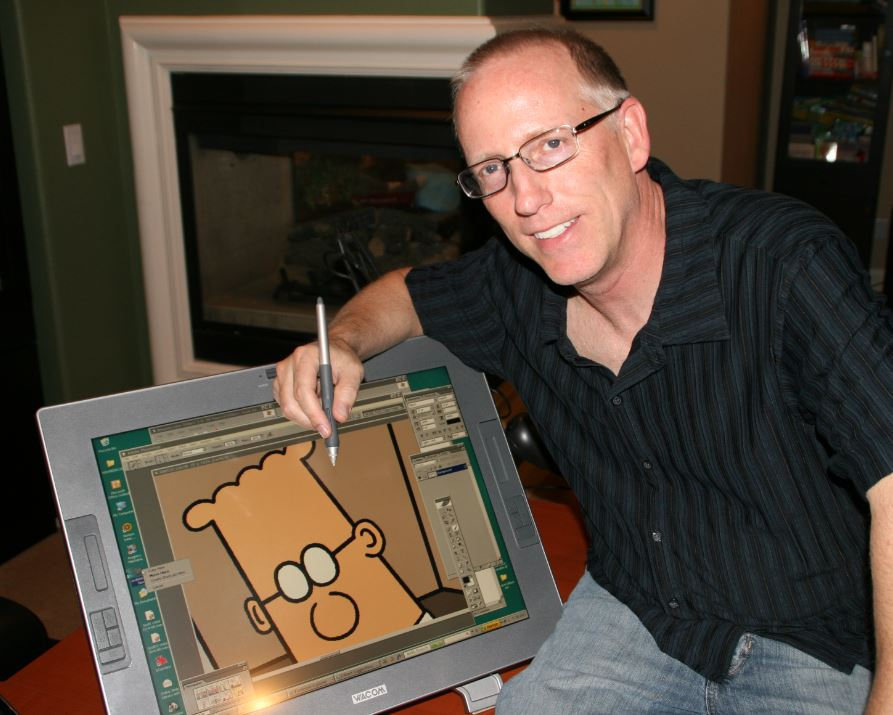
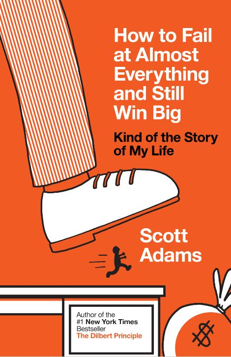

# **D**ilbert's Creator Says You Shouldn't Have A Career Plan

Scott Adams: You should have strategies, not goals**.**

There is some irony in the fact that Scott Adams, creator of the Dilbert comic, has written a book about getting ahead in life**.** The characters in his daily strip aren’t exactly success stories**.** Example: the strip that ran November 26**.**

Wally, Dilbert’s colleague: “Experts say lazy employees are the best because they know how to find shortcuts**.**”  
 Dilbert’s boss: “So you found a lot of short-cuts**.**”  
 Wally: “Me? No—I’m not lazy. I’m useless.”  
 Boss: “Then why did you bring it up**?**”  
 Wally: “Why wouldn’t I? I’m not lazy.”

Like most Dilbert strips, it’s funny but it’s also kind of depressing and circular**.** The characters are caught in dead-end, heartless jobs in a faceless office**.** They never get off the treadmill.

Meet Adams (no relation to me) in person and he’s not at all like Dilbert, except for a hint of dry wit**.** Wearing an open-neck blue shirt instead of a short-sleeved white shirt and tie, he talks about how much he enjoys a life that is the opposite of Dilbert’s**.** At age 56, he eschews a 9-5 workday**.**  Instead he rises at 5am and starts drawing by 5:10**.** Over the [next](http://www.forbes.com/companies/next/)  five hours he works steadily, writing his blog and creating two comics**.** At mid-day, he exercises, either playing tennis near where he lives in Pleasanton, [CA](http://www.forbes.com/companies/ca/)  [CA -0**.**38%](http://www.forbes.com/companies/ca/) , a suburb of San Francisco, or doing weight training and cardio at a gym**.** He devotes the rest of his time to a variety of projects**.** Right now he’s developing an internet startup called Calendartree.com, a mobile-friendly website that allows users to easily create schedules for groups**.**

Before his comics became popular and he quit his day job in 1995, he led a more Dilbert-like life**.** After growing up in Windham, NY and graduating from [Hartwick College](http://www.forbes.com/colleges/hartwick-college/)  in Oneonta he vowed he would get away from snow and bought a one-way ticket to San Francisco**.** With a degree in economics, he aimed to work in a bank**.** He landed a position as a teller at Crocker National Bank, where he was held up at gunpoint twice**.** Later he moved up to computer programmer, commercial lender, product manager and supervisor, before getting an MBA from the [Haas School of Business](http://www.forbes.com/colleges/university-of-california-berkeley/haas-school-of-business/)  at U.C. Berkeley in 1986**.** While working at Crocker, he sometimes used comic strips to lighten up presentations**.**

Next he went to work at Pacific Bell as a budget analyst**.** He says the people he met there inspired his cast of Dilbert characters**.** He started drawing the cartoons at 4am, before work**.** In 1989 he got a break when United Media published Dilbert in 30 newspapers**.** By 1995 he had left his day job and was supporting himself as a cartoonist**.**

Since then he has launched or dabbled in a dozen ventures, most unsuccessful, including a food company that sold vegetarian burritos**.** He ran one restaurant that did well at first, but eventually closed**.** Meantime his career as Dilbert’s creator has thrived**.** He has published 40 books of comics and eight other titles, including two novels, and in 1996, the influential *Dilbert Principle*, which posits that companies tend to promote the least competent employees into management, to limit the amount of damage those workers can do in more hands-on roles**.**

His latest book, *How to Fail at Almost Anything and Still Win Big: Kind of the Story of My Life*, is his first career-advice book**.** He stopped by my office this week and I asked him to sum up the contrarian lessons in the book**.** Here are edited excerpts of what he shared with me:

**1**.** Goals are for losers.** I meet a lot of people who have a plan**.** They are going to get this type of job or they are going to live in a big house**.** But most goals are overly specific. There’s a 99.9% chance you’ll never achieve your goal**.** You should have a system instead of a goal. I choose all my ventures with the notion that if they don’t work, I will still gain a new set of skills and insights and meet people who will be interesting to me in the future**.** Goals aren’t totally useless if you have a system.

When I first flew to California, I met a businessman on the plane who was a CEO at a large company**.** His system was that when he got a job, he almost always started looking for the next job right away**.** He job-hopped all over the country until he became a CEO**.** If his goal was to get the boss’s job, he probably wouldn’t have been able to do that**.**

[New Research: Workers Hate Their Cubicles](http://www.forbes.com/sites/susanadams/2013/11/25/new-research-workers-hate-their-cubicles/)

[Americans Still Prefer A Male Boss -- But Far Less Than They Used To](http://www.forbes.com/sites/susanadams/2013/11/14/americans-still-prefer-a-male-boss-but-far-less-than-they-used-to/)

**2**.** Passion is bullsh#t.** If you talk to a billionaire and you ask him, what was the secret to your success, he will often say, “passion**.**” But what else could he say without sounding like a jerk**?** He can’t say, “it was insider trading,” or “it was a family connection**.**”

Look at *American Idol.* Look at the first round and the stadiums full of people**.** They all have passion but they don’t get through the first round**.** Passion is great to have but it’s probably the least predictive property**.**

Look around your office. Look at the stapler, the furniture**.** Do you think someone was passionate about creating the stapler**?** Passion is just not predictive.

I see a lot of people sitting still because they haven’t found their passion**.** How about doing something that looks good on paper**?** I don’t think you should wait for passion. I think it’s a personality trait**.** Either you’re born with it or not. Passion and goals are just not actionable**.** Passion isn’t something you can do something about**.** How does it help you?

My own experience is that when stuff works, I get really excited about it**.** Passion follows success.

*página 2*

Page 2 of 2

**3**.** Define happiness as health plus freedom.**

Freedom is doing what you want, when you want**.** Before Dilbert took off, my whole day was absorbed with what other people wanted me to do**.** By any objective measure, things were going great. Dilbert was taking off. But I was miserable during those years because I had no freedom**.**

Fitness and diet are important for happiness**.** There have been a lot of studies on willpower and how it’s a reserve that gets used up**.** If you have a goal for your diet, like lose 10 pounds, you’re probably going to get there**.** But getting back to what I was saying about systems and goals, I suggest that instead, you simply learn as much about diet science as you can**.** Eventually knowledge will replace willpower. If I were to say to you, you have a choice between a potato and pasta, most people wouldn’t realize that a potato is twice as high on the glycemic index as pasta**.** Knowledge will get you to a much better point. You should also understand that fat doesn’t make you fat**.**

\* \* \* \* \* \* \* \* \* \*

After we talked about Scott’s career lessons, I asked him where he gets the ideas for his strip**.** This is what he said:

I put my email in the strip**.** Business 101 says that you should give your customers a channel to reach you and then try to give them what they’re asking for**.** At the same time people were telling me what they wanted, they were also making suggestions**.** People email me things that happen at the office. That’s been my primary source of inspiration**.** Most cartoonists sit at a blank screen.

Also part of the reason I got involved in start-ups like the restaurants and the burrito business is that I got to see patterns over time**.** That became material for my strip. Starting a business that fails makes the comic better**.**
