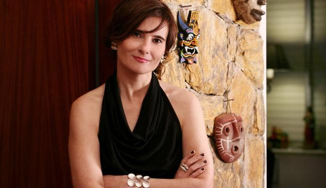

# [Rolezinhos: O que estes jovens estão “roubando” da classe média brasileira - por Eliane Brum](http://www.geledes.org.br/em-debate/colunistas/22538-rolezinhos-o-que-estes-jovens-estao-roubando-da-classe-media-brasileira-por-eliane-brum)

:   Categoria: [Colunistas](http://www.geledes.org.br/em-debate/colunistas)
:   Publicado em Quarta, 25 Dezembro 2013

### **Os novos “vândalos” do Brasil**

**O rolezinho, a novidade deste Natal, mostra que, quando a juventude pobre e negra das periferias de São Paulo ocupa os shoppings anunciando que quer fazer parte da festa do consumo, a resposta é a de sempre: criminalização**.** Mas o que estes jovens estão, de fato, “roubando” da classe média brasileira**?****

****

O Natal de 2013 ficará marcado como aquele em que o Brasil tratou garotos pobres, a maioria deles negros, como bandidos, por terem ousado se divertir nos shoppings onde a classe média faz as compras de fim de ano**.** Pelas redes sociais, centenas, às vezes milhares de jovens, combinavam o que chamam de “rolezinho”, em shopping próximos de suas comunidades, para “zoar, dar uns beijos, rolar umas paqueras” ou “tumultuar, pegar geral, se divertir, sem roubos”**.** No sábado, 14, dezenas entraram no Shopping Internacional de Guarulhos, cantando refrões de funk da ostentação**.** Não roubaram, não destruíram, não portavam drogas, mas, mesmo assim, 23 deles foram levados até a delegacia, sem que nada justificasse a detenção**.** Neste domingo, 22, no Shopping Interlagos, garotos foram revistados na chegada por um forte esquema policial: segundo a imprensa, uma base móvel e quatro camburões para a revista, outras quatro unidades da Polícia Militar, uma do GOE (Grupo de Operações Especiais) e cinco carros de segurança particular para montar guarda**.** Vários jovens foram “convidados” a se retirar do prédio, por exibirem uma aparência de funkeiros, como dois irmãos que empurravam o pai, amputado, numa cadeira de rodas**.** De novo, nenhum furto foi registrado**.** No sábado, 21, a polícia, chamada pela administração do Shopping Campo Limpo, não constatou nenhum “tumulto”, mas viaturas da Força Tática e motos da Rocam (Ronda Ostensiva com Apoio de Motocicletas) permaneceram no estacionamento para inibir o rolezinho e policiais entraram no shopping com armas de balas de borracha e bombas de gás**.**

## **Se não há crime, por que a juventude pobre e negra das periferias da Grande São Paulo está sendo criminalizada**?****

Primeiro, por causa do passo para dentro**.** Os shoppings foram construídos para mantê-los do lado de fora e, de repente, eles ousaram superar a margem e entrar**.** E reivindicando algo transgressor para jovens negros e pobres, no imaginário nacional: divertir-se fora dos limites do gueto**.** E desejar objetos de consumo**.** Não geladeiras e TVs de tela plana, símbolos da chamada classe C ou “nova classe média”, parcela da população que ascendeu com a ampliação de renda no governo Lula, mas marcas de luxo, as grandes grifes internacionais, aqueles que se pretendem exclusivas para uma elite, em geral branca**.**

Antes, em 7 de dezembro, cerca de 6 mil jovens haviam ocupado o estacionamento do Shopping Metrô Itaquera, e também foram reprimidos**.** Vários rolezinhos foram marcados pelas redes sociais em diferentes shoppings da região metropolitana de São Paulo até o final de janeiro, mas, com medo da repressão, muitos têm sido cancelados**.** Seus organizadores, jovens que trabalham em serviços como o de office-boy e ajudante geral, temem perder o emprego ao serem detidos pela polícia por estarem onde supostamente não deveriam estar – numa lei não escrita, mas sempre cumprida no Brasil**.** Seguranças dos shoppings foram orientados a monitorar qualquer jovem “suspeito” que esteja diante de uma vitrine, mesmo que sozinho, desejando óculos da Oakley ou tênis Mizuno, dois dos ícones dos funkeiros da ostentação**.** Às vésperas do Natal, o Brasil mostra a face deformada do seu racismo**.** E precisa encará-la, porque racismo, sim, é crime.

“Eita porra, que cheiro de maconha” foi o refrão cantado pelos jovens ao entrarem no Shopping Internacional de Guarulhos**.** O funk é de MC Daleste, que afirma no nome artístico a região onde nasceu e se criou, a zona leste, a mais pobre de São Paulo, aquela que todo o verão naufraga com as chuvas, por obras que os sucessivos governos sempre adiam, esmagando sonhos, soterrando casas, matando adultos e crianças**.** Daleste morreu assassinado em julho com um tiro no peito durante um show em Campinas – e assassinato é a primeira causa de morte dos jovens negros e pobres no Brasil, como os que ocuparam o Shopping Internacional de Guarulhos**.**

A polícia reprimiu, os lojistas fecharam as lojas, a clientela correu**.** Uma das frequentadores do shopping disse a frase-símbolo à repórter Laura Capriglione, na Folha de S. Paulo: “Tem de proibir este tipo de maloqueiro de entrar num lugar como este”**.** Nos dias que se seguiram, em diferentes sites de imprensa, leitores assim definiram os “rolezeiros” (veja entrevista abaixo): “maloqueiros”, “bandidos”, “prostitutas” e “negros”**.** Negros emerge aqui como palavra de ofensa.

> ## **As novelas já vendiam uma vida de luxo há muito tempo, só que nelas os ricos eram os que pertenciam ao mundo de riqueza**.** Nos videoclipes de funk ostentação, são os pobres que aparecem neste mundo**.**”**

O funk da ostentação, surgido na Baixada Santista e Região Metropolitana de São Paulo nos últimos anos, evoca o consumo, o luxo, o dinheiro e o prazer que tudo isso dá**.** Em seus clipes, os MCs aparecem com correntes e anéis de ouro, vestidos com roupas de grife, em carros caros, cercado por mulheres com muita bunda e pouca roupa**.** ([Para conhecer o funk da ostentação, assista ao documentário](http://www.youtube.com/watch?v=5V3ZK6jAuNI) aqui)**.** Diferentemente do núcleo duro do hip hop paulista dos ano 80 e 90, que negava o sistema, e também do movimento de literatura periférica e marginal que, no início dos anos 2000, defendia que, se é para consumir, que se compre as marcas produzidas pela periferia, para a periferia, o funk da ostentação coloca os jovens, ainda que para a maioria só pelo imaginário, em cenários até então reservados para a juventude branca das classes média e alta**.** Esta, talvez, seja a sua transgressão. Em seus clipes, os MCs têm vida de rico, com todos os signos dos ricos**.** Graças ao sucesso de seu funk nas comunidades, muitos MCs enriqueceram de fato e tiveram acesso ao mundo que celebravam**.**

Esta exaltação do luxo e do consumo, interpretada como adesão ao sistema, tornou o funk da ostentação desconfortável para uma parcela dos intelectuais brasileiros e mesmo para parte das lideranças culturais das periferias de São Paulo**.** Agora, os rolezinhos – e a repressão que se seguiu a eles – deram a esta vertente do funk uma marca de insurgência, celebrada nos últimos dias por vozes da esquerda**.** Ao ocupar os shoppings, a juventude pobre e negra das periferias não estava apenas se apropriando dos valores simbólicos, como já fazia pelas letras do funk da ostentação, mas também dos espaços físicos, o que marca uma diferença**.** E, para alguns setores da sociedade, adiciona um conteúdo perigoso àquele que já foi chamado de “funk do bem”**.**

A resposta violenta da administração dos shoppings, das autoridades públicas, da clientela e de parte da mídia demonstra que esses atores decodificaram a entrada da juventude das periferias nos shoppings como uma violência**.** Mas a violência era justamente o fato de não estarem lá para roubar, o único lugar em que se acostumaram a enxergar jovens negros e pobres**.** Então, como encaixá-los, em que lugar colocá-los**?** Preferiram concluir que havia a intenção de furtar e destruir, o que era mais fácil de aceitar do que admitir que apenas queriam se divertir nos mesmos lugares da classe média, desejando os mesmo objetos de consumo que ela**.** Levaram uma parte dos rolezeiros para a delegacia**.** Ainda que tivessem de soltá-los logo depois, porque nada de fato havia para mantê-los ali, o ato já estigmatizou-os e assinalará suas vidas, como historicamente se fez com os negros e pobres no Brasil**.**

Jefferson Luís, 20 anos, organizador do rolezinho do Shopping Internacional de Guarulhos, foi detido, é alvo de inquérito policial, sua mãe chorou e ele acabou cancelando outro rolezinho já marcado por medo de ser ainda mais massacrado**.** Ajudante geral de uma empresa, economizou um mês de salário para comprar a corrente dourada que ostenta no pescoço**.** Jefferson disse ao jornal O Globo: “Não seria um protesto, seria uma resposta à opressão**.** Não dá para ficar em casa trancado”.

Por esta subversão, ele não será perdoado**.** Os jovens negros e pobres das periferias de São Paulo, em vez de se contentarem em trabalhar na construção civil e em serviços subalternos das empresas de segunda a sexta, e ficar trancados em casas sem saneamento no fim de semana, querem também se divertir**.** Zoar, como dizem. A classe média até aceita que queiram pão, que queiram geladeira, sente-se mais incomodada quando lotam os aeroportos, mas se divertir – e nos shoppings**?** Mais uma frase de Jefferson Luiz: “Se eu tivesse um quarto só pra mim hoje já seria uma ostentação”**.** Ele divide um cômodo na periferia de Guarulhos com oito pessoas**.**

Neste Natal, os funkeiros da ostentação parecem ter virado os novos “vândalos”, como são chamados todos os manifestantes que, nos protestos, não se comportam dentro da etiqueta estabelecida pelas autoridades instituídas e por parte da mídia**.** Nas primeiras notícias da imprensa, o rolezinho do Shopping Internacional de Guarulhos foi tachado de “arrastão”**.** Mas não havia arrastão nenhum. O antropólogo Alexandre Barbosa Pereira faz uma provocação precisa: “Se fosse um grupo numeroso de jovens brancos de classe média, como aconteceu várias vezes, seria interpretado como um *flash mob***?**”.

> ## **A ideia da imaginação como uma força criativa apresenta-se fortemente no funk ostentação**.**”**

Por que os administradores dos shoppings, polícia, parte da mídia e clientela só conseguem enquadrar um grupo de jovens negros e pobres dentro de um shopping como “arrastão”**?** Há várias respostas possíveis. Pereira propõe uma bastante aguda: “Será que a classe média entende que os jovens estão ‘roubando’ o direito exclusivo de eles consumirem**?**”. Seria este o “roubo” imperdoável, que colocou as forças de repressão na porta dos shoppings, para impedir a entrada de garotos desarmados que queriam zoar, dar uns beijos e cobiçar seus objetos de desejo nas vitrines**?**

Para nos ajudar a pensar sobre os significados do rolezinho e do funk da ostentação, entrevisto Alexandre Barbosa Pereira nesta coluna**.** Professor da Universidade Federal de São Paulo (Unifesp), ele dedica-se a pesquisar as manifestações culturais das periferias paulistas**.** Em seu mestrado, percorreu o mundo da pichação. No doutorado, mergulhou nas escolas públicas para compreender o que é “zoar”**.** Desde 2012, pesquisa o funk da ostentação. Mesmo que os rolezinhos, pela força da repressão, se encerrem neste Natal, há muito que precisamos compreender sobre o que dizem seus protagonistas – e sobre o que a reação violenta contra eles diz da sociedade brasileira

## - O rolezinho aparece ligado ao funk da ostentação**.** Em que medida há, de fato, essa ligação?

Alexandre Barbosa Pereira – O funk ostentação é uma releitura paulista do funk carioca, feita a partir da Baixada Santista e da Região Metropolitana de São Paulo, na qual as letras passam a ter a seguinte temática: dinheiro, grifes, carros, bebidas e mulheres**.** Não se fala mais diretamente de crime, drogas ou sexo**.** Os funkeiros dessa vertente começaram a produzir videoclipes inspirados na estética dos videocliples do gangsta rap estadunidense**.** Mas o mais curioso desse movimento é a virada que os jovens fazem ao mudar a pauta que, até então, era principalmente a criminalidade para o consumo**.** As músicas deixam de falar de crime para falar de produtos que eles querem consumir**.** Assim, ao invés de cantarem: “Rouba moto, rouba carro, bandido não anda à pé” (Bonde Sinistro), os funkeiros da vertente ostentação cantam: “Vida é ter um Hyundai e um hornet, dez mil para gastar, rolex, juliet**.** Melhores kits, vários investimentos**.** Ah como é bom ser o top do momento” (MC Danado). Deste modo, os MCs começaram a ter mais espaços para cantar em casas noturnas e passaram a produzir videoclipes cada vez mais elaborados, com mais de 20 milhões de acessos no YouTube, o que levou a um sucesso às margens da mídia tradicional**.** Alguns MCs chegaram a alcançar grande repercussão entre um segmento do público jovem, sem nunca ter aparecido na televisão**.** Vi meninas chorando por MCs em bailes, mesmo antes de o funk ostentação alcançar o destaque que conseguiu na grande mídia**.** Surgiram empresas especializadas na produção de clipes no estilo ostentação, como a Kondzilla e a Funk TV, claramente inspirados no gangsta rap, em que os jovens aparecem em carrões e motos, exibindo-se com roupas, dinheiro e mulheres**.** Uma reflexão interessante a se fazer é como a mídia tradicional, que antes execrava o chamado funk proibidão, que falava de crime, drogas e sexo abertamente, agora começa a elogiar o funk ostentação, denominando-o até como “funk do bem” e ressaltando a trajetória econômica e social ascendente dos MCs**.**

Pergunta. Fazendo um parêntese aqui, antes de chegar ao rolezinho, qual é o caminho para um jovem pobre ter acesso ao consumo de luxo, segundo o olhar do funk da ostentação**?** Esta virada que você mencionou...

Resposta**.** Primeiro que esse bem de luxo não é tão de luxo assim, afinal uma garrafa de uísque a 60 ou 80 Reais não é nenhum absurdo**.** É sempre possível comprar uma réplica daqueles óculos escuros que custam mais de mil reais**.** Nas casas noturnas de funk que observei, este era o preço**.** Pensemos num grupo de pelo menos quatro amigos dividindo o valor da compra**.** Não sai tão caro brincar de ostentar. Agora, tem os carros**.** Estes sim estão fora do alcance da maioria desses jovens**.** Mas aí há uma explicação interessante, que Montanha, um produtor e diretor de videoclipes da Funk TV, em Cidade Tiradentes, sabiamente me deu**.** Ele me disse que as novelas já vendiam uma vida de luxo há muito tempo, só que nelas os ricos eram os que pertenciam ao mundo de luxo**.** Nos videoclipes de funk ostentação, são os pobres que aparecem como um mundo de “riqueza” ou de “luxo”, com carros, mansões, roupas de marcas mais caras**.** Os jovens agora poderiam, segundo afirmou Montanha, ver-se como parte de um mundo de prestígio, daí a grande identificação**.** O crime pode ser um caminho para acessar esse mundo de luxo ou o que esses jovens entendem por um mundo de luxo, mas não é único**.** Esta é a lição que muitos MCs de funk têm tentando passar em suas falas na grande mídia**.** Eles de certa forma mostram um outro caminho, que, aliás, sempre esteve presente para esses jovens da periferia: tornar-se famoso pela música ou pelo futebol**.** Aliás, esses são caminhos que aparecem como os mais possíveis para os jovens negros e pobres das periferias do país imaginarem um futuro de sucesso**.** Num mundo em que há uma forte divisão entre trabalho intelectual e manual, com a extrema valorização do primeiro, o uso do corpo em formas lúdicas como meio de ganhar dinheiro mostra-se como opção para uma transformação da vida**.** “Crime, futebol, música, caralho, eu também não consegui fugir disso aí”, esse é o Negro Drama cantado pelos Racionais MC’s**.** Os MCs de funk ostentação estão tentando dizer que é possível construir uma vida de sucesso pela música**.** E o que era ficção, os videoclipes com carros importados emprestados ou alugados, com dinheiro cenográfico jogado para o ar, começa a tornar-se realidade**.** Muitos deles começam a ganhar uma quantidade razoável de dinheiro com os shows**.** Acho que a ideia da imaginação como uma força criativa apresenta-se fortemente no funk ostentação**.**

> ## Será que a classe média entende que os jovens estão ‘roubando’ o direito exclusivo de eles consumirem**?** Direito que, por sua vez, vinha sendo roubado desses jovens pobres há muito tempo**.**”

Por outro lado, é preciso destacar que masculinidades pautadas pelo desejo de possuir um automóvel ou uma motocicleta não foram construídas pelo funk ostentação**.** Já existia há um tempo. Para os meninos da periferia, possuir um bom carro, bonito e potente, é uma das metas principais de vida**.** A posse do carro é, no imaginário desses jovens, mas também da população em geral, um indicativo de sucesso econômico e social, garantindo, consequentemente, sucesso com as mulheres**.**

Neste caldo cultural, o consumo é cada vez mais exaltado como espaço de afirmação e de reconhecimento para os jovens**.** É, inclusive, bastante complexa a forma como se dá a relação entre criminalidade e consumo no funk**.** Na virada que produziram, parece que há o recado de que essas duas ações sociais podem constituir dois lados de uma mesma moeda**.** Eles não deixam de falar do crime. Acabam citando-o indiretamente, como nas músicas do MC Rodofilho, nas quais ele celebra: “Ai meu deus, como é bom ser vida loka**!**”. O importante é entender como o crime e o consumo são pautas constantes nas relações de sociabilidade dos jovens da periferia**.** Os mais pobres também querem que ipads, iphones e automóveis potentes façam parte de seu mundo social**.** Ainda preciso observar e refletir mais sobre isso, mas acho que tanto no caso do crime, como no do consumo temos que atentar mais para o modo como se dão as relações entre pessoas e coisas**.** Fico pensando que a busca de realização apenas pelo consumo envolve sentimentos e posturas extremas de um egoísmo hedonista e de um profundo desprezo pelos outros humanos**.** As mercadorias, ou as coisas almejadas, de certa forma têm conformado as subjetividades contemporâneas**.** E nessas novas subjetividades, pautadas pelo instantâneo e o instável, parece não haver muito espaço para a solidariedade**.** Há uma nova tendência na discussão antropológica afirmando que não podemos entender as coisas apenas como representação ou resultado do social**.** Precisamos pensar também em como as coisas fazem as pessoas e mesmo o social, como as coisas, ou as mercadorias mais desejadas hoje, motivam tanto um consumismo desenfreado, irracional e egoísta, quanto o ingresso de jovens na criminalidade**.** Sempre fico espantado quando vejo as imagens, em outros países, das pessoas correndo desesperadas para comprar um novo lançamento de smartphone, videogame ou tablet..**.** Mas não só isso, tais coisas também motivam e determinam formas de estar, pensar, relacionar-se e sentir no mundo contemporâneo**.**

Penso muito nisso quando parte da classe média critica o consumo desses jovens, dizendo que apenas eles – da classe média que, supostamente, pagaria os impostos – têm direito a consumir, ou se relacionar com certos produtos**.** Será que, desse modo, a classe média entende que os jovens estão roubando o direito exclusivo de eles consumirem ou de se relacionarem com esses objetos de prestígio**?** Direito que, por sua vez, vinha sendo roubado desses jovens pobres há muito tempo**?**

Essa crítica pode vir inclusive de certa classe média mais intelectualizada e mesmo com ideias políticas progressistas, mas que acha que sabe o que é melhor para os pobres**.** Aí fazem a crítica, a partir dos seus ipads e iphones, ao que entendem como um consumo irracional dos mais pobres, que deveriam poupar ao invés de gastar com produtos que não seriam para o nível econômico deles**.** Enfim, tem aí um jogo de perde e ganha e também de busca de satisfações individuais que envolve o roubo do direito de alguns ao consumo, que é preciso aprofundar para entendermos melhor essas dinâmicas contemporâneas**.** Todos têm o direito a consumir o que quiserem hoje**?** E seria viável, hoje, todos consumirem em um alto padrão**?** Que implicações ambientais teríamos? E se não é sustentável ou viável que todos consumam em tamanha intensidade, por que incentivamos tal consumismo**?** Com isso, o que quero dizer é que não se pode pensar a relação entre crime e consumo apenas entre os pobres, mas creio que precisamos também olhar para as classes médias e altas e para os crimes que, historicamente, têm sido cometidos contra os mais pobres e o meio ambiente para proteger o consumo dos ricos**.**

P. É neste ponto que os rolezinhos aparecem e criam uma tensão das mais reveladoras neste Natal**?**

R. Os rolezinhos nos shoppings estão ligados diretamente a esse contexto**.** Não sei dizer como surgiram efetivamente, mas me parece que despontaram por essas novas associações que as redes sociais permitem fazer, de forma que uma brincadeira possa virar algo sério**.** De repente, uma convocatória feita na internet pode levar centenas de jovens a se encontrarem num shopping, local onde podem ter acesso a esses bens cantados nas músicas, ainda que apenas por acesso visual**.** Agora, o que é importante ressaltar é que não foram os rolezinhos nem o funk ostentação que criaram essa relação de fascinação com consumo**.** Esta já existia há muito tempo. Os Racionais, há mais de dez anos, já cantavam sobre isso, com afirmações como: “Você disse que era bom e a favela ouviu, lá também tem uísque, red bull, tênis nike e fuzil” ou “Fartura alegra o sofredor”

> ## É importante perceber que os shoppings onde os rolezinhos ocorreram estão em regiões mais periféricas**.** Eles não têm ido aos templos maiores do consumo de luxo na cidade**.**”

P. Algumas análises relacionam os rolezinhos a uma ação afirmativa da juventude negra e pobre, a uma denúncia da opressão e a uma reivindicação de participação, neste caso no mundo do consumo**.** Como você analisaria este fenômeno tão novo?

R**.** Não me arriscaria a dizer que há um movimento político muito claro**.** Pode indiretamente constituir-se como uma ação afirmativa da juventude negra e pobre**.** Talvez a tensão que se criou com a criminalização desses jovens, durante os rolezinhos, possa levar a algum tipo de reflexão e ação política maior, mas é difícil prever**.** Em um livro intitulado *Cidadania Insurgente*, (o antropólogo americano) James Holston analisa o surgimento das periferias urbanas no Brasil, particularmente em São Paulo, apontando a discriminação contra certas espécies de cidadãos no Brasil**.** Esse autor mostra como, historicamente, as formulações de cidadania elaboradas pelos mais pobres se deram a partir de sua ocupação dos bairros nas periferias das grandes cidades**.** Noções e práticas próprias de cidadania que se produziram, ao mesmo tempo, por meio das experiências de tornar-se proprietário, de participar de movimentos sociais por melhorias dos bairros e de ingressar no mercado consumidor**.** Primeiro se ocupou os bairros, mesmo sem estrutura mínima**.** Depois, ocorreram as reivindicações pela legalização dos terrenos ocupados**.** E, enfim, vieram as lutas pela chegada da energia elétrica, saneamento básico e asfalto**.** Acho sempre muito interessante, em conversas com lideranças antigas dos bairros periféricos de São Paulo, observar que elas indicam a chegada do asfalto como o grande marco de transformação do bairro e a integração deste ao espaço urbano**.**

Encaro, portanto, ações como estas, dos rolezinhos, do ponto de vista dessa “cidadania insurgente”, referindo-se a associações de cidadãos que reivindicam um espaço para si e, assim, se contrapõem ao grande discurso hegemônico ou, se não se dissociam do discurso hegemônico, ao menos provocam ruídos nele**.** Trata-se de uma reivindicação por cidadania, participação política e direitos que, historicamente, foi feita na marra, pelos mais pobres, muitas vezes nas costuras entre o legal e o ilegal, e que começou com a própria ocupação dos bairros na periferia da cidade de São Paulo, como forma de habitar e sobreviver no mundo urbano**.** Essa cidadania não necessariamente se apresenta como resistência, mas pode também querer, em muitos casos, associar-se ao hegemônico, produzindo dissonâncias**.**

O que são o funk ostentação e os rolezinhos se não essa reivindicação dos jovens mais pobres por maior participação na vida social mais ampla pelo consumo**?** Estas ações culturais parecem situar-se nessa lógica, que não necessariamente se contrapõe ao hegemônico, na medida em que tenta se afirmar pelo consumo, mas provoca um desconforto, um ruído extremamente irritante para aqueles que se pautam por um discurso e uma prática de segregação dos que consideram como seus “outros”**.**

P. Como definir este desconforto? O que são os “outros” neste contexto**?** E que papel estes “outros” desempenham?

R**.** O desconforto em ver pobres ocupando um lugar em que não deveriam estar, como o de consumidores de certos produtos que deveriam ser mais exclusivos**.** É um tipo de espanto, que indaga: “Como eles, que não têm dinheiro, querem consumir produtos que não são para a posição social e econômica deles**?**”. Estes “outros” são os considerados “subalternos”**.** Podem ser funkeiros, pobres e pardos da periferia, mas podem ser também as empregadas domésticas, os motoboys, os pichadores, entre outros “outros”, que muitas vezes são utilizados como bode expiatório das frustrações de uma parcela considerável da classe média**.**

> ## Há uma tendência de perceber os jovens pobres a partir de três perspectivas: a do bandido, a da vítima e a do herói**.**”

Os rolezinhos não são protestos contra o shopping ou o consumo, mas afirmações de: “Queremos estar no mundo do consumo, nos templos do consumo”**.** Entretanto, por serem jovens pobres de bairros periféricos, negros e pardos em sua maioria, e que ouvem um gênero musical considerado marginal, eles passam a ser vistos e classificados pela maioria dos segmentos da sociedade como bandidos ou marginais**.** Vamos pensar que, na própria concepção do shopping, não está prevista a presença desse público, ainda mais em grupo e fazendo barulho**.** Pergunto-me se fosse em um shopping mais nobre, com jovens brancos de classe média alta, vestidos como se espera que um jovem deste estrato social se vista, se a repercussão seria a mesma, se a criminalização seria a mesma**.** Talvez fosse considerado apenas um *flash mob***.** Há uma tendência, por parcela considerável da classe média, da mídia e do poder público de perceber os jovens pobres a partir de três perspectivas, quase sempre exclusivistas: a do bandido, a da vítima e a do herói**.**

P. Como funcionam estas três perspectivas – bandido, vítima e herói**?**

R.  São muito mais formas de enquadrar esses jovens por aqueles que querem tutelá-los do que categorias assumidas pelos próprios jovens**.** Por isso, são contextuais. Dependendo da situação e dos atores sociais com quem dialogam, o jovem pode ser entendido a partir de uma dessas categorias**.** O pichador, por exemplo, é um agente que pode mobilizar todas essas classificações, dependendo do contexto e dos interlocutores: a polícia, a secretaria de cultura, os pesquisadores acadêmicos ou a ONG que quer salvar os jovens da periferia da violência**.** No caso do funk, por exemplo, já há comentários e mesmo textos de pessoas mais politizadas vendo os rolezinhos como uma ação afirmativa ou extremamente contestatória**.** Para estes, os protagonistas dos rolezinhos são vítimas que se tornaram heróis**.** Outros, como a polícia, a administração dos shoppings e a clientela, mas também seus vizinhos, que moram lá nos bairros pobres da periferia, enxergam neles principalmente vilões e mesmo bandidos**.**

Jovens como estes que estão nos rolezinhos não necessariamente aceitam se encaixar nesses rótulos, mas, em alguns casos, podem também se encaixar em todos eles ao mesmo tempo**.** Não se pode simplificar um fenômeno como este. Porém, se pensarmos esse movimento que surge principalmente com o hip hop, de valorizar a periferia como espaço político e de afirmação positiva, é possível ver, sim, ainda que em menor intensidade, uma certa ação política**.** De dizer: “Somos da quebrada e temos orgulho disso”**.** Um movimento de reversão do estigma em marca positiva**.**

P. Mas há, de fato, uma ação consciente, organizada, com um sentido político prévio**?** Ou o sentido está sendo construído a partir dos acontecimentos, o que é igualmente legítimo**?**

R. Olha, sinceramente, é difícil dizer se há um sentido político, direto, consciente e/ou explícito**.** Talvez por parte de alguns, mas pelo que vi nas redes sociais, não da maioria**.** Se o movimento persistir ou tomar outras formas, pode ser que tal sentido político fique mais forte**.** Por enquanto é difícil analisar esse ponto. O antropólogo (indiano) Arjun Appadurai analisa há algum tempo as mudanças que se processam no mundo por causa do avanço das tecnologias de comunicação e de transporte**.** Segundo este autor, as pessoas cada vez mais se deslocam no mundo atual, e não apenas fisicamente, mas também e talvez principalmente pela imaginação, por causa de meios de comunicação como a televisão e, mais recentemente, pela internet**.** Hoje é possível imaginar-se nos mais diferentes lugares do mundo, mas também em diferentes classes sociais**.** O que são os videoclipes de funk da ostentação que não imagens/imaginações que os jovens produzem sobre o que seria pertencer a outra classe social ou possuir melhores condições econômicas para o consumo**?**

> ## O que são os videoclipes de funk ostentação que não imagens que os jovens produzem sobre o que seria pertencer a outra classe social**?**”

Essa imaginação, segundo esse autor, pode constituir-se como um projeto político compartilhado, mas pode também ser apenas uma fantasia, como algo individualista e egoísta, sem grandes potenciais políticos**.** Parece-me que o funk da ostentação em São Paulo e movimentos como o dos rolezinhos nos shoppings têm intensamente essas duas potências**.** Difícil saber se alguma delas irá prevalecer ou tornar-se hegemônica**.**

P. A escolha da música do MC Daleste, assassinado num show em Campinas, para o rolezinho promovido no Shopping Internacional de Guarulhos, pode ter um significado a mais**?**

R. A escolha da música do MC Daleste na entrada dos jovens no shopping de Guarulhos me pareceu bastante significativa, por vários motivos**.** Principalmente, porque a morte dele no palco, cantando funk, de certa forma construiu um marco para esse funk da ostentação**.** O seu assassinato acabou por dar ainda mais visibilidade a esta vertente do funk paulista**.** MC Daleste cantava proibidão antes e, assim, essa relação confusa entre crime e consumo manifesta-se de modo bastante forte no que o MC Daleste representa**.** Há no seu próprio nome artístico essa afirmação de um certo orgulho do lugar de onde vem e de ser da periferia, que tanto o funk quanto o hip hop expressam**.** Não é por acaso que ele é “Da Leste”. Lembremos que Guarulhos também está à leste da Região Metropolitana de São Paulo**.**

P. Hoje, uma parte significativa da geração que se criou nas periferias com movimentos contestatórios como o hip hop e a literatura periférica ou marginal tem, pelo funk da ostentação, assumido os valores de consumo das classes médias e alta**.** Como você analisa este fenômeno e o insere no contexto histórico atual do Brasil**?**

R. O que um evento como esse parece evidenciar é, por um lado, esse anseio por consumir e por afirmar-se pelo consumo que esses jovens vêm demonstrando já há algum tempo, pelas letras dos funks, mas que também já é visto no hip hop**.** Apesar das críticas de certos segmentos do hip hop, não sei se o funk ostentação rompe com o hip hop mais politizado dos anos 1980 e 1990 ou se oferece uma das muitas possíveis continuidades a esse movimento cultural**.** Parece-me que o funk ostentação é uma releitura paulista, muito influenciada pelo hip hop, do funk carioca**.** Muitos MCs de funk eram MCs de hip hop, muitos deles, além dos funks, cantam também raps, e músicas dos Racionais são ouvidas nos shows**.** Trechos de letras de músicas dos Racionais podem ser encontrados facilmente nas letras do funk**.** Agora, o fato é que o funk não é tão marcado pela questão política como o hip hop**.** O Montanha, de Cidade Tiradentes, disse-me algo interessante, certa vez, de que, na verdade, o hip hop ofereceria um espaço de expressão política que faltava aos jovens, já o funk é um espaço de lazer e de sociabilidade**.** Parece-me uma reflexão interessante. Não que o hip hop não possa conter lazer e sociabilidade também, nem o funk, protesto político, mas que as duas vertentes tendem para um dos polos**.** O funk, aliás, ganhou esse grande espaço junto aos jovens das periferias de São Paulo porque, nessa articulação de um espaço de lazer, configurou-se um espaço para as mulheres que, no hip hop, era mais difícil**.** As mulheres são presença fundamental nos bailes funks**.** O protagonismo da dança sempre foi delas. Ainda que os meninos também dancem e as meninas participem cada vez mais como MCs**.** O hip hop sempre foi muito mais masculino, da dança ao estilo de se vestir**.**

P**.** Mas qual é a diferença, na sua opinião, entre a forma como, por exemplo, os Racionais falam em consumo e os MCs da ostentação falam de consumo**?**

> ## Devemos questionar não a ação dos meninos, mas as relações sociais fomentadas na contemporaneidade que se pautam cada vez mais pela busca do reconhecimento pelo consumo, pela posse de bens**.**”

R. Há aí duas perspectivas**.** Quando digo que os Racionais já cantavam isso, quero dizer que eles já identificavam essa necessidade de consumir da juventude**.** E de consumir o que eles achavam que era bom, nada de consumo consciente**.** Por isso digo que os Racionais já faziam, há mais de dez anos, uma leitura desse anseio por consumir dos jovens pobres**.** Por outro lado, há essa dimensão de movimentos como o dos escritores da periferia, promovendo produtos da periferia, pela periferia**.** O funk ostentação começa sem se preocupar com essa questão diretamente**.** Ele não tem dor na consciência por cantar o consumo em suas músicas e aderir ao sistema, por exemplo**.** Porém, indiretamente, se acaba chegando a um outro ponto, na medida em que uma parcela considerável de jovens da periferia passa a possuir algum tipo de renda com a produção do funk**.** Sejam os meninos que gravam os videoclipes, os próprios MCs, mas também empresários, produtores, técnicos e mesmo alguns MCs tornando-se empreendedores e criando seus próprios negócios**.** Como o MC Nego Blue, que observando de perto o sucesso das roupas de grife entre os jovens, criou a Black Blue, uma loja de roupas cujo símbolo é uma carpa colorida**.** Hoje, além de possuir lojas próprias, já vende suas roupas em lojas multimarcas, ao lado de camisas da Lacoste ou de outras marcas famosas que os meninos procuram, e por um preço muito parecido**.** Uma das empresas que agencia shows de funk em Cidade Tiradentes chama-se justamente “Nóis por nóis”**.**

Os rolezinhos parecem dizer: não apenas queremos consumir, mas queremos ocupar em massa e se divertir aí nos seus shoppings, nos seus ou nos nossos**.** É importante perceber também que os shoppings onde os eventos ocorreram estão em regiões mais periféricas, provavelmente próximos ao próprio bairro de moradia dos jovens**.** Por enquanto, eles não têm ido aos templos maiores do consumo de luxo na cidade, na região dos Jardins, Faria Lima, Marginal Pinheiros etc**.** Pode haver aí também um componente de um termo que surgiu muito forte para mim na pesquisa que fiz em escolas de ensino médio, no meu doutorado, que é a ideia do “zoar”**.** Eles querem zoar, que é chamar a atenção para si e se divertir, namorar, brincar e, se for preciso, brigar**.**

P. Por que, neste momento, o lazer se impõe como uma reivindicação desta geração, acima de questões como saúde, educação e transporte de qualidade**?**

R. Acho que não há uma reivindicação política bem formuladinha como acontecia com o hip hop: queremos mais saúde, educação e lazer**.** Eles simplesmente querem estar nos shoppings para zoar e vão**.** Não há essa reflexão mais elaborada que o hip hop produz, é mais espontâneo**.** Esse talvez possa ser um ponto de distinção. E o próprio funk é, por si só, lazer e diversão, um dispositivo poderosíssimo para dançar e motivar paqueras**.** O zoar pode ser lido como um ato político, mas não me parece intencional**.** Acho que cria uma tensão que é política, que é de disputa de poder pelos espaços da cidade, mas não há um manifesto pela zoeira ou pelos rolezinhos, como houve, por exemplo, no caso do manifesto da arte periférica dos escritores**.**

P. Há também um movimento maior para sair dos guetos e ocupar os guetos da classe média**?** Em massa e não mais individualmente, como quando um grupo de rap aparecia numa TV, mesmo sendo a MTV, ou um escritor do movimento literário marginal ou periférico publicava numa grande editora**?** Esta é uma novidade importante?

R. Acho que abre, sim, para fora do gueto, do bairro onde se vive, mas não para muito longe, pois, afinal, os shoppings para os quais eles vão estão do lado de suas casas**.** Neste sentido, acho que o hip hop, apesar de falar mais do gueto, abre-se muito mais para fora do gueto, na medida em que conquista um espaço importante nas políticas públicas de cultura, por exemplo**.**

## É como se a sociedade dissesse: ‘Vocês, pobres, podem consumir, mas ir ao shopping em grandes grupos, só para zoar e cantar funk, aí já é vandalismo’**.**”

Claro que esse espaço de lazer é problemático e conflitivo mesmo dentro dos bairros das periferias onde moram esses jovens**.** Se entrevistarmos os seus vizinhos, certamente a maioria vai se posicionar totalmente favorável à proibição das festas de rua que eles organizam, com som alto que muitas vezes toma a madrugada toda**.** Por isso, acho importante não tomar o funk nem como um movimento libertador, nem como o grande vilão ou o grande movimento de corrupção da juventude contemporânea, como setores mais moralistas, à esquerda e à direita, tendem a fazer**.**

A questão do consumo também me parece problemática**.** O desejo pelo consumo sempre existiu. Bem antes do governo Lula, o processo de urbanização induz a esse apego maior ao consumo**.** Porém, não dá para se negar que houve, nos últimos anos, também uma melhora econômica para segmentos que antes estavam bastante afastados do mercado**.** Porém, acho que reduzir o sucesso do funk da ostentação a isso é simplificar demais o movimento e esquecer que ocorreram e ocorrem movimentos juvenis parecidos em outras partes do mundo, como o próprio gangsta rap, nos Estados Unidos, no qual os videoclipes se inspiram**.**

Devemos questionar não a ação dos meninos, mas as relações sociais fomentadas na contemporaneidade**.** É preciso conceder aos jovens, e não apenas aos pobres, mas aos de classe média e alta também, outros espaços de reconhecimento e de estabelecimento de relações sociais que não sejam pautados pela afirmação por meio da posse e do consumo de bens**.** Porque, afinal, como dizem os Racionais, mais uma vez: “Quem não quer brilhar, quem não**?** Mostra quem. Ninguém quer ser coadjuvante de ninguém”. De repente, para alguns, ter um tênis caro, um smartphone de última geração ou ir ao shopping para zoar, pode ser uma forma encontrada para tentar brilhar**.**

P. Ao ocupar os shoppings, os adeptos do funk da ostentação estariam promovendo sua primeira atitude de insurgência contra o sistema, no sentido de: “Vou ocupar o espaço que me é negado ou onde não me querem”**.** É isso? Ou as próprias letras das músicas, interpretadas, em geral, como adesão ao sistema, já seriam, de fato, uma insurgência, na medida que se apropriam, simbolicamente, dos valores da elite e da classe média e, agora, com os rolezinhos, também de seus espaços físicos**?**

R. Sim, acho que essa é a maior irritação da classe média com esses movimentos**.** Basta ver os comentários aos videoclipes no YouTube, irritados com os meninos ostentando e exibindo-se com produtos mais caros, que não deveriam estar com aqueles meninos, pobre e negros, em sua maioria**.** Esta é a principal insurgência que eles provocam. A classe média, de uma maneira geral, a mais pobre ou a mais rica, a mais ou menos intelectualizada, irrita-se bastante quando os subalternos compram bens caros, mesmo antes deles**.** Já ouvi comentários indignados, do tipo: “Minha empregada comprou uma televisão de última geração, melhor do que a minha”**.** Isso tem antecedentes históricos que parecem refletir até hoje**.** James Holston, ainda no livro sobre cidadania insurgente, que citei anteriormente, traz como exemplo a legislação colonial portuguesa, que proibia aos negros o uso de joias e artigos considerados finos..**.**

P. Parece que os “rolezeiros” dos shoppings estão ocupando o mesmo lugar simbólico dos “vândalos” nas manifestações, na narrativa feita por parte da grande mídia e pelas autoridades instituídas**.** Como você interpreta essa reação?

## Os comentários em sites e redes sociais revelam esse profundo racismo entranhado em parcela considerável da população brasileira**.**”

R. O que me assustou de verdade nessa história toda foram as reações, de mídia e de polícia, condenando e mandando prender, mesmo em casos em que disseram que não houve arrastões, mas correrias**.** Fico questionando quem provocou a correria: os jovens ou a ação dos seguranças e da polícia**?** Eventos como estes revelam também uma faceta complicada e extremamente preconceituosa da classe média brasileira**.** Dei uma entrevista curta para o site de um grande grupo de comunicação e fiquei assustado ao ler os comentários dos leitores, de um ódio terrível contras os meninos e meninas que foram aos shoppings, contra os pobres, contra mim, que tive uma fala dissonante na entrevista, ressaltando a forma preconceituosa com que tal tema vinha sendo tratado**.** Ao falarem do evento, algumas palavras utilizadas como categorias de acusação contra os jovens e as jovens foram bastante reveladoras do preconceito, e mesmo do racismo, deste segmento social: “favelados”, “maloqueiros”, “bandidos”, “prostitutas” e “negros”**.** Nesse último caso, inclusive, fica evidente o racismo que aparece em muitos comentários dessa notícia, mas também nas comunidades dos rolezinhos que os jovens criaram nas redes sociais**.** Um dos comentários pede para que os jovens voltem para a África**.** Isso é muito grave. Revela esse profundo racismo entranhado em parcela considerável da população**.** Como se tal sociedade dissesse, por meio dos representantes dos shoppings, da mídia e da polícia, brincando um pouco com a questão das manifestações de junho: “Vocês, pobres, podem consumir, mas ir ao shopping em grandes grupos, só para zoar e cantar funk, aí já é vandalismo”**.**

P. A classe média é racista?

R**.** O que chamamos de classe média não é um todo homogêneo**.** É possível segmentá-la em diferentes níveis e a partir de diferentes contextos, é possível pensar em uma classe média intelectualizada ou não intelectualizada**.** Contudo, parece-me que a divisão mais importante para se pensar a classe média em São Paulo é a que se dá por critérios socioeconômicos e espaciais**.** Há a classe média que está concentrada principalmente no entorno do eixo central, que vai do Centro a Pinheiros, passando pela Avenida Paulista e bairros próximos**.** Esta, em sua maioria, vive numa bolha e tem poucos contatos com outras classes sociais, com exceção dos trabalhadores subalternos: porteiros, empregadas domésticas etc**.** Para esta, em grande medida, o Shopping Itaquera pode estar mais distante do que Paris ou Londres**.**

Porém, há também certa classe média baixa que vive na periferia**.** Citando novamente o Holston, ele fala de uma diferenciação que se produziu nas periferias de São Paulo entre aqueles que compraram seus terrenos, ainda que por meio de contratos obscuros, e aqueles que ocuparam os espaços da cidade, formando as favelas**.** Essa pequena diferença não cria um grande abismo econômico, mas produz uma profunda diferenciação, por meio do qual um grupo estigmatiza o outro**.** Já vi um indivíduo desta classe média da periferia questionando programas como o bolsa família, porque tinha visto potes vazios de iogurte no lixo da favela**.** Este indivíduo afirmava que nem ele consumia iogurte com tanta frequência, como eles se davam ao direito de consumir tal produto, que era um luxo, raro, mas sobre o qual ele detinha certa exclusividade**?**

A questão do auxílio aos mais pobres, principalmente o bolsa família, é um forte fator de estigmatização por parte desses diferentes segmentos da classe média, mas principalmente por parte dessa classe média da periferia**.** Estive, recentemente, em uma escola pública próxima a uma grande favela de São Paulo**.** Segundo os professores, um dos problemas daquela escola era o fato de que 90% dos alunos vinham da favela vizinha**.** E que, hoje, esses alunos estavam muito acomodados, pois viviam de bolsas e na favela tinham tudo muito fácil, com a grande quantidade de projetos presentes por lá**.** Inclusive, projetos de música, ressaltou um professor**.** É muito importante refletir sobre isso, porque esses professores, se não moram na favela, são vizinhos dela**.** Mas, ainda assim, permitem-se diferenciar-se dos jovens por questões muito pequenas**.** E são estes professores os responsáveis por formar esses jovens**.** Será que, com este olhar, são capazes de lutar para que a escola se torne um espaço de convivência, afirmação e reconhecimento para os jovens**?**

P. Como você, que tem acompanhado o cotidiano de escolas públicas, em São Paulo, percebe a educação**?**

## Para uma parcela da classe média de São Paulo, o Shopping Itaquera pode estar mais distante do que Paris ou Londres**.**”

R. É necessário pensarmos em uma educação para as diferenças, para que não caiamos mais na armadilha da intolerância e das análises apressadas e preconceituosas de setores das elites e das camadas médias, ao se referirem aos “subalternos”**.** Lembro-me de um documentário português, que vale a pena ser assistido, sobre a história de um arrastão que não existiu**.** Chama-se: “Era uma vez um arrastão” ([assista aqui](http://www.dailymotion.com/video/xe4px_era-uma-vez-um-arrastao_news) )**.** Nele, conta-se do dia em que jovens caboverdianos ou descendentes de caboverdianos resolveram frequentar a nobre praia de Carcavelos, em Portugal**.** A polícia, ao ver a concentração de jovens de origem africana, assustou-se e resolveu intervir, provocando uma grande correria, que foi noticiada como arrastão**.** Mas, de fato, os jovens fugiam da repressão policial gratuita**.** Isso talvez nos ensine algo sobre os arrastões que estamos a criar todo dia, criminalizando jovens pobres cotidianamente**.**

Quando estive pesquisando em escolas públicas da periferia de São Paulo, era comum ouvir dos professores que, naquela escola, os alunos eram todos bandidos ou marginais**.** O discurso da criminalização é efetivo e poderoso e condena muita gente ao fracasso escolar e mesmo ao crime**.** O sociólogo polonês Zygmunt Bauman, num livro sobre educação e juventude, ressalta a necessidade cada vez mais premente, na contemporaneidade, de desenvolvermos a arte de conviver com os estranhos e a diferença**.** Em especial num mundo no qual as migrações tendem a aumentar cada vez mais**.** No nosso caso, não foi preciso a chegada de estrangeiros para a expressão das mais brutais formas de preconceito, pois os estrangeiros éramos nós, os brasileiros**.** Mas brasileiros que moram muito, muito distante, ainda que vizinhos**.** Moram em Guaianazes, Capão Redondo, Grajaú, Cidade Ademar, Cidade Tiradentes, Vila Brasilândia..**.**

P. Em que medida, na sua opinião, os rolezinhos se ligam às manifestações de junho**?**

R. Acho que não há uma ligação direta**.** Mas, indiretamente, é possível perceber a reivindicação comum do uso do espaço público e de quebra das marcas da segregação**.** Lembro-me que, antes das manifestações de junho, para a imprensa conservadora era um tabu ocupar a Avenida Paulista**.** Os movimentos sociais mostraram que não apenas não era um tabu, como era um direito, o direito de ir às ruas e ocupá-las para protestar**.** Os rolezinhos não parecem ter uma pauta tão clara, mas também estão, ainda que indiretamente, dizendo: “Vocês não disseram que era bom consumir**?** Pois bem, nós também queremos!”

P**.** Essa ocupação de espaços que supostamente pertenceriam a “outros”, tanto no caso das manifestações como no caso dos rolezinhos, parece marcar uma novidade importante**.** O que está acontecendo**?**

R.  Acho que a novidade está aí, mas é difícil dizer o que está acontecendo ou o que acontecerá**.** Pode ser apenas um surto – algo parecido com o que foi a revolta da vacina como reação às propostas políticas opressoras de reforma sanitária do Rio de Janeiro, por exemplo – ou pode ser uma nova forma de pensar os espaços públicos e privados nas cidades brasileiras**.** Porém, é difícil prever. Os rolezinhos podem ter acabado nesta semana, por exemplo**.** E movimentos como os de junho não se repetiram com tanta intensidade e repercussão**.** Contudo, o que movimentos como estes garantem é a possibilidade de se tensionar essa ocupação dos espaços urbanos, amplamente negada até então**.**

## Aqui não foi preciso a chegada de estrangeiros para a expressão das mais brutais formas de preconceito, pois os estrangeiros éramos nós, os brasileiros que moram em Guaianazes, Capão Redondo, Grajaú, Cidade Ademar, Cidade Tiradentes, Vila Brasilândia..**.**”

P. Por que este nome, rolezinho**?** E que significados ele contém?

R. Rolezinho é um termo que está diretamente ligado à ideia de lazer**.** De sair para se divertir e usufruir da cidade. Os pichadores, com os quais realizei pesquisa no mestrado, também usam a ideia de rolê, para se referirem às suas pichações**.** Com isso estão dizendo que pichar é dar voltas para conhecer e se apropriar da cidade**.** Parece que, por este termo, indiretamente, podemos entender uma reivindicação pelo direito de se divertir na cidade**.**

P. Divertir-se na cidade não seria um ato de insubordinação para jovens pobres e negros**?** Talvez até o maior ato de insubordinação?

R. Sim, principalmente numa sociedade em que pobres e negros têm que trabalhar – e apenas trabalhar – sem reclamar**.** Lembremos de que a ROTA, no final do regime militar, atuava nas periferias abordando os moradores e cobrando-lhes a carteira profissional como prova de que eram trabalhadores e não vagabundos**.** Devotados, portanto, ao trabalho e não à diversão**.** Agora, claro que esses jovens não estão pensando exatamente nisso**.** Querem muito mais é se divertir**.**

P. Como entender este fenômeno, que é, ao mesmo tempo, uma insubordinação e uma adesão ao sistema**?**

R.  Acho que a melhor palavra é paradoxo**.** O funk da ostentação em São Paulo é paradoxal: não dá para situá-lo num polo ou noutro, dentro do modo tradicional de pensar a política**.** Conservador ou revolucionário**?** Nenhum dos dois, mas com possibilidade para os dois ao mesmo tempo**.**

---

Eliane Brum é escritora, repórter e documentarista**.** Autora dos livros de não ficção *A Vida Que Ninguém vê, O Olho da Rua* e *A Menina Quebrada* e do romance *Uma Duas***.**

### [**ROLEZINHOS** & FLASH MOB: A Consciência Humana é branca e rica](http://www.geledes.org.br/racismo-preconceito/racismo-no-brasil/22495-rolezinhos-flash-mob-a-consciencia-humana-e-branca-e-rica)

### [Polícia prende 14 após ‘rolezinho’ em shopping na zona sul de São Paulo](http://www.geledes.org.br/areas-de-atuacao/questao-racial/violencia-racial/22518-policia-prende-14-apos-rolezinho-em-shopping-na-zona-sul-de-sao-paulo)

Fonte: [El País](http://brasil.elpais.com/brasil/2013/12/23/opinion/1387799473_348730.html)

