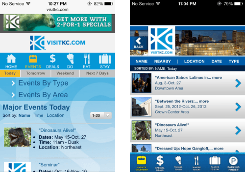
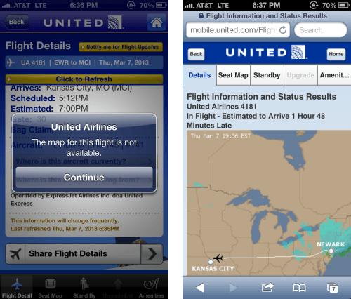
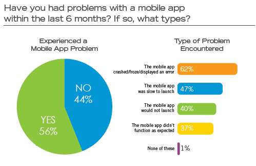
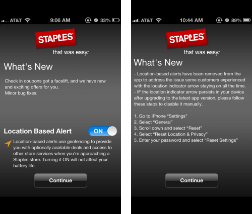
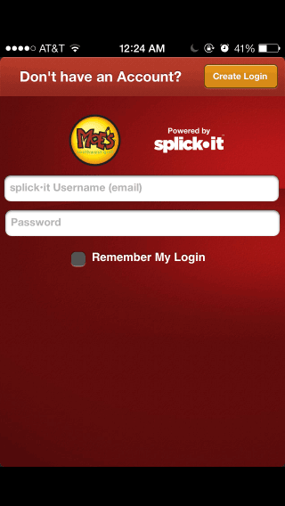
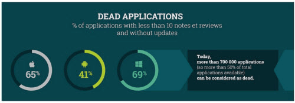
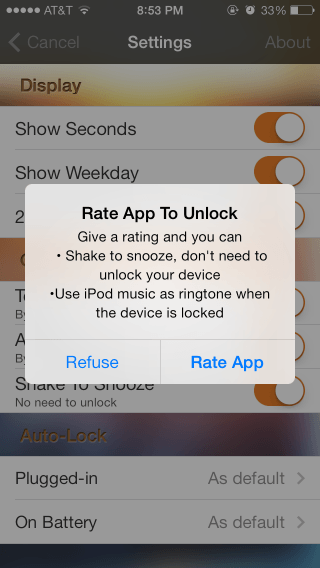
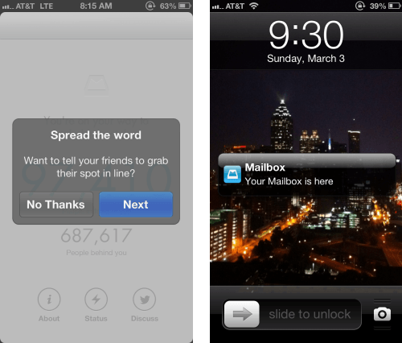
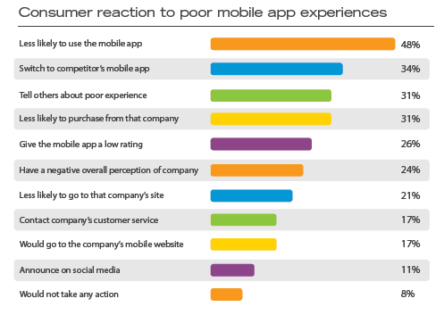

# [Lessons Learned From An App Graveyard](http://mobile.smashingmagazine.com/2013/11/28/lessons-from-an-app-graveyard/ "Read 'Lessons Learned From An App Graveyard'")

Advertisement

Guesstimates by analysts put the number of mobile app downloads this year at somewhere [between 56 and 82 billion](http://mobithinking.com/mobile-marketing-tools/latest-mobile-stats/) , with the average user downloading somewhere [between 26 and 41 apps](http://mashable.com/2013/09/05/most-apps-download-countries/) , with a smaller subset of those apps being used on a regular basis**.** Other numbers indicate that [95% of downloaded apps are abandoned within a month](http://community.nuance.com/blogs/expertsblog/archive/2011/10/19/why-95-of-apps-are-quickly-abandoned-and-how-to-avoid-becoming-a-statistic.aspx)  and [26% of apps are only used once](http://www.localytics.com/blog/2011/first-impressions-matter-26-percent-of-apps-downloaded-used-just-once/) **.**

**Depending on the user, these abandoned apps are deleted or ignored**, never to be opened again**.** I choose to leave these ignored apps on my phone and tablet, and at last count, I had over 375 apps on my iPhone**.** I turned off badges for my App Store app because it was a constant reminder that over 250 apps are waiting to be updated, which is intentional**.** A majority of those outdated apps lie in what I refer to as my app graveyard — buried beyond the first two screens of apps**.**

*Illustration by Nancy C Xu**.***

My app graveyard is the final resting place for apps that I have downloaded, tried or used briefly but have since left neglected**.** I leave them on my phone and tablet as a constant reminder of what killed these apps**.** The following are lessons from my app graveyard that I keep in mind when designing apps, and they might help you, too**.**

### Lesson 1: Validate The Need For An App

Don’t stretch Apple’s catchphrase “There’s an app for that” too far — not everything has to exist as an app**.** A [recent study](http://offers2.compuware.com/rs/compuware/images/Mobile_App_Survey_Report.pdf)  (PDF, 2 MB) by Compuware found that smartphone users prefer mobile apps to mobile websites, but [other research](http://blogs.forrester.com/david_aponovich/13-06-04-survey_shows_mobile_web_gets_priority_over_mobile_apps_in_2013)  shows organizational strategy shifting away from native mobile apps towards Web experiences**.** If your content and functionality can be better served to users through a responsive website or Web app, then you have **no real need for a native app****.** While native apps can easily use a device’s capabilities, a few features, such as GPS, can be used by websites, too**.**

Couple that with offline storage and many websites can do whatever their native equivalents currently do**.** Visitors to [Kansas City](http://www.visitkc.com/getting-around/mobile-website/index.aspx)  can easily do everything they need to from the VisitKC mobile website, instead of downloading and installing the dedicated app, which is now in my app graveyard**.**

  
*VisitKC.com (left) can do everything the VisitKC app (right) has to offer**.** (Large views: [left](http://media.smashingmagazine.com/wp-content/uploads/2013/11/visit-kc-large-opt.png) , [right](http://media.smashingmagazine.com/wp-content/uploads/2013/11/visit-kc-app-large-opt.png) )*

**How do you decide whether you need an app**?**** The decision should be driven by business goals, user needs and the user experience**.** The short version is, if you plan to primarily offer content and basic functionality that users will access infrequently from different platforms and devices, then those users might be best served with a responsive website**.** Also, consider the time, effort and cost involved in creating a platform-specific native app, as well as the ongoing maintenance**.**

#### Additional Reading

- “[Mobile: Native Apps, Web Apps and Hybrid Apps](http://www.nngroup.com/articles/mobile-native-apps/)  5,” Raluca Budiu, Nielsen Norman Group  
  Budiu discusses the advantages and disadvantages of the three approaches**.**
- “[Mobile App vs**.** Responsive Design: Ask These 10 Questions First](http://www.tablexi.com/blog/2013/05/mobile-app-vs-responsive-design-ask-these-10-questions-first/mobile/)  6,” Mark Rickmeier, Table XI  
  And note the [accompanying infographic](http://www.tablexi.com/blog/2013/08/infographic-mobile-app-vs-responsive-website/mobile/)  7**.**
- “[The Future of Mobile Development: HTML5 vs**.** Native Apps](http://www.businessinsider.com/html5-vs-native-apps-for-mobile-2013-4?op=1)  8,” BI Intelligence, Business Insider

### Lesson 2: Make Sure The App Works As Expected

This one might sound like common sense, but you would be surprised by how many apps do not work as expected or end up crashing (see the image below), often after an update — and that’s not just from personal experience**.** One- and two-star reviews in the App Store often complain about just that**.** Look at reviews of Apple’s own Find My Friends or the beautifully designed alarm app Rise — when apps do not do the one thing they are supposed to do, users will stop using it or will use a competing app instead**.**

Staples’ app had problems authenticating users and would repeatedly lock users out of their accounts, even though the same credentials worked on the website**.** And the flight-tracking functionality in United’s app frequently does not work, although it works just fine on United’s mobile website, as shown below**.**

  
*(Large views: [left](http://media.smashingmagazine.com/wp-content/uploads/2013/11/United-app-large-opt.png) , [right](http://media.smashingmagazine.com/wp-content/uploads/2013/11/United-app-flight-information-large-opt.png) )*

One way to avoid this is by thoroughly [testing your app](http://mobile.smashingmagazine.com/2012/10/22/a-guide-to-mobile-app-testing/)  when releasing a new version or after an OS release**.** Test on actual devices, with bonus points for testing in mobile contexts (for example, testing an alarm app during deep sleep)**.** Another ongoing proactive method is to use [analytics tools](http://www.buzinga.com.au/buzz/10-most-popular-mobile-app-analytics-tools/)  to **monitor where your app fails users or even crashes****.**

*Source: “[Mobile Apps: What Consumers Really Need and Want](http://offers2.compuware.com/rs/compuware/images/Mobile_App_Survey_Report.pdf) ,” Compuware (PDF, 2 MB)*

### Lesson 3: Don’t Drain The User’s Device

Apps should judiciously use a device’s resources, including memory, bandwidth and power**.** Apps that do not minimize their use of a device’s location capabilities or that do not disable location updates as soon as possible are common offenders**.** Earlier this year, the Taxi Magic app alone drained about 20% of my battery during a 40-minute ride to the airport, leaving me hunting for juice on my way home**.** Staples’ location-based alerts appear to be active and display the location-indicator arrow even after the app is closed, and even after the app says it will affect battery life (below)**.**

*Before and after a Staples app update with location-based alerts**.** (Large views: [left](http://media.smashingmagazine.com/wp-content/uploads/2013/11/Staples-app-location-based-alert-large-opt.png) , [right](http://media.smashingmagazine.com/wp-content/uploads/2013/11/staples-app-large-opt.png) )*

Apple’s “iOS App Programming Guide” offers some factors to consider when [tuning an app’s performance](https://developer.apple.com/library/ios/documentation/iphone/conceptual/iphoneosprogrammingguide/PerformanceTuning/PerformanceTuning.html#//apple_ref/doc/uid/TP40007072-CH8-SW1)**.** Android has corresponding [best practices](http://developer.android.com/training/best-performance.html) **.**

### Lesson 4: Follow Design Standards And Guidelines

The mobile experience is built from [individual elements](http://mobile.smashingmagazine.com/2012/07/12/elements-mobile-user-experience/)  that require careful consideration**.** For instance, apps with a unique interaction design should onboard new users with a quick introduction or a short tutorial on using the app upon first launching, with options for the user to skip and view it later**.** Yet many unintuitive apps do not do this or do not even offer help, forcing users to give up**.**

Spellcheck is not an option either, as Mitt Romney’s mobile developers quickly discovered last year when they misspelled “America” in one of their photo-sharing banners as “[Amercia](http://www.cnn.com/2012/05/30/tech/mobile/amercia-romney-iphone-app/) ”**.** Though the app was updated within a day, I did not update, but rather buried it in my app graveyard as a reminder that the little details matter**.**

*“Bart Simpson is with Mitt**.**” (Image: [Joao Correia](http://pic.twitter.com/L0ur6z0N) )*

When designing for different platforms, follow the design elements and conventions of the respective platforms, be it [iOS](https://developer.apple.com/library/ios/documentation/UserExperience/Conceptual/MobileHIG/index.html) , [Android](http://developer.android.com/design/patterns/pure-android.html)  or [Windows](http://msdn.microsoft.com/library/windows/apps/hh465424.aspx) **.**

### Lesson 5: Earn Your Users’ Trust By Addressing Privacy And Security Concerns

Ask only for what you need — don’t collect or access information that is not required for the app to function**.** Many apps need access to such device information as contacts, calendar and photos to be useful, but **an app should be transparent about why it needs that data** and how it will be used**.** Apps that consume or store sensitive information (such as financial data) should demonstrate their trustworthiness up front or risk being abandoned**.**

One app in my graveyard is Card Mate Pro, which stores credit-card information but does not impart a feeling of security or confidence**.** Another common reason that apps are abandoned is that they ask users to register (or use social sign-in) in order to gain functionality that does not depend on having a profile**.** The app for Moe’s Southwest Grill (a fast-food chain) required registration before users could use any functionality in the app, including locating restaurants and browsing the menu**.**

*Previous versions of Moe’s app required users to register or log in to use it**.***

#### Additional Reading

- “[Best Practices for Mobile App Developers](http://www.futureofprivacy.org/best-practices-for-mobile-app-developers/)  9,” Future of Privacy Forum

### Lesson 6: Give Users Control And Ownership Of Their Data

Apps that create, capture or store user data should offer a way for users to save, back up or archive that information**.** A couple of apps that capture and organize my kids’ artwork now lie in my app graveyard because there’s no way for me to save or back up those pictures to iCloud or Dropbox**.** Every app, free or paid, is at the mercy of its developer and can be [discontinued at any time](http://media.smashingmagazine.com/wp-content/uploads/2013/11/orchestra-cards-eol-large.png)  or removed from the App Store, as recently happened with the to-do app [Orchestra](http://www.orchestra.com/)  and Apple’s own [Cards](http://support.apple.com/kb/ht4990) **.** Enabling users to easily save their own data gives them confidence that they won’t lose it forever if the app were to be discontinued or [automatically upgraded](http://www.zdnet.com/how-the-ios-7-auto-app-update-feature-is-a-ticking-data-loss-timebomb-7000021394/) **.**

[*A part of*](http://media.smashingmagazine.com/wp-content/uploads/2013/11/StarDust-mobile-reputation-infographic-large-opt.png) *[StarDust’s mobile reputation infographic](http://www.stardustspm.com/infographie-m-reputation-en.jpg)  shows just how many apps are dead**.** ([Large view](http://media.smashingmagazine.com/wp-content/uploads/2013/11/StarDust-mobile-reputation-infographic-large-opt.png) )*

### Lesson 7: Don’t Bait And Switch

Descriptions in the App Store (even for free apps) should clearly indicate what is included in the purchase price and what is available via in-app purchases, which will help users decide whether to buy and download that app**.** [Not making this clear up front](http://www.ilounge.com/index.php/articles/comments/bait-and-switch-apps-the-dark-side-of-in-app-purchasing/)  is wrong, as is forcing users to rate or share an app in order to enable features that they’ve already paid for**.**

Step Out Alarm Clock is one such app in my graveyard**.** While it forces you to wake up, it also forces you to rate the app to unlock features that are listed as part of the paid app**.** While we’re on the topic of ratings and reviews, when prompting users to rate an app, wait until they’ve had an opportunity to use it, and **give them the option to rate it later or never rate it**, and honor their selection**.**

*Step Out Alarm Clock forces users to rate the app to unlock features listed as part of the paid app**.***

### Lesson 8: Load The App Quickly, Without Fanfare Or Annoyance

The “[iOS Human Interface Guidelines](https://developer.apple.com/library/ios/documentation/userexperience/conceptual/mobilehig/StartingStopping.html) **.**” recommend enabling your users to begin using your app immediately:

> “It’s often said that people spend no more than a minute or two evaluating a new app**.** When you make the most of this brief period by presenting useful content immediately, you pique the interest of new users and give all users a superior experience**.**”

Apple goes on to recommend avoiding a splash screen or other “launch” experience, and instead using a [simple launch image](https://developer.apple.com/library/ios/documentation/userexperience/conceptual/mobilehig/LaunchImages.html) **.** While resource-intensive apps such as games need a few seconds to load, [games are among the biggest offenders](http://www.macgasm.net/2012/03/21/clearly-game-splash-screens-in-ios-need-to-die/)  of the recommendation against splash screens**.** Moe’s Southwest Grill launches with its loud signature “Welcome to Moe’s” yell, without any option to mute it — which I discovered in a client’s quiet office**.** The developers have since listened to feedback, and an update last December allows users to mute the greeting**.**

### Lesson 9: Marketing And Incentives Only Go So Far

Apps need marketing — and sometimes incentives — to get noticed and downloaded**.** However, that alone does not guarantee continued usage**.** The [reservation system](http://www.fastcodesign.com/1671952/the-ux-thinking-behind-mailboxs-800000-person-waiting-list)  that the developers of Mailbox followed when they launched earlier this year, to stagger the app’s rollout, added to the hype for the app**.** [Like many others](http://mashable.com/2013/04/16/mailbox-has-finally-ditched-its-reservation-system/) , I haven’t used Mailbox since I downloaded it to try it out**.**

An incentive will get users to download and try an app, but [engagement will not last long](http://gigaom.com/2011/12/12/survey-users-abandon-apps-downloaded-via-incentives/) **.** The preceding lessons should help you create a good first impression, but **users will often need to be nudged** to continue using the app**.** This could take the form of reminders to use the app, as 1 Second Everyday does, or subtle email messages, if users have given you their email address and permission to contact them**.**

### Lesson 10: What The App Store Gives, Apple Can Take Away

With each iOS release, third-party apps become redundant as their primary functionality in integrated into the new OS**.** iOS 7 suddenly made flashlight apps and bubble-level apps redundant**.** Still, some third-party apps have survived and thrived by offering additional unique functionality or a better experience**.** Examples include Instapaper and Pocket (formerly Read It Later), both of which were supposed to be killed by Safari’s Reading List in iOS 5 but are still alive and actively used today, two iOS releases later**.**

### What’s A Developer To Do?

The lessons above are just a few of the reasons why an app may be downloaded by many but actively used by few**.** The Compuware study mentioned earlier found that 79% of consumers would retry a mobile app only once or twice if it failed to work the first time, and only 16% would give it more than two attempts**.** This gives app developers a small window of opportunity to make a good impression**.** So, **put your best foot forward**, and make sure your app is ready for prime time before launching**.** As shown below, abandonment is perhaps the least damaging response to a poor app experience**.**

*[Mobile Apps: What Consumers Really Need and Want](http://offers2.compuware.com/rs/compuware/images/Mobile_App_Survey_Report.pdf) ,” Compuware (PDF, 2 MB)**.** ([Large view](http://media.smashingmagazine.com/wp-content/uploads/2013/11/user-reaction-poor-mobile-app-experiences-large-opt.png) )*

If you already have an app struggling in the App Store, make sure to monitor social-media feedback, support emails, reviews on third-party websites, and App Store reviews and ratings to glean the reasons for the abandonment of your app**.** Services such as [App Annie](http://www.appannie.com)  and [App Figures](http://www.appfigures.com)  will consolidate your reviews, which are a great source to learn about problems as well as suggestions for features**.** Prioritize and address these problems in your next release, and [improve the app’s quality after launch](http://developer.android.com/distribute/googleplay/strategies/app-quality.html)  to reduce the chance of your app joining users’ graveyard**.**

What other lessons have you learned from your own app graveyard**?** We would love for you to share them in the comments below**.**

*(al, ea)*

It's done**.** The [Smashing Book #4](http://auslieferung.commindo-media-ressourcen.de/www/delivery/ck.php?oaparams=2__bannerid=6607__zoneid=94__OXLCA=1__cb=916a113ebb__oadest=http%3A%2F%2Fauslieferung.commindo-media-ressourcen.de%2Fwww%2Fdelivery%2Fck.php%3Foaparams%3D2__bannerid%3D6259__zoneid%3D68__OXLCA%3D1__cb%3D66994866a6__oadest%3Dhttp%3A%2F%2Fwww.smashingmagazine.com%2Fbooks%2F%23the-smashing-book-4) , our brand new book with smart techniques, ideas and approaches for front-end development and design**.** Written by respected designers and developers, neatly packed in a gorgeous hardcover**.** [Get the book now](http://auslieferung.commindo-media-ressourcen.de/www/delivery/ck.php?oaparams=2__bannerid=6607__zoneid=94__OXLCA=1__cb=916a113ebb__oadest=http%3A%2F%2Fauslieferung.commindo-media-ressourcen.de%2Fwww%2Fdelivery%2Fck.php%3Foaparams%3D2__bannerid%3D6259__zoneid%3D68__OXLCA%3D1__cb%3D66994866a6__oadest%3Dhttp%3A%2F%2Fwww.smashingmagazine.com%2Fsmashing-book-4-new-perspectives%2F) .
