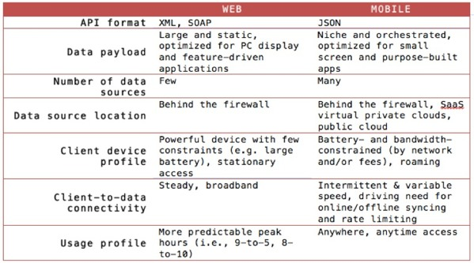
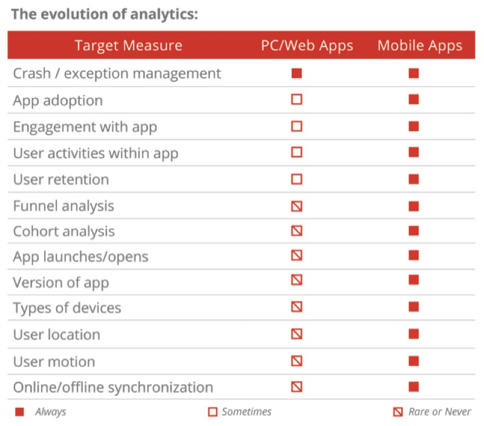

# **W**hy The HTML5 Vs. Native Debate Obscures The Real Challenges Of Mobility

The argument over which type of code to build our apps in masks the need to update our architecture and provide better analytical tools**.**

*Guest author Nolan Wright is the CTO of Appcelerator**.***

The vitriol spews on a daily basis**.** HTML5 or native apps? Each side is well armed with arguments and data to prove their points**.** This fight, destined to go on for a long while, masks some of the real problems that enterprises are facing when it comes to mobile applications**.** Do you have the right backend architecture for a mobile world**?** The right business analytics? Enterprises, brands and developers need to put their houses well in order before even beginning to answer what type of code an app will be built in**.**

## HTML5 Or Native? Wrong Question

Most mobile discussions to-date have focused on the explosion in devices and operating systems, and the challenge of building great apps for a multi-platform world**.** This has given rise to the latest round of techno-religious wars, with the HTML5ers on one side and Nativists on the other**.**

Lost in all the shouting is a much bigger challenge—in fact, two challenges**.** First, the traditional Web architecture that undergirds most enterprises is rusting**.** Mobile is stressing the way these architectures feed data to applications, as well as their mechanisms for performance and scale—the technical equivalent of a bridge collapse waiting to happen**.**

Second, where the business performance of their mobile app portfolios are concerned, most companies are flying blind**.** While traditional application portfolios are held to all kinds of return-on-investment measurements, the investment plan for mobile apps (increasingly a more substantive bet) is made by guesswork and dart-throwing**.**

## All Dressed Up With No Data To Show

The standards for middleware and backend data access that defined the Web era don’t work for mobile**.** The mobile world brings different types and sources of data, different formats and payload sizes, different transaction volumes and usage profiles and the end of connection persistence**.** “Mobile,” [as Forrester Research observes](http://www.forrester.com/Mobile+Needs+A+FourTier+Engagement+Platform/fulltext/-/E-RES100161) , “is pushing aging Web architectures to the brink**.**”

Mobile’s first challenge to the old Web world is the expansion and diversification of data sources**.** Any mobile app worth its salt must orchestrate data not only from private enterprise systems, but also public clouds (e**.**g**.** social media), corporate SaaS systems (e.g. Salesforce) and increasingly even smart appliances drawn from the Internet of Things**.**

But the challenge doesn’t stop there**.** The regular, anywhere/anytime access habits of mobile users increases transaction volumes through apps, meaning that architectures must scale elastically**.** Furthermore, because mobile devices can’t count on an uninterrupted connection, the apps must continue to function when offline and gracefully synchronize to the backend when the connection is restored**.** As the following table shows, virtually every aspect of mobile app connectivity differs from the Web**.**

To succeed in this new age, companies need mobile-optimized APIs backed by a scalable cloud architecture**.** Properly designed, these APIs deliver three things:

- **Orchestration**: the ability to collect data from any data source regardless of where it resides**.**
- **Optimization**: boiling down the data set to its essential payload size for consumption by a mobile app**.** For instance, if a traditional Web API returns 20 fields, the mobile variant might want only five**.**
- **Transformation**: converting the data format from legacy styles such as XML or SOAP to a mobile-optimized format such as JSON**.**

[Our own enterprise survey](http://www.appcelerator.com.s3.amazonaws.com/enterprisesurvey/index.html)  shows that companies are waking up to the challenge**.** A full 40% rank mobile-optimized APIs as their top investment priority**.** These APIs, when combined with elastic scale and performance, mark the way to a new standard in enterprise architectures**.**

## App Portfolios: A Big Bet On Lagging Indicators

We live in the Land Of The Device, and in this country the user is king**.** Don't like an app? Delete it and find a better one**.**

For proof of the user’s clout, witness the rise in power of the star system: one-star apps die a quick death, while five-star apps go on to rule the world**.** But this ranking system is insanely crude**.** It provides little measurable data for what makes an app good or bad**.** Is the problem in stability**?** Performance? Installation? Design?

The crudeness of the star system leaves most enterprises blind when it comes to understanding their mobile apps**.** Ratings alone won’t deliver true understanding of user preferences (or frustrations), or how the app is being used, or what is the best business decision for the next version**.**

Not unlike its impacts on data access, mobile is driving the need for app and portfolio measures unlike any we saw in the days of Web**.** Good mobile analytics must provide insight into both the behavior of the app and the behavior of the user**.**

Understanding the behaviors of the app is a good start**.** Crashes, for example, are the kind of app behavior that should trigger an alert**.** Otherwise there’s not much hope of fixing the problem before users begin to mutiny**.**

But seeing into app behavior alone isn’t enough**.** For a complete picture of engagement, we need to understand user behaviors as well**.** What is the frequency and duration of user engagement**?** When and where are users most often interacting with the app**?** On what types of devices & platforms are users engaged with the app**?** Which features are most popular**?**

Just as apps are seldom built without some form of requirements, neither should they be launched without measurable usage goals**.** The analytics above stand as a quantitative, metrics-based strategy for app improvement**.** This is a chief difference from pre-mobile applications, few of which provided the specificity of usage and context data that mobile apps do**.**

The HTML5 vs**.** native debate has been fun, but it’s taking too much oxygen from the bigger issues**.** Organizations conditioned by legacy Web interpretations of enterprise architecture and portfolio planning are at risk of finding themselves disrupted by mobile-savvy competitors, regardless of their client-side technology choice**.** This is for a simple reason. Mobile signals nothing less than the rise of a post-Web world**.**
