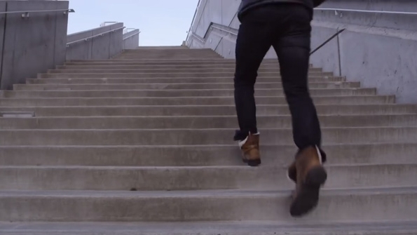
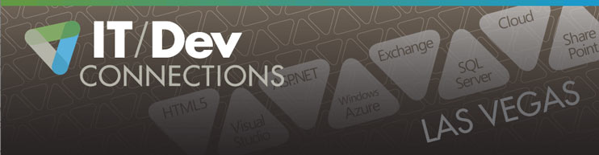
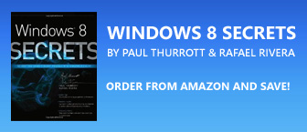

# **F**urther Changes Coming in Windows "Threshold"

Reset 2, the Quickening

Dec**.** 9, 2013
[Paul Thurrott](http://winsupersite.com/author/paul-thurrott)

After previous revelations about Windows "Threshold," a release we might think of as [Windows 8](http://www.windowsitpro.com/windows-8) **.**2, some more information has emerged about Microsoft's plans for the future**.** And if you were worried that Windows 8**.**1 didn't go far enough in appeasing desktop users on traditional PCs, I think I have some good news for you**.**

I first discussed Windows "Threshold" last week in [Microsoft to Take Windows to the "Threshold"](http://winsupersite.com/windows/microsoft-take-windows-threshold) **.** According to Mary Jo Foley, Threshold is a wave of updates that will bring Windows 8**.**x, Windows Phone and Xbox One closer together from a user experience perspective**.** My theory is that Threshold is the release that will put Microsoft on the threshold, if you will, of a truly consolidated OS**.**

Today, Foley further expanded on the information she's received about "Threshold**.**" And the Windows version of this wave of releases will apparently ship with three product SKUs, or versions: a consumer-focused Windows that is much like Windows RT today, a more traditional consumer release based on the x86 codebase and a traditional Enterprise SKU**.** Check out her post [More on Microsoft's SKU-morphic Windows vision](http://www.zdnet.com/more-on-microsofts-sku-morphic-windows-vision-7000024092/)  for more information**.**

I've not heard anything independently about the product versions in Threshold**.** But I do know about a few changes that Microsoft is planning for what my sources have described as "the next version of Windows," which I assume is Threshold**.** (Though to be clear, they never used this name.) And they're big news**.**

They are..**.**

**Metro apps running in windows on the desktop**.**** As you can today with third-party utilities such as ModernMix, the next version of Windows will let users optionally run Metro apps in floating windows on the desktop**.**

**Start menu****.** After bringing back the Start button in Windows 8.1, Microsoft will take the next logical step in the next Windows version and make the Start menu available as an option**.** It's possible this will appear only on those product versions that support the desktop**.**

There's more coming, and some things still up in the air of course, but I need to verify them with others**.** In the meantime, I felt this was big enough to get it out there**.** When you combine this information with Mary Jo's SKU info, you can see that Microsoft is, if not moving forward per se, at least continuing to do the right thing and responding to complaints**.** And given the changes in the groups responsible for Windows, this wasn't a given at all**.** It's a good sign**.**

#### Discuss this Article 82

"Metro apps running in windows on the desktop**.**"

This should have been a no brainer**.** Add a Metro button to the Start Menu, and you're done**.** Then people would have be saying, "Wow, Windows 8 is fast**.**" Removing the Windows 7 eye candy was a good idea.

- [Login](http://winsupersite.com/user/login?destination=node%2F34171%23comment-form)  or [register](http://winsupersite.com/user/register?destination=node%2F34171%23comment-form)  to post comments

Windows 8**.**1 is a good improvement, Microsoft needs to realize it cannot force people to adopt a technology, the Modern UI works great in a tablet environment, With my Clients they want their start menu, killing something that's been in use since windows 95 is too much change for most people, end users just want it work so they can get their work done, Companies do not want to spend $$$ on training employees on how to use a new operating system**.** if 8.2 brings back the option for the windows 7 style start menu, then as long as ie12 is not integrated it will be fine**.** Microsoft should also include an option for browsers, a lot of cloud services do not yet support or will work with Internet Explorer 11 or even 10 correctly as of yet, examples include property management software websites and some of the banking sites if you are using check scanners**.**

- [Login](http://winsupersite.com/user/login?destination=node%2F34171%23comment-form)  or [register](http://winsupersite.com/user/register?destination=node%2F34171%23comment-form)  to post comments

I don't know, this sounds too intelligent to be true....

- [Login](http://winsupersite.com/user/login?destination=node%2F34171%23comment-form)  or [register](http://winsupersite.com/user/register?destination=node%2F34171%23comment-form)  to post comments

Well I guess hell might freeze over after all if they do bring back the start menu**.** lol

The Metro apps running on desktop is interesting**.**

Hopefully this will make more people happy**.**

- [Login](http://winsupersite.com/user/login?destination=node%2F34171%23comment-form)  or [register](http://winsupersite.com/user/register?destination=node%2F34171%23comment-form)  to post comments

I like the idea of 3 SKUs**.** Hopefully that consumer one will be the merger of RT and Phone**.** Maybe in time they will give you the ability to split screen Metro and Desktop apps**.** Also, it might be nice to see them implement stacked Metro apps**.** If you use the iOs version or LinkedIn, you'll see that each profile opens stacked kind of like titled windows in some of the earliest versions of Windows**.**

- [Login](http://winsupersite.com/user/login?destination=node%2F34171%23comment-form)  or [register](http://winsupersite.com/user/register?destination=node%2F34171%23comment-form)  to post comments

I'm still hoping to see improvements to Skydrive ("Fetch my files" was removed in 8**.**1 ... I want it back!), to the Photos app (put back the ability to see photos from other PCs as well as other sources**!**), improvements to File History, the ability to set the "Last Active Window" behavior of the taskbar in the Taskbar properties UI (google that phrase to get the registry hack that makes the Desktop/Taskbar INFINITELY more useful and consistent in behavior), more support for very high pixel density displays on the desktop (including adding "touch mode" to various apps like IE and File Manger, a la Office 2013), standardized gestures to zoom to the top/bottom of long web pages or long lists, the ability to scroll the page with your finger while not losing current focus/caret-position, removal of the transparency of the Taskbar (weird hold-over from Aero), updating of system icons to be more Metro/Win8 in design (graphical consistency)..**.**

And of course a NOTIFICATION CENTER**!** (actually, I'm hoping that comes out with Update 1 for Windows 8**.**1 this sprint, in conjunction with Windows Phone 8**.**1). This is DESPERATELY needed. I want a nice user-friendly log of when WIn8 apps updated on me, what toast notifications I just missed, etc**.** Every other OS on the planet has a decent notification center**.**

- [Login](http://winsupersite.com/user/login?destination=node%2F34171%23comment-form)  or [register](http://winsupersite.com/user/register?destination=node%2F34171%23comment-form)  to post comments

The return of the Start Menu is long overdue**.** Another problem is if you want the desktop experience, why should you ever go to the Start Screen and the App Screen**?** You should not. Instead, they should offer an App launch task bar that is already on the desktop**.**

Alternatively, if you want the Tablet experience, you should never have to be forced to go to the desktop**.** The desktop will gone forever and never to be seen**.** If you have a desktop application, the application will have a tablet mode that can be used as a full screen or split screen touch app**.**

Of course, you hinted that there will be a consolidated experience**.** Nothing will be better than having one screen that does it all..**.** desktop, start screen, and app screen**.** Cutting downt he complexity will win more users.

- [Login](http://winsupersite.com/user/login?destination=node%2F34171%23comment-form)  or [register](http://winsupersite.com/user/register?destination=node%2F34171%23comment-form)  to post comments

The start screen and all apps screen ARE the start menu**.** I will NEVER understand people like you and your rabid and irrational hatred of the start screen..**.** of course, most people who I see hating it seem to be oblivious to the fact you can customize it, remove all you don't want from it, add tiles for everything you do want, and voila**.** I'm far MORE productive and faster with the start screen than I ever was with the start menu**.**

Also, have you ever gone to taskbar properties, clicked on the Toolbars tab, and checked the "Desktop" toolbar**?** It's like a mini-start menu, giving you easy access to anything on your desktop (without showing it) or anywhere else on your system**.** Combined with right-clicking the start button, you have all the navigation you need**.** And With 8.1 allowing Desktop apps to be listed first, never mind the powerful search, why on EARTH do you miss the start menu**?**

- [Login](http://winsupersite.com/user/login?destination=node%2F34171%23comment-form)  or [register](http://winsupersite.com/user/register?destination=node%2F34171%23comment-form)  to post comments

"I will NEVER understand people like you and your rabid and irrational hatred of the start screen"

Never**?** I already said so earlier**.** If I want the desktop experience, why would I want the Start Screen and the App Menu, which are the tablet interface**.** They are not substitutes for the Start Menu**.**

Why would I want to customize it unless I can customize it into the Start Menu**?** You're irrational and not sensitive to the needs of the user**.**

Face palm. You keep telling me to fix it**.** Why not just say it is broken?

"why on EARTH do you miss the start menu**?**"

Hmmm... You wonder why? You just spent two paragraphs telling me how to get it back without getting back the Start Menu**.** You want me to use a pale imitation or a substitute for exactly what purpose**?** The Start Menu does it quicker and much more elegantly and no customization needed**.**

I don't need to reprogram my needs**.** You could have saved yourself the two paragraphs of "blah blah blah"**.**

- [Login](http://winsupersite.com/user/login?destination=node%2F34171%23comment-form)  or [register](http://winsupersite.com/user/register?destination=node%2F34171%23comment-form)  to post comments

Save your breath, @pmbAustin**.** Although the whiners sound half-credible this close to the introduction of W8, these people will NEVER let go of UI element that they were used to that MS has decided to ditch, no matter how much time passes**.** Note that I say "used to," rather than that the "liked," or "prefered**.**" These people have never given a thought to what they prefer, and certainly never sat back and gave careful consideration to the differences between the start screen and start menu to decide, with some sort of dispassionate analysis and assessment, which of the two may actually be "better" (or even, for that matter, better "for them")**.**

Today there are probably many millions of users of Office that have no idea that there was "pre-ribbon" version of this product, and that number will continue to grow with time**.** If sat down by someone today and told that the ribbon UI is simply "awful" in comparison to what came before, they'd probably conclude that that person is just nuts**.**

You will hear the same people groan about the start screen years and years from now**.** The people who started using a PC with W8 and later will simply wonder why those complainers haven't yet sought treatment for what is a manifestly debilitating mental illness**.**

- [Login](http://winsupersite.com/user/login?destination=node%2F34171%23comment-form)  or [register](http://winsupersite.com/user/register?destination=node%2F34171%23comment-form)  to post comments

I find using the start screen fine**.** On the desktop with a scroll mouse the start screen works very well**.** However, I did not know about the Desktop app on taskbar tip**.** Thanks.

But I can see why people complain**.**

I never understood why MS never left an option to 1) turn of start button 2) turn on start menu 3) boot to desktop**.** From the very beginning**.** For the Windows users who are explorers you can experience the metro UI and see the future with tablets (touch)**.** The power users could adjust as needed**.** For non-power users you have the option to go back to the Win7 experience**.** Having those options seems the definition of the Windows experience - the ability to meet the needs of multiple users**.** Sinofsky and Balmer should be fired or at least forced out.... oh..**.**

- [Login](http://winsupersite.com/user/login?destination=node%2F34171%23comment-form)  or [register](http://winsupersite.com/user/register?destination=node%2F34171%23comment-form)  to post comments

I will NEVER understand people like you and your rabid and irrational hatred of people who want a choice**.** Of course, most people who I see hating it seem oblivious to the fact that their opinions are not everyone's, and to the fact that some see the All Apps view as a jumbled mess of anything goes, while the basic view is a massive waste of screen real estate**.**

- [Login](http://winsupersite.com/user/login?destination=node%2F34171%23comment-form)  or [register](http://winsupersite.com/user/register?destination=node%2F34171%23comment-form)  to post comments

Thank God i'm not alone in this sea of hysteria**!**  
I'm a developer and a sys admin, at work I barely see metro anything, when I do its works super fast**.** I have users here, who i would generously describe as novices, who were given Win8 laptops, not a single complaint or query  
At home I barely see the desktop, who needs it (except for office currently)

- [Login](http://winsupersite.com/user/login?destination=node%2F34171%23comment-form)  or [register](http://winsupersite.com/user/register?destination=node%2F34171%23comment-form)  to post comments

Exactly**.** This is to some extent a good move for Microsoft because some idiots will just never move on from the start menu regardless of what else is there to replace it**.** The start screen does everything the start menu did and much more without any loss of functionality whatsoever**.** If it was in W8, I would not use the old start menu unless they paid me to, I can't believe people ever used it, let alone defend it**.**

Yet since the start menu is familiar and was created a long time ago, it must be better I guess**.** Some kind of reverse psychology msft inadvertently triggered that makes people think they are being tricked or screwed into fulfilling microsoft's evil plans (that's the best I can describe it)**.** Some people are so stubborn they will not listen to any sentence with the words 'start' and 'screen' in it until windows 8 has the old program list that people know so well**.**

- [Login](http://winsupersite.com/user/login?destination=node%2F34171%23comment-form)  or [register](http://winsupersite.com/user/register?destination=node%2F34171%23comment-form)  to post comments

The only person with "rabid and irrational hatred" here is you**.** I'm sorry you feel the need to project your anger on the vast majority of customers who have good reasons to reject Windows 8**.**

- [Login](http://winsupersite.com/user/login?destination=node%2F34171%23comment-form)  or [register](http://winsupersite.com/user/register?destination=node%2F34171%23comment-form)  to post comments

The start menu allow me to continue seeing the entire set of active applications I'm running w/o having focus taken away in a jarring manner**.** I can ponder what I'm doing while making sort of automatic subconscious movements on the start menu and change my mind half way through with no significant change to my screen**.** The tile start menu takes all this away on the desktop, where I get work done**.** (I have no problem with it for phone or desktop though**.**)

- [Login](http://winsupersite.com/user/login?destination=node%2F34171%23comment-form)  or [register](http://winsupersite.com/user/register?destination=node%2F34171%23comment-form)  to post comments

I will admit that there is such a thing as “rabid and irrational hatred” of the start screen**.** But not all criticism of the start screen falls into that category**.**

The Windows 7 era start menu represented over 10 years of user interface refinement**.** Sure, I can pin Microsoft Word to my start screen**.** But can I hover over my pinned Word tile and get a list of recently opened Word documents**?** Does the start screen automatically populate with my most frequently used programs**?** Both those highly useful features exist in the Windows 7 era start menu**.**

Most people who don’t understand there are legitimate criticisms of the start screen were probably unaware of much of the subtle and powerful features available in the Windows 7 start menu**.**

Windows 8.1 was a huge usability improvement over 8**.**0. And if these rumors are true then 8**.**2 will be as significant an improvement.

- [Login](http://winsupersite.com/user/login?destination=node%2F34171%23comment-form)  or [register](http://winsupersite.com/user/register?destination=node%2F34171%23comment-form)  to post comments

Personally I think the start menu is rubbish and just something the marketing people dreamt up**.** Saying that, I see no downside in adding a legacy option to display it, with maybe a start screen button on the right side, similar to the control panel one**.** The more customers Microsoft pleases the better, in a competitive world**.** What's really missing is a full metro Office suite**.** I actually find windowing can be less productive.

- [Login](http://winsupersite.com/user/login?destination=node%2F34171%23comment-form)  or [register](http://winsupersite.com/user/register?destination=node%2F34171%23comment-form)  to post comments

Both bolded changes are smart, smart, smart**.** They will help make Windows 8 more user-friendly. They still won't solve the fundamental problem, though--Windows 8**.**x's Modern side is not as awesome as Windows Phone (requires more resources for less speed)**.** Windows 9 is likelier to be the real salvation here, predictably**.**

- [Login](http://winsupersite.com/user/login?destination=node%2F34171%23comment-form)  or [register](http://winsupersite.com/user/register?destination=node%2F34171%23comment-form)  to post comments

Passing off Metro apps as a desktop equivalent will NOT help anything**.** They can do what ever they want, but what people want are desktop apps for the desktop interface**.** That should be a freaking standard by now. They need to put more resources into the desktop, if they don't it only gives the competition more time to add and enhance what Windows is already lacking**.**

- [Login](http://winsupersite.com/user/login?destination=node%2F34171%23comment-form)  or [register](http://winsupersite.com/user/register?destination=node%2F34171%23comment-form)  to post comments

This is not about passing off Metro apps as desktop apps**.**

This is about allowing users to use an app across all devices, which means developers only need to write it once and it will work everywhere, with the operating system taking care of the best way to run it on a given device**.**

This is a HUGE deal for developers and consumers and offers the opportunity for true device convergence**.**

The Windows 8 desktop has many significant improvements over Windows 7, so to say that more resource is needed there is not true**.** What is needed is more resource in device convergence so that developers can suddenly see it's worth targeting Windows again**.**

As a developer, this news is very exciting to me**.**

- [Login](http://winsupersite.com/user/login?destination=node%2F34171%23comment-form)  or [register](http://winsupersite.com/user/register?destination=node%2F34171%23comment-form)  to post comments

I'm not sure how the developer story changes**.** The Metro apps already worked on desktops. Doesn't this potentially add some complexity to the platform to allow for windowing**?**

I think it's good news for apps already developed, as a Windows 8 user, I've avoided the Metro apps a bit because of the inconvenience and performance issues**.**

But the platform move overall is another damned-if-you-do, damned-if-you-don't move by MS. If the apps work well windowed, how will they work well on mobile phones or small tablets**?**

It's not a bad move per se, but making these awkward adjustments so late is kind of beside the point**.** These aren't features that will move markets**.** Getting a unified gaming story would move markets (pc and xbox coordinated or one dropped)**.** Getting a unified platform (yes, they're working on this) would be a bigger help**.** Getting the Windows 'legacy' desktop in order would be a big help, I'm not sure but this might just complicate that again, another hard to describe feature**.** If they manage to simplify and unify the whole Metro/'legacy' desktop in a logical way, then awesome, but it's hard to see how**.**

- [Login](http://winsupersite.com/user/login?destination=node%2F34171%23comment-form)  or [register](http://winsupersite.com/user/register?destination=node%2F34171%23comment-form)  to post comments

The developer story does change in a significant way**.**

At the moment, if you want to use a Metro app on the desktop efficiently, you need to install StarDock's ModernMix app first which allows you to run Metro apps windowed, and close them using the close button instead of having to drag the mouse down from top to bottom**.** By eliminating this 3rd party requirement, existing classic desktop users (especially businesses) are much more likely to upgrade to Windows 8 and use windowed Metro apps**.** You get all the benefits of Metro apps (security, performance, etc), whilst keeping the familiar desktop environment**.**

- [Login](http://winsupersite.com/user/login?destination=node%2F34171%23comment-form)  or [register](http://winsupersite.com/user/register?destination=node%2F34171%23comment-form)  to post comments

This is about passing off Metro apps as desktop equivalents**.** What if I don't want Metro on my Desktop**?** The Desktop is their professional standard and should have more resources than Metro**.** A Messenging app, an Alarm app, and an app for the desktop app store**.** I want the option to choose to install Metro when I install Windows**.**

- [Login](http://winsupersite.com/user/login?destination=node%2F34171%23comment-form)  or [register](http://winsupersite.com/user/register?destination=node%2F34171%23comment-form)  to post comments

Consumers dont want x86/Win32 applications anymore**.** This can be seen as easily as nobody is developing them anymore**.** Even the following super popular apps dont get any or get very rare updates:  
- WinAmp  
- WinRar  
- VLC player  
- TrueCrypt  
- ..**.**

In consumer space Desktop is as good as dead except for hard core gaming**.** In business its a totally different story though**.** Bringing Metro apps to Desktop gives developers of Metro apps some extra audience and users a way to access some online services from the desktop (like banks, airlines, navigation, ..**.**)**.**

I hope this also means ability to buy desktop applications and games from the Store and would bring drag and drop ability between apps/applications**.** I like what I'm hearing about these changes**.**

- [Login](http://winsupersite.com/user/login?destination=node%2F34171%23comment-form)  or [register](http://winsupersite.com/user/register?destination=node%2F34171%23comment-form)  to post comments

VLC Player is going to be released as a Metro app soon**.** next will be one for Windows Phone..**.**  
There are metro apps to zip files too. WinAmp is comatose if not totally dead**.**

So, yep, that says a lot to me.

In fact, if we get a decent Photoshop metro app from Adobe, when MS will release its Gemini Office metro apps, I think I won't need much the desktop anymore if at all**.**

- [Login](http://winsupersite.com/user/login?destination=node%2F34171%23comment-form)  or [register](http://winsupersite.com/user/register?destination=node%2F34171%23comment-form)  to post comments

I disagree**.** VLC had to update a few weeks ago as well as Gimp**.** And of course, Firefox always needs to be updated. Adobe updates all the time**.** Skype needs to be updated. Itunes is always updating**.** Thunderbird keeps updating automatically. I need to update OpenOffice**.** I think VMware sent me a message about updating VirtualBox**.** And Steam is constantly updating.

- [Login](http://winsupersite.com/user/login?destination=node%2F34171%23comment-form)  or [register](http://winsupersite.com/user/register?destination=node%2F34171%23comment-form)  to post comments

True, but I'd argue that consumers never wanted win32 apps**.** The desktop isn't some incredible perfection in computer UI, and desktop apps are far from it**.** The explosion in computer popularity and necessity firmly seated the desktop environment and for no reason at all**.** Besides the vast availability of them, there is really nothing good about desktop apps, people only use them because that's what has always been there**.** And now people defend the desktop environment to the death for some reason..**.**

- [Login](http://winsupersite.com/user/login?destination=node%2F34171%23comment-form)  or [register](http://winsupersite.com/user/register?destination=node%2F34171%23comment-form)  to post comments

Thanks for speaking on behalf of everyone**.** Oh wait. Who in the wold wants poorly written, badly maintained, hard to find, malware-prone, power inefficient, UX inconsistent, platform dependent, old desktop apps**?** It's nearly 2014 and none of those things are acceptable, yet the vast majority of desktop apps have all of those problems. Sorry that it's so familiar and all, but the desktop has to go, there was nothing good about it to begin with except that it worked when computers took off**.** Standards are a bit beyond that now**.**

- [Login](http://winsupersite.com/user/login?destination=node%2F34171%23comment-form)  or [register](http://winsupersite.com/user/register?destination=node%2F34171%23comment-form)  to post comments

WinRT is finally dead**.** Now:

1**.** Kill the Metro UX  
2. Add a scalable UI to the Win32 API  
3**.** Chop out obsolete/insecure Win32 functions  
4**.** Backport the scalable Win32 UI system to Windows 7  
5**.** Have a Win32 Store that only takes a 10% cut of sales

Win7 availability adds an instant billion users to the new system**.** Devs would jump on the new Win32 app infrastructure**.**

- [Login](http://winsupersite.com/user/login?destination=node%2F34171%23comment-form)  or [register](http://winsupersite.com/user/register?destination=node%2F34171%23comment-form)  to post comments

Rubbish**.** Don't kill the Metro UX - it's awesome on touch-screens and works great for tablets**.**

- [Login](http://winsupersite.com/user/login?destination=node%2F34171%23comment-form)  or [register](http://winsupersite.com/user/register?destination=node%2F34171%23comment-form)  to post comments

You don't have to read between the lines too much to see that the Metro UX (on larger screen devices) is dead**.** It will be an RT-only thing (phone and small tablets)**.**

- [Login](http://winsupersite.com/user/login?destination=node%2F34171%23comment-form)  or [register](http://winsupersite.com/user/register?destination=node%2F34171%23comment-form)  to post comments

1**.** You can forget about it.  
2. impossible**.** even if they added it, which they have with WPF back many years ago, NOBODY CARED**.** Win32 apps aren't going to get re-written**.**  
3. they already did. it is called the windows runtime (winRT). If they suddenly chopped win32, every app out there would break and nobody would buy windows if it doesn't run apps...you're cheering to end windowsRT**.** this is worse than winRT.  
4. Pointless. Windows 7 supports WPF which is dpi independant**.** nobody used it.  
5. The win32 installers are too demanding to be secure**.** apps would need to be re-written, and the metro environment is more secure for this and tools are more modern**.**

In summary, everything you said, Microsoft did back in the vista days with WPF, and developers didn't care**.** The other part you want, winRT already provides as so does the windows store**.** Not to say they shouldn't sell win32 apps in the store, but it should be rare**.**

- [Login](http://winsupersite.com/user/login?destination=node%2F34171%23comment-form)  or [register](http://winsupersite.com/user/register?destination=node%2F34171%23comment-form)  to post comments

1**.** Guess again. Running WinRT apps in the Desktop environment means that Metro is dead**.**

2. WPF was C# only. I'm talking about a USER replacement accessible from C++**.** And, NOBODY CARES about WinRT.

3. No they didn't**.** They created a critically limited, poorly performing framework and API, WinRT, that was completely incompatible with all existing code**.**

4**.** WPF was C# only. In addition, most Windows systems use standard DPI displays (around 96 dpi)**.** That's changing and thus the need for a real Win32 scalable API**.**

5. I'm talking about a new class of Win32 apps. Existing ones will work the way they always have**.** The new scalable Win32 programs would have extra requirements for security (this is something that should have been done years ago)**.**

The transition from old Win32 to the new Win32 I envision would be no more painful than the Win16 to Win32 transition, which was very successful**.** What we did NOT need was MSFT throwing everything away like they did with WinRT**.** Did we need new file and directory APIs**?** New multithreading APIs and system? New HTTP APIs (which used WinInet under the covers)**?** No, we didn't need any of that.

- [Login](http://winsupersite.com/user/login?destination=node%2F34171%23comment-form)  or [register](http://winsupersite.com/user/register?destination=node%2F34171%23comment-form)  to post comments

WPF was not C# only**.** VB.Net for sure, and I also believe Managed C++**.**  
WinRT is the new Win32**.** That way, there is backwards compatibility for the interim**.** The new APIs allow easier access to cloud services, better power usage, and are being expanded for a more complete replacement of Win32**.**

- [Login](http://winsupersite.com/user/login?destination=node%2F34171%23comment-form)  or [register](http://winsupersite.com/user/register?destination=node%2F34171%23comment-form)  to post comments

I hope they fix the dark titlebar / dark text problem**.**  
Perhaps they do not comprehend the issue**?**

As it is, if the title bar is set to a dark colour the text remains black (or near black)**.** Perhaps this doesn't present a problem to the Logans Run world of the modern tech company, but to others the dark text on dark titlebar makes the text difficult to perceive, distinguish, and even to read**.**

This could easily be remedied: when the titlebar is set to a colour that is dark enough, the titlebar text colour could change to a lighter colour, say, light beige or white or light grey**.**

I know it might be difficult to imagine, but for some people this would be a great help in simply reading the title text**.** Moreover it would give the titlebars a polished look and feel ,and give the impression to the Microsoft customer that Microsoft programmers care about their work (something which Windows 8 has called into question)**.**

Let me explain it another way**.** Imagine a book printed with pure white letters on a pure white page (not Braille, not raised, not outlined)**.** Do you imagine that some people just might have difficulty discerning the letters (and therefore find the book difficult to read)**?**

Or imagine a foggy evening during a blackout**.** In the mist when everything is close to the same colour, do you think the odd person might find making out further away objects an issue**?** Now imagine the same place during a bright clear day, where colour and brightness make for sharp contrast between objects**.** Some people would actually find it easier to get around and make things out**.** Yes they would!

And same with the titlebars**.** If the titlebar colour contrasts with the text colour somehow, then it makes the text easier to read**!** Hard to believe, but it's true.

- [Login](http://winsupersite.com/user/login?destination=node%2F34171%23comment-form)  or [register](http://winsupersite.com/user/register?destination=node%2F34171%23comment-form)  to post comments

I guess we'll have to see what this looks like**.** I'm not too excited by this news. I really like that the Windows computer I use at work is just like the Windows computer I use at home that is just like my Surface tablet**.**

- [Login](http://winsupersite.com/user/login?destination=node%2F34171%23comment-form)  or [register](http://winsupersite.com/user/register?destination=node%2F34171%23comment-form)  to post comments

Need to bring back the X close button for all apps**.**

- [Login](http://winsupersite.com/user/login?destination=node%2F34171%23comment-form)  or [register](http://winsupersite.com/user/register?destination=node%2F34171%23comment-form)  to post comments

For those thinking that this means a 180 degree turn, or a capitulation think again**.**  
1) Metro just took over. Win32 is now really dead.  
The biggest reason the 1+ billion users don’t use metro apps was the full screen problem**.** Snap just isn’t good. This means over 200K apps are about to enter the windows ecosystem**.** This is huge. Win32 apps just aren’t made any more**.** Windows store apps OTOH, are where the active development is at**.**  
2) Finally 1 app: works on tablets and desktop**.** This about this. Nobody will ever make a win32 app again if they can**.** Why? If you make it for metro, works on desktops, tablets, possibly xbox, likely phones, and it is discoverable from the windows store**.**  
3) finally, the desktop tile makes sense. Use a tablet**?** Keep them full screen. Connect to a monitor: shazam**!** Now they are within windows windowing system.  
This is how things should have been**.** This is the biggest news the windows developer community has received: finally an alternative UI framework that unlike WPF, works on tablets and best of all, scales properly at all DPIs and it is fast and can run in low power systems and ARM chips**.** Wow. Did MSFT just come back all the sudden? I think so**.**

- [Login](http://winsupersite.com/user/login?destination=node%2F34171%23comment-form)  or [register](http://winsupersite.com/user/register?destination=node%2F34171%23comment-form)  to post comments

"Finally 1 app: works on tablets and desktop**.** This about this**.** Nobody will ever make a win32 app again if they can**.** Why**?** If you make it for metro, works on desktops, tablets, possibly xbox, likely phones, and it is discoverable from the windows store**.**"

Don't forget Microsoft makes 30% on all apps sold through the store**.** This is ok for a $5 game, but if you develop business software worth hundreds of thousands of dollars, you're not going to sell it through the store**.**

- [Login](http://winsupersite.com/user/login?destination=node%2F34171%23comment-form)  or [register](http://winsupersite.com/user/register?destination=node%2F34171%23comment-form)  to post comments

One more enhancement I'd like to see: On multi-monitor systems, the lock screen only takes up one screen and the other(s) are just a blank color**.** It'd sure be nice if you could select to replicate the screen or stretch the image across screens..**.**

There are a LOT of little touches like that, that are inexplicably missing**.** Here's hoping that they fill some of these gaps in the Update 1 this spring, and don't wait more than a year to do them**.**

- [Login](http://winsupersite.com/user/login?destination=node%2F34171%23comment-form)  or [register](http://winsupersite.com/user/register?destination=node%2F34171%23comment-form)  to post comments

Feels like they just cant stop falling backwards..**.**

Metro apps on the desktop is the wrong way**.** Bring desktop apps to metro**.** Desktop may be the backend of win 8 i dont know, but from the metro side of things desktop appears to run as an app, at least when viewed in the left hand app switcher menu**.**

Apple and Linux offer multiple workspaces, which are essentially multiple desktops, i was on my gf's macbook pro and created probably 20 blank desktops for no reason**.** So on these desktops you run 1 application full screen**.** You can access everything you would normally access within the application**.** Need another app, home screen, open it up, snap it next to the other**.** These would be full x86 applications running on duplicate virtual desktops**.**

WHY DOESNT THIS EXIST?

- [Login](http://winsupersite.com/user/login?destination=node%2F34171%23comment-form)  or [register](http://winsupersite.com/user/register?destination=node%2F34171%23comment-form)  to post comments

MJ Foley's report is fascinating in the sense that Windows might have 'LTS' versions like Ubuntu**.** It's probably the most sensible way to address mobile and desktop's differing release schedule/support needs**.**

- [Login](http://winsupersite.com/user/login?destination=node%2F34171%23comment-form)  or [register](http://winsupersite.com/user/register?destination=node%2F34171%23comment-form)  to post comments

It is just four years late..**.**

- [Login](http://winsupersite.com/user/login?destination=node%2F34171%23comment-form)  or [register](http://winsupersite.com/user/register?destination=node%2F34171%23comment-form)  to post comments

I wonder if this new concession on Windows 8 was due to Windows 7 at End of Life and businesses refuse to upgrade to Windows 8**.**1. The slow uptake of Windows 8.1 is already well known, which means the lack of successor to Windows 7 has caused the enterprise to look outside of Windows for upgrades**.** This will cause turmoil if not addressed adequately; however, since you said the new 8**.**2 will not be released until Spring 2015, they still are not at panic mode yet**.** 8.2 should be version 9.0 if the changes are as radical as you suggest. Perhaps bury Windows 8**.**1 like Vista. An experimental OS that ran out of steam**.** Windows 9.0 is the new Windows 7**.**0 in record time.

Despite a potential fix for Windows 8**.**1, I wonder if Microsoft has a long range strategy beyond touch tablets and smart phones**.** Microsoft has always missed the boat on the latest innovations**.** They can't always "come back" (Walking Dead mantra)**.** Microsoft needs to be the company to deliver the next big thing**.** They can't keep coming back from behind. They need to move forward**.**

- [Login](http://winsupersite.com/user/login?destination=node%2F34171%23comment-form)  or [register](http://winsupersite.com/user/register?destination=node%2F34171%23comment-form)  to post comments

Uh, Windows 7 End of Life is like in 2020, dude**.** Are you thinking of XP being at end-of-life**?**

- [Login](http://winsupersite.com/user/login?destination=node%2F34171%23comment-form)  or [register](http://winsupersite.com/user/register?destination=node%2F34171%23comment-form)  to post comments

The key MS should remember is that all these additions should be OPTIONS that you can enable or disable in the control panel**.**  
They should also include options to completely disable the start button (i**.**e. Win8 before 8.1) and configure the behavior of apps on swipe down (it annoys me to no end to have apps only suspended in 8**.**1 and not fully shut down on swipe down).

In other words allow the end user to decide how they want to use Windows 8 depending on their needs and on the device they are using**.** I don't know what is so friking hard to understand about giving users option**.**

- [Login](http://winsupersite.com/user/login?destination=node%2F34171%23comment-form)  or [register](http://winsupersite.com/user/register?destination=node%2F34171%23comment-form)  to post comments

Most of this sounds like stuff Microsoft should have done when Windows 8 was released but Sinofsky had too much power**.**

- [Login](http://winsupersite.com/user/login?destination=node%2F34171%23comment-form)  or [register](http://winsupersite.com/user/register?destination=node%2F34171%23comment-form)  to post comments

Bravo Microsoft**!** Good first step. Now be the old world beater and ship this September 2014 and make Apple and Android sweat it**.**

- [Login](http://winsupersite.com/user/login?destination=node%2F34171%23comment-form)  or [register](http://winsupersite.com/user/register?destination=node%2F34171%23comment-form)  to post comments

"Microsoft's SKU-morphic Windows vision" I see what she did there**.**

- [Login](http://winsupersite.com/user/login?destination=node%2F34171%23comment-form)  or [register](http://winsupersite.com/user/register?destination=node%2F34171%23comment-form)  to post comments

#### Please [Log In](http://winsupersite.com/penton_ur/nojs/login) or [Register](http://winsupersite.com/penton_ur/nojs/light/register "Register at this site.") to post comments**.**

##### IT/Dev Connections

Over 50 hours of recorded sessions**.** Including topics on:

• Windows Server & Windows 8  
• SQL Server  
• SharePoint  
• Exchange  
• Platform Development Tools

Known for its unbiased content, this year’s IT/Dev Connections provides deep training on the technologies that run your business**.**

**[Buy Now!](http://windowsitpro.com/itdev-connections)**

Advertisement

##### What I Use

Article

### [What I Use: December 2013](http://winsupersite.com/hardware/what-i-use-december-2013 "What I Use: December 2013") [27](http://winsupersite.com/hardware/what-i-use-december-2013#comments)

Lots of changes since July, including the return of my desktop PC tower, a new keyboard and mouse set, many new tablets, new phones, Windows 8**.**1, new noise- cancelling headphones, the Xbox One and much more....[More](http://winsupersite.com/hardware/what-i-use-december-2013)

Article

### [What I Use: On the Road](http://winsupersite.com/mobile/what-i-use-road "What I Use: On the Road") [24](http://winsupersite.com/mobile/what-i-use-road#comments)

Every so often, I publish an updated version of my “What I Use” document, which details the technology products and services I actually use day-to-day**.** Since I’m currently on my third business trip in five weeks, this is perhaps an ideal time to discuss the technology products I rely on when I travel and a few related points....[More](http://winsupersite.com/mobile/what-i-use-road)

Advertisement

[anexo ausente]
