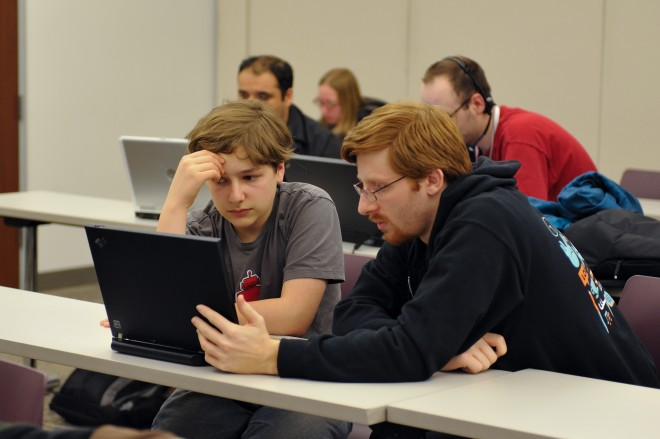

# **W**hy Pushing People to Code Will Widen the Gap Between Rich and Poor

*Image: Kathleen Murtagh / [Flickr](http://www.flickr.com/photos/ceardach/4550838283/)*

Nearly every part of our lives is influenced by code**.** It’s the infrastructure that makes our digital technologies operate — the software that’s [changing our world](http://www.wired.com/opinion/2013/11/software-is-reorganizing-the-world-and-cloud-formations-could-lead-to-physical-nations/)  in innumerable ways — and knowing how to code opens up a new world of opportunities**.** Some would even argue it’s a prerequisite in our increasingly algorithmic existence**.**

So it’s no surprise that we have so many people from Barack Obama (it “[makes sense](http://news.cnet.com/8301-17938_105-57569503-1/obama-endorses-required-high-school-coding-classes/) ” for coding to be written into high school curricula) to NBA superstar Chris Bosh (it’s “simply [about understanding](http://www.wired.com/opinion/2013/10/chris-bosh-why-everyone-should-learn-to-code/)  how the world functions”) arguing everyone should learn to code — and that coding ought to be a required part of a complete education**.** Starting really [young](http://www.wired.com/opinion/2013/09/ap_code/) , “because it is code, not Mandarin, that will be the true *lingua franca* of the future**.**”

Knowing how to code — the narrative goes — will help usnavigate life, snag a lucrative job, and stay competitive with other countries**.** And then there’s the digital version of the “teach a man to fish” adage where a software engineer decided he would [teach](https://medium.com/architecting-a-life/fee8f3ee97a0)  a homeless man to code**.** Though it caused a vitriolic [reaction](http://valleywag.gawker.com/homelessness-solved-1183778023)  amongst tech bloggers, the homeless man was [reportedly](http://www.businessinsider.com/homeless-coder-2013-9)  on his way to finishing up his first app**.**

That is, until he was [arrested](http://gothamist.com/2013/10/14/code_homeless_arrested.php)  and his belongings were seized by the NYPD**.** Because “fairy tales [don’t scale](https://medium.com/weird-future/d19c8db85c2) ” in the real world**.**

All that compiles is not gold. Coding is only a panacea in a world where merit is all it takes to succeed**.** In other words, a starkly different world from the one we [actually live in](http://www.wired.com/opinion/2013/11/silicon-valley-isnt-a-meritocracy-and-the-cult-of-the-entrepreneur-holds-people-back/)  where social structures, systemic biases, and luck may matter more**.**

# Jathan Sadowski

So is it wrong to teach a person to code**?** No. I don’t deny that coding is a useful skill to have in a modern ubiquitous computing society**.** It can help people personalize and understand the devices and services they use on a daily basis**.** It’s also good news that [methods for teaching](http://www.wired.com/opinion/2013/09/ap_code/)  kids how to code are improving and becoming more effective, or that kids can ostensibly [learn on their own](http://www.wired.com/business/2013/10/free-thinkers/)  when left to their own devices**.**

The problem is elevating coding to the level of a required or necessary ability**.** I believe that is a recipe for further technologically induced stratification**.** Before jumping on the everybody-must-code bandwagon, we have to look at the larger, societal effects — or else risk running headlong into an even [wider](http://www.bbc.co.uk/news/world-us-canada-24039202)  inequality gap**.**

For instance, the burden of adding coding to curricula ignores the fact that the English literacy rate in America is still abysmal: 45 million U.S. adults are “functionally illiterate” and “read below a 5th grade level,” according to data [gathered](http://literacyprojectfoundation.org/community/statistics/)  by the Literacy Project Foundation**.** Almost *half* of all Americans read “so poorly that they are unable to perform simple tasks such as reading prescription drug labels**.**” The reading proficiency of Americans is much [lower](http://www.latimes.com/books/jacketcopy/la-et-jc-american-adults-have-low-and-declining-reading-proficiency-20131008,0,3562742.story#axzz2lsbl4Z3Y) than most other developed countries, and it’s declining**.**

We have enough trouble raising English literacy rates, let alone increasing basic computer literacy: the ability to effectively use computers to, say, access programs or log onto the internet**.** Throwing coding literacy into the mix means further divvying up scarce resources**.** Teaching code is expensive. It requires more computers and trained teachers, which many cash-strapped schools don’t have the luxury of providing**.** As software engineer Chase Felker [has](http://www.slate.com/articles/technology/future_tense/2013/08/everybody_does_not_need_to_learn_to_code.single.html)  argued:

> “I’m not sure it’s even possible to teach everyone how to code, but I do know that to mandate programming as a general education requirement would displace something else that we’re already failing to teach, and that’s not good, either**.**”

Focusing on the additional, costly skillset of coding — rather than the other more essential, but still lacking, types of literacy — is the product of myopic technical privilege**.** There’s a reason such arguments arise primarily from the digerati: In that world, basic access is rarely a problem**.**

What’s more, a society where people are expected to know how to code is one where powerful players like big corporations and government are more likely to ignore responsible design obligations — design decisions such as building in privacy protections and making sure technologies have a degree of transparency about how they operate**.** It would be like saying safety-enhancing features in vehicles aren’t necessary because everyone learned the basics in driving school… or worse, who needs to learn when autonomous cars do it for us anyway**?**

Why should a startup or tech goliath worry about concerns such as not exploiting users when people can examine the source code**?** When members of the coderati can customize changes, live in private clouds, and protect only themselves**?**

Even worse is that the “everybody should learn to code” [mindset](http://www.slate.com/blogs/future_tense/2013/03/29/codecademy_hacker_school_why_everyone_should_learn_to_code.html)  adds fuel to the wrongheaded tech-solutionist ideology that tech hacks [can fix](http://www.wired.com/opinion/2013/08/yah-surveillance-sucks-but-technology-isnt-the-only-solution/)  all our problems. And if you don’t have those abilities, well then, perhaps you’re incompatible with our high-tech economy and digital environment**.** If coding becomes a required skill to navigate a technological environment, then a large part of the population without the privilege of becoming fluent in code will be left behind**.** It will be the gap between the coding haves and have-nots**.** A world where filter bubbles and sameness rules over the messy realities of life**.**

But a world where coding dictates the future is not inevitable**.** Instead of making people adapt to technologies — in the process leaving behind large swaths of society — technologies should adapt to *our* needs and values**.** As the media theorist Marshall McLuhan said, “There is absolutely no inevitability as long as there is a willingness to contemplate what is happening**.**” There’s still plenty of room for our contemplation — and deeper consideration — of how to advance our future without leaving anyone behind**.**
