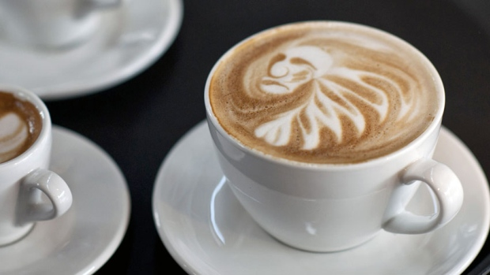
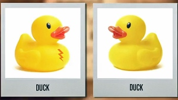

# **C**offee boosts memory retention, study says

Caffeine may deliver a jolt of energy in the morning, but it's also an effective memory enhancer, Johns Hopkins University researchers say in a new study**.** (Morris Mac Matzen/Reuters )

Did you start your morning by preparing a strong cup of coffee**?** Chances are you were also brewing an effective long-term memory tonic, according to researchers with Johns Hopkins University**.**

> "The caffeine enhanced their ability to say, 'This item was similar but not identical to the one I'd seen before**.**'"—Dr. Michael Yassa, Johns Hopkins University

Psychologists and neuroscientists with the Krieger School of Arts & Sciences at Johns Hopkins found that the amount of caffeine consumed daily by the average American adult — 200 milligrams, or roughly the equivalent of a strong cup or two small cups of coffee — helped to bolster the brain's "pattern separation" performance**.**

Pattern separation refers to the ability to discern between two similar but not identical events or experiences, and is considered to be an effective yardstick for measuring recall accuracy**.**

This computational power in our brains prevents our memories from getting muddled and can also be crucial to learning, as it helps us recognize whether a piece of information is foreign or must be assigned some new meaning**.**

The results are published in the journal [Nature Neuroscience](http://www.nature.com/neuro/journal/vaop/ncurrent/abs/nn.3623.html) **.**

## Caffeine tablets

Michael Yassa, one of the paper's co-authors and an assistant professor of psychological and brain sciences, said scientists have long known that caffeine has "cognitive-enhancing effects," but an analysis of how the stimulant also helps humans prevent memory loss hasn't been deeply studied**.**

"I'm one of those people that feels they can't function without coffee," Yassa says in a [video released about the study](http://www.youtube.com/watch?v=quvKBJKoRgo&feature=player_embedded) **.**

Researchers recruited more than 150 people for the double-blind trial**.** Participants were people who did not regularly consume caffeinated products**.**

Before the caffeine was administered, subjects were shown pictures of everyday objects such as a rubber duck or an office chair**.** The participants were then divided into two groups — one that received a placebo and another that was administered a 200-milligram caffeine tablet**.**

The placebo and caffeine tablets were only given five minutes after the study phase**.** The participants returned 24 hours later to be tested again and were asked to recognize images that were either the same as pictures viewed the day before, completely new or similar but slightly altered**.**

For example, a slightly altered image of a rubber duck could have new characteristics such as a small orange mark on its chest, or it could be a mirror image of the original**.**

## 'Tricky' items

"We found that those who were administered caffeine actually had better retention of the information we taught them the day before," Yassa said**.** "The caffeine enhanced their ability to say, 'This item was similar but not identical to the one I'd seen before**.**'"

Two side-by-side images of rubber ducks show slight differences in characteristics**.** The caffeinated group was more easily able to distinguish between the two in a memory test, according to Johns Hopkins University researchers**.** (Johns Hopkins University)

This pattern separation ability reflects a deeper level of memory retention, the researchers said, because a standard recognition test omitting the "tricky similar items" would likely show the caffeinated and non-caffeinated groups performing equally**.**

Yassa said that another condition that set this experiment apart was that caffeine was only administered after the study period**.**

"By administering caffeine after the experiment, we rule out all of these effects and make sure that if there is an enhancement, it’s due to memory and nothing else,” he said**.**

According to the U.S. Food and Drug Administration, 90 per cent of people worldwide consume caffeine in one form or another**.** The 2013 Canadian Coffee Drinking Study said that 78 per cent of Canadians aged 18-79 drank coffee within the past week (the survey results were released on Oct**.** 24, 2013).

Yassa said the researchers' next step will be to figure out the brain mechanisms driving this enhanced memory retention**.** Brain-imaging may be able to answer some of these questions, he said**.**
