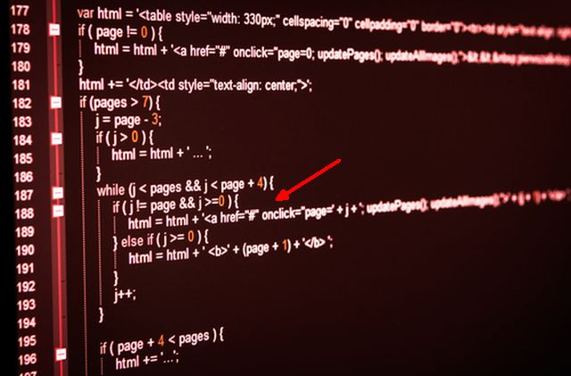

# 6 Life Habits That Programming Could Teach You Today

[Ads by Google](https://www.google.com/url?ct=abg&q=https://www.google.com/adsense/support/bin/request.py%3Fcontact%3Dabg_afc%26url%3Dhttp://www.makeuseof.com/tag/6-life-habits-programming-teach-today/%26gl%3DBR%26hl%3Den%26client%3Dca-pub-5700237260308472%26ai0%3DCE8O9T3nZUri1M8y3lQeInICQBMafg7ADrvXfs3j--vbpvgEQASDjh4ANKARQgtaim_7_____AWDNwOeAnAOgAY7Uu_sDyAEBqQLot6Fza35qPqgDAaoEjwFP0Kp5ZjBwZ6zanfN_pNBVm4AadbXIaowHgcgDKwLUR1vq30taY9qo--wU_Expcq1vMb14KcLgUCfu9jNSnvpuaW6AybGElUPJBq-67OeTxVHIiwS4saHudmjCjAdIMAD84Cv27MLfkAyXGOYqRLUO-_bVngW01nLGO-yqm4VKQd9XAH2Zj4oeuOWY2tHhKIgGAYAH2qvEBA%26ai1%3DCAYNGT3nZUri1M8y3lQeInICQBIPw078Eu-DG-JUB54CghjQQAiDjh4ANKARQjaWV2vj_____AWDNwOeAnAOgAdO4lP8DyAEBqAMBqgSQAU_Q2nehKmpelGgu4xmk0AzYjBB7pc58hg7JhQ8ptQ8FcPbfTxB22vD77E2_QGN8vWknt3Fhj-xSZbXjNRqH4S9sYYOB9I2WSNQB8efu-pvQQsSLAL-467dnbMCHQhErC_n4fSFtwV5SD1LS4jzluIfG2SJ1GYjSU8LO76pbcIm03FcQiIp6yR74BZ7UQJ_sk4gGAYAHlcdr%26ai2%3DCPfkyT3nZUri1M8y3lQeInICQBJeOjdMC956lxAzAjbcBEAMg44eADSgEUOiR5XlgzcDngJwDoAH1-Yv8A8gBAagDAaoEiwFP0OojrSprXpRoLuMZpNAM2IwQe6XOfIYOyYUPKbUPBXD2308Qdtrw--xNv0BjfL1pJ7dxYY_sUmW14zUah-EvbGGDgfSNlkjUAfHn7vqb0ELEiwC_uOu3Z2zAh0IRKwv5-H1ZbsEWUql-T6Ec5HTMECHNgwVg0YcFzu-qW3BZtNxXUIiab8ylU6ibiAYBgAfzhfQD%26ai3%3DClCQkT3nZUri1M8y3lQeInICQBPed3MYD35im1kfAjbcBEAQg44eADSgEUPajv_T5_____wFgzcDngJwDoAGVj6z_A8gBAakCCTjt6a--tj6oAwGqBIoBT9D6E6MqbF6UaC7jGaTQDNiMEHulznyGDsmFDym1DwVw9t9PEHba8PvsTb9AY3y9aSe3cWGP7FJlteM1GofhL2xhg4H0jZZI1AHx5-76m9BCxIsAv7jrt2dswIdCESsL-fh9WW7BFlLRbXzwHOR0zBAhzYMFYNGHBc7vqltwWbTcV1CImm_MpVQTiAYBgAfT8FM&usg=AFQjCNF7dfQTE5fAk0aIVkH4jype8-BX2A)

[**Try Easy Redmine for Free**](http://www.googleadservices.com/pagead/aclk?sa=L&ai=CE8O9T3nZUri1M8y3lQeInICQBMafg7ADrvXfs3j--vbpvgEQASDjh4ANKARQgtaim_7_____AWDNwOeAnAOgAY7Uu_sDyAEBqQLot6Fza35qPqgDAaoEjwFP0Kp5ZjBwZ6zanfN_pNBVm4AadbXIaowHgcgDKwLUR1vq30taY9qo--wU_Expcq1vMb14KcLgUCfu9jNSnvpuaW6AybGElUPJBq-67OeTxVHIiwS4saHudmjCjAdIMAD84Cv27MLfkAyXGOYqRLUO-_bVngW01nLGO-yqm4VKQd9XAH2Zj4oeuOWY2tHhKIgGAYAH2qvEBA&num=1&cid=5Gi8ePdDswu9WyETN_huc-QK&sig=AOD64_0Z3W2jvpKlwxt7ZneZRDyDFbS5WQ&client=ca-pub-5700237260308472&adurl=http://www.easyredmine.com/landing-en)  Implementation, plugins & support**.** Easy Redmine = great pm software.  
  
[easyredmine.com/30-day-Free-trial](http://www.googleadservices.com/pagead/aclk?sa=L&ai=CE8O9T3nZUri1M8y3lQeInICQBMafg7ADrvXfs3j--vbpvgEQASDjh4ANKARQgtaim_7_____AWDNwOeAnAOgAY7Uu_sDyAEBqQLot6Fza35qPqgDAaoEjwFP0Kp5ZjBwZ6zanfN_pNBVm4AadbXIaowHgcgDKwLUR1vq30taY9qo--wU_Expcq1vMb14KcLgUCfu9jNSnvpuaW6AybGElUPJBq-67OeTxVHIiwS4saHudmjCjAdIMAD84Cv27MLfkAyXGOYqRLUO-_bVngW01nLGO-yqm4VKQd9XAH2Zj4oeuOWY2tHhKIgGAYAH2qvEBA&num=1&cid=5Gi8ePdDswu9WyETN_huc-QK&sig=AOD64_0Z3W2jvpKlwxt7ZneZRDyDFbS5WQ&client=ca-pub-5700237260308472&adurl=http://www.easyredmine.com/landing-en)   
  
 [**$0**.**01 Web Hosting**](http://www.googleadservices.com/pagead/aclk?sa=L&ai=CAYNGT3nZUri1M8y3lQeInICQBIPw078Eu-DG-JUB54CghjQQAiDjh4ANKARQjaWV2vj_____AWDNwOeAnAOgAdO4lP8DyAEBqAMBqgSQAU_Q2nehKmpelGgu4xmk0AzYjBB7pc58hg7JhQ8ptQ8FcPbfTxB22vD77E2_QGN8vWknt3Fhj-xSZbXjNRqH4S9sYYOB9I2WSNQB8efu-pvQQsSLAL-467dnbMCHQhErC_n4fSFtwV5SD1LS4jzluIfG2SJ1GYjSU8LO76pbcIm03FcQiIp6yR74BZ7UQJ_sk4gGAYAHlcdr&num=2&cid=5Gi8ePdDswu9WyETN_huc-QK&sig=AOD64_1tyPPUPWGPqnnK18lPuaYKGtmdbQ&client=ca-pub-5700237260308472&adurl=http://secure.hostgator.com/~affiliat/cgi-bin/affiliates/clickthru.cgi%3Fid%3Dgoogle%26page%3Dhttp://marketing.hostgator.com/promo/penny.html)  Scalable, Secure Web Hosting**.** Try Our Award-Winning Service Now!  
  
[www.hostgator.com/1Penny](http://www.googleadservices.com/pagead/aclk?sa=L&ai=CAYNGT3nZUri1M8y3lQeInICQBIPw078Eu-DG-JUB54CghjQQAiDjh4ANKARQjaWV2vj_____AWDNwOeAnAOgAdO4lP8DyAEBqAMBqgSQAU_Q2nehKmpelGgu4xmk0AzYjBB7pc58hg7JhQ8ptQ8FcPbfTxB22vD77E2_QGN8vWknt3Fhj-xSZbXjNRqH4S9sYYOB9I2WSNQB8efu-pvQQsSLAL-467dnbMCHQhErC_n4fSFtwV5SD1LS4jzluIfG2SJ1GYjSU8LO76pbcIm03FcQiIp6yR74BZ7UQJ_sk4gGAYAHlcdr&num=2&cid=5Gi8ePdDswu9WyETN_huc-QK&sig=AOD64_1tyPPUPWGPqnnK18lPuaYKGtmdbQ&client=ca-pub-5700237260308472&adurl=http://secure.hostgator.com/~affiliat/cgi-bin/affiliates/clickthru.cgi%3Fid%3Dgoogle%26page%3Dhttp://marketing.hostgator.com/promo/penny.html)   
  
 [**Flowchart Software**](http://www.googleadservices.com/pagead/aclk?sa=L&ai=CPfkyT3nZUri1M8y3lQeInICQBJeOjdMC956lxAzAjbcBEAMg44eADSgEUOiR5XlgzcDngJwDoAH1-Yv8A8gBAagDAaoEiwFP0OojrSprXpRoLuMZpNAM2IwQe6XOfIYOyYUPKbUPBXD2308Qdtrw--xNv0BjfL1pJ7dxYY_sUmW14zUah-EvbGGDgfSNlkjUAfHn7vqb0ELEiwC_uOu3Z2zAh0IRKwv5-H1ZbsEWUql-T6Ec5HTMECHNgwVg0YcFzu-qW3BZtNxXUIiab8ylU6ibiAYBgAfzhfQD&num=3&cid=5Gi8ePdDswu9WyETN_huc-QK&sig=AOD64_1fzcLJX22YbhSLUVTOeTF43zMFBQ&client=ca-pub-5700237260308472&adurl=http://www.SmartDraw.com/specials/ppc/flowcharting-software.htm%3Fid%3D216014)  Create Perfect Flowcharts Fast See Examples**.** Free Trial!  
  
[www.smartdraw.com](http://www.googleadservices.com/pagead/aclk?sa=L&ai=CPfkyT3nZUri1M8y3lQeInICQBJeOjdMC956lxAzAjbcBEAMg44eADSgEUOiR5XlgzcDngJwDoAH1-Yv8A8gBAagDAaoEiwFP0OojrSprXpRoLuMZpNAM2IwQe6XOfIYOyYUPKbUPBXD2308Qdtrw--xNv0BjfL1pJ7dxYY_sUmW14zUah-EvbGGDgfSNlkjUAfHn7vqb0ELEiwC_uOu3Z2zAh0IRKwv5-H1ZbsEWUql-T6Ec5HTMECHNgwVg0YcFzu-qW3BZtNxXUIiab8ylU6ibiAYBgAfzhfQD&num=3&cid=5Gi8ePdDswu9WyETN_huc-QK&sig=AOD64_1fzcLJX22YbhSLUVTOeTF43zMFBQ&client=ca-pub-5700237260308472&adurl=http://www.SmartDraw.com/specials/ppc/flowcharting-software.htm%3Fid%3D216014)   
  
 [**Study Spanish Abroad**](http://www.googleadservices.com/pagead/aclk?sa=L&ai=ClCQkT3nZUri1M8y3lQeInICQBPed3MYD35im1kfAjbcBEAQg44eADSgEUPajv_T5_____wFgzcDngJwDoAGVj6z_A8gBAakCCTjt6a--tj6oAwGqBIoBT9D6E6MqbF6UaC7jGaTQDNiMEHulznyGDsmFDym1DwVw9t9PEHba8PvsTb9AY3y9aSe3cWGP7FJlteM1GofhL2xhg4H0jZZI1AHx5-76m9BCxIsAv7jrt2dswIdCESsL-fh9WW7BFlLRbXzwHOR0zBAhzYMFYNGHBc7vqltwWbTcV1CImm_MpVQTiAYBgAfT8FM&num=4&cid=5Gi8ePdDswu9WyETN_huc-QK&sig=AOD64_1vIQsvCkw2-QucXPThTK1ukdVs6w&client=ca-pub-5700237260308472&adurl=http://www.babylon-idiomas.com/en/index.htm)  in Spain, Argentina or Costa Rica Intensive Courses, Small Groups  
  
[www.babylon-idiomas.com](http://www.googleadservices.com/pagead/aclk?sa=L&ai=ClCQkT3nZUri1M8y3lQeInICQBPed3MYD35im1kfAjbcBEAQg44eADSgEUPajv_T5_____wFgzcDngJwDoAGVj6z_A8gBAakCCTjt6a--tj6oAwGqBIoBT9D6E6MqbF6UaC7jGaTQDNiMEHulznyGDsmFDym1DwVw9t9PEHba8PvsTb9AY3y9aSe3cWGP7FJlteM1GofhL2xhg4H0jZZI1AHx5-76m9BCxIsAv7jrt2dswIdCESsL-fh9WW7BFlLRbXzwHOR0zBAhzYMFYNGHBc7vqltwWbTcV1CImm_MpVQTiAYBgAfT8FM&num=4&cid=5Gi8ePdDswu9WyETN_huc-QK&sig=AOD64_1vIQsvCkw2-QucXPThTK1ukdVs6w&client=ca-pub-5700237260308472&adurl=http://www.babylon-idiomas.com/en/index.htm)

By [Ryan Dube](http://www.makeuseof.com/tag/author/ryandube/)  on 9th January, 2014 | [Offbeat Stuff](http://www.makeuseof.com/service/offbeat/ "View all posts in Offbeat Stuff") , [The Internet](http://www.makeuseof.com/service/web-based/ "View all posts in The Internet")  |  [15 Comments](#first-comment)

Everything important that you need to know about living a successful life, you can get from a computer program**.** Don’t believe me? Read on.

When I first started programming as a young kid, it only amounted to copying foreign-looking words and symbols out of a computer magazine so that my brother and I could get our old Franklin 64 with a dual floppy drive to play a cute little digital tune at us**.** Back then, there weren’t many life lessons to discern out of that cryptic text**.**

A number of years later, in high school Pascal class, things started to look different**.** Learning about IF statements and FOR loops started to spark philosophical synapse connections the likes of which Walt Whitman and Robert Frost would have been proud of**.** Okay, I exaggerate a bit, but still the insights were pretty cool**.**

Yes, I know, it’s quite a nerdy thing to say — but the truth is that there’s a lot of wisdom in code…**.**in while statements, arrays, methods, objects and all that**.** In fact, a whole lot that I learned about managing life in general came directly from my study of various programming languages**.**

## Flow Charts Simplify Everything

Many programmers start out using flow charts long before they ever start writing a single line of code**.** The reason for this is, trying to write an entire program all at once can feel really overwhelming at times, especially when the program is going to accomplish some pretty complex tasks**.**

Programmers will take that big, giant software project, and then break them down into smaller components that can be better managed — sort of like building a car by building each required component first, before assembling them all together**.**  Each component is a block (or several blocks) of code that take in specific sets of input values or actions, and then accomplish some output task**.** Within that component, a programmer will trace out the logic from input to output using flow charts**.**

Flow charts help you follow the logic in a visual format that is far easier to understand than if you try to write it out in text, or just try to blow right through writing code and figuring it out as you go**.** The reason programmers don’t figure out the logic “on the fly” like this is because the logic that comes later often depends a great deal on the decisions you make about how to handle the earlier logic in the program**.** Decide wrong early, and you could program yourself into a dead-end**.**

The same is true in life**.** When you’re making a decision about how to go about [paying off debt](http://www.makeuseof.com/tag/excel-spreadsheet-techniques-to-make-a-personal-budget/) , [buying a house](http://www.makeuseof.com/tag/the-best-free-websites-to-find-foreclosed-houses/) , or how to handle any other complex life situation or even how to [manage a project](http://www.makeuseof.com/tag/trello-unique-simple-powerful-project-management-system-good-home/)  at work**.** All of those seemingly insurmountable tasks can be better managed when you first sit down, put pen to paper, and [draw out a creative flow chart](http://www.makeuseof.com/tag/5-flowchart-examples-streamline-work-life/)  of every step in the process or decision**.** This will help you decide on all possible choices or predict all possibilities at each stage, and then trace through the various scenarios**.** Just like with programming, understanding how early choices could affect the outcomes later on will help you make much better-educated decisions early on**.**

## Everything Has Its Place

Whenever you launch into writing a script or a program, the first step is to always create your variables**.** In programming, there are variables of different types**.** You’ve got strings to hold text, integers to hold non-decimal numbers, double or variants to handle bigger numbers, and then you’ve got arrays, structures and more**.** The idea is to define a variable that’s suitable for the task at hand**.** For example, if the output of a function is the name of a person, then a string variable is what you want**.**

The same is true when you’re organizing your life, whether it’s your house or your office**.** You choose the size of containers for things based on how much of it you need to store**.** A small, clear plastic bin for dry goods or a rack of like well-labeled containers for spices to conserve space**.** At the office, you want to store daily work documents in a drawer in your desk, but you store sensitive, business documents in a locked cabinet**.** The right container for everything, and everything has it’s right place – it’s the motto for a well organized life**.**

## Re-Use Program Modules to Save Time

Any good programmer eventually learns that certain blocks of code, otherwise known as “functions” can be reused in multiple programs. For example, one function to convert from Fahrenheit to Celsius can be used in any program you’re creating that needs that kind of task completed**.** The function is simply a module that takes the temperature in Fahrenheit and gives it back to you in Celsius**.** The function may include a certain number of lines of code, but why would you re-create those lines of code for every program you write, when you can just save them once as a program “module”, and then insert that module into any future programs that need it**?**

Henry Ford once said about his famous Model T, “Any customer can have a car painted any colour that he wants, so long as it is black**.**”

The reason for this is that Ford had figured out how to assemble cars and get them out the door faster if he could reuse the same equipment (and the same color paint) without having to recreate the process every time a new car was made**.** This gave birth to the assembly-line, and it revolutionized the auto industry**.** In the same way, you can use this principle in every area of your life where you do the same task over and over**.** Automation is the key to success, so if you can find ways to automate tasks in your job that you do repeatedly — you can make your day much more efficient and save time**.**

As a start, go through our [Automation Guide for The Web](http://www.makeuseof.com/pages/web-automation-part-1) **.**

## Document Everything

Sometimes, it can be pretty tempting for a programmer to just fly through writing code without documenting a single thing**.** It’s tempting because, any moment you know exactly what you want the program to do and how you want to do it**.** Documenting a program takes time**.** You have to describe how and why you’re doing each step**.** It seems pointless at the time, but months later when you decide to reuse that code or modify it for another purpose, it can mean the difference between struggling through trying to remember what the heck you were doing with each line of code, or quickly getting back up to speed with the whole intent behind your logic**.**

This meticulous documentation can help in every area of life, from keeping track of birthdays and anniversaries, to keeping a log of daily business transactions and why you made them**.** Daily life can turn into a blur of days passing by, with decisions coming and going like leaves blowing by in the wind**.** It’s naive and inefficient to trust only your memory to remember why you attended certain meetings or why you made certain purchases**.** A [daily journal](http://www.makeuseof.com/tag/the-beginners-guide-to-digital-journaling/)  or log can go a long way to freeing up your mind for more important things**.**

## Always Leave Yourself an Escape Route

One of the most common mistakes of an amateur programmer is the infinite loop**.** That’s a situation where the condition required to break out of the loop never actually takes place, so the program stays in that loop and never ends — this consumes 100% of the PC CPU and pretty much locks up the computer for good until you kill the process**.**

The lesson that amateur programmer needs to learn is that whenever you create a loop to perform some kind of task that chews up a lot of CPU power, it’s important to introduce a release valve of sorts**.** In other words, instead of basing a While loop on whether or not your calculation exceeds a certain value (which it might never reach in some cases), it’s a good idea to introduce a very basic loop count and then add a secondary condition where the loop must end if it exceeds a certain ridiculous number of loops it should never really reach if everything is working okay**.**

How might this apply to real life**?** It goes to show that even when you think you have everything planned perfectly, things can go wrong**.** One example might be planning a week-long family vacation in the most beautiful, relaxing tropical paradise, only to have it end up raining the entire week**.** The idea of an “escape route” in life is to think of the “worst case” scenario, and then figure out how you’re going to either avoid that situation or make the best of it, if it comes true**.**

Life isn’t always predictable, and some of the best-laid plans can easily unravel, even when you think nothing at all can go wrong**.** Planning for the worst contingency will make sure that you don’t end up dead-in-the-water when that event that you never expected to happen actually comes true**.**

## Free Up Memory When You’re Done

The final life lesson that comes out of programming is cleaning up after yourself**.** In a program, you will need to open up a stream to an output file, create a large array filled with data points, and other things that consume computer memory and resources**.** A clean program is one that closes those output streams or empties those arrays once the program is done with them**.** The idea here is to avoid a common problem with poorly written applications known as a memory leak**.**

For example, in a simple VB app, you would clear an array like this:

*Erase ArrayDin*

Or close out a file stream like this:

*FileClose(1)*

It sounds like something you’ve probably heard your mother say when you were younger, right**?** Clean your room**.** Put your clothes away. Do your dishes. However, taken a step further, putting away the tools that you’re currently using for the task at hand not only keeps your home and your workspace tidy, it also leaves you with plenty of space to accomplish your next project more quickly**.** Leaving things hanging around just wastes space and wastes your time when you can’t find what you need later on**.**

## Bottom Line

The truth is, there aren’t just six life lessons that you can learn from the art of programming — there are many more**.** When it comes to organization, planning, plotting out strategies, and conserving resources, computer programmers have got it figured out**.** There’s a lot to be learned from taking the time to [learn a programming language](http://www.makeuseof.com/tag/programming-language-learn-software-development/) , beyond just programming itself**.** In fact, this is why every child should learn at least one programming language in school — because once you’ve caught on to the tricks of the trade, it becomes apparent pretty fast that you can use those same tricks throughout many other parts of your life**.**

What are some of the other life lessons you found a parallel for in the world of programming**?**

Image Credits: [Flow Chart Diagram](http://image.shutterstock.com/display_pic_with_logo/159397/159397,1264268377,2/stock-photo-a-flow-chart-diagram-representing-if-statement-computer-programming-45102430.jpg)  at Shutterstock, [Javascript Code](http://image.shutterstock.com/display_pic_with_logo/157666/157666,1321883538,1/stock-photo-screen-with-javascript-code-89257249.jpg)  at Shutterstock, [Programming HTML code](http://image.shutterstock.com/display_pic_with_logo/163852/163852,1248318968,1/stock-photo-programming-html-code-34098682.jpg)  at Shutterstock, [program code on monitor](http://image.shutterstock.com/display_pic_with_logo/273481/158882201/stock-photo-program-code-on-a-monitor-158882201.jpg)  via Shutterstock, [Pavel L Photo and Video](http://www.shutterstock.com/gallery-4225p1.html?cr=00&pl=edit-00)  / [Shutterstock.com](http://www.shutterstock.com/?cr=00&pl=edit-00)

Check out more about: [programming](http://www.makeuseof.com/tags/programming/) , [self-improvement](http://www.makeuseof.com/tags/self-improvement/)
