# 15 Windows Phone 8 podcatchers compared and reviewed (part 1)

Published by [Steve Litchfield](http://allaboutwindowsphone.com/authors/steve-litchfield.php) at 9:10 UTC, January 22nd 2014

Podcatching, as you'll probably know, is the act of grabbing podcasts directly, over the air, on your smartphone. Automatically, seamlessly and without needing a desktop or any direct manual intervention. And then sorting them, playing them back in sensible fashion, working around interruptions, and cleaning up afterwards. It's a tall order for an application, yet we have no less than FIFTEEN likely contenders here for Windows Phone 8, all of which I've put through their paces. The first nine in this, part 1 of the feature, and the remaining six, plus a verdict, in [part 2 of the feature here](http://allaboutwindowsphone.com/features/item/19144_15_Windows_Phone_8_podcatchers.php).

I don't need to evangelise the need for a good podcatcher to you, gentle reader. The very fact that you're reading on means that you're a podcast fan and that you too want a decent system for grabbing them on Windows Phone 8. Note that this is all explicitly under GDR2 (or later), since it was in this OS update that background updating and downloading of podcasts actually became reliable.

In contention, we have, starting in part 1:

- DotArrow's [i Podcast](http://allaboutwindowsphone.com/software/content/i-Podcast.php)
- Singular Scope's [Podcast Brain](http://allaboutwindowsphone.com/software/content/Podcast-Brain.php)
- Johan Paul's [Podcatcher](http://www.windowsphone.com/en-gb/store/app/podcatcher/5d5cebe9-420a-4566-a468-04c94aa34d93) (also available for the Meego-powered Nokia N9, interestingly)
- Igneous Software's [Podcast Lounge](http://www.windowsphone.com/en-gb/store/app/podcast-lounge/83bc0329-8e02-410e-b6d2-da3c0c1d971d)
- Jendalu Ventures' [Podcast Bandit](http://www.windowsphone.com/en-gb/store/app/podcast-bandit/6666709a-d718-4738-a917-7967f8dc807e)
- FrostyNixon Software's [SlapDash Podcasts](http://www.windowsphone.com/en-gb/store/app/slapdash-podcasts-full/5d3de26c-d271-4ea2-8f5c-73aded12b647)
- ObjectivePixel's [BringCast](http://www.windowsphone.com/en-gb/store/app/bringcast/e5abef38-d413-e011-9264-00237de2db9e)
- Apocalypse Interrupted's '[Play, Look and Listen](http://www.windowsphone.com/en-gb/store/app/play-look-and-listen/fb0e9059-e237-e011-854c-00237de2db9e)'
- Juuso Ala-Uotila's [WPodder](http://www.windowsphone.com/en-gb/store/app/wpodder/5ad3fe0d-c0bb-41e7-a3c1-306b596237e8)

...and in [part 2 of this feature](http://allaboutwindowsphone.com/features/item/19144_15_Windows_Phone_8_podcatchers.php) (split for length):

- Meltingbot Software's emphatically named [PODCASTS](http://www.windowsphone.com/en-gb/store/app/podcasts/ff0796f0-a6e2-df11-a844-00237de2db9e)!
- Constructiv's [Carboncast](http://allaboutwindowsphone.com/software/content/Carboncast.php)
- Richard Szalay's [Podcaster](http://allaboutwindowsphone.com/software/content/Podcaster_2.php)
- Volker Voecking's [Podcast Picker](http://allaboutwindowsphone.com/software/content/Podcast-Picker.php)
- Monster's [P | Cast](http://allaboutwindowsphone.com/software/content/P--Cast.php)
- create.ding's [pod.ding](http://allaboutwindowsphone.com/software/content/podding.php)

For a mobile platform that started out with no way to grab podcasts at all - Microsoft's vision was that everything had to be synced in, iPhone-style (even the iPhone has now moved away from this model), from a Windows Desktop and Zune - that's a *lot* of options in 2013.

Which is why a group test was in order.

Now, obviously, I can't go into gory detail for each of the applications, every last setting and feature can't be explored. But I can set out some ground rules and see how well each of the applications do:

1. **Import** of an existing set of podcasts (e.g. from an OPML or XML file, or from an online service such as gpodder.net) - having to add podcasts manually by searching or typing in URLs is a right pain when you've got 20 or 30!
2. Include **search** functions for new podcasts that you've been told about, or for simply browsing for likely candidates. The test search strings here are for the [AAWP podcast](http://allaboutwindowsphone.com/media/) (of course), plus my own [Phones Show Chat](http://stevelitchfield.com/), a totally separate entity with different RSS/directory history, and the fairly new [Tech Talk UK](http://www.techtalkuk.com/).
3. Auto-check for new programmes in each feed and **auto-download** them in the background (this being Windows Phone, with its multitasking restrictions, it's a probable that the application will probably have to at least start in the foreground, i.e. you'd tap on the application's icon or live tile).
4. Play podcasts, of course, **remembering where you'd got to in each** - Windows Phone is famous for terminating (hibernating) applications in the background, so the podcast application needs to do everything it can to keep track of your listening positions.
5. **List new programmes**, across all your feeds, in chronological order, or at least isolating new content that you haven't heard yet.
6. Include **clean-up** options to remove listened-to podcasts and reclaim space on the phone, preferably as quickly and automatically as possible.
7. Able to run in **dark or light themes**, according to AMOLED-screened power efficiency and taste/preference - note that this doesn't have to be an explicit setting in the application, so long as the app picks up the chosen Windows Phone 'theme'.
8. Ability to **skip** past adverts with 'nudge' controls, both in the main UI and in the OS's pop-up audio handler (as opposed to moving between podcasts as if they were music tracks)

\_\_\_\_\_\_\_\_\_\_\_\_\_\_\_\_\_\_\_\_\_\_\_\_\_\_\_\_

## [iPodcast](http://allaboutwindowsphone.com/software/content/i-Podcast.php) (v2.7.1)

|  |  |  |  |  |  |  |  |  |
| --- | --- | --- | --- | --- | --- | --- | --- | --- |
| Import/sync | Directory search | Auto check | Auto download | Playback position | What's new | Clean-up | Dark compatible | Skip? |
| Yes\* | Yes | Yes | Yes | Yes | Yes | Yes | Yes | Yes |

\* via a specific URL that you set up

Getting set up isn't trivial, in that the only way to import your set of podcasts is via an online .OPML file - and I'm not talking about SkyDrive. Instead, you have to FTP up your .OPML file to webspace that you own and then type this URL in painstakingly in iPodcast. Still, it did work, accompanied by a chorus of bleeps and jangles - happily the many sound notifications here can be turned off in the Settings.

If you have a new podcast that you want to search for then there's a decent search engine - it's not clear which directory is used but it found all of my test podcasts.

The auto-download and auto-clean-up of podcasts is all present and correct, plus playback position was largely remembered within each podcast. However, I found it odd that, returning to the application after doing something else that used Windows Phone's audio system, the lack of a 'Now playing' (or similar) screen meant that there's no way to immediately resume what you were listening to - you have to remember it or scan down the list of feeds manually, looking for something unfinished.

Solid functionality, once set up then, but the UI, though improved over earlier versions, still feels like it could be tweaked for easier access. In addition, it's a little basic graphically, not helped by failing to grab the cover art for most podcasts. Add in the odd error mesage and you can see that there's still work to be done here.

Overall rating: **71%**

Gallery of screenshots - iPodcast:

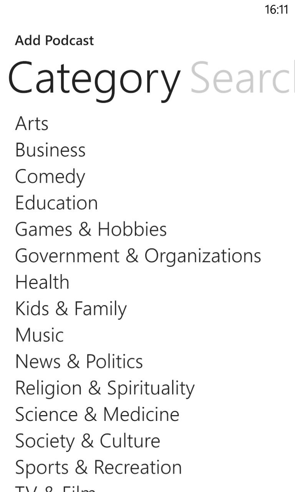

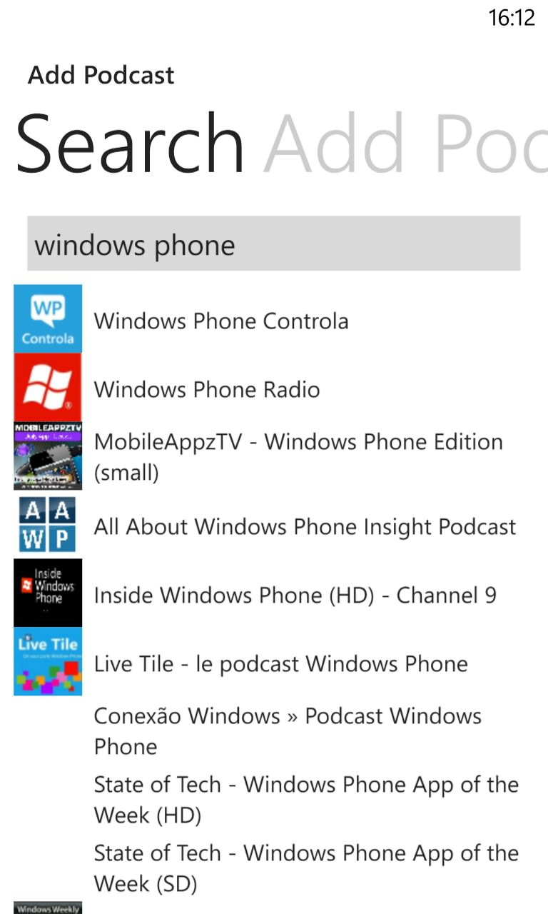

A decent hierarchical podcast directory...

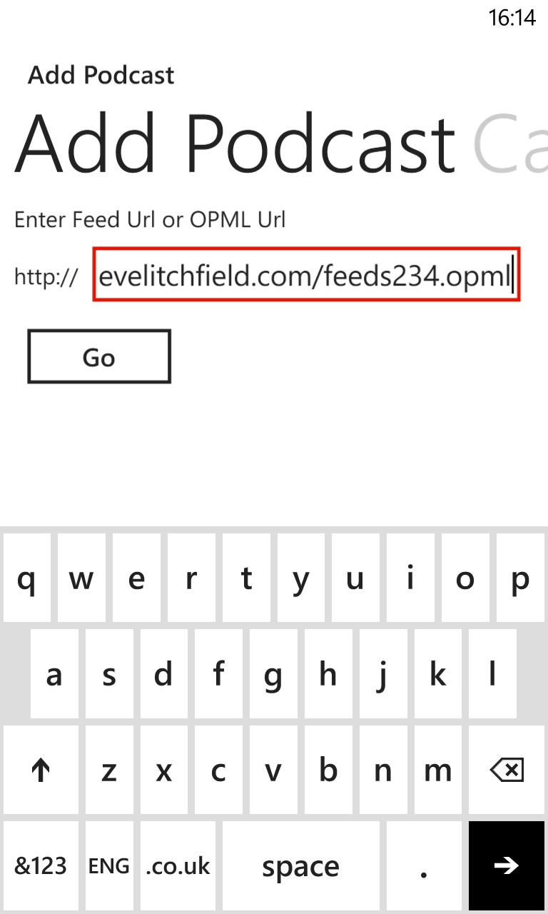

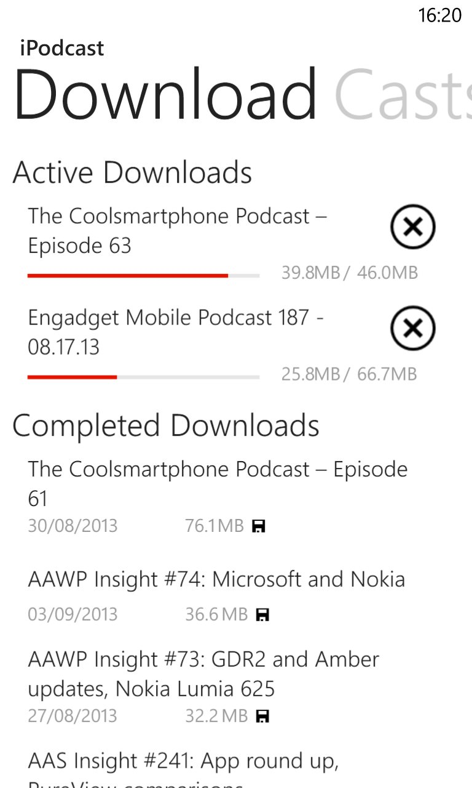

Having to explicitly put my OPML file online via FTP, in order to import it - ugh! (right) a great overview of what's downloading and what's new.

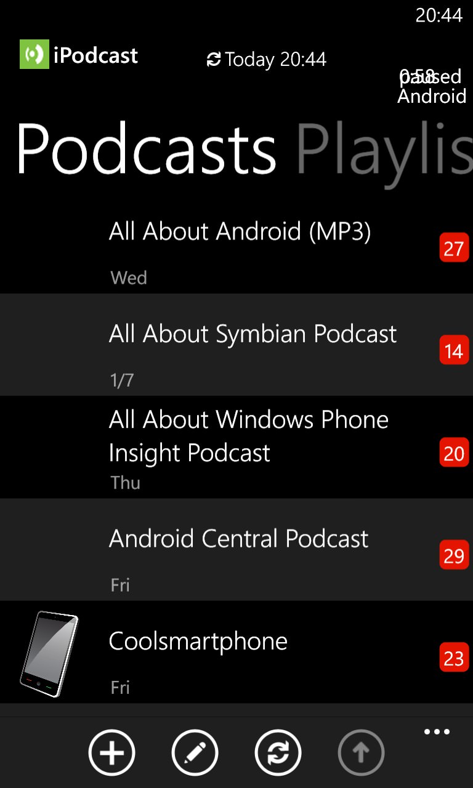

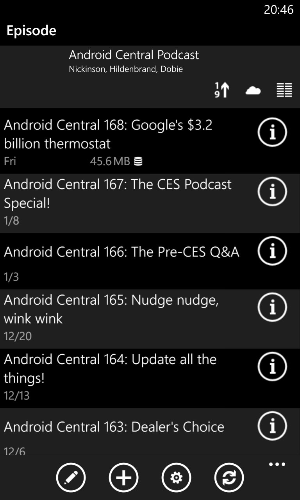

The main feeds list and, right, digging down into a feed's episodes, all of this now in the optional dark theme.

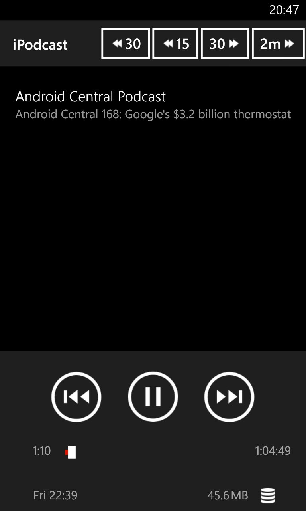

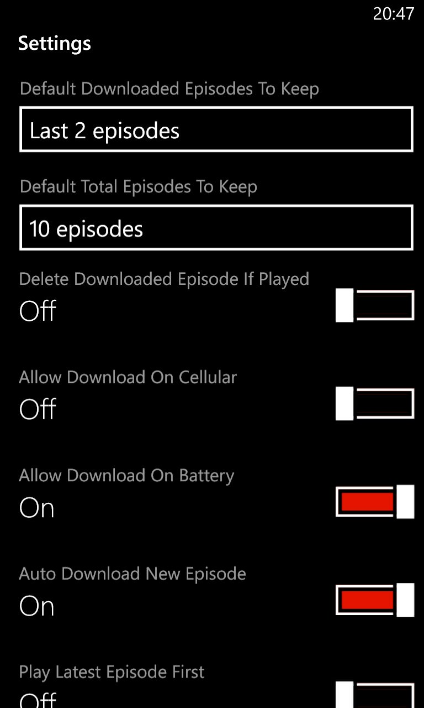

As in the main feeds list, the cover art from quite a few podcasts simply eluded iPodcast - very odd. (Right) Some of the extensive settings available.

## [Podcast Brain](http://allaboutwindowsphone.com/software/content/Podcast-Brain.php) (v2.2.3.32312)

|  |  |  |  |  |  |  |  |  |
| --- | --- | --- | --- | --- | --- | --- | --- | --- |
| Import/sync | Directory search | Auto check | Auto download | Playback position | What's new | Clean-up | Dark compatible | Skip |
| Yes\* | Yes | Yes | No | Yes | Yes | Yes | Yes | Yes\*\* |

\* only via previously backed up SkyDrive config from Podcast Brain on another device, or via import from a specific OPML file on a web URL, manually uploaded and typed in here. It works, but gPodder would have been a lot easier....

\*\* Skipping from the WP pop-up audio handler is done via tapping and holding for a few seconds - it's not an exact science, but it's better than nothing!

Yes, that really is the version number above. To the developer: what on earth was wrong with just v2.2.3?(!) Podcast Brain has improved a lot in the last six months, but there's still a way to go. When finding feeds manually in the search system, there's the ugly step of seeing the underlying RSS addresses, which then have to be accepted - it's all a little clumsy.

All feed downloads have to be done manually, which is a bit of a blow. Plus downloads don't continue when you switch away from Podcast Brain, so you may have to keep it in the foreground a lot longer than you might like. Playback position wasn't always remembered properly, plus there are no nudge controls, either in the main user interface or in the OS's audio playback pop-ups.

It's also hard to get a complete overview of what's new since you can only see each feed's episodes, one at a time, plus I encountered numerous glitches and 'application errors'.

There is an innovative 'car mode', but the large buttons only skip backwards and forwards by entire episodes, which is little use (skipping by a minute or so each way would be far better, obviously).

Overall, Podcast Brain seems very buggy still - steer clear until a lot more work is done here.

Overall rating: **51%**

Gallery of screenshots - Podcast Brain:

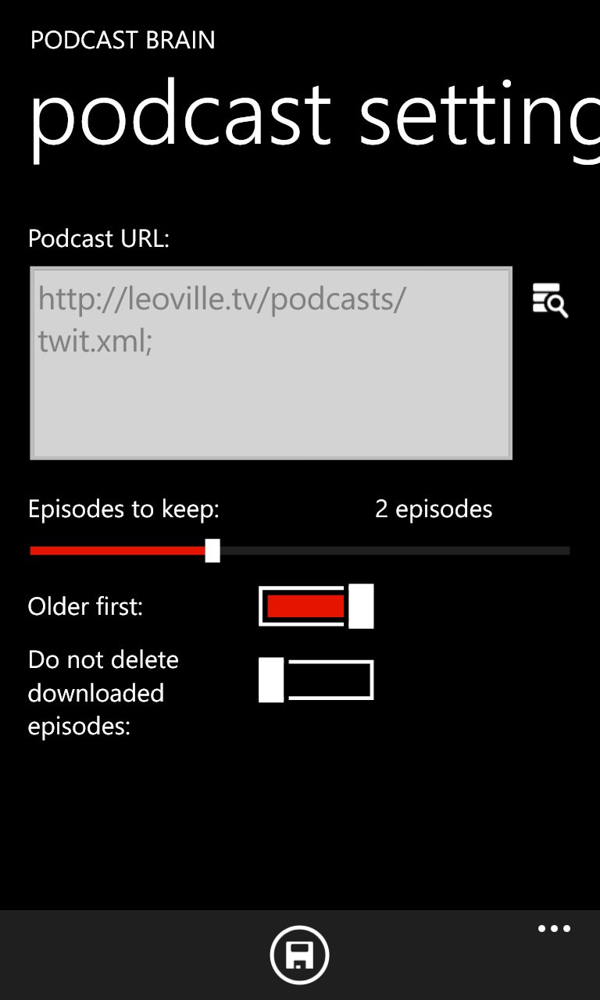

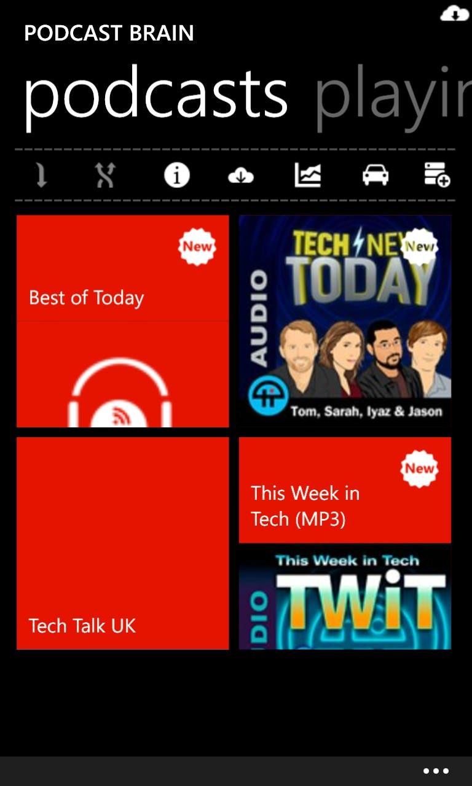

In the midst of searching for, and adding, podcasts. Type, search, find, see the RSS pasted in, tap on 'Save' - rinse and repeat! (right) the main view, very tile-styled, completed with cover art that animates up and down - either cool or annoying, depending on your view!

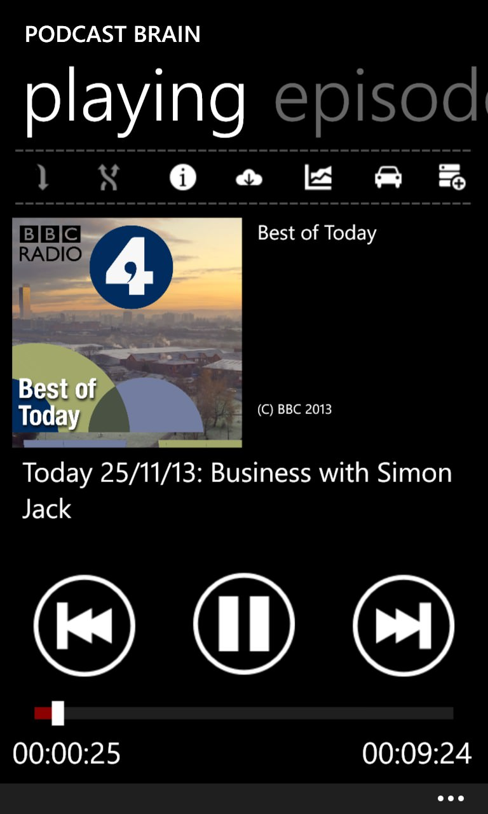

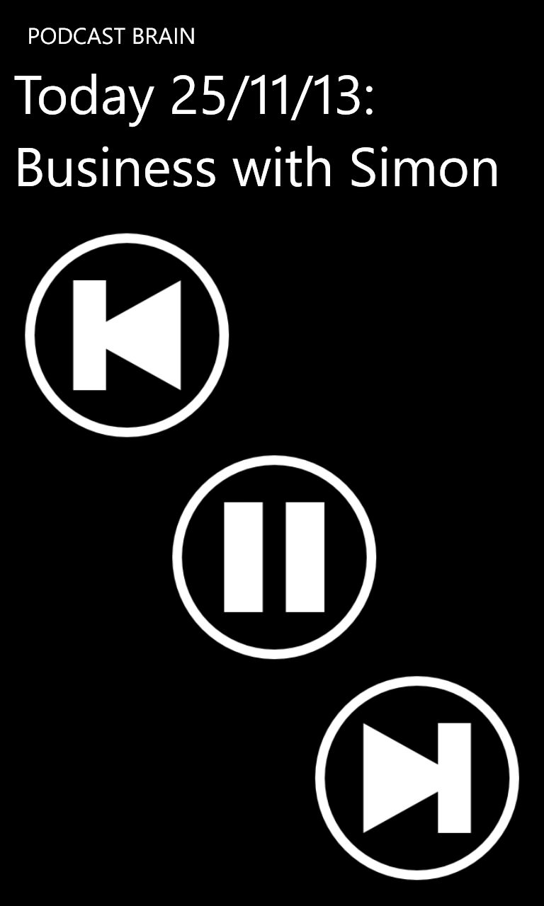

Each white icon in the strip is a relevant function (info, download, storage-chart, car mode, add another feed) - it's a novel UI touch that doesn't work as well as the other apps here, in my opinion.... (right) the car mode with fairly useless controls (see main text)

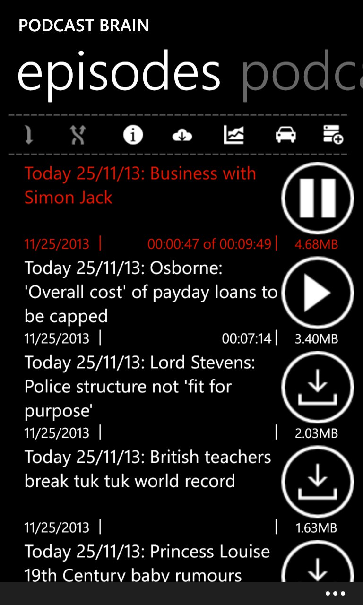

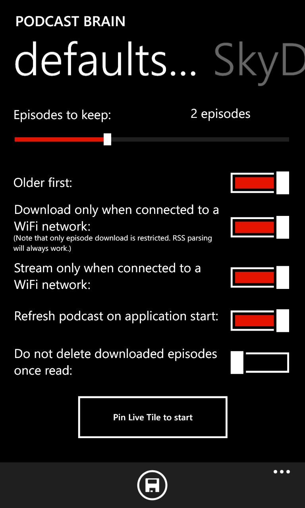

Viewing one feed at a time, it's all clear enough, but there's lots of diving up and down in the UI; (right) the main Settings pane....

## [Podcatcher](http://www.windowsphone.com/en-gb/store/app/podcatcher/5d5cebe9-420a-4566-a468-04c94aa34d93) (v2.5.1.0)

|  |  |  |  |  |  |  |  |  |
| --- | --- | --- | --- | --- | --- | --- | --- | --- |
| Import/sync | Directory search | Auto check | Auto download | Playback position | What's new | Clean-up | Dark compatible | Skip |
| Yes | Yes | Yes | Yes | Yes | Yes | Yes | Yes | Yes |

As the application here with the longest history (reaching back into the days of Meego and Maemo before it....), you'd expect Podcatcher to be fairly fully functioned and it is. 'Subscriptions', 'Downloads' (in progress) and 'Play history' panes are the heart of the application, with options within each feed to auto-update and download new content (though the default is to handle this manually). Integration with the popular gPodder.net cloud service handles the import/sync/search issue, though you can also manually import and export in OPML format as well, as a last resort, via the likes of SkyDrive.

So far so good, though each feed has to be set to 'auto-download' individually, i.e. there's no global setting, which is a bit irritating when settings things up. Once set, auto-checking and auto-downloading works fine as long as Podcatcher's brought up by the user every so often (as would happen normally, but there doesn't seem to be full background gathering, should you neglect the app for a bit). A 'Latest' pane shows what's come in recently and what's (in theory) playing.

Finally, the exact amount of space taken up by Podcatcher feed downloads is shown clearly in 'Settings/usage' and can be wiped at any point.

However - playback under Windows Phone is a bit erratic - Podcatcher would sometimes resume playback with a totally blank screen (shown, somewhat trivially, below!), sometimes resume with a 'You have no podcast playing' message (also shown below), even though my ears told me that a podcast actually *was(!),* and sometimes restart a podcast from the beginning because the playback position hadn't been saved.

I really want to like Podcatcher, but its playback reliability, in terms of dove tailing with the rest of Windows Phone, still seems to be its weak point.

Overall rating: **67%**

Gallery of screenshots - Podcatcher:

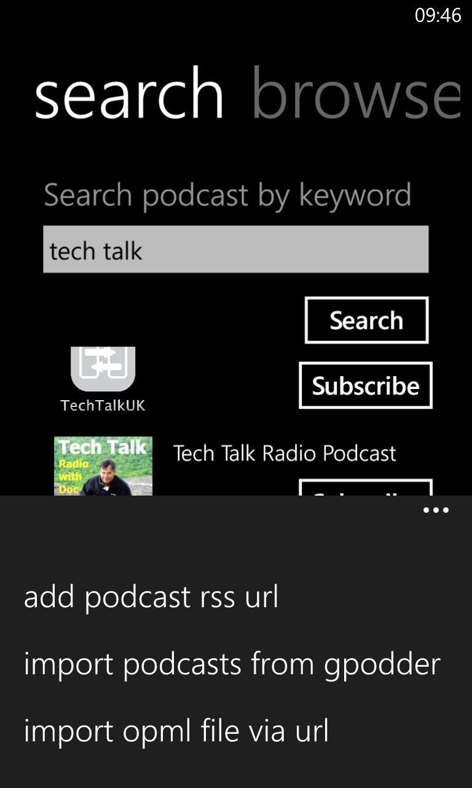

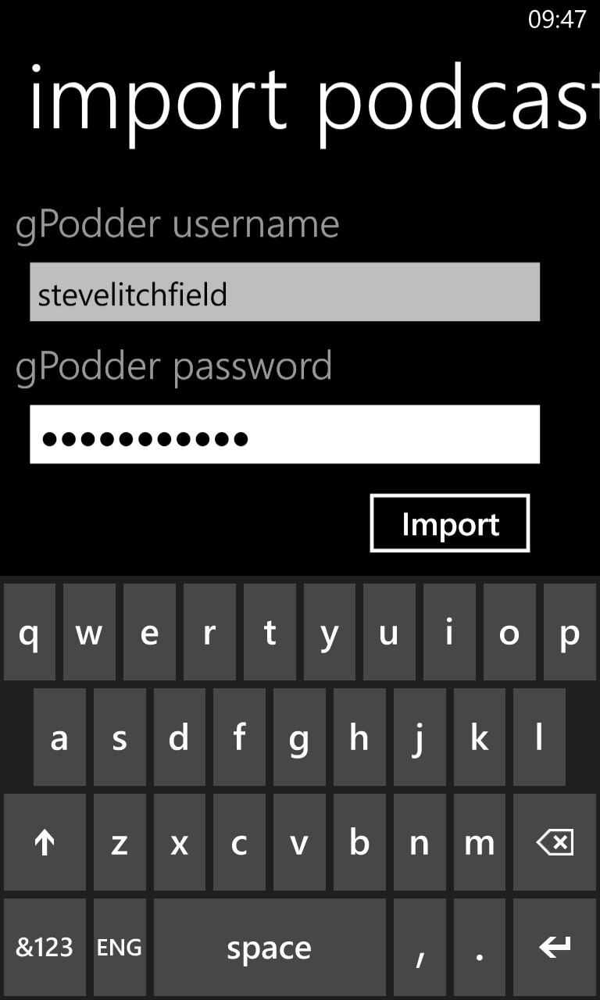

The podcast directory searching works very well, should you want to build up your podcast set from scratch, but the gPodder integration is also very good to see - one login and that's all your podcasts onboard etc.

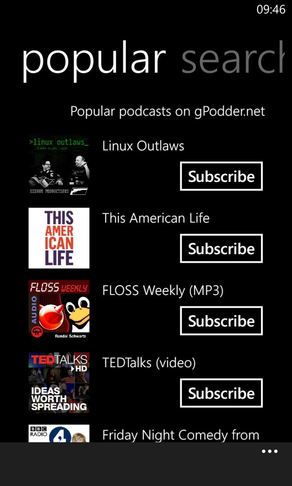

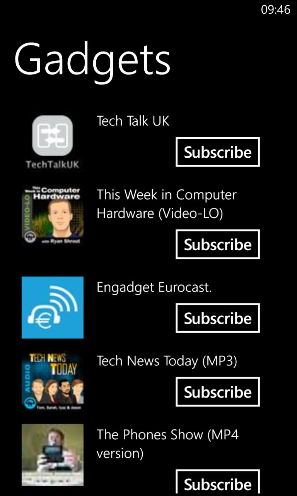

The supplied podcast directory has multiple views, including 'popular' and subject lists, such as 'Gadgets', here....

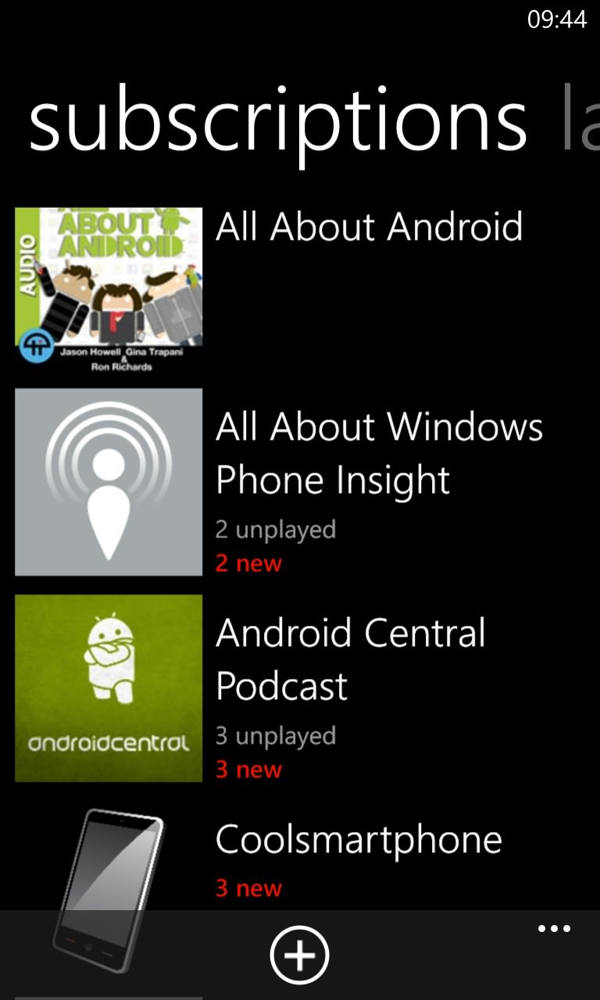

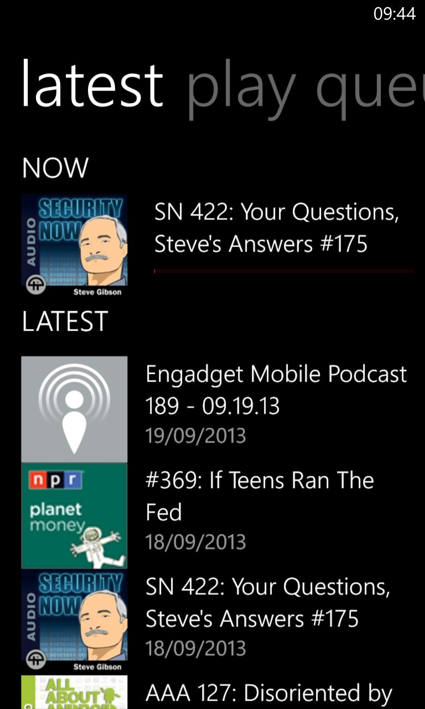

The main podcast view, with little red indicators for new podcasts and a separate 'latest' view which is exactly what's needed.

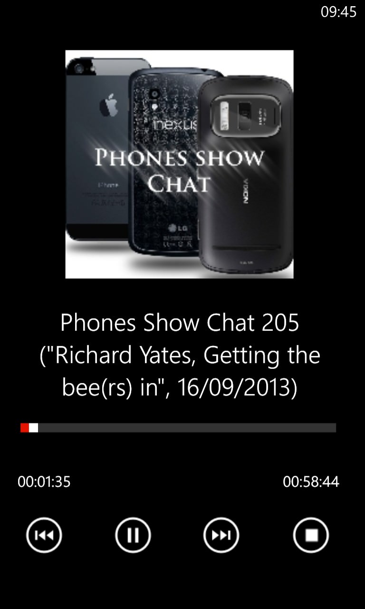

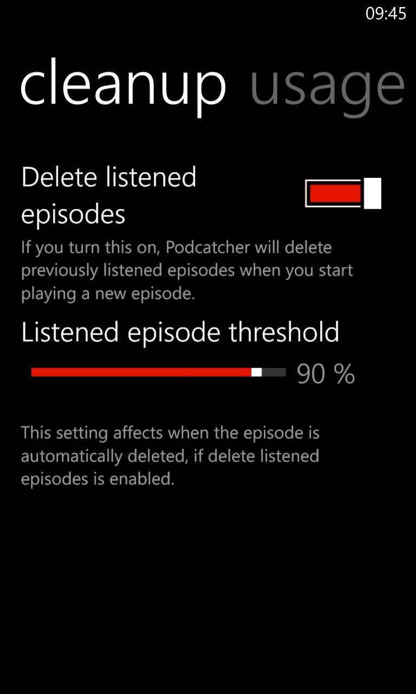

Playing back a podcast - the skip buttons go backwards and forwards 30 seconds at a time; (right) there's good and intelligent podcast cleanup after listening...

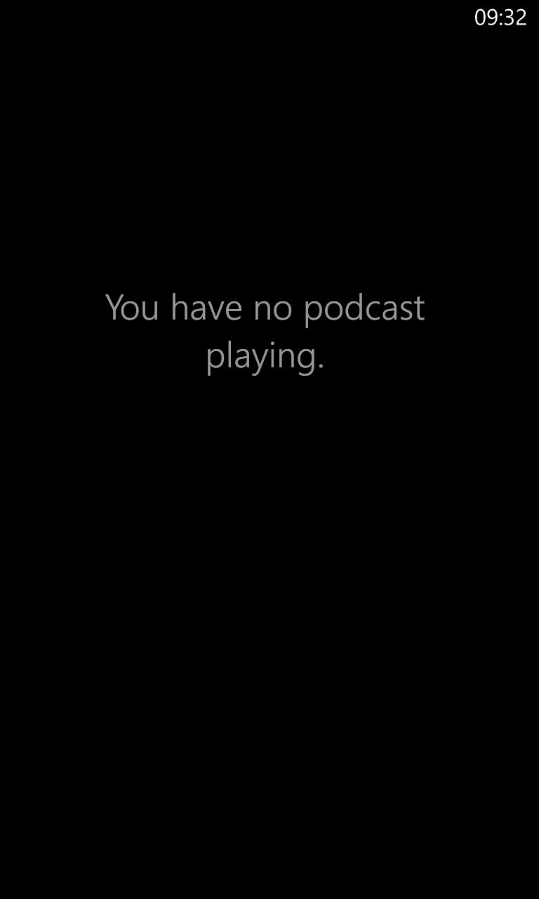

However, sometimes it still all goes horribly wrong. Throughout the two screens shown here my podcast continued to play. Umm..... Something's missing here, Johan!

## [Podcast Lounge](http://www.windowsphone.com/en-gb/store/app/podcast-lounge/83bc0329-8e02-410e-b6d2-da3c0c1d971d) (v1.9.6.1)

|  |  |  |  |  |  |  |  |  |
| --- | --- | --- | --- | --- | --- | --- | --- | --- |
| Import/sync | Directory search | Auto check | Auto download | Playback position | What's new | Clean-up | Dark compatible | Skip |
| Yes | Yes | Yes | Yes | Yes | No | Yes | Yes | Yes |

Podcast Lounge has always looked the part but with this update it now takes its place as perhaps the Rolls Royce podcatcher on the platform. Importing from gPodder or SkyDrive is now in place, plus you can export your feeds later if you need to. The podcast directory/searching is second to none and retention of playback position is perfect. When heading back into Podcast Lounge, getting to your current or last played podcast isn't obvious, but once you learn to tap on 'play history' then you're in business.

Of all the apps here, Podcast Lounge has (in theory, by far) the most foolproof implementation in terms of background downloading of new podcast episodes, to the extent that you can leave the app alone for weeks, then come back to it and find that 30 or 40 programmes had been downloaded 'while you were gone' - it's perfect podcatching behaviour ([limited only by Microsoft's own OS restrictions](http://allaboutwindowsphone.com/features/item/18687_How_to_podcatch_100_reliably_w.php)).

New episodes are shown with little numeric flags on the podcast art and it's a shame that there's not a chronologically sorted list in the application. My only other minor quibbles are that the import/export functions are buried deep in Settings - not exactly obvious for a new user, plus there's no way to alter the time steps applied when tapping on forward and back within playback.

[I've had a peek of a brand new v2.0, heading into beta early in 2014, and there are a bunch of UI improvements that address my criticisms above - watch this space!]

Overall rating: **84%**

Gallery of screenshots - Podcast Lounge:

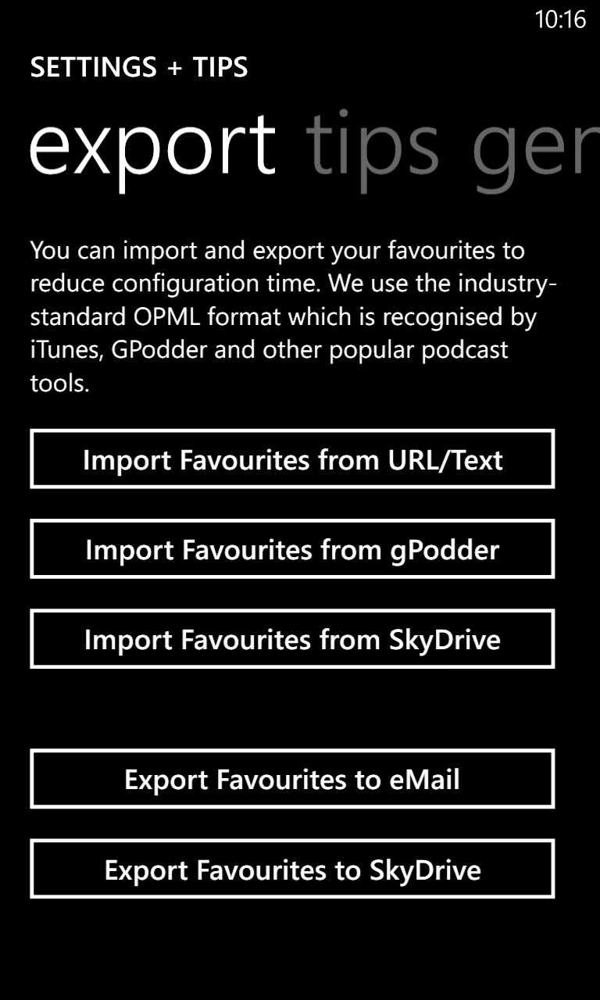

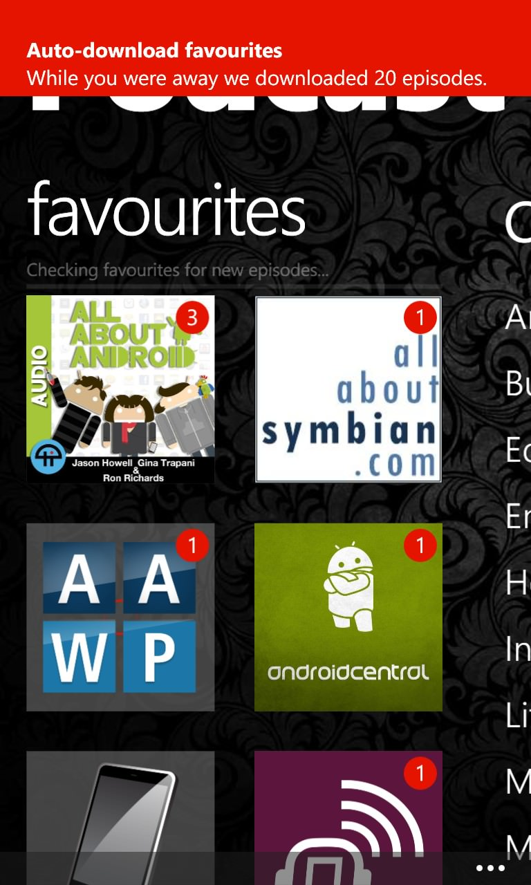

Getting off to a great start (once you find the function), full import of an existing podcast set; (right) Podcast Lounge is second to none at auto-checking and auto-downloading in the background - it 'just works'!

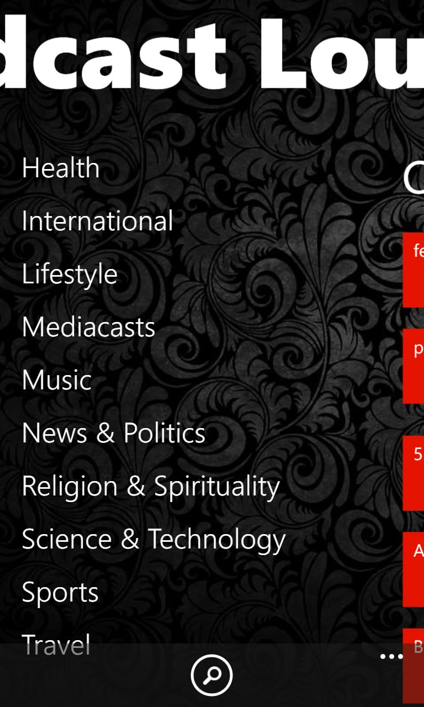

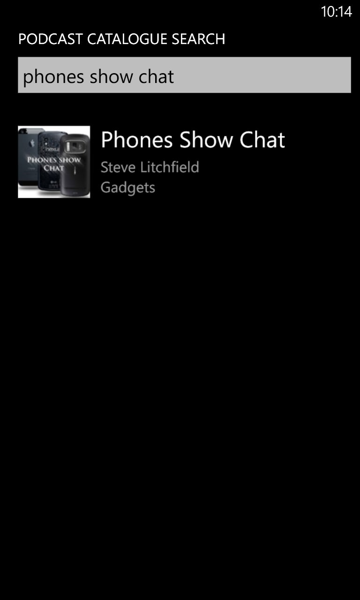

If you'd rather just browse for new podcasts or search, the directory here and the matching is perfect - every podcast I looked for was found with no fuss.

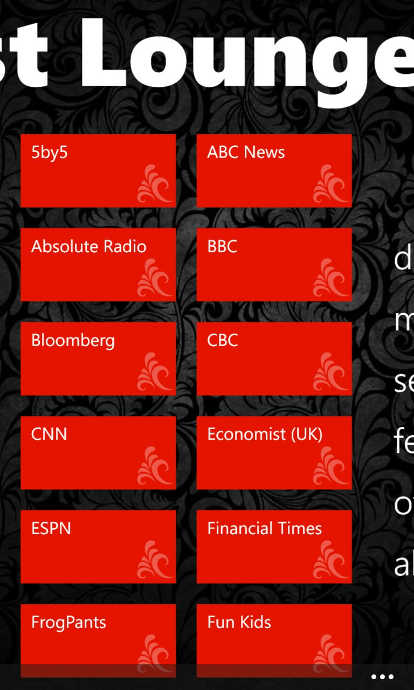

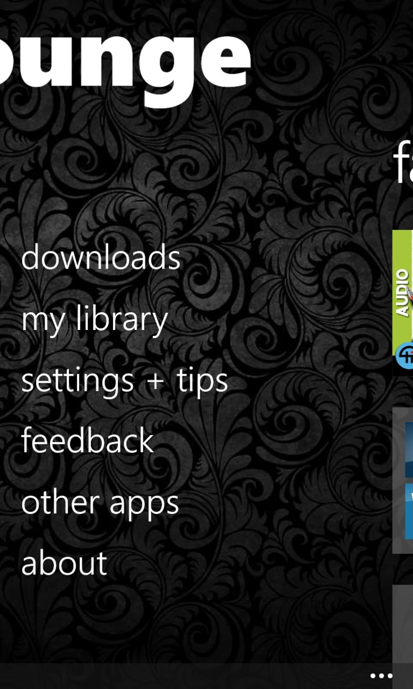

There's even a 'collection' system for its directory, bringing common sets of podcasts together by publisher etc. (right) the main menu, though you won't need it much with the current UI.

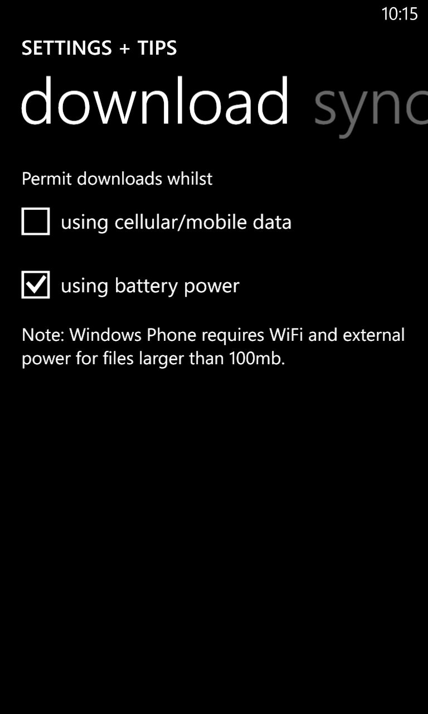

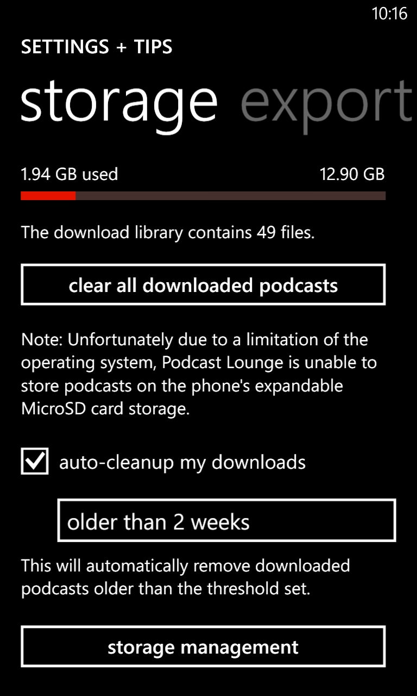

Being able to auto-download while not on charge is important - not everyone's podcatching needs can be synced neatly with a night stand charge, etc. (right) there's good auto-cleanup too.

## [Podcast Bandit](http://www.windowsphone.com/en-gb/store/app/podcast-bandit/6666709a-d718-4738-a917-7967f8dc807e) (v1.0.0.15 or 1.4 or 1.14\*\*)

|  |  |  |  |  |  |  |  |  |
| --- | --- | --- | --- | --- | --- | --- | --- | --- |
| Import/sync | Directory search | Auto check | Auto download | Playback position | What's new | Clean-up | Dark compatible | Skip |
| No | Yes\* | Yes | Yes | No | Yes | No | Yes | No\*\*\* |

\* if you can call it a search! - see below       \*\* depending where you look! (Store, app, on the web, etc.)    \*\*\* cueing is possible within the playback screen, if you're careful, otherwise skipping adverts (etc.) is tricky and impossible from the OS audio pop-up.

Podcast Bandit and I got off to a rocky start, to say the least. There's no way to import or sync in my existing podcast feed collection, so I headed for the 'Add a podcast' search function, as with Podcast Lounge above. Sadly, this uses just about the oldest and worst podcast directory in the world, it seems. Over half of my favourite podcasts weren't in the directory at all. Which means that I'd have to go researching their feed URLs and then typing in or pasting them from scratch.

Once in Podcast Bandit, subscribing to podcasts is easy enough and, with an appropriate check box or two in Settings, the application can be set to auto-download the latest programme for each feed when available. This not only works well, but a 'Latest episodes' list keeps track of the latest items that have been downloaded.

So Podcast Bandit redeemed itself? Nope. When actually playing podcasts, there's a misguided attempt to force everything into an auto-playlist, it seems. So you start listening to podcast A and change your mind, tapping on podcast B to try that. Up comes the artwork for podcast B and you tap on the play icon, only to have podcast A resume its audio. Gah. Over and over again I struggled with the wrong audio playing behind the wrong artwork or episode details. And then often I'd end up with a playback screen with the play icon greyed out altogether, or with the podcast starting from the beginning for the umpteenth time.

Finally, there's no way to clean up downloads, so the MP3 files will keep on hogging space on your phone until, presumably, you delete the application in frustration. Luckily, that point is reached quite quickly.

Overall rating: **43%**

Gallery of screenshots - Podcast Bandit:

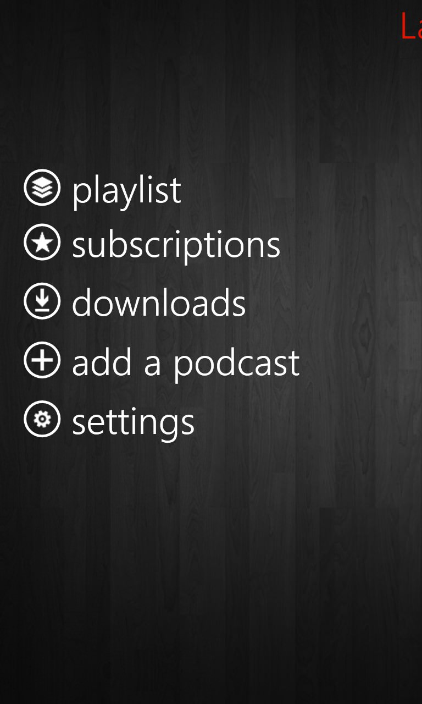

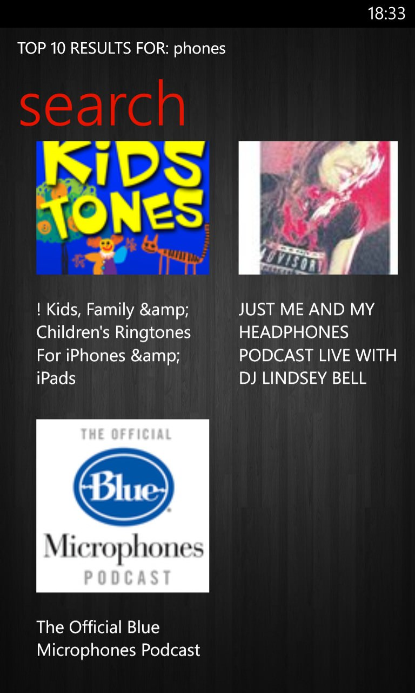

*A bare bones, but functional main menu; oh dear, a search for 'phones' should have brought up hundreds of candidates - not three!*

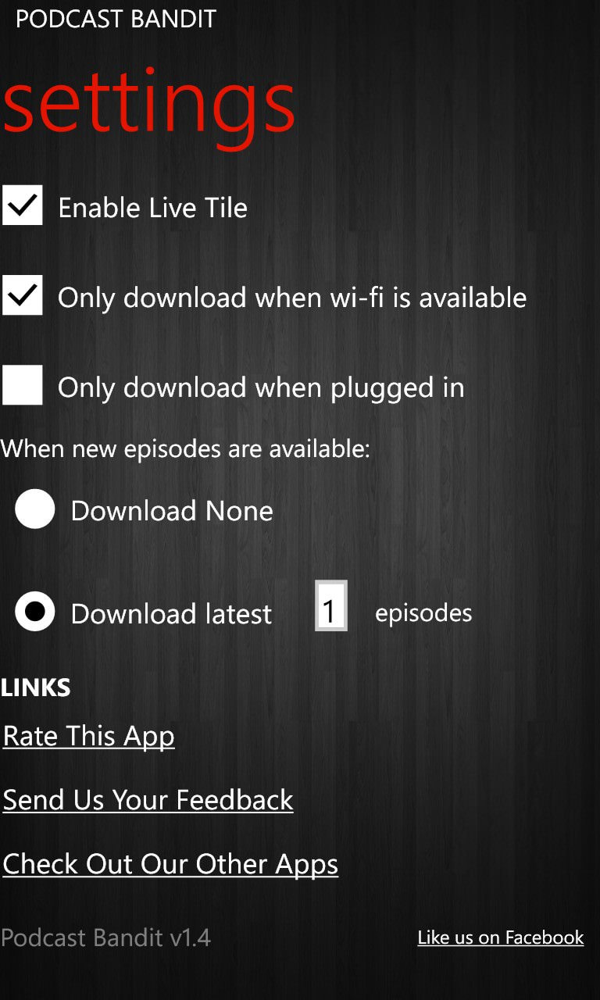

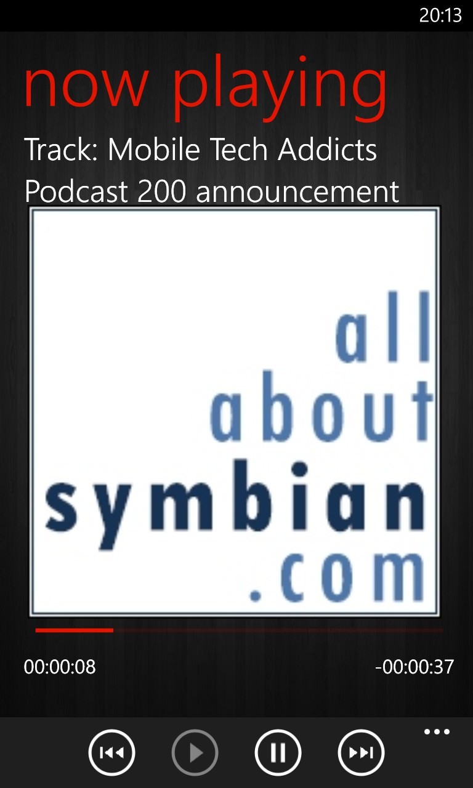

Note the right hand screenshot - the artwork and 'now playing' rarely match up. Me using it wrong? Or a horrible UI design choice by the developer?

## [SlapDash Podcasts](http://www.windowsphone.com/en-gb/store/app/slapdash-podcasts-full/5d3de26c-d271-4ea2-8f5c-73aded12b647) (v2.1)

|  |  |  |  |  |  |  |  |  |
| --- | --- | --- | --- | --- | --- | --- | --- | --- |
| Import/sync | Directory search | Auto check | Auto download | Playback position | What's new | Clean-up | Dark compatible | Skip |
| Yes\* | Yes | No | No | Yes | No | Yes | Yes | No\*\* |

\* To SlapDash Radio subscriptions \*\* Skipping is possible in the main playback UI, but not at ALL on the OS audio pop-up, i.e. during background playback

Getting started with SlapDash Podcasts is easy if you're already a user of their podcast and streaming system online, since you can log in (usually with your Facebook account) and your SlapDash Radio subscriptions simply appear in the Windows Phone client. However, everybody else is out of luck, since there are no import (or export) options, and searching for the podcasts you love in SlapDash's directory online is rather hit and miss, quite a few of my favourites weren't included. You can manually paste in a feed URL, but as usual that's quite a lot of work.

Once subscribed, the artwork for each feed is displayed in a grid, annoyingly dynamic, based on the last ones you listened to - so each podcast keeps appearing in a different place in the grid. There's also no option to auto-update or auto-download anything. A feed isn't touched until you tap on it manually and then choose to stream a programme or download it for offline listen. It's all very functional, but with zero intelligence or automation.

At least there's an option to clear all downloads, so SlapDash claws back a little credibility by tidying up after itself.

Overall rating: **54%**

Gallery of screenshots - SlapDash Podcasts:

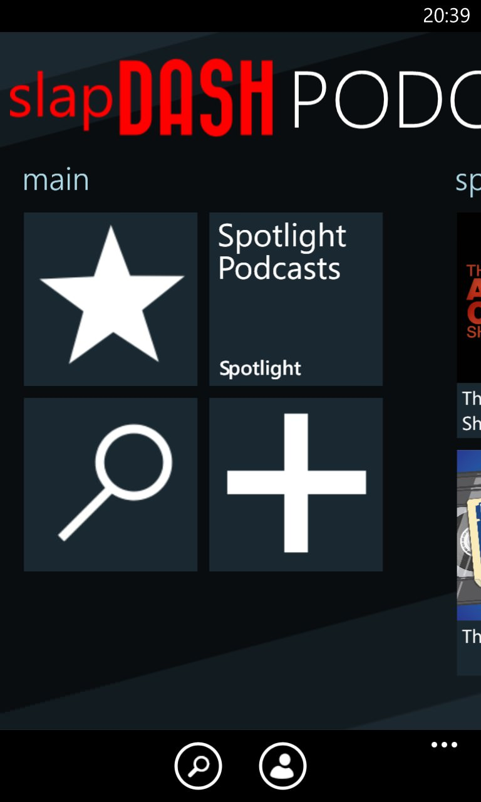

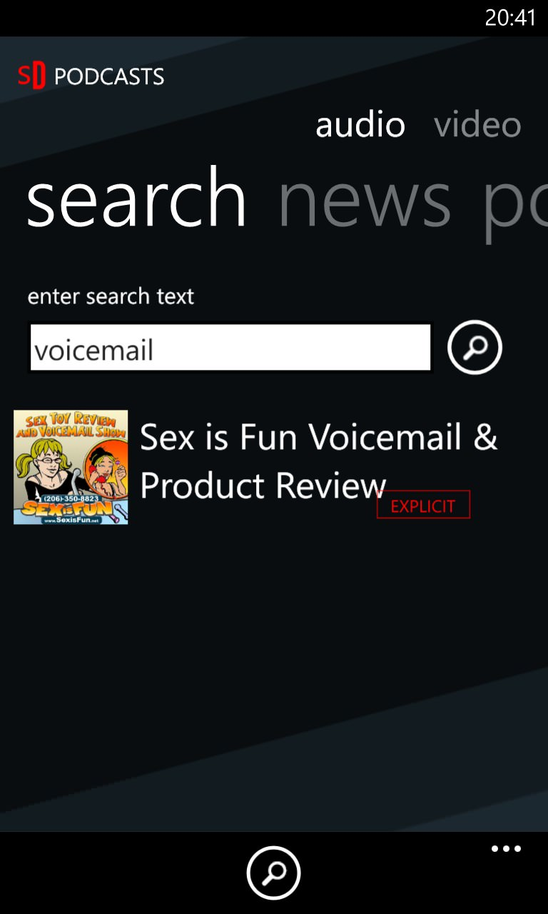

Oh dear, oh dear, searching for a popular 2012/2013 podcast reveals just one and it's err... NSFW!

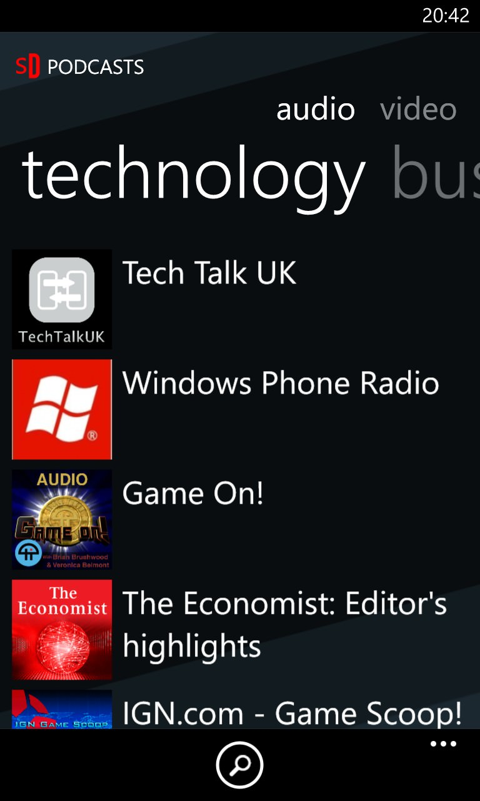

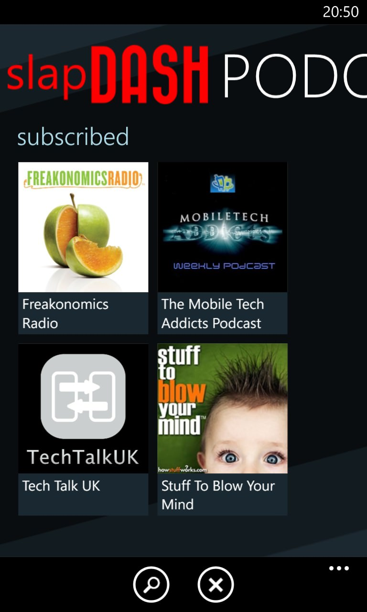

## '[Play, Look and Listen](http://www.windowsphone.com/en-gb/store/app/play-look-and-listen/fb0e9059-e237-e011-854c-00237de2db9e)' (v5.0.4.0)

|  |  |  |  |  |  |  |  |  |
| --- | --- | --- | --- | --- | --- | --- | --- | --- |
| Import/sync | Directory search | Auto check | Auto download | Playback position | What's new | Clean-up | Dark compatible | Skip |
| No\* | Yes | Yes | Yes | No | Yes | Yes | Yes | No\*\* |

\* There's full sync to its own spot in SkyDrive or DropBox, but no import or export system from or to other clients or systems  \*\* Skipping is possible in the main playback UI, but not at ALL on the OS audio pop-up, i.e. during background playback

Starting out based on Google Reader, this quirky podcatcher keeps its unique UI but now runs independently. So much so that there's no sync server or feed import at all - so you have to search for each favourite podcast from scratch - at least the search directory is comprehensive so this shouldn't take too much time.

There's full background checking and downloading, which is good to see, with a 'Just in' list of the most recently downloaded episodes - very handy.

Nice touches include an independent volume control (so you can have your Windows Phone system volume high (for ringtones) yet have podcasts playing far more quietly, if desired. There's a lot to like in Play, Look and Listen, but there's an Achilles heel - it's completely rubbish at remembering where you got up to in a podcast. So if you get interrupted and something else uses the Windows Phone audio system for a bit (e.g. music), when you pop back to the application, you're plonked right back at the start of the relevant podcast and it's guesswork as to where you got up to.

Overall rating: **52%**

Gallery of screenshots - Play, Look and Listen:

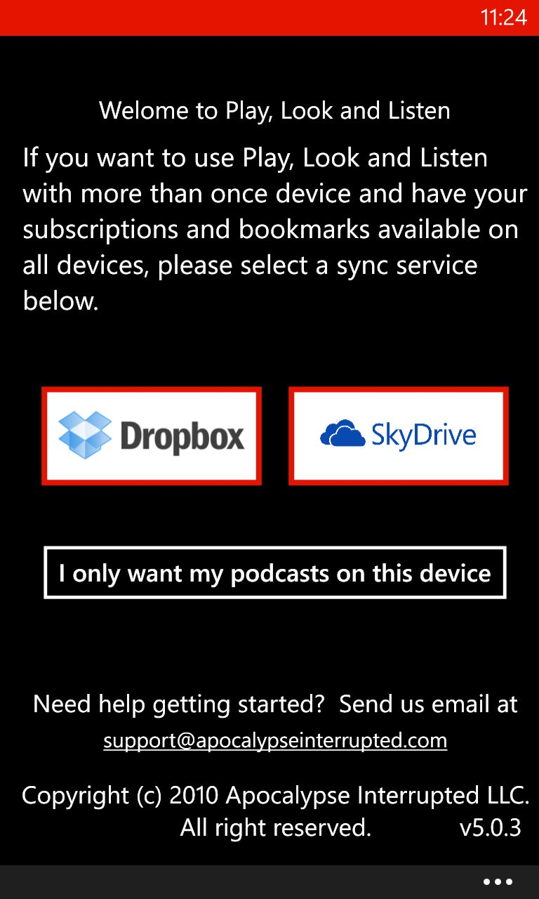

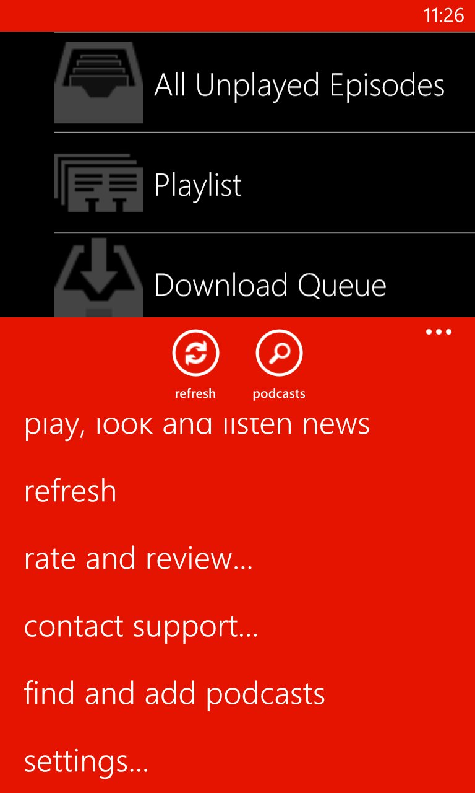

In fairness, the SkyDrive sync kicks in almost every time you do anything in the client - the idea is to keep the same client fully up to date on another device - but there's no way to bring in settings and feeds from elsewhere. (right) Finding new podcasts is down to a search-based menu function.

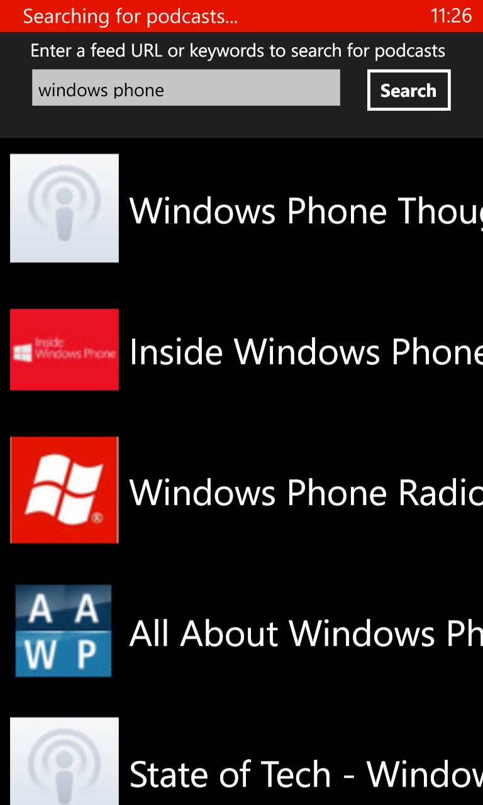

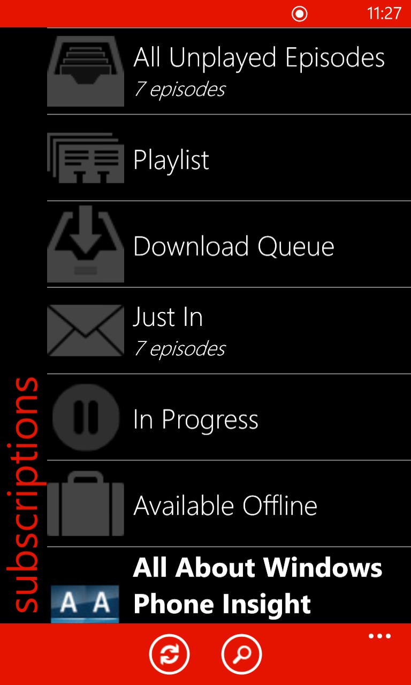

The search is quite thorough, so at least you won't have to spend hours typing in RSS URLs etc. (right) The unique interface, though the 'Just In' and 'All Unplayed' entries to seem to duplicate each other for normal use!

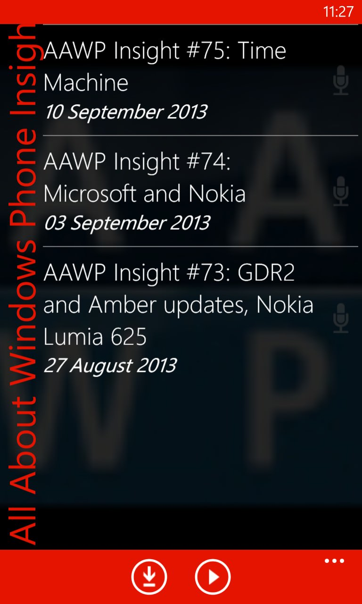

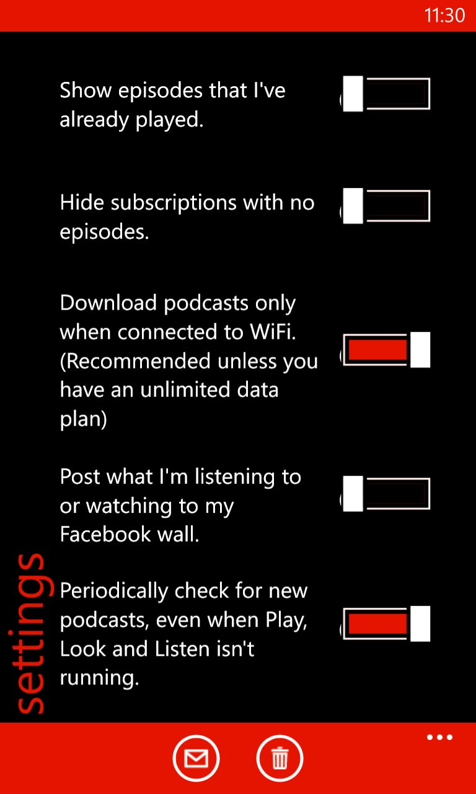

Distinctive presentation of a podcast feed (note the subtle background from podcast art); (right) Some of the many settings, including the all important download and background check switches (the latter defaults to 'off').

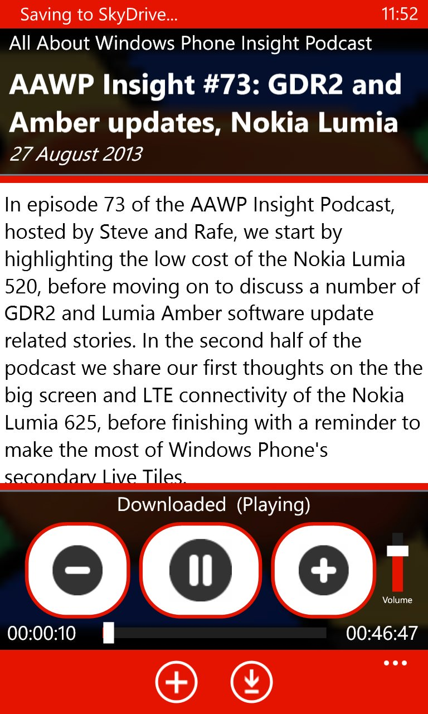

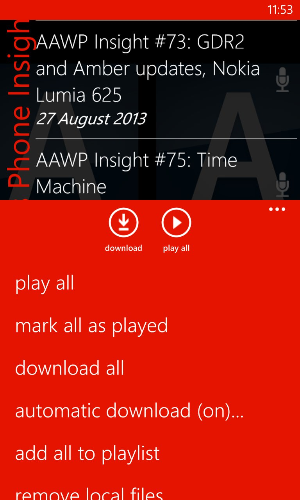

Nice presentation of podcast playback, with episode notes from the RSS feed. Note also the separate volume control and nudge buttons (15 seconds at a time); the all important 'automatic download' function is on the menu within a feed. Isn't it time that this function was turned on as standard?...

## [BringCast](http://www.windowsphone.com/en-gb/store/app/bringcast/e5abef38-d413-e011-9264-00237de2db9e) (v3.8.1.389)

|  |  |  |  |  |  |  |  |  |
| --- | --- | --- | --- | --- | --- | --- | --- | --- |
| Import/sync | Directory search | Auto check | Auto download | Playback position | What's new | Clean-up | Dark compatible | Skip |
| Yes | Yes | Yes | Yes | Yes | Yes | Yes | Yes | Yes |

BringCast has matured nicely, with a major fix-up update late in 2013. There's a love-it-or-hate-it UI, with (by default) garish greens and iOS 7-like iconography, though personally I loved the large, easy to hit controls, including 30 second nudges in either direction, an innovative 'skip play' (playing a few seconds each minute until you get to roughly where you wanted to be) and podcast resumption after interruptions was 99% *faultless*.

Getting a group of podcast feeds in is possible, but you'll have to do some work, renaming your .OPML file and then uploading it manually to SkyDrive. There's also an adequate (manually curated) podcast directory, with reasonable search and a bunch of podcast categories that are well worth a browse. The strip of thumbnails along the middle of the main UI represent the most recently download podcasts for your attention, which is both pretty and handy. New episodes just appear, as if by magic, off to the right hand side. This system can get a little cumbersome and needs regular 'clearing', mind you.

Also worth mentioning is a three screen 'tap this...' style of tutorial when you first start BringCast - it's static but very effective and you can't help but wish that more applications would do this.

From being the basic, unloved runt of the podcasting litter, BringCast is now a firm contender here, great work by the developers. The late 2013 update brought (among other things) a bunch of new themes (including one suggested by me! The theme pack is a small extra charge, but worth it), but there's still work to do, with occasional freezes of playback and with visual oddities (see below) that require the phone to be restarted, currently. With these fixed, easier OPML import and a better podcast directory, this might well end up top of the heap. One to watch closely.

Overall rating: **80%**

Gallery of screenshots - BringCast:

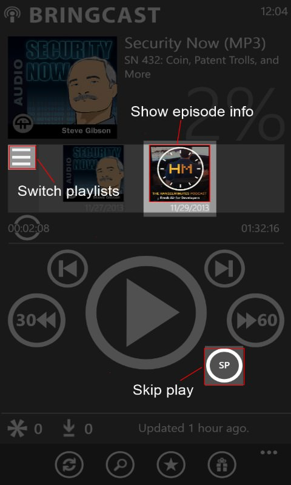

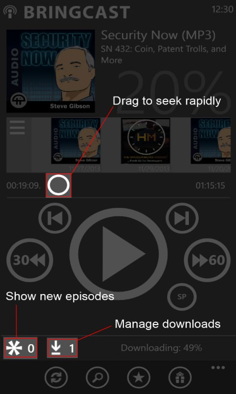

Two of the (first) start up tutorial screens, nicely done!

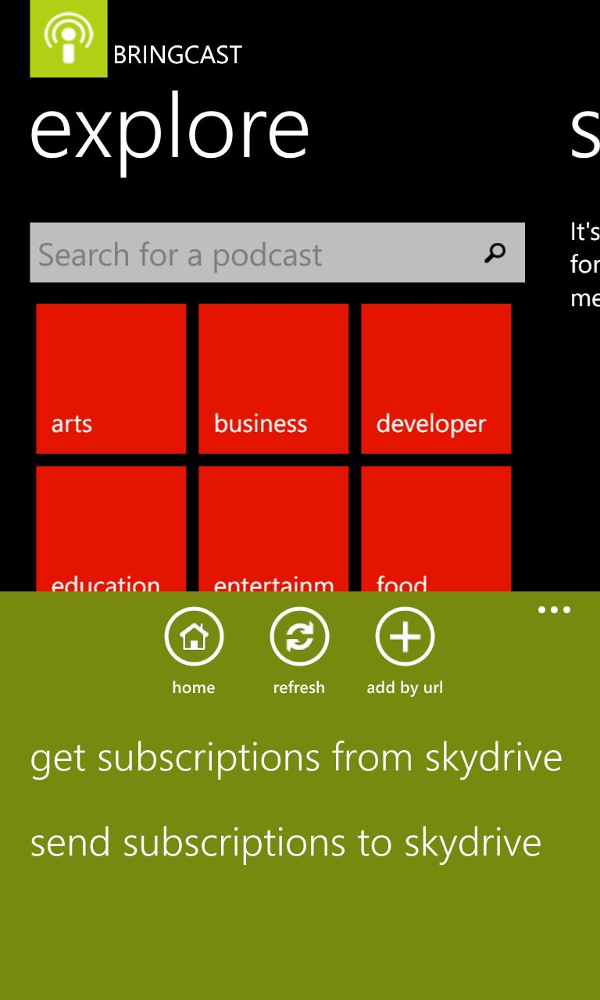

Ah, OPML import is possible via SkyDrive - though you don't get told the filename to use *until* you've tried to use the feature and failed!

Browsing a podcast feed. Tap the 'Add to favourites' button to subscribe, etc. Nice to see the wizard-like prompt to turn on auto-downloading too.

The main UI in use, with my 'Royal Purple' theme in place... I'm 9% through the latest AAWP podcast, with All About Android queued up to listen to next... ; (right) part of the Settings pane - note the facility to change the theme, plus turn on all the fancy auto-downloading functions.

Every so often, a peculiar bug causes BringCast to screw up its visuals, as shown here, requiring a device restart. Gah. Quick, nurse, the screens!!

## [WPodder](http://www.windowsphone.com/en-gb/store/app/wpodder/5ad3fe0d-c0bb-41e7-a3c1-306b596237e8) (v2.0.7.0)

|  |  |  |  |  |  |  |  |  |
| --- | --- | --- | --- | --- | --- | --- | --- | --- |
| Import/sync | Directory search | Auto check | Auto download | Playback position | What's new | Clean-up | Dark compatible | Skip |
| Yes | Yes | Yes | No | Yes | Yes | Yes | Yes | Yes\* |

\* On the Windows Phone pop-up playback controls, a tap and hold for a few seconds is needed - otherwise it skips to the next podcast

Updated recently for Windows Phone 8 GDR2 and its fixed background facilities, WPodder is another tool that has come a long way and has good integration with gPodder, the ubiquitous service that drives the podcast discovery here.

However, the impressive playback screen with two levels of 'nudge' (30s and 5 minutes) doesn't always respond after an interruption and twice I had to restart the app and use multiple taps in order to carry on with my podcast.

There's automatic feed checking, but not background downloading, making WPodder something of a manually intensive 'foreground' podcatching tool. It works, but you'll have to do more when compared to apps like Podcast Lounge.

Overall rating: **57%**

Gallery of screenshots - WPodder:

Great to see gPodder integration throughout the app - assuming that the service is behaving itself... (right) the list of most popular podcasts on gPodder...

The main interface, nice and clean, with an excellent playback screen (right) which, sadly, proved a little glitchy in terms of resuming podcasts properly...

\_\_\_\_\_\_\_\_\_\_\_\_\_

For reasons of length(!), the remaining podcatching applications are [reviewed in part 2 of this feature here, plus I deliver a verdict](http://allaboutwindowsphone.com/features/item/19144_15_Windows_Phone_8_podcatchers.php).
