# 14 coisas para ser em 2014

**36** Flares
Twitter
2
Facebook
31
Pin It Share
0
Google+
3
Email
--
[Email to a friend](mailto:?body=Olha%20s%C3%B3%20esse%20post%20que%20eu%20achei%20no%20Bramare%3A%0D%0A%0D%0A14%20coisas%20para%20ser%20em%202014%0D%0Ahttp%3A%2F%2Fwww.bramare.com.br%2F2014%2F01%2F28%2F14-coisas-para-ser-em-2014%2F&subject=Olha%20s%C3%B3%20esse%20post%20que%20eu%20achei%20no%20Bramare "Email to a friend") 
Filament**.**io

#### \*Este post faz parte da blogagem coletiva do **Rotaroots**, um grupo de blogueiros saudosistas que resgata a velha e verdadeira paixão por manter seus diários virtuais**.** [Faça parte do nosso grupo no Facebook](https://www.facebook.com/groups/607644552607943/) e inscreva-se no [Rotation](http://www.bramare.com.br/2014/01/28/14-coisas-para-ser-em-2014/Este é o ROTAROOTS Rotation, um link exchange destinado à ligar vários blogs e dar a oportunidade de se conhecer um novo blog sempre! O site foi idealizado por diversos blogueiros ansiosos por (re)encontrar outros blogs, trocar links e aumentar seu blogroll!) **.**

Quando o título desse post surgiu no grupo do **Rotaroots** como tema do mês eu fiquei feliz**!** Janeirão é o mês internacional das promessas de renovação, né**?** Eu realmente acredito nessa energia que colocamos pro mundo nessa época**.** Não é nada mágico e sim científico**.** Não existe um portal estelar entre sua vida agora e a vida que você quer ter no futuro só porque é janeiro, claro**.** Existe sim uma reprogramação da nossa mente e pensamentos, uma mudança de foco, uma canalização de energia (ou esforços, se você preferir) pra irmos atrás dos nossos desejos e sonhos**.**

Como o **Bramare** tem duas cabeças pensantes eu e a Ana achamos legal dividir as **14 coisas para ser em 2014**, 7 desejos para cada uma de nós**.** Mas, se você for leitor assíduo aqui do blog, vai sacar que nossos sonhos e desejos são retrato fiel das coisas que postamos, divulgamos e acreditamos pra você aí do outro lado ;)

### 1**.** Comer cada vez mais comidas orgânicas e cruas.

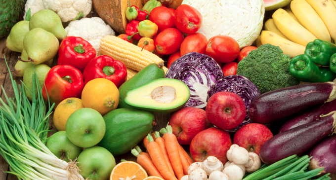

Estamos vivendo uma onda de maior contato com o que é natural e obviamente isso se reflete na alimentação**.** De repente, parar de ingerir pesticidas, carnes e álcool faz bem mais sentido hoje do que há um tempo atrás (é claro que não virei uma monja, mas mudei **MUITOS** hábitos ultimamente)**.** Claro que nesse meio tem muita gente extremista e também precisamos tomar cuidado com isso, mas uma coisa é certa: os alimentos orgânicos e crus são ótimos para a saúde**.** Menos é mais também quando se trata de ingredientes**!**

Em 2014 a gente quer que você repense com carinho seus hábitos alimentares e preste bastante atenção do que você coloca dentro desse corpinho lindo**.**

### 2. Aproveitar o que a cidade tem de bom e barato**.**

[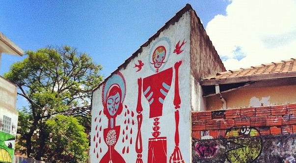](http://www.bramare.com.br/wp-content/uploads/2014/01/Screen-Shot-2014-01-28-at-1.11.07-AM.png)

  
São Paulo é uma cidade cara, mas existem várias opções interessantes que são baratas ou até de graça**!** Exposições, teatros, concertos, eventos, parques… Às vezes apenas dar umas voltinhas a pé por alguns bairros pode nos propiciar surpresas bem agradáveis**!** Além de ser mais econômico, o cérebro e o corpo agradecem**!**

Que em 2014 você redescubra sua cidade e se apaixone por ela novamente**!** Garantimos que nem vai ser tão difícil assim ;)

### 3**.** Fazer uma viagem pelo menos…

  
Ai, ai, viajar é tão bom, né**?** E hoje em dia, se você se programar, é bem viável. Vamos ver se eu consigo fazer pelo menos uminha, o ano está apenas começando**!** Enquanto isso, fico viajando na viagem dos amigos, pelos [posts do Globe Trotter](http://www.bramare.com.br/?s=globe+trotter "posts do Globe Trotter") **!**

Que 2014 seja o ano que te faça, finalmente, levantar vôo e conhecer os lugares que já moram no seu coração :)

### 4**.** Arrumar alguma parte da casa que está incomodando.

[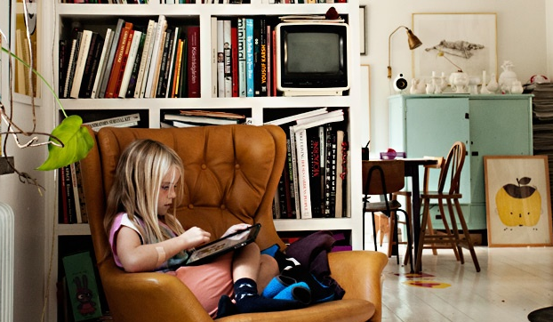](http://www.bramare.com.br/wp-content/uploads/2014/01/Screen-Shot-2014-01-28-at-1.12.03-AM.png)

Tem um ou dois cômodos da minha casa que eu quero muito dar um *up*, estão largados desde o dia que me mudei, há cinco anos atrás… Parece que dará o maior trabalhão ou que vai ser caro, mas sabe que estou bem a fim de resolver isso**?** E a melhor maneira é usando a criatividade: algumas pequenas alterações às vezes fazem toda a diferença**.**

Os [posts de decoração](http://www.bramare.com.br/?s=decor "posts de decoração")  aqui do Bramare estão seguindo essa linha de pensamento e me inspirando loucamente**!** Será que você também se anima esse ano a repaginar a casa**?** A gente promete que te ajuda ;)

### 5**.** Conhecer mais os points tradicionais da cidade

[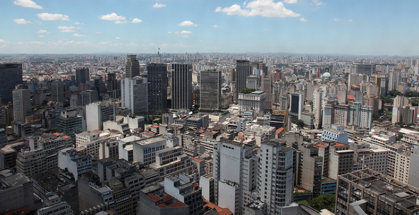](http://www.bramare.com.br/wp-content/uploads/2014/01/Screen-Shot-2014-01-28-at-12.54.00-AM.png)

  
Alguns programas básicos de São Paulo, como assistir a Missa do Mosteiro de São Bento, ir ao Ceasa comprar plantas e outros programas simples sempre são deixados para outro dia na minha lista**.** São coisas que podemos fazer todas as semanas, típicas e super legais**.** Vamos ver se consigo cumprir esses simples desejos**.** Juro que farei um post a respeito deles**!**

Se você precisar de dicas pra fazer de 2014 um ano mais agitado e cheio de novidades [aqui](http://vejasp.abril.com.br/infograficos/sao-paulo-460-anos?utm_source=redesabril_vejasp&utm_medium=facebook&utm_campaign=vejasp) "aqui")  tem várias dicas bem legais**!**

### 6**.** Investir no estilo pessoal e esquecer um pouco o que está na moda**.**

[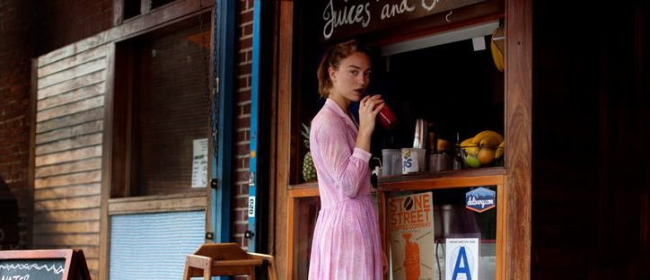](http://www.bramare.com.br/wp-content/uploads/2014/01/Screen-Shot-2014-01-28-at-1.16.39-AM.png)

  
A nossa preocupação com estar bem vestida às vezes deixa de ser uma coisa boa para virar um exercício de auto-julgamento**.** E isso não é legal *at all*! Quero cada vez mais relaxar e vestir o que tenho vontade, é a melhor coisa**!** Para ajudar a colocar as idéias no lugar e inspirar quem compartilha desse sentimento, resolvi escrever sobre o assunto todas as quartas-feiras nos meus posts [“Falando de Estilo”](http://www.bramare.com.br/?s=falando+de+estilo) **.**

Esperamos que em 2014 eles rendam boas risadas e looks inéditos pra você**!**

### 7. Me acostumar a viver com menos sem sofrimentos, dar valor ao que já tenho (reavaliar esse consumismo desenfreado)**.**

[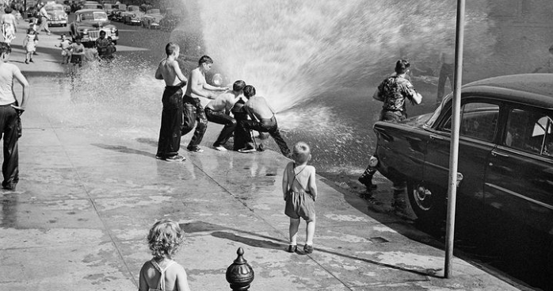](http://www.bramare.com.br/wp-content/uploads/2014/01/Screen-Shot-2014-01-28-at-1.00.28-AM.png)

Comprar é bom e não estou aqui para negar isso**.** Mas, quando esse ato começa a tomar o lugar de outras coisas, pode ser um problema**.** Só pensar em gastar ou em ganhar são dois lados da mesma moeda**.** E essa moeda não nos satisfaz, ela quer sempre mais**.** Por isso, a melhor saída é virar a chavinha, relaxar um pouco e aproveitar o que a vida tem de bom, que no final das contas são as coisas mais simples**.** Parece piegas mas se você parar para pensar **MESMO**, é a mais pura verdade…

Que em 2014 a gente desenvolva uma tranquilidade para aceitar os acontecimentos e curtir o cotidiano, simplesmente**.** Não é preciso mais do que isso para ser feliz!

### 8**.** Gastar menos e poupar mais pra viabilizar coisas como viajar, reformar a casa, etc**.**

Todo mundo está careca de saber que vivemos em uma sociedade de consumo e quem mora no eixo Rio-São Paulo está sentindo no bolso o que isso significa de uns 2/3 anos pra cá**.** Os preços atingiram níveis surreais. A gourmetização está afetando tudo o que você possa imaginar: do café com leite, passando pela pipoca e chegando até o hamburguer & pizza & cerveja nossos de toda semana**.** O valor dos aluguéis e imóveis até o preço de roupas, acessórios e sapatos, também está deixando um rastro de destruição na conta bancária de todos**.**

Em 2014 a gente quer que você pense 5**.**000 vezes **ANTES** de sair gastando R$10,00 em uma xícara de cappuccino ou R$30,00 em um chopp de 240ml ou R$500,00 em uma bolsa de couro**.** Eu já venho fazendo isso**.** Muita gente me pergunta como faz pra viajar todo ano (ou reformar a casa ou seja lá qual é o seu sonho no momento) e a resposta é essa do parágrafo anterior**.** Não tem mistério, tem que parar de gastar seu precioso $$$ com esses preços abusivos e deixar para gastá-los tomando um gelato de 2 euros na frente da Fonta de Trevi em Roma**.** Pura matemática ;)

### 9. Sair do computador e exercitar mais o lado criativo (desenhar, escrever, pintar, compor)**.**

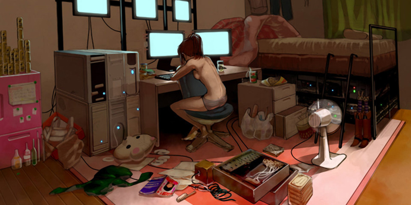

Que a internet nos aproximou e transformou o mundo todo mundo sabe**.** Não existem mais fronteiras, lugares impossíveis de conhecer ou notícias escondidas**.** Tudo está ao alcance de um click ou toque na tela. Pra ajudar ainda mais o fenômeno agora todo mundo leva a internet consigo pra lá e pra cá, seja nos smartphones ou nos tablets**.**

Apesar dessa globalização ajudar, sinto que ela também limita pois estamos nos desconectando da vida real e tangível do nosso dia a dia**.** E é nossa vida, nossas experiências que nos alimentam criativamente**.** Em 2014 queremos que você desligue o computador um pouco e escreva mais em seus diários de papel**.** Queremos que você desenha mais em seus cadernos jogados na gaveta e que passe a tarde compondo músicas ou poemas ou rimas ou cartas de amor**.** Que você **VIVA** a arte todos os dias e não apenas leia sobre ela :)

### 10**.** Viver mais em contato com a natureza, passear nos parques e trazer as plantas pra dentro de casa**.**

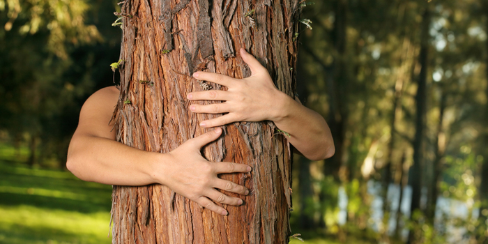

Quem acompanha blogs de estilo de vida ou segue boards do Pinterest sobre o assunto já percebeu que a onda do momento é trazer a natureza pra dentro de casa**.** Acho que isso tem muito a ver com o item acima, sabe**?** De repente ver as coisas pela internet não é mais satisfatório**.** As pessoas estão sentindo cada vez mais necessidade de se reconectar com o mundo real, com a mãe natureza**.** Quando a tecnologia nos sobrecarrega é o ar puro e as coisas simples da terra que nos acalmam**.**

Já falamos muito sobre isso aqui no **Bramare** ([aqui](http://www.bramare.com.br/2013/02/13/plantas-no-banheiro-pode/)  e [aqui](http://www.bramare.com.br/2014/01/20/nao-e-o-seu-suco-que-vai-ficar-verde-sua-casa-tambem/) )**.** Em 2014 queremos que você se reconecte com o planeta e que abrace, respeite e viva em harmonia com o presente que a Terra nos dá desde que o mundo é mundo: suas cores, seus cheiros, seus frutos**.** Temos que aprender a respeitar o solo que nos sustenta, gente**.** É a única maneira de sobreviver ao caos da vida moderna**.**

### 11**.** Reavaliar a rotina e o trabalho que consomem tanto o nosso tempo**.**

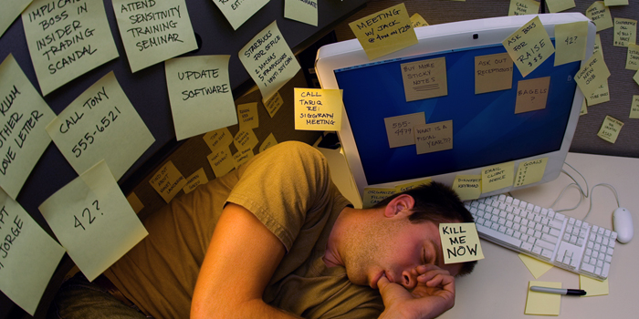

Na correria do dia a dia e na cidade caríssima em que vivemos o dinheiro costuma justificar todos os sacrifícios**.** Nada errado com isso. Todo mundo precisa construir uma base, um alicerce para poder alcançar vôos mais altos**.** Todo mundo, um dia ou outro, vai ter um emprego que detesta porque *‘paga bem’* ou vai aturar um chefe mala e sem educação porque a situação naqueles meses está difícil**.** Nós entendemos isso, mas entendemos também que esse tipo de coisa tem que ser transitória e não definitiva**.**

Vemos **MUITA GENTE** por aí aguentando **HÁ ANOS** situações estressantes e desnecessárias por simples e puro **MEDO** de não saber o que vai acontecer no futuro… Alow, alow, terráqueo, NEWS BREAK: Caso você não tenha percebido, ninguém sabe do futuro, ninguém tem bola de cristal e nenhum emprego desse mundo é garantia de nada, ainda mais nos dias de hoje**.** Vai ter medo do quê?

Em 2014 é hora de dar um **BAST**A e parar de empurrar seu futuro com a barriga**!** Está na hora de enfrentar a vida que se leva e perguntar sem medo da resposta: *‘Estou mesmo fazendo o que gosto**?** Estou vivendo uma vida da qual vou me orgulhar no futuro**?**’* Que você tome coragem e perceba a hora de parar com os sacrifícios e comece a viver a vida que nasceu pra levar, mesmo que isso signifique mudar para uma cidade mais barata e tranquila ou até mudar de profissão**.** Nenhuma dessas situações será o fim do mundo, pode acreditar**.**

Se você ainda tem dúvidas que tal [dar uma boa fuçada na nossa tag ‘Life Design’](http://www.bramare.com.br/category/life-design-2/) **?**

### 12. Ler mais livros e alimentar a mente com conteúdo rico**!**

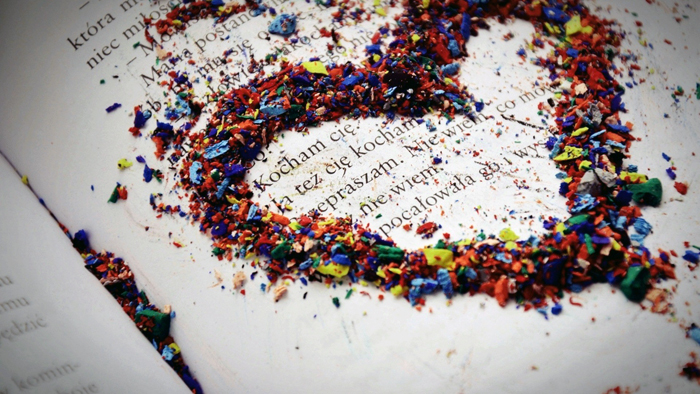

Um viva para o **Kindle**, outro para os **tablets** e mais um viva para a [**Amazon Brasil**](http://www.amazon.com.br/)  \o/ \o/ \o/ Nunca foi tão fácil lotar a estante de livros como agora**.** Num mundo onde tudo pode ser virtual porque não transformar a estante da sala em uma estante online**?** Só existem vantagens: preços mais em conta, menos impacto pro planeta e menos peso pra carregar na bolsa**!**

Que em 2014 você invista na boa e velha literatura mais do que nunca**.** Ela alimenta nossa alma, nossos sonhos e nos inspira a construir um futuro cada vez melhor, concorda**?**

### 13**.** Colocar a mão na massa e fazer cada vez mais projetos ‘DIY’ fotográficos, conhecidos como Do it yourself (ou Faça você mesmo)**!**

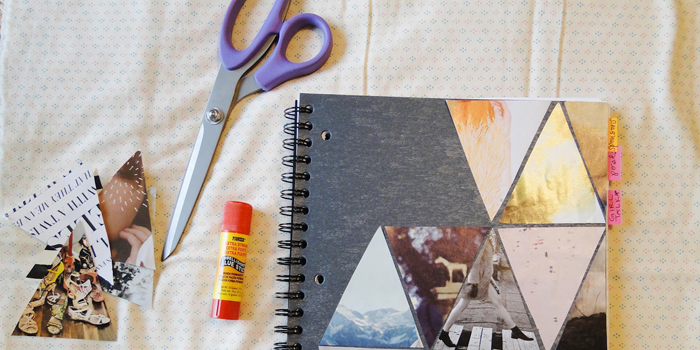

O **Instagram** e as plataformas online de compartilhamento de imagens são as coisas mais legais já inventadas pelo homem, né**?** Nós somos fãs de carteirinha (aliás, que tal nos seguir no Insta**?** [@portalbramare](http://www.instagram.com/portalbramare) ) e adoramos postar nossas fotos e trocar idéias por lá**.**

Apesar do mundo online ser mais prático no dia a dia não canso de pensar no que será dessas fotos daqui 10 ou 20 anos… Teremos acesso a elas ainda**?** Nossos filhos, amigos e parentes irão encontrá-las com facilidade**?** De repente sentimos saudades dos álbuns da nossa infância, montados com tanto carinho pelos nossos pais e que estão ao alcance de um braço nas gavetas**.**

Que em 2014 você levante as mangas e dê **VIDA REAL** a suas fotos e momentos inesquecíveis**.** Que você passe o ano montando com amor muitos cadernos e livros de registro: suas viagens, seus encontros e seus momentos de glória**.** Queremos todo mundo aos 80 anos folheando uma vida de lembranças felizes sobre o colo <3

### 14**.** Blogar cada vez mais e investir muito nesse projeto Bramare que a gente tanto gosta**!**

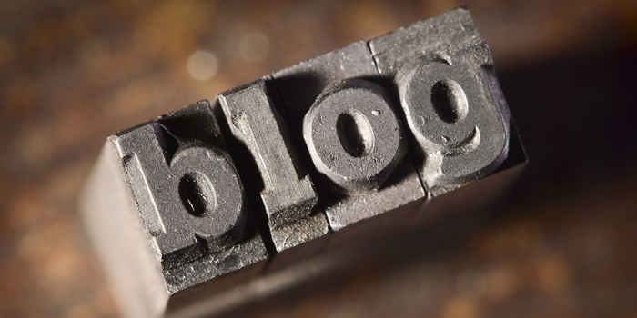

E, por último, mas não menos importante: **que em 2014 você volte ao Bramare muitas e muitas vezes**!**** Nos próximos 12 meses faremos desse cantinho virtual sua casa e seu refúgio da chatice do dia a dia**.****PODE COBRAR**!****Nós prometemos um ano cheio de conteúdos inspiradores, dicas bacanas e **APOIO MORAL** pra você viver uma vida cada vez mais sua, mais autoral :)

## Gostou das dicas**?** Compartilhe nosso ‘**Top 14 pra 2014′**com todo mundo**!** Inspiração pra enfrentar o ano que começa nunca é demais, né**?**

## Para outros posts inspiracionais e milagrosos que tal navegar na nossa tag ['Life Design'](http://www.bramare.com.br/category/life-design-2/) **?** Talvez seja o empurrãozinho que você precisava :)

14 coisas para ser em 2014
by Bia Lombardi
