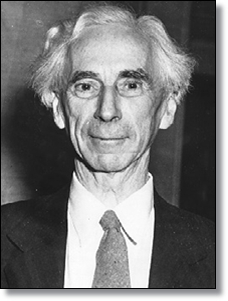

# [Perfil – Bertrand Russel](http://www.bulevoador.com.br/2010/02/perfil-bertrand-russel/)

**Fonte:** [ABCCético](http://abccetico.wordpress.com/2009/12/09/bertrand-russel/#more-311)

**Editor:** Pena Ajena

 Bertrand Arthur William Russell nasceu em Ravenscroft, no País de Gales, em 18 de Maio de 1872**.**

Foi um dos mais influentes matemáticos, filósofos e lógicos do século XX, bem como um importante político liberal, ativista político e popularizador da Filosofia**.**

Milhões de pessoas respeitaram Russell como uma espécie de profeta da vida racional e da criatividade**.** Sua voz sempre possuiu autoridade moral. Foi um crítico influente das armas nucleares e da guerra do Vietnã**.**

Em 1950, recebeu o Nobel de Literatura, em reconhecimento aos seus variados e significativos escritos, nos quais lutou por ideais humanitários e pela liberdade do pensamento**.**

### Vida e Obra

Russell estudou Filosofia na Universidade de Cambridge**.** Iniciou os estudos em 1890. Tornou-se membro (fellow) do Trinity College em 1908**.** Pacifista, recusou alistar-se durante a Primeira Guerra Mundial e, por isso, perdeu a cátedra do Trinity College e esteve preso durante seis meses**.** Nesse período, escreveu a *Introdução à Filosofia Matemática***.** Em 1927, fundou a escola experimental de Beacon Hill**.**

Na primavera de 1939, Russell foi viver nos EUA, em Santa Barbara, para ensinar na Universidade da Califórnia**.** Foi nomeado professor no City College de Nova Iorque**.** Após uma controvérsia pública, sua nomeação foi anulada pela justiça**.** Suas opiniões secularistas – como as encontradas em seu livro “Marriage and Morals”, “Por que não sou cristão” e o ensaio “Aquilo em que Creio” – tornaram-no “moralmente impróprio” para o ensino no college**.** Regressou à Grã-Bretanha em 1944 e voltou a integrar a faculdade do Trinity College**.**

Em 1962, já com 90 anos, mediou o conflito dos mísseis de Cuba**.** Organizou, com Albert Einstein, o movimento Pugwash, de luta contra a proliferação de armas nucleares**.**

Bertrand Russell escreveu a sua autobiografia em três volumes, nos finais dos anos 60**.** Nela**.** O filósofo propôs um “código de conduta” liberal, baseado em dez princípios, à maneira do decálogo cristão**.** “Não para substituir o antigo”, diz Russell, “mas para complementá-lo”**.** Os dez princípios são:

***•Não tenhas certeza absoluta de nada.***

***•Não consideres que valha a pena proceder escondendo evidências, pois as evidências inevitavelmente virão à luz.***

***•Nunca tentes desencorajar o pensamento, pois com certeza tu terás sucesso.***

***•Quando encontrares oposição, mesmo que seja de teu cônjuge ou de tuas crianças, esforça-te para superá-la pelo argumento, e não pela autoridade, pois uma vitória dependente da autoridade é irreal e ilusória.***

***•Não tenhas respeito pela autoridade dos outros, pois há sempre autoridades contrárias a serem achadas.***

***•Não uses o poder para suprimir opiniões que consideres perniciosas, pois as opiniões irão suprimir-te.***

***•Não tenhas medo de possuir opiniões excêntricas, pois todas as opiniões hoje aceitas foram um dia consideradas excêntricas.***

***•Encontres mais prazer em desacordo inteligente do que em concordância passiva, pois, se valorizas a inteligência como deverias, o primeiro será um acordo mais profundo que a segunda.***

***•Sê escrupulosamente verdadeiro, mesmo que a verdade seja inconveniente, pois será mais inconveniente se tentares escondê-la.***

***•Não tenhas inveja daqueles que vivem num paraíso dos tolos, pois apenas um tolo o consideraria um paraíso.***

Russel faleceu em 1970, no País de Gales, vítima de uma gripe**.** Suas cinzas foram espalhadas sobre as montanhas galesas**.**
