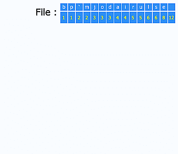
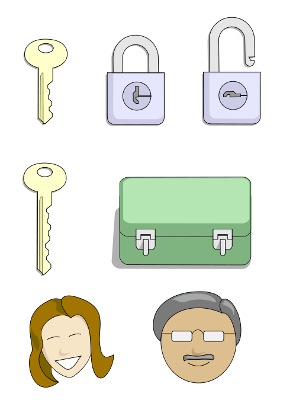
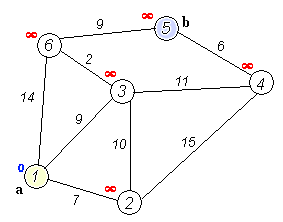
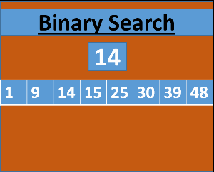
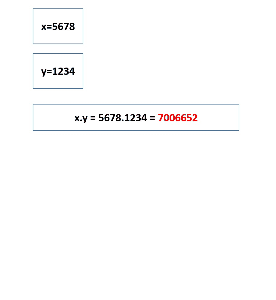
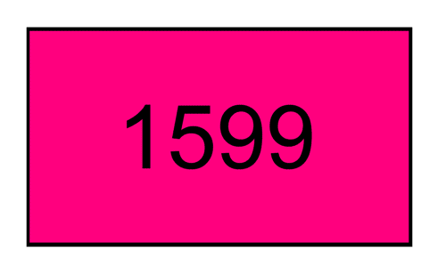

# Great Algorithms that Revolutionized Computing

Over the years, various discoveries of ingenious computer algorithms revolutionized the field of computation. Manipulating different middling operations in standard computer architectures have enabled the computer professionals to produce a variety of proficient functions. These functions have been used to manufacture diversely intricate computer programs that are major contributors for the advancement of current computer age. Put together is a list of Computer Algorithms that have literally changed our experience with computers.

## Compression Technology

### [Huffman Coding](http://in.docsity.com/en-docs/Huffman_Encoding__Properties_of_Binary_Tree_-_Data_Stuctures_-_Lecture_Slides_)

The Huffman coding algorithm is widely used in lossless data compression methods. Struggling to develop a method to find the most efficient binary code, David A. Huffman in 1951, came across the idea to use a frequency-sorted binary tree which proved to be the most efficient method. Due to the simplicity and rapidness, the algorithm is being used in a variety of compression techniques like DEFLATE (PKZIP’s algorithm) and multimedia codecs which include JPEG and MP3.

## Cryptography

### [Public-key Cryptography](http://uk.docsity.com/en-docs/Public_Key_Cryptography-Introduction_to_Networks-Lecture_18_Slides-Computer_Science-Dr_Colin_Perkins)

Referred to a cryptographic algorithm requiring two separate keys, public key is used to either encrypt plaintext or verify a digital signature. The private key is then used to decrypt the ciphered text or create a digital signature. The Public-key cryptography facilitates the users to communicate securely over a public channel. Publicly disclosed in 1997, these algorithms were secretly developed by James H. Ellis, Clifford Cocks, and Malcolm Williamson at the Government Communications Headquarters (GCHQ) in UK in 1973 and were being implemented since then.

## Search Algorithms

### [Dijkstra’s Algorithm](http://in.docsity.com/en-docs/Dijkstra_s_Shortest_Path_Algorithm-Data_Representation_And_Algorithm_Design-Lecture_Slides_)

Comprehended by Edsger Dijkstra in 1956, Dijkstra’s algorithm is a search based algorithm designed for graphs. It solves the single-source shortest path problem for a graph, hence producing the shortest path tree. The algorithm is widely implemented in routing as well as in subroutines for various graph algorithms. Using this algorithm, a shortest path on a single map (i.e graph) can be easily determined as shown here.

### [Binary Search Algorithm](http://in.docsity.com/en-docs/Binary_Search_Trees_-_Data_Structures_-_Lecture_Slides_)

A binary search algorithm is used to locate keyword within an array sorted by key value. Sorted lists are usually found in a dictionary where the definition of words is to be found. A telephone book also contains a sorted list of people’s names, addresses, and telephone numbers. One can quickly find a telephone number and address by knowing the desired name.

## Sorting Methods

### [Quick Sort](http://in.docsity.com/en-docs/Quick_Sort_-_Algorithm_-_Lecture_Slides_)

[[anexo ausente]](http://en.docsity.com/news/wp-content/uploads/2014/02/Quicksort.gif)

Developed in 1960 by Tony Hoare, the algorithm was used to sort the words to be translated, in order to provide an easy match to an already sorted dictionary. The algorithm gained its fame when it was implemented in Unix as the default library sort function where it gave its name to the C standard library function as “qsort”.

## Mathematics Algorithms

### [Karatsuba Algorithm](http://us.docsity.com/en-video/Introduction_to_Algorithms_-_Karatsuba_Multiplication_-_Victor_Costan_-_Lecture_36_of_47)

This algorithm is implemented to achieve faster multiplications. It was discovered in 1962 by Anatolii Alexeevitch Karatsuba. It reduces the digits of numbers to be multiplied and provides a quicker solution. A faster generalization of this algorithm exists by the name of Toom–Cook algorithm. Whereas for sufficiently larger numbers, the Schönhage–Strassen algorithm provides a much quicker solution.

### Euclidean Algorithm

Highest common factors, where the largest integer for two positive integers, divides both of them without leaving a remainder, can be computed using Euclidean algorithm. Since it only uses subtraction and comparison to find the HCF, it is invariably used in many advanced algorithms. Although Euclid holds the prestige of discovering this algorithm, the Euclidean algorithm is expected to be one of the oldest algorithms that appeared in Euclid’s Elements in around 300 BC.

## Graphical Breakthrough

### [Bresenham’s line Algorithm](http://in.docsity.com/en-docs/Bresenham_s_Line_Algorithm-Computer_Graphics-Lecture_Slides_)

Developed by Jack Elton Bresenham in 1962 at IBM, the Bresenham line algorithm is responsible for drawing lines on a computer screen. The algorithm uses simple techniques of integer addition, subtraction and bit shifting. The algorithm was pioneer in computer graphics. And further extensions to the original algorithm have provided functions such as drawing circles etc.Due to the speed and simplicity of Bresenham’s line algorithm, it is still vital and implemented in various hardware such as plotters and modern graphics cards.

### Fast Inverse Square Root

This algorithm provides a quick method to calculate the reciprocal of a square root and is used by 3D graphics programs to determine lighting and reflection which involves millions of calculations per second. The algorithm found its use in the Quake III Arena source code in 1999, however it wasn’t implemented widely until 2002. The algorithm uses a sequence of simple techniques to solve complex calculations. Although it is attributed to John Carmack, but the earliest use is known to be executed by both Silicon Graphics and 3dfx interactive using Gary Tarolli’s implementation.
