# [CHINESE NEW YEAR IN MOY JO LEI OU FAMILY (ANO NOVO CHINÊS DA FAMÍLIA MOY JO LEI OU)](http://moyfatlei.blogspot.com.br/2014/02/chinese-new-year-in-moy-jo-lei-ou.html)

Posted by
BLOG DO PEREIRA
Wednesday, 12 February 2014

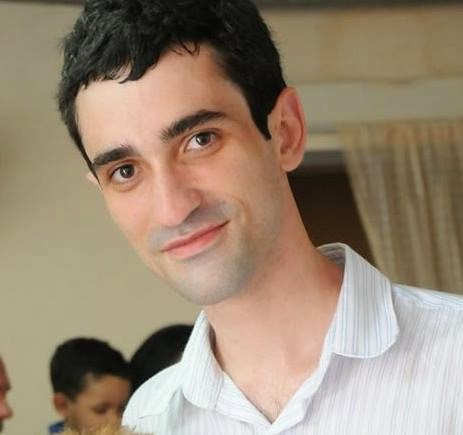

**PHOTOS by Leandro Lima Cardoso (Member of MYVT Meier School)**

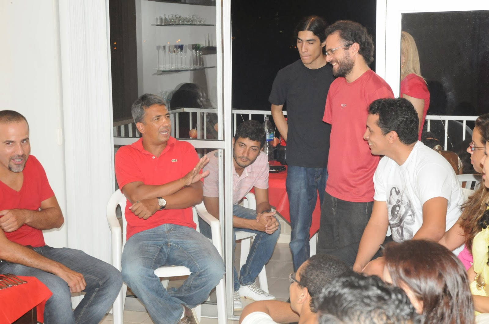

Você já se vestiu de forma equivocada para uma determinada ocasião **?** Bom, eu já consegui essa façanha algumas vezes, mas nada que se compare a última Sexta-feira, quando vesti-me de branco para a celebração do ano novo chinês**.**  
Você pode se perguntar primeira do “Por que” de fazer tal coisa**.** Bom, naquele dia eu estava muito mal de saúde, e na pressa ao sair de casa, acabei passando a mão pela camisa mais próxima, uma branca**.**  
  
Have you ever dressed wrongly for a certain occasion**?** Well, I've got this feat a few times, but nothing that compares to last Friday, when I dressed in white for the celebration of Chinese New Year**.**   
You can ask first "Why" do such a thing**.** Well, that day I was in very bad health, and in a hurry to leave my house, just grab the nearest shirt, a white one**.**

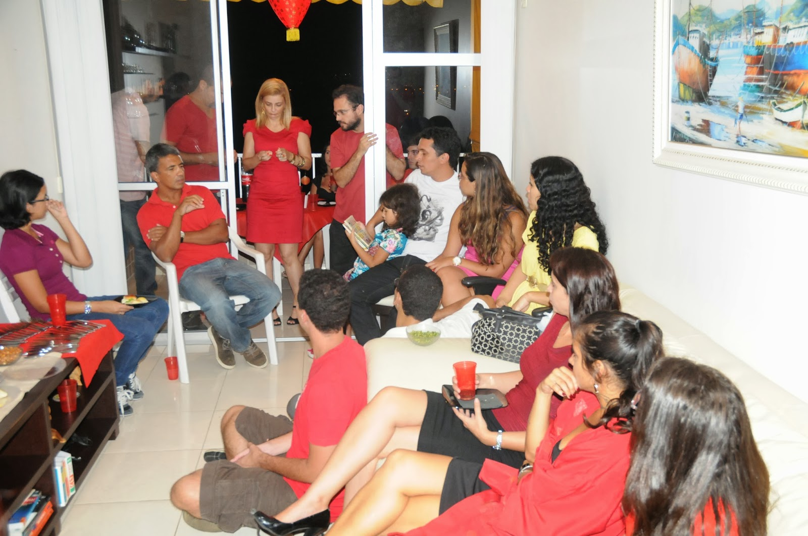

Segundo Si Fu, o branco representa a morte na cultura chinesa pelo fato de que quando uma pessoa está próxima da morte, ou seja, convalescendo**.** Seu aspecto vai ficando cada vez mais pálido. Por isso também, ele comentou sobre o oposto do branco ser o vermelho na cultura clássica chinesa**.** Já que o vermelho está ligado a cor do sangue que representa a vida**.**

According to  Si Fu, white represents death in the Chinese culture by the fact that when a person is near death, or convalescing**.** Their appearance becomes increasingly paler. So too, he commented on the opposite of white is red in Chinese classical culture**.** Because the color red is connected to the blood that is life**.**

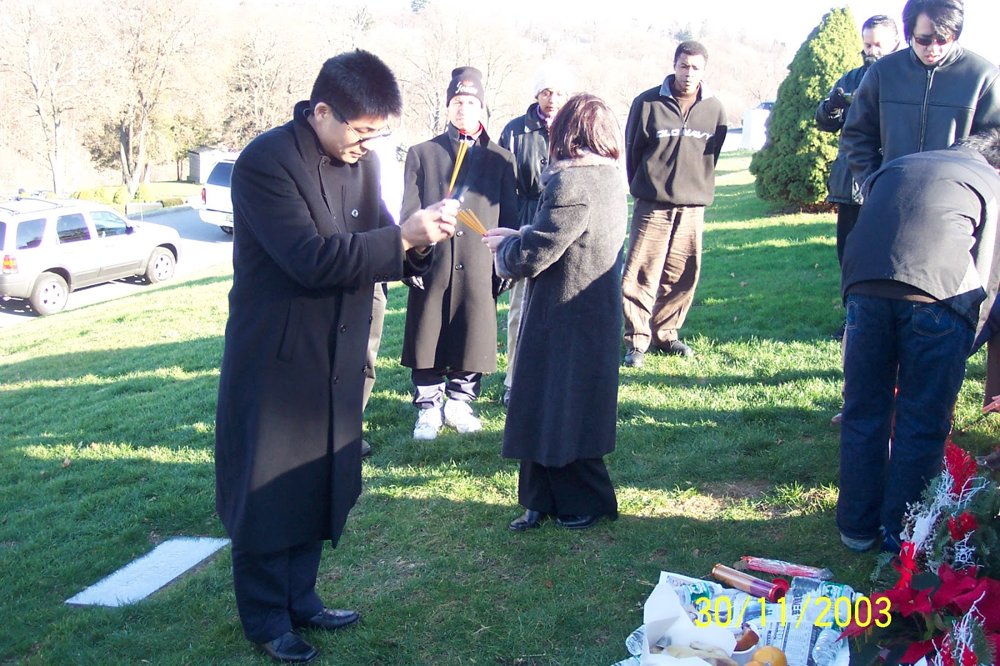

(Si Gung presta reverência a seu falecido Si Fu, Grão Mestre Moy Yat)

(Si Gung doing reverence to his Si Fu's tomb , Grand-Master Moy Yat)

Tendo dito isso, Si Fu aproveitou para citar que nos preparativos do funeral de Si Taai Gung Moy Yat, a casa responsável pelo preparo fez um panfleto em cantonês e inglês falando sobre alguns procedimento a respeito do dia do funeral**.** Dentre eles, o pedido de evitar cores vibrantes na roupa, em especial o vermelho**.**

Sobre isso, Si Fu comentou que na verdade esse não é o melhor tema para se tomar como exemplo neste tipo de ocasião, pois no ano novo chinês o costume é que se evite dar más notícias**.** Costume esse que faz com que as pessoas desliguem seus telefones, para não correr o risco de atender uma chamada com alguma má notícia nos dias que compõem as festividades do ano novo chinês**.**

Having said that, Si Fu took the opportunity to mention that the preparations for the funeral of Si Taai Gung Moy Yat ,the home ​responsible for preparing, made a pamphlet in English and Cantonese speaking about some procedure about the day of the funeral**.** Among them, the application to avoid vibrant colors in clothing, especially red**.**

About it, Si Fu said that this is not the best subject to take as an example this type of occasion actually, because the Chinese New Year custom is that you avoid giving bad news**.** Costume this that makes people turn off their phones, not to run the risk of answering a call with some bad news in the days that make up the festivities of Chinese New Year**.**

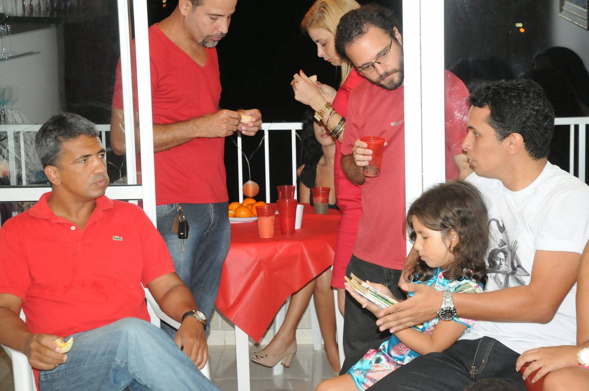

Neste ponto, você pode ter estranhado a palavra “dias”**.** Isso porque o nosso réveillon ocidental acontece na passagem do dia 31 de Dezembro para o dia 01 de Janeiro**.** Já o ano novo chinês ele acontece por vários dias até aquele que é considerado o ano novo chinês em si**.**

At this point, you may have been surprised by the word "days"**.** That's because our western new year party happens between December 31  and January the first.. The Chinese new year it happens for several days before what is considered the Chinese New Year itself**.**

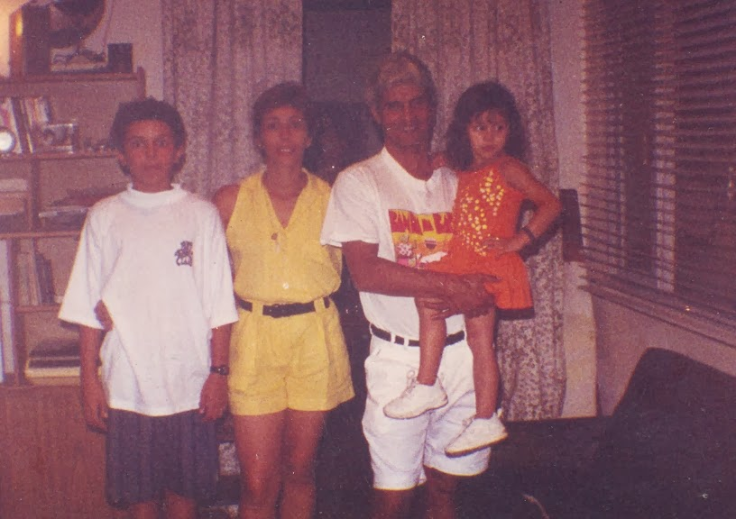

*(Na foto estou com minha mãe,pai e irmã no dia 31 de Dezembro de 1994)*

*(Thats me with my mom, dad and sis in December 31**.**1994)*

*Eu nunca fui no réveillon em Copacabana**.** Este ano fui convidado mas na última hora minha saúde de passarinho não deixou e fiquei com meus pais**.** Na verdade, sempre evitei multidões, e passar o ano novo sozinho em casa quando era adolescente não parecia tão ruim assim**.** Meus pais gostavam de ir pra casa da minha tia em frente à praia, eu preferia sempre ficar jogando meu Playstation 1 sozinho no meu quarto**.** Mas pra falar que não curto ano novo, em 1994 eu estava no início da rua com meu amigo Herbert, esperando os lendários fogos do seu Araquem explodirem**.** Meu pai e a mãe do Herbert nos deixaram ir até lá com a condição de voltarmos antes de meia-noite, o que não fazia o menor sentido pensando agora**.** Quando deu 23:40 Herbert me chamou pra subir , eu disse que iria ficar**.** As 23:55 h avisto meu pai vindo lá de cima, lá do final da rua com algo na mão**.** Eu sabia que era a colher-de-pau que ele usava pra me bater**.** Eu ainda pensei em correr e implorar para não apanhar, mas os fogos do Seu Araquem eram irresistíveis**.** E lá estavam eles explodindo com ele no meio gritando feliz ano novo, as pessoas se abraçavam e aplaudiam o maior espetáculo de Rocha Miranda quando senti a mão pesada da justiça paterna me puxar pelo braço direito seguido de um “abre a mão**!**”... E lá estava eu apanhando de colher –de-pau em meio a gritos de feliz ano novo**.***.. rsrsrs

I've never been in New Year's Eve in Copacabana beach **.** This year I was invited ,but at the last minute my health did notallowed me to leve home and stayed with my parents **.** In fact , I had always avoided crowds , and spend the New Year alone at home as a teenager did not seem so bad for me **.** My parents liked to go to my aunt's house on the beach front , I always preferred to be playing my Playstation 1 alone in my room **.** But a long time ago, in new year in 1994 to 1995, I was at the beginning of the my street with my friend Herbert , waiting for the legendary fireworks explode by Mr Araquém**.** The firework master of our hood . My father and the mother of Herbert left us to go there on the condition return before midnight , which made ​​no sense thinking now **.** 23:40h  Herbert decided to go back home and he called me to go with him , I said I would stay**.** So, 23:55 h I spot my father coming from the end of the street ,with something in hand **.** I knew it was the wodden-spoon that  he used to beat me up **.** I even thought about running and beg not to be beaten, but the fires of Mr Araquém were irresistible **.** And there they were! Exploding! with Mr Araquem in the middle shouting Happy New Year , people hugged and applauded the biggest show of Rocha Miranda when I felt the heavy hand of paternal justice pull me by the right arm followed by an word: "Thiago, open hand boy**!** " .. . And there I was being beaten up with his wodden-spoon in the middle of shouts of Happy New Year ..**.** lol

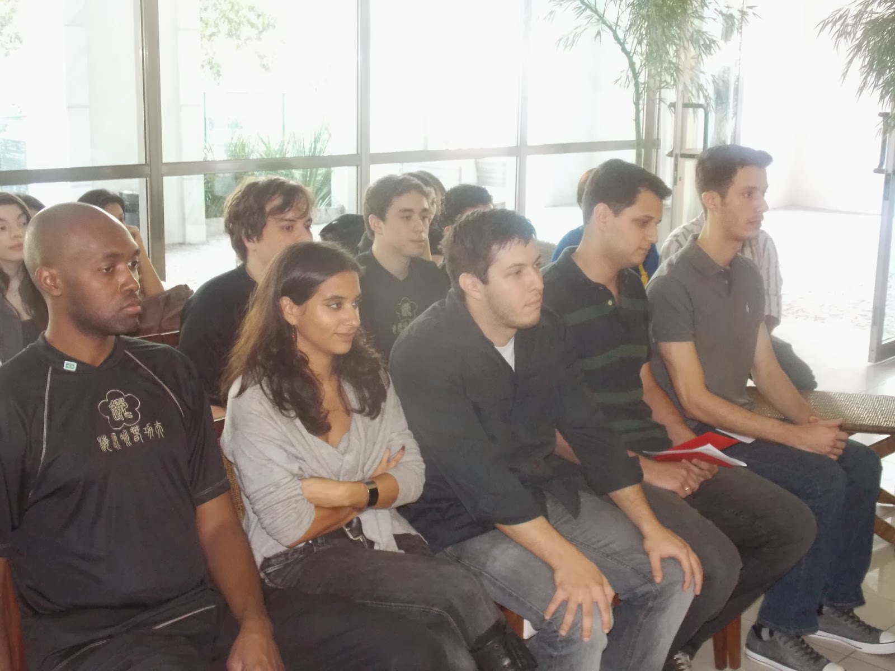

Ana Patricia é uma menina portuguesa(foto) que agora reside no Brasil**.** Se você já jogou WAR alguma vez, saiba que ela já viveu em mais países do que o tabuleiro possui..**.** Acredito que ela não tenha vivido em Omnski nem em Dudinka..**.**  Mas ainda assim é muita coisa!

Ela ingressou na Família Kung Fu junto de Joelson Junior, Leandro Carlos, Roger Luz , Glauco Gavioli e Waldyr Neto**.**

Sua chegada até aquele momento, se deveu muito também ao belo trabalho desenvolvido com sua pessoa pelo Mestre Felipe Soares, que coordena o Ving Tsun experience no Rio de Janeiro**.**

Ana Patricia is a Portuguese girl (photo) who now resides in Brazil**.** If you've ever played RISK, know that she has lived in more countries than the board has ..**.** I believe she just has nit lived in Omnski nor Dudinka ..**.** But so is still a lot!

She joined the Kung Fu Family along with Joelson Junior, Leandro Carlos, Roger Luz, Glauco Gavioli and Waldyr Neto**.**

Her journey until that moment, also owed ​​much to the beautiful work done on his person by the Master Felipe Soares, who coordinates the Ving Tsun experience in Rio de Janeiro**.**

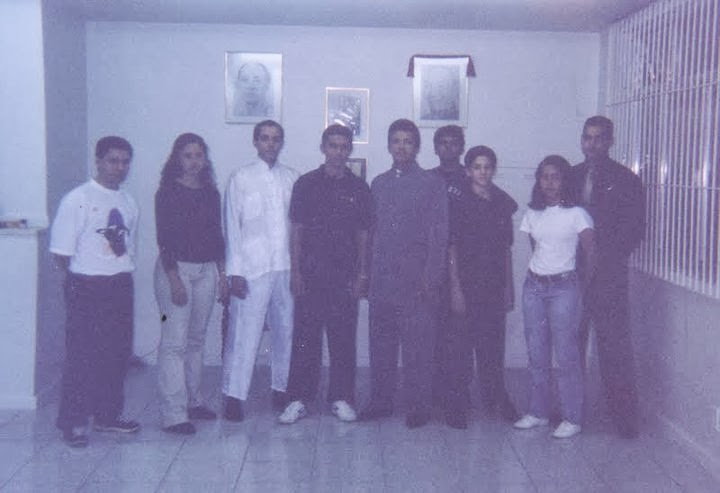

Nesta foto acima, vemos o dia em que ingressei na Família Kung Fu em 1999**.** Isso faz tanto tempo , que o telefone mais avançado da época era o Startac**.** Mas daquele dia, algo que já escrevi aqui, foi que Si Fu me disse que esperava que minha entrada na Família não fosse por acaso**.**

In this photo above, we see the day when I entered the Kung Fu Family in 1999**.** That was so long ago, the most advanced phone of the day was Startac**.** But that day, something I've already written here, was that

Si Fu told me he hoped my entry in the Family was not by chance**.**

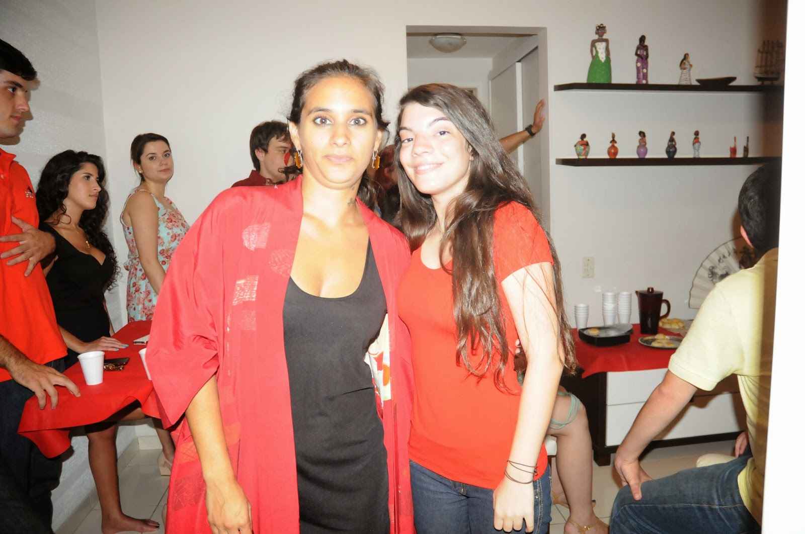

Patricia (Esquerda) abriu as portas de sua casa com muito carinho para esta celebração**.** E ainda lembrou-se de comemorar o aniversário de Leticia Ghenov (direita) que na data celebrava mais um ano de vida**.**

Patricia (left) opened the doors of her house with great affection for this celebration**.** And she also remembered the anniversary of Leticia Ghenov (right) on the date celebrated another year of life**.**

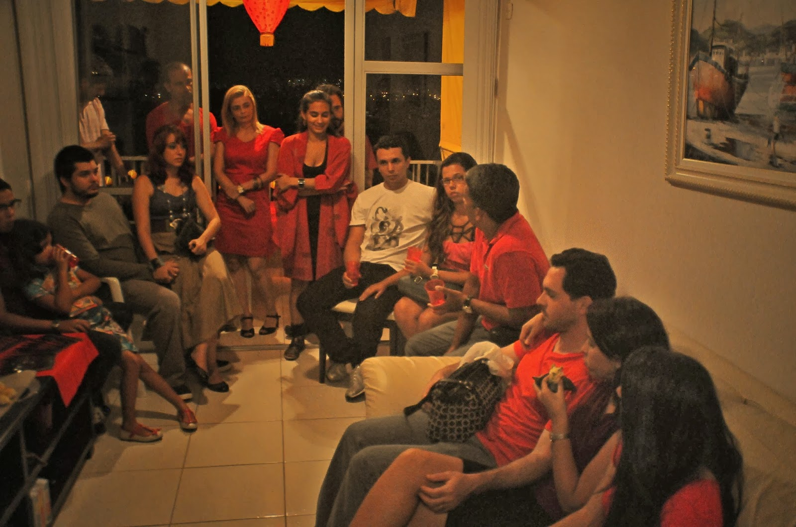

Si Fu prosseguiu comentando coisas muito interessantes sobre a cultura chinesa como as danças do dragão e do leão presentes neste tipo de festejos e suas diferenças**.** Citou a importância dos fogos, mas não só daqueles como vemos no reveillon daqui, mas sim daqueles carckers que parecem pequenas dinamites e servem para espantar os maus espíritos**.**

Ao final, Patricia ofereceu uma saborosa carne assada que todos puderam saborear**.**

Aqui, o Blog do Pereira deixa em nome de todos o "Muito Obrigado" por nos receber em sua residência**!** E que este ato, de alguém que não entrou na Família por acaso, inspire os demais irmãos e irmãs kung fu a se mobilizarem para que mais momentos como esses possam ser proporcionados**!**

Si Fu went on to comment very interesting things about Chinese culture as the dragon  and lion dances present in this type of festival and their differences**.** He cited the importance of the fireworks, but not only those we see in the New Year's Eve here, but those that seem small carckers like dynamite and serve to scare away demons**.**

Finally, Patricia offered a tasty roast that everyone could enjoy**.**

Here, the blog lets a "Thank You" for having us in her home**!** And we hope that this act of someone who has not entered the family by chance, inspire other kung fu brothers and sisters  to mobilize themselves for more moments like these can be provided**!**

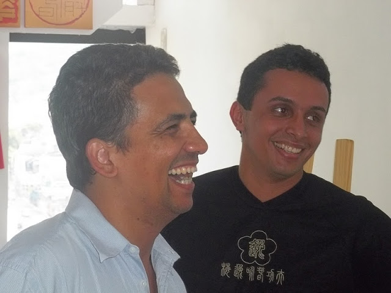

**THE DISCIPLE OF MASTER JULIO CAMACHO**

**Thiago Pereira "Moy Fat Lei"**

**moyfatlei.myvt@Gmail.com**
