# [OPEN LETTER TO MASTER JULIO CAMACHO(CARTA ABERTA PARA MESTRE JULIO CAMACHO)](http://moyfatlei.blogspot.com.br/2014/02/open-letter-to-master-julio.html)

Posted by
BLOG DO PEREIRA
Wednesday, 26 February 2014

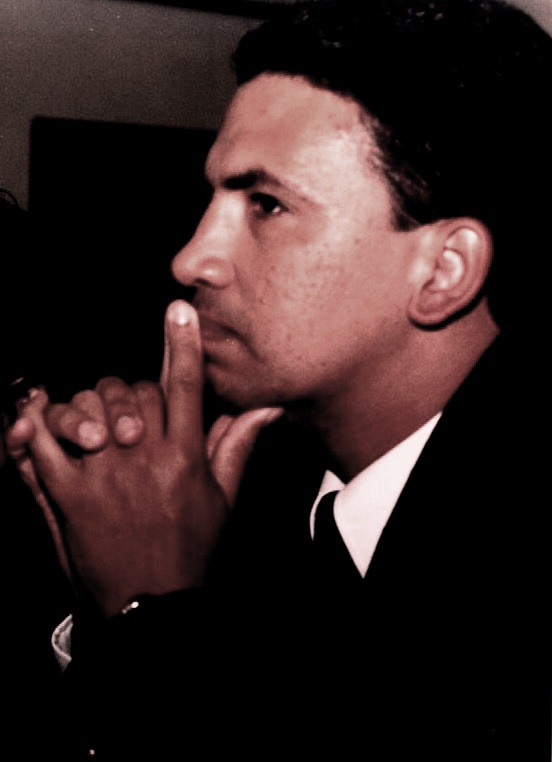

*Si Fu,*  
  
*não sei se o senhor sabe, mas eu morava no 386 da Rua Vieira do Couto em Rocha Miranda de aluguel com meus pais. Em 1994 meu pai foi pedir a um tio para novamente ser seu fiador como ele vinha fazendo desde 1989, mas desta vez ele disse "não". Do dia pra noite, ficamos sem ter onde morar e fomos todos pro início da rua nos fundos do 126 morar com meu avô e avó numa casa com sala, quarto, cozinha e banheiro. Seis pessoas, sendo que tinha a minha irmã com uma mega bronquite. Nossas roupas estavam todas em sacos plásticos azuis, daqueles de lixo, porque não tinha onde guardar. E de Setembro até 11 de Novembro de 1995 quando isso tudo aconteceu, eu comi miojo todos os dias. Todos os dias!*  
*Pra mim era uma festa morar na mesma casa do meu avô, mas não pro meu pai. Minha avó nunca havia ido muito com a cara dele, porque no fundo sempre achou que ele tinha sido uma má influência pra minha mãe que tinha um futuro brilhante.*  
*Si Fu,*  
*I do not know if you know, but I lived in the number 386 of the  Vieira Couto Street by rental in Rocha Miranda neighborhood with my parents. In 1994 my father went to one of my uncles to ask again to be his guarantor as he had been doing since 1989, but this time he said "no." From morning to night, we were without a home , so we moved to the othe number in the same street  to live with my grandfather and grandmother in a house with living room, bedroom, kitchen and bathroom. Six people, and I had my sister with a mega-bronchitis. Our clothes were all in blue plastic bags, those garbage plastic bags, because we did not have where to store it. And from September until  November,11 of 1995 when it all happened, I ate ramen noodles every day. Every day!*  
  
*For me it was a party living in the same house of my grandfather, but not for my dad. My grandmother never really liked him very much, because deep down always thought he was a bad influence for my mother who had a bright future.*

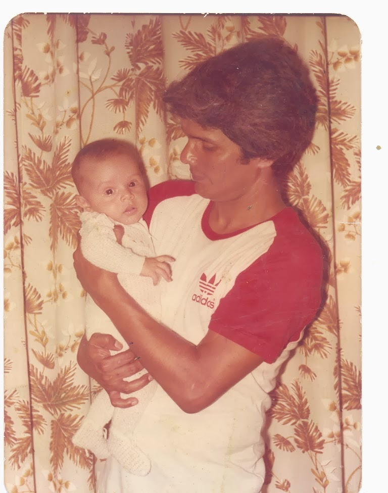

(meu pai comigo no colo recem-nascido na casa de sua sogra, onde teria que morar de favor anos depois)

(my father with me at his mother-in-law´s house, where he would have to live by favor for some time years later)

*Anos depois, estávamos vivendo numa casa que no terreno caberiam 15 daquela casa onde minha avó vivia e ele teve que morar de favor. Tínhamos agora um quintal muito grande, e ele vivia me fazendo limpá-lo. Coisa que eu fazia a muito contra-gosto. Numa dessas vezes, ele disse algo que nunca esqueci: "Thiago, quando o cara tá bem, é muito fácil você ser legal com ele, procurar ele. Quando o cara tá mal, ninguém procura."*  
*Years later, we were living in a house that would fit 15of that house where my grandmother lived and dad had to live with us. We now had a very large yard, and he lived making me clean it. Something I did with no smile in my face. One of those times, he said something I never forgot: "Thiago, when the guy is living well, it is very easy for you to be cool with him, but when the guy is having a hard time, nobody looks for him.."*

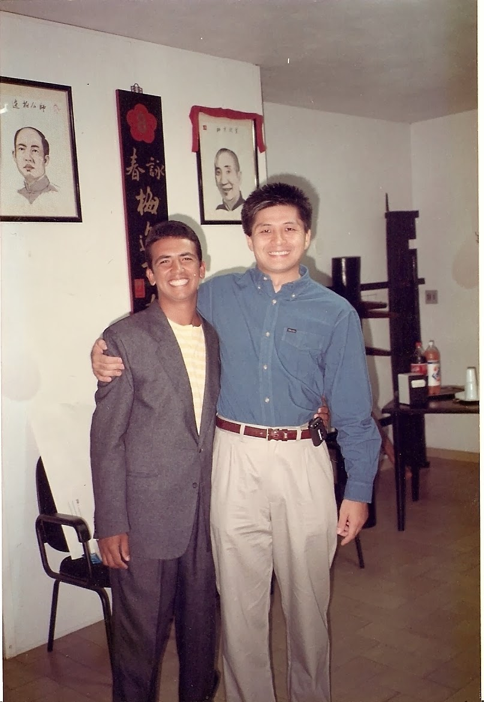

*Nos últimos 3 anos Si Fu, as coisas não foram fáceis pro senhor . E eu tenho que confessar que pra mim foi bem difícil acompanhar todo esse processo. Desde a primeira vez que o vi, sempre enxerguei tanta vida no senhor, que vê-lo adoentado , ou cansado, ou preocupado para mim foi bem duro. E eu sempre lembrava do que o senhor havia falado certa vez citando o Si Gung: "Julio, no início quando você começou, você era um jovem seguindo um jovem, depois um jovem seguindo um adulto, e agora um adulto seguindo um adulto."  Eu acho que conosco foi quase  o mesmo, mas talvez eu tenha travado entre o jovem e o adulto.*  
*Over the past three years Si Fu, things were not easy for you. And I have to confess that for me it was very difficult to live this process. From the first time I saw you, whenever I saw you, you had so much life in you, So, to see you getting sick, or tired, or worried for me was pretty hard. And I always remembered what you had spoken once citing Si Gung: "Julio, in the beginning when you started, you were a young man following a young man, then a young man following an adult, and now an adult following an adult." I think it was with us almost the same, but maybe I was frozen between the young and adult.*

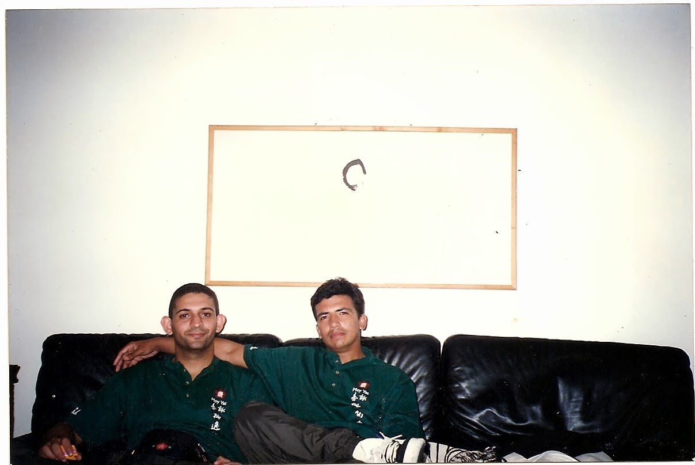

*O senhor sempre aparecia com novidades e com histórias incríveis sobre a vida de forma geral. Mas vezes eu achava chato quando o senhor cismava com alguma coisa, como quando o começou a falar de etimologia e filosofia grega. Mas como mágica, de repente lá estava eu me interessando por esses assuntos também. Porque o senhor sempre colocou tanta paixão nas suas histórias, que elas contagiavam quem quer que fosse.*  
*You always show up with new and amazing stories about life in general. But sometimes I found annoying when you mused about something, as when you started talking about etymology and Greek philosophy. But like magic, suddenly there I was  interested by these subjects as well. Because you always put so much passion into your stories,that they spread to everyone.*

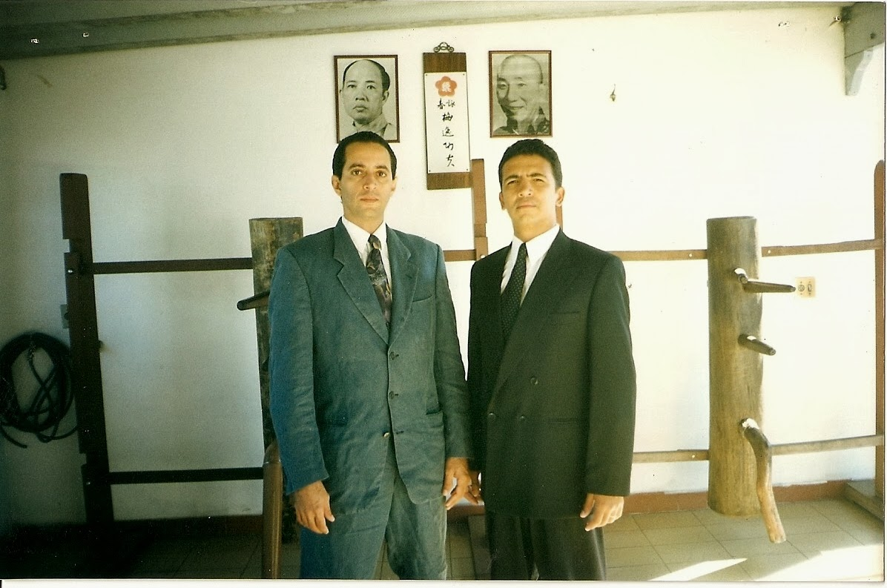

*(Com Mestre Ricardo Queiroz, seu Si Dai e hoje diretor do Nucleo Centro no Rio)*

*(With Master Ricardo Queiroz, his Si Dai, and nowadays the director of MYVT Downtown School in Rio)*

*O senhor inspirou muitas pessoas nesses anos. Fossem elas pessoas que o chamavam de Si Hing ou de Si Fu. O senhor sempre esteve lá por elas. Mas hoje vejo, o quanto o senhor sacrificou para tanto. O senhor realmente sempre levou esse compromisso a sério, e por muitas vezes as pessoas que o senhor ajudava,ouvia, aconselhava, e abraçava. Eram as mesmas que falavam besteiras depois. E foi quando o senhor me disse: "...Não importa quem seja, ou o que falou por aí. Quantas vezes retornar, eu vou sempre receber com um abraço.Mas um abraço de verdade."*  
*You inspired many people over the years. They were people who called you as Si Hing or Si Fu. You were always there for them. But now I see, how much you sacrificed for us. You really always took that commitment seriously, and often people that you helped, listened, counseled, and hugged. Were the same after speaking nonsense about you. And I remember when you told me: ".. ... No matter who or what the person said before. Every time they return, I will always welcome this person with a hug But a honestly hug."*

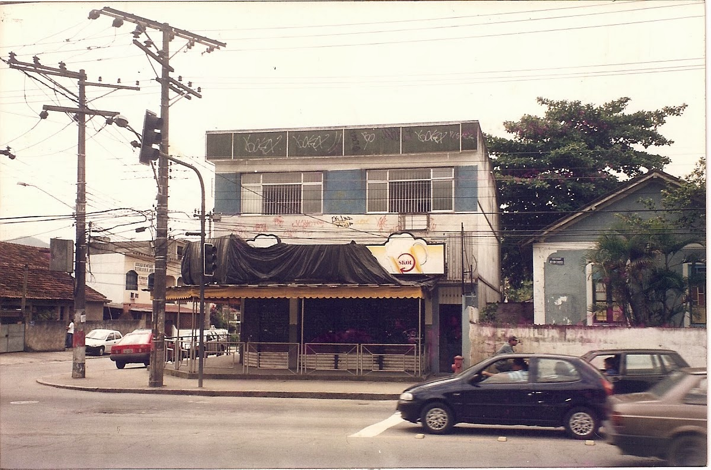

*O senhor consegue olhar para algo e enxergar o que esse algo pode se tornar. Isso é muito valioso, porque o senhor não fazia isso apenas com espaços físicos que se tornavam um Mo Gun incrivel depois. Mas o senhor também o fez com pessoas como eu...*  
*You were always able to look at something and see what that something could become. This is very valuable, because you did that not just with places but also with people  like me ...*

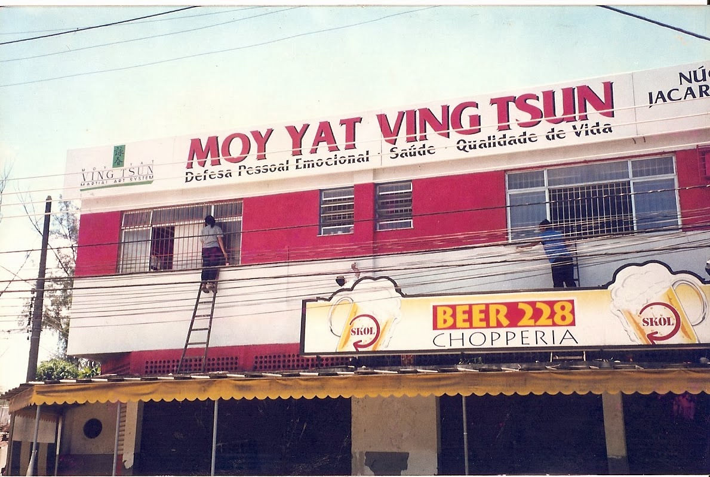

*Para muitos de nós, o senhor era quase uma entidade que só vivia em função do Ving Tsun. Nunca pensamos de verdade , em como estavam as coisas na sua casa ou com a sua Família. E mesmo assim, todas as vezes, o senhor se preocupou com a casa, e com a família de cada um de nós. E por mais trivial que fossem os nossos problemas, o senhor os ouvia com uma atenção que muitas vezes surpreendia quem estava falando.*  
*For many of us, you were almost an entity that lived only for Ving Tsun. We Never thought for real in how things were going at your home and with your family. And yet, every time, you cared about the house, and the family of each of us. And no matter how trivial  were our problems, you heard them with an attention which often surprised who was speaking.*

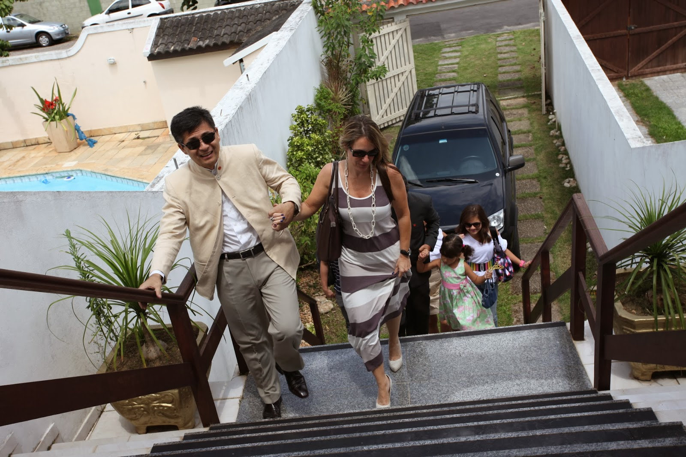

*Um belo dia o senhor parou comigo em frente a um local enorme e me perguntou se eu achava que era muito para nós. Pela confiança que sempre tive no senhor e na sua visão, eu disse que não. Ao mesmo tempo, numa vez o senhor disse para alguém que estava em um Mo Gun que o senhor dirigia: "Cuidado quando pisar aqui, porque você está pisando no meu sonho"*  
*E honestamente Si Fu, acho que ninguém se deu conta disso naquele momento. Ninguém se deu conta de que o sonho era de todos nós.*  
*One day you stopped me in front of a huge site and asked me if I thought it was too much for us. I always had the confidence in you and in your vision, So I said "no". At the same time, one time you said to someone who was in a Mo Gun that you ran years before: "Beware when you walk here, because you are walking on my dreams"*  
  
*And honestly Si Fu, I think nobody realized it at the time. Nobody realized that the dream was for all of us.*

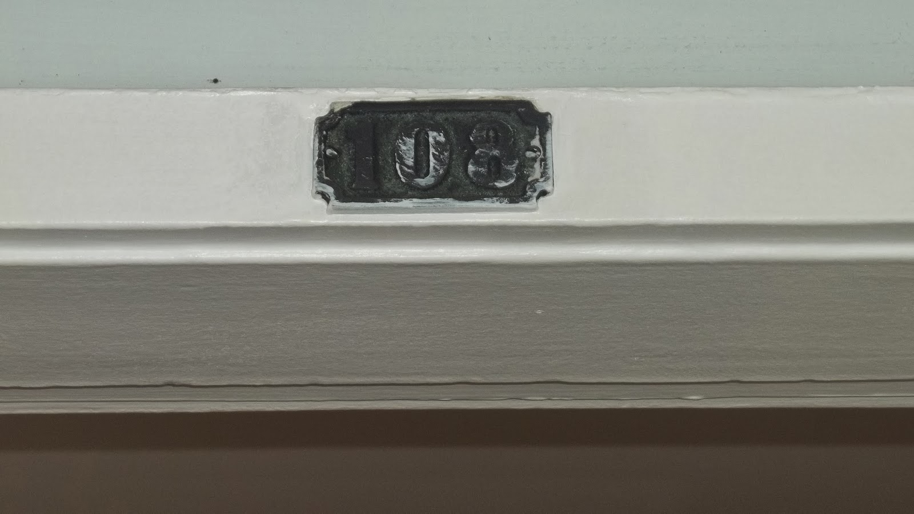

*Quando nos demos conta, os que ficaram ao final pelo menos, lá estávamos nós: Começando num novo local. Porém dessa vez, o inspirador, o conselheiro, o amigo era quem precisava de nós, e nós não estivemos lá por ele.*  
*E eu imagino o quanto isso deve ter sido duro. Mas não posso falar por todos Si Fu, só por mim...*  
*When we realized, those who stayed untill the end at least, there we were: Starting in a new place. But this time, the inspirator, the counselor, the friend was the one who needed us, and we were not there for him.*  
  
*And I imagine how it must have been hard for you. But I can not speak for everyone Si Fu, just for me ...*

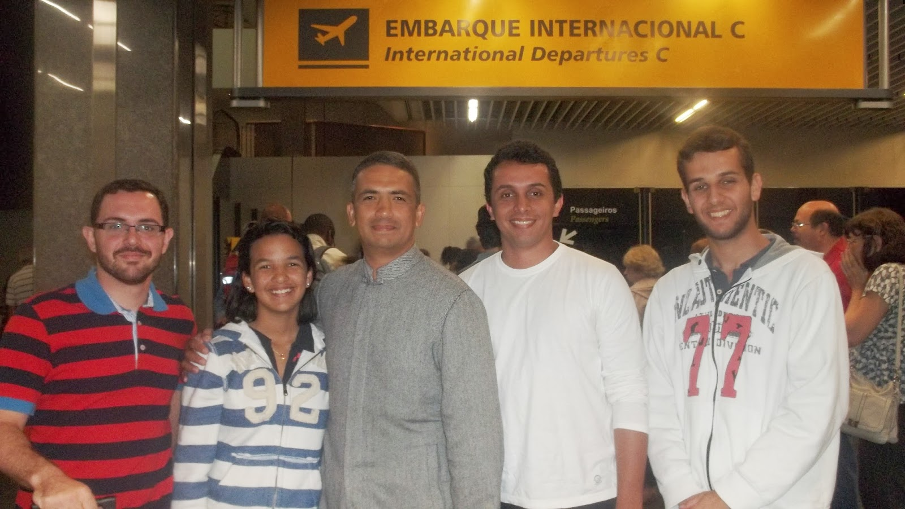

*Em 15 anos, o senhor nunca virou as costas pra mim. E por mais que eu tenha pensado , discordado, questionado o senhor muitas e muitas vezes nesses anos,durante esse período difícil um único sentimento sempre esteve presente: "Gratidão". Porque "...**quando o cara tá bem, é muito fácil você ser legal com ele, procurar ele. Quando o cara tá mal, ninguém procura..." - Foi o que meu pai disse.*  
*In 15 years, you never turned your back on me. And as much as I have thought, disagreed, and questioned you many many times over the years, during this difficult period an unique feeling has always been present in me: "Gratitude". Because "... when the guy is doing well, it is very easy for you to be cool with him, But when he is living a hard time, nobody looks for him..." - That's what my father said.*

*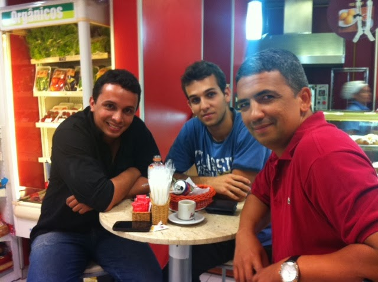*

*O senhor Si Fu, me ensinou a me vestir de acordo com a ocasião. O senhor me ensinou que se não posso ter determinado objeto,antes de comprar falsificado, é melhor não ter. Porque se o que uso for falso, o que pensarão do meu Kung Fu? O senhor me fez até apreciar vinho, ainda que eu tenha preferido continuar bebendo Pérgola..(risos)*  
*O senhor me convidou pra viajar pra outros países com o senhor muitas vezes, e eu que nunca fui, só reparei na besteira que fiz, quando meu Si Dai Ismael disse ao entrar na Família que o sonho dele era um dia ser convidado pelo senhor para uma viagem dessas.*  
*You Si Fu, taught me how to dress according to the occasion. You taught me that if I can not have certain object, before buying a false onet, it is better not to have. Because if what I use is false, what they will think of my Kung Fu? You made me like to appreciate wine, though I have preferred to continue drinking the chip ones .. (laughs)*  
  
*You invited me to travel to other countries with you many times, and I've never been there with you, and I just noticed the mistake I did when my Si Dai Ismael said , when he entered into the family, that his dream was to one day be invited by yiu for such a trip.*

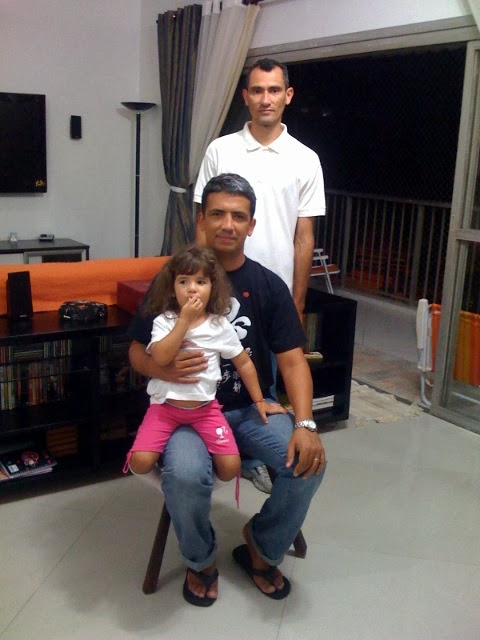

*Se o senhor ouviu muita besteira a seu respeito nesse período, eu também ouvi. Mas eu queria que o senhor soubesse que outras tantas pessoas como o Vlad(foto), pensavam o contrário, como numa vez que ele disse no carro em 2012: "...O cara tá numa situação dificil e ainda vai pra China buscar conhecimento pra gente e eu não vou ajudar? Se fosse outro tinha jogado tudo pro alto por muito menos!..."*  
  
*I know you heard a lot of nonsense about you during this period, I also heard. But I wanted you to know that so many people like Vlad (photo), thought otherwise, as a time when he said in my car in 2012: "... The guy is in a difficult situation and still goes to China to seek knowledge to share with  us and I will not help him? If was anyone else would had thrown it all away for a lot less! ... "*

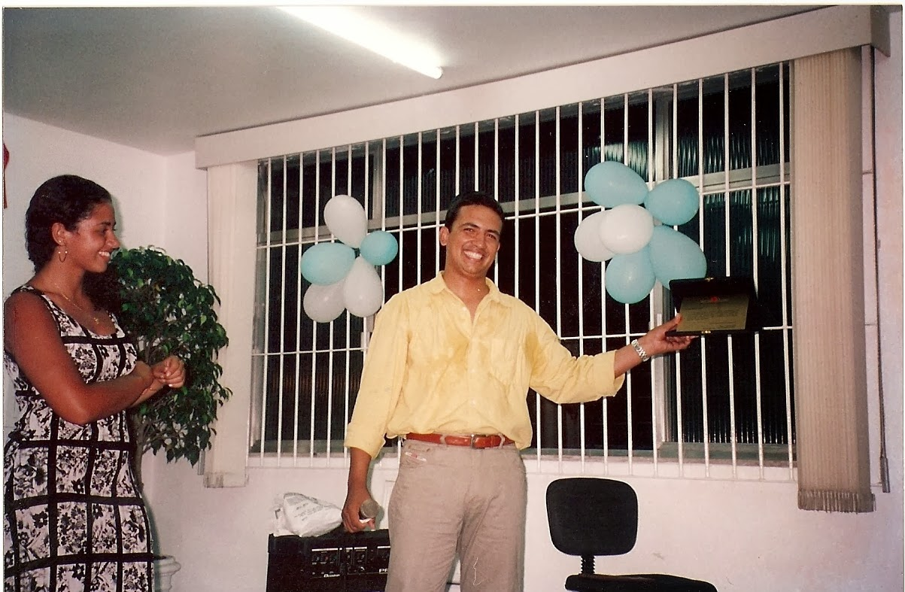

*Uma vez o senhor iria dar uma palestra sobre Ving Tsun no Mo Gun e estava muito animado. Chegou a noite no seu primeiro Núcleo Tindiba e só tinham duas pessoas. Aquilo chocou o senhor. A Si Sok Ursula(foto), que era uma das duas pessoas presentes,disse pro senhor focar em quem tinha ido, mesmo que fossem só duas pessoas.*  
*Long time ago, you would give a lecture on the Ving Tsun at the old MYVT TIndiba School in Rio  and you were very excited. The night came and there were only two students. What shocked you.  Si Sok Ursula (photo), who was one of  the two people present, said to you to focus on who was there, even though they were only two people.*

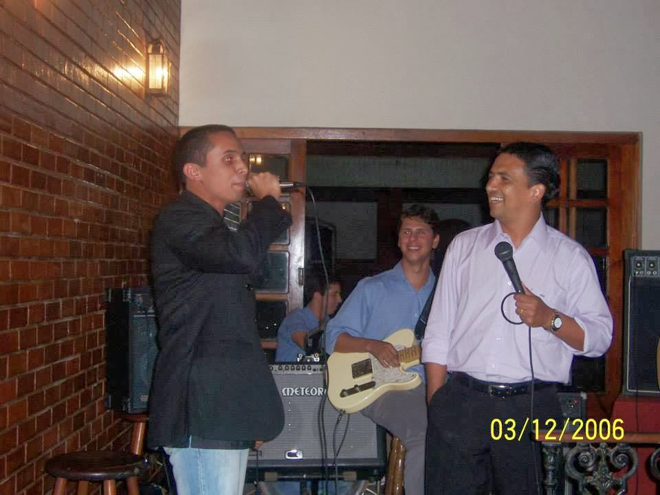

*Si Fu, eu vou continuar discordando do senhor em muita coisa e concordando e admirando tantas outras. Mas sabe? Tudo que escrevi no Blog até hoje, e mesmo o que não escrevi sobre o senhor, eu o vi fazer na prática nos piores momentos: Manter a firmeza, seguir em frente porque a sensação do final da guerra é muito melhor do que a do alívio da desistência como o senhor mesmo disse. E o mais importante: A manutenção do seu compromisso. O senhor não nos abandonou em nenhum momento.*  
*Si Fu, I'll keep disagreeing very much with you. And agreeing and admiring in many other ways. But you know something? Everything I wrote in this blog today, and before about you, I saw you do in practice at the worst times: Keep tightly, move on because the feeling of the end of the war is far better than the relief of the dropout as you yourself said to me once. And most importantly: Maintaining your commitment. You never forgot us , even in the hardests times.*

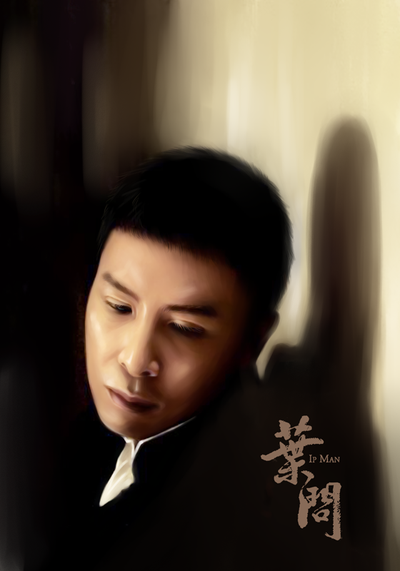

*Eu escrevi isso tudo, porque ontem vi Si Gung num vídeo se referindo a vida de Ip Man como privilegiada por ter ele vivido no mais alto nível sócio-econômico e no mais rasteiro. Aquilo me tocou. Porque é muito bobo ver o filme e ficar se perguntando se ele realmente lutou com dez karatecas ou não. Mas ninguém pensa no que ele passou naquele momento difícil com a Família dele durante a invasão...*  
*I wrote all this because yesterday I watched a video where Si Gung refered to the life of Ip Man as a privileged life, Because he had lived in the highest socio-economic level and in poorest. It touched me. Because it is very silly to watch the movie and  wonder if he really struggled with ten karate-guy or not. But nobody thinks about what he went through that tough time with his Family during the invasion ...*

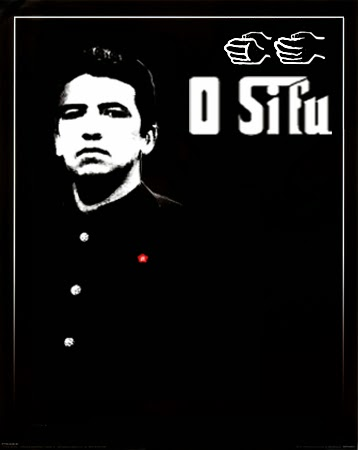

*Então agora que o pior já está passando Si Fu, pra você que me ensinou a ser um homem , posso dizer que o privilégio foi meu, e dos demais que estiveram com o senhor durante estes momentos. Porque eu ainda não sei, nem nunca vou saber o quanto o senhor é bom de luta, ainda que tenha meus palpites(risos). Mas acredito que nunca vou ver outra pessoa enfrentar a vida da forma que o senhor enfrenta.*  
*E acredite, que a sua preocupação dita a mim anos atrás, de que o senhor não queria ser o elo da corrente a se partir, não aconteceu. Nós ainda estamos aqui, e estaremos sempre com o senhor.*  
*Porque se o senhor fosse o publicitário que ganhasse bem e estivesse com a tarde livre pra surfar, com certeza não teria mudado a vida de tantas pessoas...  Ou pelo menos a minha...*  
*So now that the worst is almost behind Si Fu, for you who taught me to be a man, I can say that the privilege was mine, and the others who've been with you during these hard times. Because I still do not know or will never know how  good you are in a fight, even though I have my guesses (laughs). But I believe I'll never see another person face life the way that you face.*  
*And believe that your concern said to me years ago that you do not want to be the link in the chain to break, did not happen. We're still here, and we will always be with you.*  
  
*Because if you werea simples guy , in a simple job, with lots of money and have the the afternoon free to surf, surely you would not have changed the lives of so many people ... Or at least mine ...*

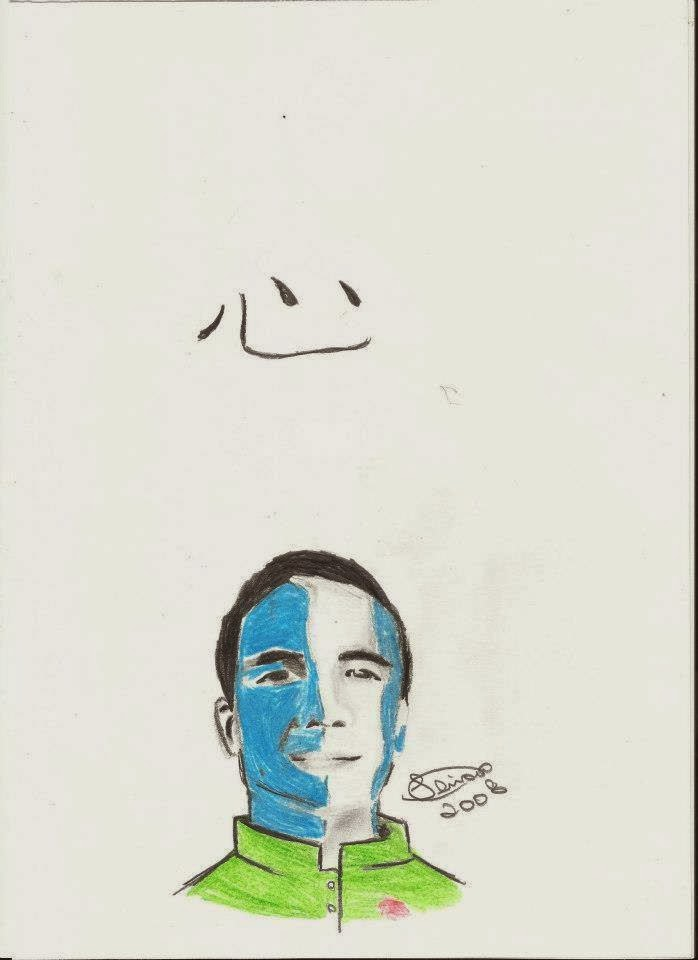

*Obrigado Si Fu! Porque como disse Si Taai Gung Moy Yat certa vez: Não existiria quantidade de Hung Bao no mundo que eu pudesse entregar ao senhor, para agradecer tudo que fez por mim! Obrigado!*  
*Thanks Si Fu! Because as Si Taai Gung Moy Yat once said: There would be no amount of Hung Bao in the world I could give to you, to thank you for everything you did for me! Thank you!*  
***Moy Fat Lei***  
***discípulo número 2 de Mestre Julio Camacho***  
***Fevereiro de 2014.***  
*(Moy Fat Lei*  
*The disciple number two of Master Julio Camacho*  
*Feb. 2014)*
