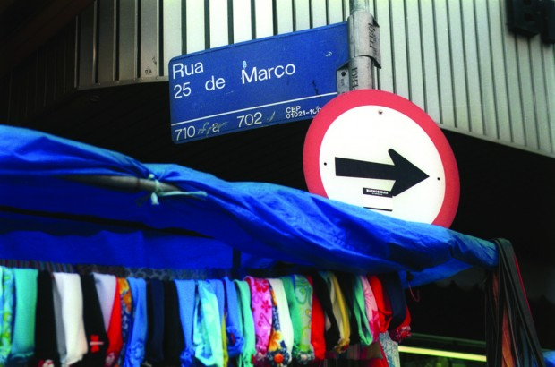
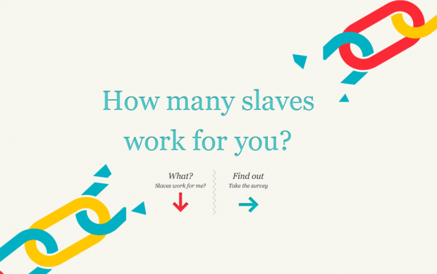

# Quantos escravos trabalham pra você?

### Foco e Disciplina

Vivemos reclamando da falta de tempo no nosso dia.

Mas quanto tempo e energia perdemos procrastinando ou nos auto-sabotando?

[Aprenda gerenciar melhor seu tempo e aumentar sua produtividade](http://pdh.co/cmbprodutividade)

E se eu dissesse que um menino doce e inteligente de 12 anos, recém chegado da Bolívia, mora em uma casa de apenas 90m² no centro de São Paulo com mais 27 pessoas, entre parentes e desconhecidos? Que essa casa velha e úmida mal comporta todas as beliches cobertas com roupas de cama maltrapilhas, porque tem que ceder espaço para colunas babilônicas de tecidos e máquinas de costura?

E se eu dissesse que esses 28 trabalham cerca de 13 horas quase ininterruptas por dia, no mesmo lugar em que moram e comem e vão ao banheiro e dormem e acordam e começam tudo outra vez, por R$350,00 mensais?

E se eu dissesse ainda que todos os 28, por não terem como pagar pela casa velha e pela comida úmida, contraem dívidas absurdas e infindáveis com o indivíduo que os contratou, e, por isso, tem seus passaportes e pertences apreendidos até que o pagamento venha?

E se eu dissesse que quem financia isso tudo é você?

*[Link Youtube](http://youtu.be/VruYBfo--hU) | De onde vem esse seu macacão estiloso, brother?*

Em pleno século 21, [enquanto alguns falam de Google Glass](http://papodehomem.com.br/o-google-glass-vai-nos-deixar-mais-virtuais/) e discutem as questões éticas da [clonagem terapêutica](http://pt.wikipedia.org/wiki/Clonagem#Clonagem_terap.C3.AAutica), os 28 costuram sem parar em instalações insalubres por 4 reais a peça.

Essa mesma jaqueta que você comprou por 150 reais ontem na liquidação de verão e correu para chegar em casa, vestir e mostrar para o namorado. Essa jaqueta que você estava procurando, deu a sorte de encontrar e que te caiu como uma luva.

Em pleno século 21, aqui, no Brasil, o [trabalho escravo não está só na manufatura têxtil](http://reporterbrasil.org.br/trabalho-escravo/). Esse é só o [exemplo mais próximo de mim](http://reporterbrasil.org.br/2005/04/trabalho-escravo-e-uma-realidade-tambem-na-cidade-de-sao-paulo/). O trabalho escravo [está em todo o país](http://revistagalileu.globo.com/Revista/Galileu2/foto/0,,69818165,00.jpg), muito provavelmente na sua cidade, no seu bairro. Nos diversos fornecedores da indústria têxtil, na pecuária, na agricultura, na indústria madeireira, [na construção civil](http://brasileconomico.ig.com.br/noticias/situacao-nas-obras-da-mrv-e-preocupante-diz-procurador_120213.html), nas carvoarias.

Mas, calma. Você não tem nada a ver com isso.

Porque você não sabe, certo? [Você não sabia de nada disso](http://www.ebc.com.br/noticias/brasil/2013/01/lista-suja-do-trabalho-escravo-tem-409-empregadores). Ou ainda que soubesse, entende que não há o que possa fazer. Claro. Porque você não é o dono da [GAP, Cori, da Luigi Bertolli, Emme, Collins, Gregory](http://g1.globo.com/sao-paulo/noticia/2013/03/operarios-estrangeiros-sao-resgatados-de-trabalho-escravo-em-sp.html) (…) E não é você quem contrata essas pessoas e as submete a essas condições de trabalho horríveis. E se não for lá, onde é que você vai comprar as suas roupas, não é mesmo?

E de que adianta você parar de comprar essas pechinchas incríveis que encontra nas ruas do centro, nas [Lojas Marisa, Pernambucanas, C&A](http://exame.abril.com.br/gestao/noticias/o-que-a-zara-e-5-grifes-fazem-mesmo-com-o-trabalho-escravo/), se todo mundo continua comprando? Que diferença vai fazer, não é? Além do mais, aquela bota tinha um ótimo preço, e não te interessa, na verdade, de onde é que ela veio e o que é que foi preciso ser feito para que ela estivesse aí, bonita e confortável no seu pé, certo?

Alguém foi mal pago para a sua camiseta custar quinze reais na 25 de Março

O bom é que agora você sabe. Vai dormir e acordar sabendo. Vai ter de admitir que sabe, e encarar cada escolha. Sabendo. Que quatro ônibus com 235 trabalhadores em situação análoga a de escravos foram apreendidos pela Polícia Rodoviária Federal do Piauí. Que imigrantes de 12 anos de idade trabalham 16 horas por dia para fazer a sua [camiseta descolada de gola V da Zara](http://blogdosakamoto.blogosfera.uol.com.br/2012/08/23/zara-e-suspensa-de-pacto-contra-trabalho-escravo-por-discordar-da-lista-suja/). Que é você quem financia cada uma das 28 máquinas de costura.

Não precisa ser um fashionista [pródigo](http://pt.wikipedia.org/wiki/Pr%C3%B3digo). Muito pelo contrário. Você, que não se importa muito com o que veste, e só quando precisa recorre a alguma loja de departamento para comprar uma polo descolada a um bom preço. Você, sempre antenado nas últimas tendências ditadas pelo mundo da moda. E você, que vira e mexe vai até o centro de São Paulo atrás daquelas pechinchas no atacado. Que pega carona com a mãe até a Pernambucanas que é para ver se sai de lá com uma bermuda ou 2 camisetas básicas. Não é fácil lavar as mãos.

Se você não sabe de onde é quem vem, muito provavelmente, financia o trabalho escravo.

São dois os fatores escancarados e objetivos que mantém o trabalho escravo no país. O motor econômico (que alimenta empregadores inescrupulosos e faz com que você vá até o centro da cidade, compre aquela camiseta bacana por vintão e saia se achando esperto), e a impunidade de crimes contra os direitos humanos.

Mas há um terceiro, que penso ser o mais importante guarda-chuva dos maiores problemas da humanidade. A desconexão.

Pessoas submetem pessoas à condições de escravidão porque, como você e eu, acham que não tem nada a ver com isso.

[Link Vídeo | Daniel Goleman fala da sua desconexão](http://www.ted.com/talks/lang/pt-br/daniel_goleman_on_compassion.html)

Sobre esse processo de “desligamento empático”, não tem como não transcrever um trecho da fala do [Daniel Goleman](http://danielgoleman.info/) no TED Lateral Thinking, em 2007:

> “Os objetos que compramos e usamos têm consequências ocultas. Somos todos vítimas passivas do nosso ponto cego coletivo. Nós não notamos. E não notamos que não notamos. Somos indiferentes às consequências ecológicas, de saúde pública, sociais e econômicas das coisas que compramos e usamos. De certa forma, a própria sala é o elefante branco na sala, e nós não vemos. E nos tornamos vítimas de um sistema que nos aponta para o outro lado.”

O assunto daria milhares de outros textos.

Hoje, eu só vim aqui [para te fazer notar que você não nota.](http://papodehomem.com.br/o-mal-e-a-falta-de-atencao/)

Que existe trabalho escravo. Aos montes. Agora. Não há 150 anos atrás, em período escravocrata. [Aqui, no Brasil](http://www.youtube.com/watch?v=QPPvgLkvvew), não em Zimbábue. Em Goiás, Minas, Santa Catarina. No Brás, [em São Paulo](http://www.youtube.com/watch?v=gaYVu8KrQo0) – não só naquela fazenda escondida no sul do Pará.

Hoje, eu vim aqui para dizer que você tem tudo a ver com isso.

E aí? [Quantos escravos trabalham](   http://slaveryfootprint.org/) para você?

O Slavery Footprint te mostra o que tem no seu prato
