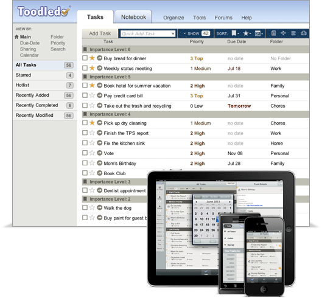

# Por que o Toodledo é a ferramenta perfeita para o GTD

Ok, o título foi um pouco sensacionalista. =) Não existe ferramenta perfeita e cada um tem sua opinião – acho que isso já está claro para todo mundo. O que escrevo aqui é o que *euzinha* acho e, para mim, depois de testar muitas, muitas, MUITAS ferramentas, ainda acho que, de todas o [Toodledo](http://www.toodledo.com) é a mais incrível para aplicar o GTD, e mostro por quê.

Este post *não é* um publieditorial. Escrevo porque muitas pessoas me perguntam se eu já testei essa, essa e aquela ferramenta, e não entendem por que eu gosto tanto do Toodledo. Vou fazer esse post meio “definitivo” para explicar a diferença entre o Toodledo para um aplicativo como o Wunderlist, por exemplo.

- O Toodledo tem uma **interface** simples e condensada. Uma coisa que eu não gosto nos demais aplicativos é que ou eles têm coisas demais, ou têm coisas de menos. O Wunderlist, por exemplo, me dá “nervoso”, porque perde-se um espaço imenso entre as linhas com as tarefas. Não gosto, e isso é obviamente pessoal. Outros aplicativos, como o IQTell, têm coisas demais. Por fim, simplesmente prefiro a interface do Toodledo.
- No Toodledo, posso acessar as tarefas de hoje e **filtrar** pelo parâmetro que eu quiser (prioridade, folder, contexto etc). Isso para mim faz toda a diferença, pois eu me guio por aquilo. Se eu processei as tarefas direitinho ao longo da semana, basta ir executando, simplesmente. E então, todos os dias, faço as tarefas do dia em questão, por ordem de prioridade, seguindo os contextos nos quais estou inserida, e só depois passo para as listas de contexto, também vendo por prioridade. Nenhuma ferramenta tem isso, e para mim é o que faz toda a diferença na execução diária. Produzo MUITO mais e de forma melhor assim.
- O Toodledo me dá **estatísticas** das tarefas que venho realizando. Posso verificar se investi mais meu tempo em tarefas de baixa ou alta prioridade, se estou dando mais atenção a uma área que à outra, entre diversos outros dados. Para mim, isso é FUNDAMENTAL para avaliar a própria vida mesmo, sabe? Para saber se estou caminhando em direção do que é coerente para mim, e não só executando coisas sem sentido.
- Existe uma ferramenta sensacional dentro do Toodledo que é a possibilidade de ele te dar um **plano de execução**. Basta você entrar na seção [Scheduler](http://www.toodledo.com/tools/scheduler.php) e colocar quanto tempo você tem disponível e em qual contexto se encontra, qual área quer focar, e ele te sugere tarefas. Para quem trabalha com pomodoros ou períodos de tempo específicos, essa ferramenta é fantástica.
- O fato de poder visualizar as tarefas no **Google Calendar** faz muita diferença no dia a dia. A primeira coisa que eu faço quando começo o meu dia é ver a minha agenda, então dá para ter uma visão das tarefas que preciso executar também.
- Tem **alarmes, lembretes**, acesso mobile, possibilidade de compartilhamento, anexo de notas e tudo o mais que qualquer aplicativo gerenciador de tarefas têm. Além disso, o gerenciamento de **tarefas recorrentes** é o melhor que existe de todas as ferramentas que já testei. Tem outros recursos como status, por exemplo, tudo construído com base no GTD.
- Dá para listar **objetivos (goals)** de curto, médio e longo prazo que se relacionam (ou seja, um objetivo de curto prazo que se relaciona com um de longo prazo, por exemplo), e você pode inserir na tarefa no ou no projeto com qual objetivo ele/a se relaciona. Isso dá uma boa dimensão do que você está fazendo – se tudo faz sentido. Se eu coloco uma tarefa que não contribui com nenhum objetivo, eu seriamente fico pensando se deveria executá-la! Aí, depois, você pode olhar nas suas estatísticas e ver que objetivo está sendo mais trabalhado que outros, onde deve investir mais tempo.
- É altamente **customizável**! Os campos de cada tarefa podem ser customizados maravilhosamente dentro do sistema GTD. Um recurso que costumo usar bastante é associar determinadas tarefas a lugares (diferente de contextos). Por exemplo, tem coisas que só posso fazer no contexto “@rua” quando estiver em São Paulo, então eu coloco essa opção. Os filtros do Toodledo são a melhor coisa da ferramenta!
- Para quem não quiser usá-lo com outras ferramentas, como o Evernote, dá para criar [listas e checklist](http://lists.toodledo.com/) diversas, com templates já pré-estabelecidos, se precisar.
- Agora tem **aplicativo** oficial para o Android também. <3 Já tinha para Mac e iOS.
- Por último, mas não menos importante: em quase dez anos usando a ferramenta, ela NUNCA teve bug, problema de segurança ou ficou fora do ar. Para pensar com carinho. ;D

Com certeza existem outras razões para amar o Toodledo com o GTD, mas quis escrever esse post-desabafo porque me dói demais o coração quando alguém diz que, entre o Toodledo e o Wunderlist, prefere o Wunderlist, por exemplo. O Toodledo não é um simples gerenciador de tarefas! Ele é muito pouco explorado, e tem muitos, muitos recursos bom demais, todos feitos para fazer o GTD funcionar com foco na execução. Por isso eu recomendo tanto. Não é só afetividade não, viu?

Para quem estiver com dúvidas, eu estou usando NOVAMENTE o Toodledo. Não dá para ficar sem ele. Agora que existe integração com o Evernote, então… imbatível. Só não escrevi um post geral sobre a minha organização atual porque ainda estou trabalhando em alguns pontos, mas em breve escreverei. =)
