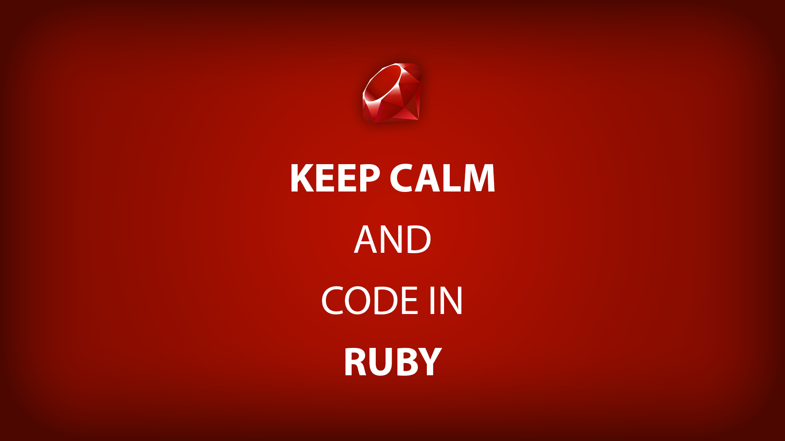
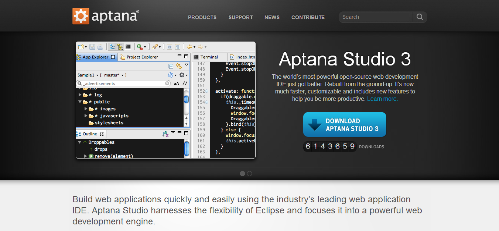
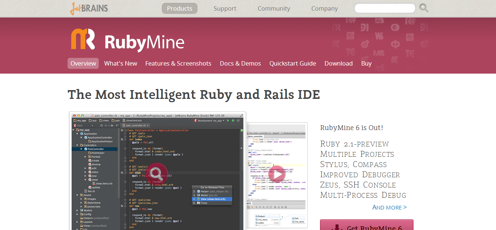
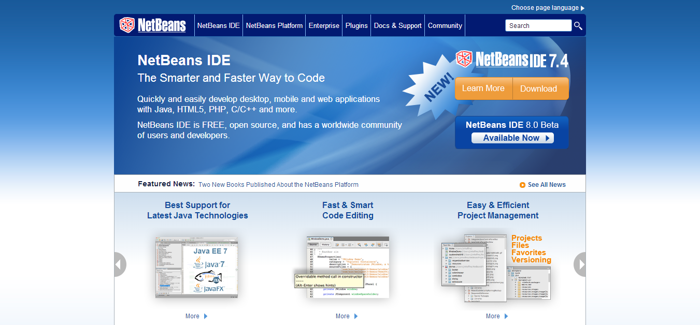
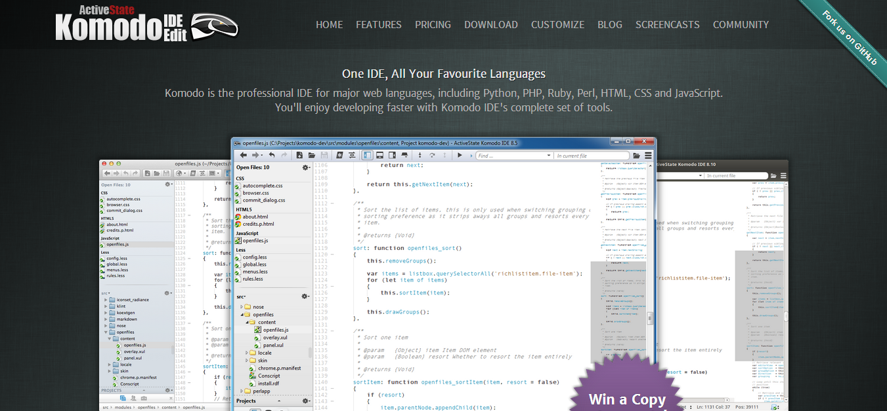
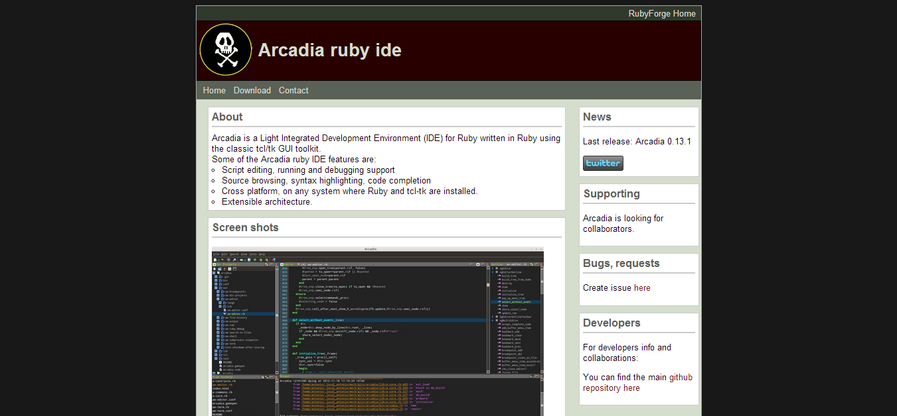

# Top 5 Ruby IDE Solutions for Web Developers

I’m pretty sure that the majority of web developers, and web designers, begin their journey on either Notepad++ or simple Notepad – although many programming tutorials now provide integrated, interactive web editors – just typing away the code that a tutor is presenting them with.

The majority of Ruby IDE’s are actually not strictly limited to Ruby alone, and come as a standalone plugins from companies who’ve invested their time in building something for the whole community to enjoy. I’m a huge Sublime fan, and for now I get all of my work done there, but I saw that there is a demand for strict Ruby IDE’s and I thought I’d put together a list of the best ones around. (or at least the ones that get updated frequently)

This post was inspired by my recent list of sites to help you find [Ruby development jobs](http://codecondo.com/jobs-for-ruby-developers/ "ruby development jobs"), and if you happen to have an idea for a blog post, or you are looking for a solution that needs solving, I’m all ears and I’ll gladly see what I can do, if you let me know in the comments.

I’ll be going over each of the Ruby IDE’s briefly, and if possible include a tutorial from someone who’s experienced with each platform more than I am. You can also submit your own, and I’ll consider adding it to the list.

## [Aptana Studio 3](http://www.aptana.com/products/studio3)

Aptana is an open-source development environment that has been around since the Universe initially formed, or close to it.. I’m not kidding, either.

It used to be called ‘RadRails’, but Aptana realized that it’s easier to just have the whole plugin integrated in their main development editor, and so it’s not available for single download anymore. You’ll get a few other great IDE’s that come in Aptana, such as:

- HTML & HTML5
- CSS & CSS3
- JavaScript

It will support deployment to many of the major [free hosting platforms for applications and frameworks](http://codecondo.com/5-platforms-provide-free-django-app-hosting/), and make it really easy to develop and test your code on the go. I’m also impressed by the Git functionality, and full integration which allows you to deploy to Git in just a few clicks.

The above video doesn’t provide any voice over, but it’s one of the few that displays Ruby environment on Aptana, to help you better understand the interface. It’s can be highly customized to your own specifications and needs.

## [RubyMine 6](http://www.jetbrains.com/ruby/index.html)

JetBrains provide some of the best IDE’s in the world, and you know it. RubyMine is no exception, and is one of the most sophisticated, modern, easy to use Ruby IDE’s you’ll ever find. It comes at a price, but you can try it for 30-days to get a feel of it, and if you like it – make a purchase. It offers free plans for non-profit’s and school teachers, educational institutions – all other plans start at a [low cost of $20](http://www.jetbrains.com/ruby/buy/).

It’s always up to date, and constantly updates with new features. You can expect to manage multiple projects at the same time, have Zeus functionality for quicker coding, and full Rails integration that makes it incredibly easy to create and launch applications. I’m particularly fond of the way files are structured, and the IDE automatically knows what’s priority and what’s lesser needed.

The video has a lot more info on the newest version.

## [NetBeans](https://netbeans.org/) ⇄ [Ruby Plugin](http://plugins.netbeans.org/plugin/38549/ruby-and-rails)

They discontinued the Ruby IDE support back in 2011, due to Oracle introducing a new Java Dev Kit, and the overall use of Ruby being too shallow, for anyone having serious interest in continuing the project, the plug was pulled. It didn’t take long for the community to come up with a solution: a ruby and rails plugin for NetBeans.

It’s now one of the most downloaded plugins in their database, and it provides a full IDE solution for those Ruby programmers who like the NetBeans interface, and functionality. Ruby for Netbeans provides all the basics needed in a full-featured Ruby IDE.

## [Komodo](http://komodoide.com/)

We as developers should be able to afford things that can help us in the long-term, especially when it comes to making it easier to write, launch and debug code. Komodo is the perfect IDE for any experienced developer, who doesn’t work only with Ruby, but also several other languages. Notable languages that Komodo supports for editing,

- Node.js
- CoffeeScript
- a lot more…

Komodo comes equipped with a [ton of features](http://komodoide.com/features/), one too many to be listing on this page. You can get a free version if you’re creating an open-source or a non-profit project, but other than that – it’s going to cost you $300 for a developer license, after the initial 21-day trial version expires.

## [Arcadia](http://arcadia.rubyforge.org/)

The last Ruby IDE on our list is ‘Arcadia’, the only IDE from all of the above which is written in Ruby, for Ruby. It does not provide any support for other languages, and is purely focused on Ruby’s development. It’s also not run by a huge corporation, so updates and fixes might take time to happen.

It has been in the beta status since the initial release, back in 2010, but it doesn’t mean there isn’t a community of users who’re using this IDE on daily basis. I’d actually love to hear some feedback on this, and whether or not it’s a good choice for beginners, and what type of applications are you managing trough this IDE?

## Ruby IDE’s

I was initially thinking to create this categorized, both for Linux, Mac and Windows, but it so happens that most either support all of the operating systems, or just one. I was not able to find anymore to add to the list, and I checked out a dozen of ‘simple’ editors which don’t really account for being a full-scale IDE.

I hope the content in this post helps you find a development environment that you’ll love to work with.

photo by [upixup](http://a3.upixup.com/orig/2013/10/13/525b5ccf6fad5.png)
