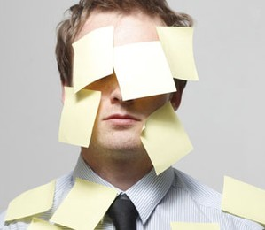

# Três coisas que acabam com a sua produtividade sem você perceber

## Especialista em organização dá dicas para perder menos tempo com coisas aparentemente inofensivas

Já perdeu tempo procurando um papel na bagunça da sua mesa? (Foto: Shutterstock)

Você trabalha, trabalha e trabalha, mas no final do dia parece que não conseguiu resolver quase nada? Talvez você esteja se perdendo em armadilhas da rotina sem nem perceber. Segundo Barry Iszak, fundador da consultoria de organização Arranging it All e ex-presidente da Associação Nacional de Organizadores Profissionais dos Estados Unidos, alguns hábitos adotados nas empresas são **grandes vilões da produtividade**, mas pouca gente presta atenção neles. A boa notícia é que pequenas mudanças bastam para fazer o seu dia render muito mais. De passagem pelo Brasil, Iszak conversou com Época NEGÓCIOS e deu algumas dicas de como ser mais produtivo.

**Email**  
"Email não é trabalho, email é uma ferramenta de trabalho", resume Barry. Claro que a tecnologia facilita a vida e ajuda a resolver problemas urgentes, mas dificlmente uma troca de emails vai fechar um grande negócio ou desenvolver um novo projeto.

Muitas pessoas acabam perdendo um tempo precioso com a caixa de entrada. Como geralmente é a tarefa mais fácil de cumprir, elas deixam os projetos grandes de lado e passam horas apenas lendo e respondendo as mensagens, sem efetivamente entregar resultados. Assim, o email torna-se uma boa desculpa para procrastinar, dando ao funcionário a impressão, às vezes errada, de que ele está cumprindo seu papel.

"Mas eu não paro de receber mensagens", você pode argumentar. Sim, mas o mundo não vai parar de girar se você demorar algumas horas para respondê-las. Caso o assunto seja urgente, uma saída é criar o hábito entre seus subordinados ou clientes que o ideal é ligar. "As pessoas aprendem a não precisar de uma resposta imediata", garante Iszak. Faça um teste: deixe o email fechado durante duas horas enquanto escreve uma apresentação ou um relatório. Provavelmente vai ser mais fácil terminar.

**Lista de tarefas**  
Pelo menos uma vez na vida, todo mundo já escreveu uma "to do list" (lista de afazeres) e chegou ao final do dia sem conseguir resolver quase nada. Usada como uma ferramenta para lembrar as tarefas prioritárias, a lista pode ser uma grande furada, segundo o organizador. "Costumo dizer que a 'to do list' é só uma lista de desejos. As tarefas não serão cumpridas até que você marque na agenda um horário para encará-las", diz Iszak.

Segundo ele, as pessoas tentam fazer muitas coisas ao mesmo tempo e isso atrapalha a rotina. A dica para resolver esse problema é, ao final de cada expediente, escolher três obrigações mais importantes para resolver no dia seguinte e anotar na agenda qual horário você vai usar para trabalhar em cada uma delas.

"Mesmo que você resolva duas, já estará na frente do funcionário que só fica lendo os emails, que responde todo mundo e faz o que os outros solicitam em vez de focar em suas próprias prioridades."

**Papelada**  
Iszak não acredita no mito dos escritórios livres de papel. "Estamos produzindo mais papel do que nunca e ele não será extinto. Portanto, precisamos aprender a gerenciá-lo", diz.

Os papéis considerados relevantes, aqueles de registro e que são acessados com pouca frequência, geralmente têm um local garantido e bem organizado dentro das empresas. O grande problema, segundo ele, são os papéis que estão espalhados pelas mesas dos funcionários. "É neles que estão os trabalhos mais importantes, que nos lembram de ligar para determinada pessoa, fazer uma encomenda, trabalhar em um projeto, marcar uma reunião, mas que estão simplesmente espalhados."

Algumas tarefas acabam esquecidas para sempre na pilha de papel e outras, das quais por acaso nos lembramos, acabam criando estresse e perda de tempo quando tentamos recuperá-las.

A solução é criar um sistema de organização que funcione para você. Por exemplo, para quem é mais visual e gosta de ter tudo ao alcance do olho, vale providenciar uma prateleira ou arquivos feitos para ficar sobre a mesa. Quem se irrita com a bagunça pode arquivar a papelada na gaveta. O importante é, uma vez encontrado um método, por mais simples que ele pareça, não deixar de organizar os documentos.

"O objetivo da organização é ajudar as pessoas a encontrarem o que quiserem quando precisarem, para que não se sintam enterradas na bagunça ou percam tempo com ela", afirma Iszak.
