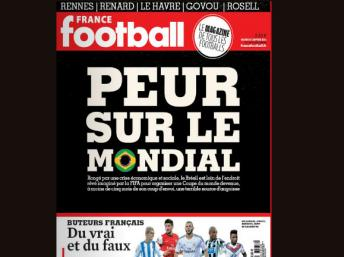

# Se você ler isso e não sentir “vergonha”, você não é um brasileiro de verdade

**A revista francesa “France Football” publicou em 12 páginas de sua edição nº 3537, do dia 28 de janeiro de 2014, uma reportagem de capa, intitulada “Peur sur le mondial”, que seria algo mais ou menos do tipo “Medo do mundial”.**  
  
  
A reportagem do respeitado meio de comunicação francês relata ao pé da letra e em boas verdades tudo que está acontecendo no Brasil nos últimos anos. Acredito que se você ler essa publicação até o final vai sentir muita vergonha. Infelizmente nosso país está virando motivo de “chacota” internacional. E o pior, infelizmente eles tem razão no que dizem.   
  
“MAS LEIA ATÉ O FINAL, O BRASILEIRO TAMBÉM TEM FAMA DE NÃO LER TEXTOS GRANDES.”

ALGUNS TRECHOS DA REVISTA FRANCESA COM TRADUÇÃO PARA O PORTUGUÊS:

- Apesar do lema brasileiro: “Ordem e Progresso”, o que menos se vê na preparação deste mundial, é Ordem ou Progresso.

- A FIFA não pediu o Brasil para sediar a Copa, foi o Brasil que procurou a FIFA e fez a proposta.

- A corrupção no Brasil é endêmica, do povo ao governo.

- A burocracia é cultural, tudo precisa ser carimbado, gerando milhões para os Cartórios.

- Tudo se desenvolve a base de propinas.

- Todo o alto escalão do governo Lula está preso por corrupção, mas os artistas e grande parte da população acham que eles são honestos, e fazem campanhas para recolher dinheiro para eles.

- Hoje, tudo que acontece de errado no Brasil, a culpa é da FIFA, antes era dos EUA, já foi de Portugal, o brasileiro não tem culpa de nada.

- O Brasileiro dá mais importância ao futebol do que à política.   
- O Brasileiro elege jogadores de futebol para cargos públicos.

- Romário (ex-Barcelona) é hoje deputado. Aproveita o descontentamento com a Copa para se autopromover, mas nunca apresentou um projeto de lei sobre saúde ou educação. Sua meta é dar ingresso da Copa para pobre(como se essa fosse a prioridade para um pobre brasileiro)

- O Deputado mais votado do Brasil é um palhaço analfabeto e banguela, que faz uma dança ridícula, com roupas igualmente ridículas, e seu bordão é: “pior que está não fica”. Será?

- Em uma das músicas deste palhaço analfabeto ele diz: “Ele é ladrão, mas é meu amigo!”, Isso traduz bem o espírito do Brasileiro. (http://letras.mus.br/tiririca/176533/)

- Brasileiros se identificam com analfabetos.

- A carga tributária do Brasil é altíssima maior que a da França, e os serviços públicos são péssimos comparáveis aos do Congo. - Mas o Brasileiro médio pensa que ele mora na Suíça. Quem está lá, na verdade, é a FIFA.   
- Há um dito popular que diz que “Deus é brasileiro”.

- A FIFA, como imagem institucional, busca não associar-se a ditaduras. Tanto que excluiu a África do Sul na época do Apartheid e, ao contrário do COI, recusou a candidatura da China, apesar das ótimas condições que o país oferecia. Mas o Brasil, sede da Copa, vive um caso de amor com ditaduras.

- O Brasil pleiteava uma cadeira no Conselho de Segurança da ONU, para sentar-se ao lado França, mas devido ao seu alinhamento com ditaduras, a França já se manifestou contrariamente.

- A Presidente Brasileira parece estar alienada da realidade e diz que será o melhor mundial de todos os tempos, isso, melhor que o do Japão, dos EUA, da França, da Alemanha.

Só ela pensa assim, na FIFA se fala em maior erro estratégico da história da Instituição.

**CONFRONTOS**: - Ano passado os brasileiros saíram as ruas para manifestar, pela primeira vez se viu um movimento assim num país acostumado a inércia, mas o Governo disse que eles eram baderneiros e reprimiu o movimento com violência. 2 mortos, mais de 2000 feridos, mais de 2000 prisões. Ninguém responsabilizado…

- Há um movimento chamado “Black Blocs” que ameaça revidar a violência do Governo. - Há um # hastag que já foi repetido mais de 500.000.000 de vezes em redes sociais e ameaça #naovaitercopa

- Os próprios brasileiros pedem para os estrangeiros não irem para o Brasil. Há milhares de vídeos feitos por brasileiros neste sentido:

- O governo brasileiro acaba de gastar 400 milhões de Euros com compras de armas para a polícia e disse estar disposto a colocar o exército na rua para proteger a Copa contra os. Brasileiros (???) Isso mesmo, o governo está ameaçando seu próprio povo.  
 - Há um movimento de alguns jogadores de futebol, liderado pelo ídolo do Lyon (França) Juninho Pernambucano, chamado “Bom Senso”, pedindo conscientização dos jogadores. - Analisando os países sedes desde 1970, o número de mortes em estádios, nos 16 anos prévios a cada edição da Copa:  
› México: (1970): 06 mortes;   
› Alemanha (1974): 00 mortes;   
› Argentina (1978): 04 mortes;   
› Espanha (1982): 00 mortes;   
› México (1986): 12 mortes;   
› Itália (1990): 00 mortes;   
› EUA (1994): 00 mortes;  
› França (1998): 00 mortes;  
› Japão (2002): 00 mortes;  
› Coreia do Sul (2002): 00 mortes;  
› Alemanha: (2006): 00 mortes;   
› África do Sul: (2010): 17 mortes;  
› Brasil: (2014): 234 mortes;

**OBRAS:**

- O Brasil foi o país que teve mais tempo na história de todos os mundiais para prepará-lo: 7 anos, mas o Brasil é o mais atrasado.

- O Francês Jérome Valcke, secretário geral da FIFA criticou o Brasil pelos atrasos. O governo brasileiro disse que não conversaria mais com Jérome Valcke.

- A França teve apenas 3 anos, e finalizou as obras 1 ano e 2 meses antes.

- A África do Sul teve 5 anos, e terminou com 5 meses de antecedência.

- Há pouco mais de 3 meses da Copa, o Brasil ainda tem que fazer 15% do previsto.

- O custo do “Stade de France” foi de 280 milhões de Euros(o mais caro da França), uma vergonha se comparado ao “Olimpiastadium” sede da final da Copa da Alemanha em 2006, que consumiu menos de 140 milhões de Euros.

- Mas perto do Brasil isso não é nada. Cada estádio custa em média mais de 1/2 bilhão de Euros.

- E o dinheiro sai do bolso do Brasileiro. Tudo é financiado com recursos públicos. Na França tudo foi financiado com recursos privados.

- Mas o custo não é alto porque os trabalhadores recebem muito. Os trabalhadores recebem salários de fome.

- As empreiteiras é que ganham muito e há muita corrupção para os políticos. - Não há segurança para os trabalhadores, acidentes e mortes são comuns. Na França o número de mortes nas construções foi 0(zero)

- Mesmo com os milhões a mais, os Estádios são ruins.

- Em 2007 o Brasil construiu um estádio para o Panamericano do Rio e homenageou quem???? Um diretor da FIFA, um brasileiro, corrupto para variar: João Havelange! No Brasil corruptos recebem homenagens.

- O estádio era tão ruim que não durou nem 6 anos. Isso mesmo, 6 anos…. - Hoje o estádio está interditado e não recebe mais jogos. Detalhe: custou mais de 150 milhões de Euros(mais do que o Estádio do Olympic de Marseille), e hoje serve de ninho para pombos. - Na França, os Estádios são multi-uso, servem para competições olímpicas, jogos de Rugby, e são centro de lazer, com lojas e restaurantes e estacionamento nos outros dias da semana. No Brasil são usados só para jogos.

- Em Brasília estão construindo um Estádio para 68.000 pessoas, sendo que o time local está na quarta divisão do campeonato brasileiro e tem média de público de 600 pagantes.

Tudo com financiamento público.

- Em São Paulo há 2 estádios, Morumbi e Pacaembú, ao invés de reformá-los, construíram um 3o. estádio, Itaquerão, 23km do centro da cidade e sem metrô até lá.

- O ex-presidente Lula, torcedor do Corinthians, empenhou-se pessoalmente para que construíssem este estádio em vez de reformar um dos outros 2 já existentes.

- Exceto seus correligionários, ninguém acredita que Lula foi movido por amor ao “Timão” .

- Lula é amigo íntimo de Marcelo Bahia, Diretor da Odebrecht, vencedora da licitação. Um reforma custaria menos de 100 milhões de Euros, um novo estádio tinha previsão de custo inicial de 300 milhões de Euros (mas já passou de 500 milhões) um dos mais caros da história da humanidade. Lula e Marcelo são constantemente vistos em caríssimos restaurantes de Paris, tomando bons vinhos franceses. Lula, claro, se declara socialista. - Este estádio é igualmente ruim, alagamento, péssima infraestrutura, e antes mesmo de inaugurar já caiu, matando funcionários. (http://oglobo.globo.com/esportes/video-mostra-momento-do-acidente-no-itaquerao-10911765)

**TRANSPORTES:**

- A atual presidente Dilma Rousseff garantiu que faria um trem-bala, nos moldes do TGV Francês, que ligaria 4 cidades-sede: SP-RJ-BH-Brasilia.

A promessa está gravada em redes sociais. (http://www.estadao.com.br/noticias/esportes,governo-garante-trem-bala-pronto-ate-a-copa-de-2014,381839,0.htm)

- Em 2009 foram aprovados 13 bilhões de Euros no PAC, uma soma gigantesca de dinheiro, suficiente para construir um TGV de Paris a Cabul no Afeganistão. Nunca se viu um orçamento tão alto.

- Mas o dinheiro desapareceu e nem um único centímetro do TGV brasileiro foi construído. - Nenhum brasileiro cobra da Dilma a responsabilidade sobre a promessa do trem bala. - Nenhuma das cidades-sede tem metrô até o Aeroporto.

- O taxis são caríssimos e os taxistas fazem trajetos mais longos com os estrangeiros que não conhecem a cidade.

- Aprenda Português pois os Taxistas não falam nem espanhol, francês não existe. Inglês nem pensar??? - Para os taxistas não há cursos de inglês financiados pelo governo, mas para as prostitutas sim. Parece piada, mas é verdade: (http://www1.folha.uol.com.br/cotidiano/2013/01/1211528-prostitutas-de-bh-tem-aulas-gratis-de-ingles-para-se-preparar-para-a-copa.shtml)

- É assim que o Brasil está se preparando para receber os turistas, ensinando inglês para as prostitutas. Pergunte se há um programa assim para policiais???

- Metrôs não funcionam bem, não cobre nem 10% das cidades ou simplesmente não existem. - Os ônibus são precários, com muitos atrasos.

- O sistema de ônibus é complicadíssimo e ineficiente.

- Diariamente os ônibus são atacados por gangues que lhes ateiam fogo sob ordem de criminosos ou simplesmente para protestar.

- Às vezes não dá tempo do passageiro sair correndo e morre carbonizado. - Ninguém é preso, mas as autoridades dizem: “estamos investigando…”

- O aeroporto da Megalópolis São Paulo tem uma capacidade de receber vôos inferior ao Aeroporto da pequena cidade de Orly, no interior da França.

- Os preços de passagens de aviões dispararam. Por um trajeto de 400km chegam a cobrar 1.000Euros durante a copa.

- Como o Brasil não tem infraestrutura, não aproveitará a alta demanda, devendo permitir que empresas aéreas estrangeiras atuem durante a Copa, o lucro virá para a Europa ou os EUA.

- Aluguel de carros é caríssimo, e, como disse um ex-presidente brasileiro, Fernando Collor, também afastado por corrupção, os carros brasileiros são carroças, sem os principais itens de segurança.

- Muito cuidado ao dirigir, o trânsito é uma selvageria. Sinalização, quando existe, é exclusivamente em português.

- Ônibus lotados a toda velocidade, dividem faixas com carroças, mendigos que puxam carros de ferro-velho, motoqueiros cruzando faixas sem sinalizar, pessoas xingando, engarrafamentos de horas. Em São Paulo chega a passar de 300km de engarrafamento, dentro da cidade, o maior da humanidade. -

Faixa de pedestre não serve para nada, não espere que os carros parem. Atropelam, matam e fogem. - Não tente andar de bicicleta, será atropelado ou roubado.

- As estradas estão caindo aos pedaços, sem sinalização e o número de mortes em acidentes de trânsito em 2008 foi de 57.166, na França, 399, ou seja, quase 15.000% a mais de mortes, e levando em conta que no Brasil não há acidentes por neve ou gelo na pista.

- Apesar do Brasil ser autossuficiente em petróleo e estar do lado de países da OPEP, como Venezuela e Equador, a gasolina uma das mais caras do mundo, e de péssima qualidade, misturada com etanol e solvente de borracha, não há fiscalização nos postos.

- Mas o Brasileiro defende o monopólio do petróleo. É o único país do mundo onde os consumidores acham que o monopólio é bom para o consumidor, e não para o monopolista.

- Não existe transporte fluvial, apesar de ser o país com mais rios no mundo. O Brasil deveria investir em barcos, todo ano as cidades alagam.

- As autoridades dizem que foram pegas de surpresa! - Não há transporte por trens.  
- Não há transporte por trens.

**SAÚDE:**

- Reze para não ter problemas de saúde enquanto estiver alí.

- Vacina contra febre amarela é recomendada.

- Use repelentes, no Brasil ainda há pessoas morrendo com dengue, malária ou doença de chagas, já erradicadas na França no século XVIII.

- Faça um seguro de saúde privado antes de ir ao Brasil.

- Médicos privados cobram mais de 100Euro por consultas de 20 minutos.

- Os hospitais públicos são péssimos, comparáveis a zonas de guerra.

- Nos últimos 10 anos o número de leitos em hospitais públicos caiu 15%. (http://veja.abril.com.br/blog/reinaldo/geral/em-11-anos-taxa-de-leitos-hospitalares-caiu-15-no-brasil-o-bravateiro-no-entanto-dava-licoes-a-obama-vinda-de-cubanos-serve-para-demonizar-medicos-brasileiros-e-e-projeto-ideologico-dos-paises-do/)

- O Brasil precisa importar médicos de Cuba, já que não tem competência para formar médicos no próprio país. Acredite: Há um programa governamental para isso.

- O Brasil gasta apenas 4% do seu PIB com saúde, e 12% com pagamentos de funcionários públicos. Nos últimos anos o gasto com funcionários cresceu, e com saúde encolheu.

- A França gasta 12% com saúde e 4% com funcionalismo.

- Resultado: Brasil é 72. entre 100 países pesquisados pela OMS, a França 7.

- O craque Zinédine Zidane já era mal visto no Brasil, por ser responsável direto por 2 derrotas humilhantes da “canarinha” em mundiais. Ao saber que o Brasil sediaria a Copa, Zidane afirmou que o Brasil tinha outras prioridades, como a saúde, não os Estádios.

- Ronaldinho Fenômeno rebateu a frase dizendo que “não se faz copa com hospitais”.

A frase de Ronaldinho Fenômeno virou hit no Twitter e record e visualizações no youtube.

- O Pelé pediu para os Brasileiros esquecerem os problemas e curtirem a Copa.

- Paris é a cidade mais visitada do mundo, com quase 20 milhões de turistas / ano. São Paulo é menos visitada que a pequena Benidorm na Espanha, ou que a cinza Varsóvia, na Polônia ou a poluída Chenzen na China.

- São Paulo perde para Buenos Aires, Cuzco e outras cidades Sulamericanas.

- Nem no Brasil é a mais visitada. Ninguém faz turismo em São Paulo. - Amarga o posto 68 na lista das mais visitadas do mundo.

- No entanto, um hotel em São Paulo custa em média 40% mais do que se hospedar em um equivalente hotel em Paris.

- Na época da Copa, um hotel de baixa qualidade em São Paulo chega a pedir 800Euros por noite.

- Os brasileiros não tem hábito de intercambiar casas, alugar sofás ou hospedar pessoas por sites em internet.

- Leve adaptador de tomada. O Brasil adotou um sistema que só existe no Brasil, e muda a cada 4 ou 5 anos, gerando milhões para algumas empresas.

**TELECOMUNICAÇÕES:**

- Minuto de celular mais caro do mundo. (http://www1.folha.uol.com.br/mercado/2013/10/1352956-minuto-do-celular-no-brasil-e-o-mais-caro-do-mundo.shtml)

- O sinal é péssimo, um dos piores do mundo.

- 4G não existe na maioria das cidades.

- A internet é horrível e caríssima. Para o Brasil chegar aos níveis do Iraque deveria dobrar o investimento em banda larga. (http://veja.abril.com.br/noticia/vida-digital/conexao-de-internet-no-brasil-e-mais-lenta-que-no-iraque-e-cazaquistao)

**SEGURANÇA:**

- Se você não gostou do que leu até agora, o pior está aqui.

- No Brasil há mais assassinatos que na Palestina, no Afeganistão, Síria e no Iraque JUNTOS. - No Brasil há mais assassinatos que em toda a AMÉRICA DO NORTE + EUROPA + JAPÃO + OCEANIA.

- A guerra do Vietnã matou 50.000 pessoas em 7 anos. No Brasil se mata a mesma quantidade em um ano.

- Ano passado foram 50.177 segundo o governo, segundo a ONGs superam 63.000 mortes. - Todo brasileiro conhece alguém que foi assassinado.

- 1% dos casos resultam em prisão.

- Este 1% não chega a cumprir 1/6 da pena, e é beneficiado por vantagens que se dão aos criminosos.

- As prisões parecem masmorras e não recuperam.

- Rebeliões com dezenas de mortos, pessoas decapitadas, esquartejadas são frequentes.

- Recomenda-se levar uma pequenas quantidade de dinheiro para caso de assaltos. É comum assassinarem as pessoas que nada tem para o assalto.

- Não leve o cartão consigo, você pode ser vítima de uma espécie de sequestro que só tem no Brasil: “Sequestro Relâmpago”.

- Não use relógios, máquinas fotográficas, celulares, pulseiras, brincos, colares, anéis, bolsas caras, bonés caros, óculos caros, tênis caro, etc… vista-se da forma mais simples possível. - Se for assaltado, não reaja.

- Não ande pelas ruas após as 22hs.

- Caixas eletrônicos não funcionam após as 22h30, devido aos assaltos. Os políticos, no lugar de aumentar a segurança, tiveram a brilhante idéia de proibir o cidadão de bem de tirar dinheiro do caixa. - Os bancos fecham as 15hs.

- Só faça câmbio em bancos ou casas autorizadas. Existe uma grande quantidade de moeda falsa e estrangeiros são alvo fácil.

- Policiais são monoglotas. Aprenda frases como: “Eu fui assaltado”; “preciso de ajuda”, “estou ferido”, “sou francês, leve-me ao consulado por favor”

- Há falsas blitz para assaltar pessoas.

**CONCLUSÃO:**

- O que falta no Brasil é educação. Os números são assustadores, mesmo quando comparados com seus vizinhos sulamericanos.

- O Brasil tem uma porcentagem de universitários menor que o Paraguai;

- Apenas 3% dos Brasileiros são bilingues.

- A Argentina tem 5 prêmios Nobel, a Colombia 3, o Chile 3, a Venezuela 1, a Colombia 4, o Brasil??? Zero!

- Entre as 300 melhores Universidades do mundo, não tem nenhuma Universidade Brasileira. - O país tem 9% de analfabetos;

- No Brasil há 33.000.000 de analfabetos funcionais.

- Ano passado surgiram 300.000 novos analfabetos.

- No ranking da ONU de 2012 o Brasil, que já estava mal colocado, caiu mais 3 posições, e hoje é o número 88 no mundo. (A França é 5.)

- O Brasil fica atrás de Belize, Ilhas Fiji, Tchad, Azerbaijão, Ilhas Maurícios, Uzbequistão, Mongólia, Paraguai, Trinidad e Tobago, Belarus, Tijiquistão, Botswana, São Tomé e Príncipe, Namíbia, Santa Lúcia, Moldavia…. até atrás da Palestina em guerra, o Brasil conseguiu ficar. - UMA VERGONHA INTERNACIONAL mas o brasileiro está muito feliz de ser pentacampeão de futebol. Nos corredores da FIFA já se admite que foi o maior erro da história da Instituição eleger o Brasil como sede. O que se fala é que os dirigentes deveriam ter ouvido o grande Estadista Francês Charles de Gaulle, quando disse:

**“O Brasil não é um país sério”**

“Os franceses só cometeram um pequeno erro, esqueceram de falar sobre a TV aberta brasileira, que possui cenas como a da imagem acima de uma rede de TV manipuladora que faz o que quer com a população.”

**[LINK DA REVISTA FRANCESA “FRANCE FOOTBALL”](http://www.relay.com/france-football-mardi/peur-sur-le-mondial-numero-3537-sport-66234-21.html)**
