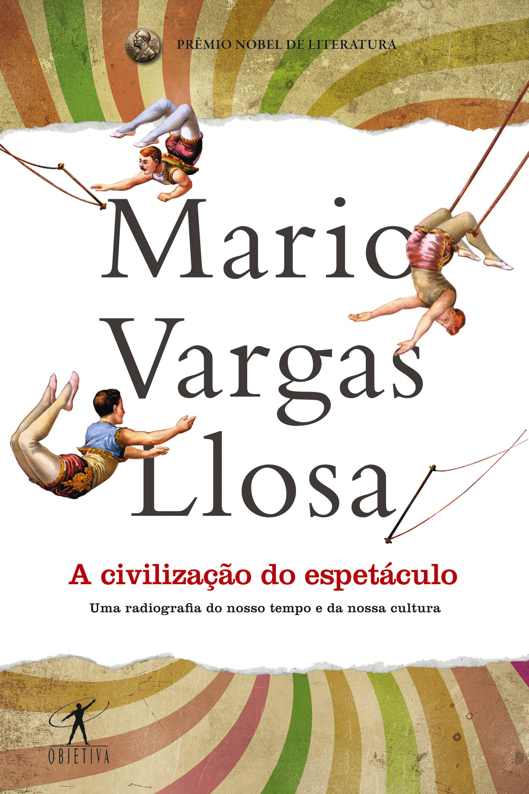

# Em ‘A civilização do espetáculo’, Vargas Llosa analisa a decadência da cultura

“A cultura, no sentido tradicionalmente dado a esse vocábulo, está prestes a desaparecer em nossos dias. E talvez já tenha desaparecido, discretamente esvaziada de conteúdo.” A pouca repercussão de “A civilização do espetáculo – Uma radiografia do nosso tempo e da nossa cultura” (Objetiva, 208 pgs. R$ 34,90) dá razão ao diagnóstico feito pelo peruano Mario Vargas Llosa: em um contexto no qual a cultura se aproxima cada vez mais do entretenimento e se afasta da reflexão, qualquer empreendimento que exija algum esforço intelectual maior tende a ser rejeitado pelo leitor/consumidor em busca de prazeres fáceis e instantâneos, “que os imunize contra a preocupação e a responsabilidade”. Este é, no entanto (ou por isso mesmo), um livro necessário, ainda que o Prêmio Nobel de Literatura de 2010 exagere em seu pessimismo e pese a mão nas suas críticas algo ressentidas a determinados pensadores, como Jean Baudrillard e Michel Foucault.

Vargas Llosa começa recapitulando obras de cinco autores que, ao longo das últimas décadas, se detiveram no exame do mesmo tema, começando pelo T.S.Eliot. Em seu clássico “Notas sobre a definição de cultura”, de 1948, o poeta anglo-americano lamentou a decadência da cultura ocidental, defendendo a alta cultura das elites e rejeitando a ideia de que esta deve ser democratizada. Para Eliot, a divisão entre classes sociais e as respectivas culturas de classe é que mantém coeso e faz prosperar o conjunto da sociedade. Ele vai além: defende o legado do cristianismo, berço do pensamento europeu, e afirma que a religião é necessária, por proporcionar o arcabouço para a cultura e proteger a massa da humanidade do tédio e do desespero. Desnecessário dizer, qualquer autor que defendesse hoje essa visão elitista da cultura seria apedrejado.

Já em 1971 George Steiner dedicou um livro inteiro a refutar as teses de Eliot: em “O castelo do barba Azul – Algumas notas para a redefinição de cultura”, Steiner critica o autor de “The waste land” por ter publicado, apenas três anos após o fim da Segunda Guerra, um tratado sobre a cultura que ignorou completamente o Holocausto e seus efeitos. Depois de uma densa reflexão sobre as origens secretas da violência e a relação entre a barbárie e a modernidade na Europa (“a cultura europeia não só anuncia também deseja que venha esse estouro sanguinário e purificador que serão as revoluções e as duas guerras mundiais”), Steiner se aproxima contudo do pessimismo eliotiano ao lamentar a derrocada da tradição e a captura da cultura, já naquele momento, pelo meio acadêmico: “Uma parte importante da poesia, do pensamento religioso e da arte já desapareceu da proximidade pessoal para passar à custódia dos especialistas” – “inacessíveis em seus jargões herméticos e sua erudição asfixiante, quando não em teorias delirantes”, completa o escritor peruano, com toda razão.

Vargas Llosa examina em seguida a obra “A sociedade do espetáculo”, de Guy Debord (1967). Atualizando conceitos marxistas, Debord afirma que na nossa sociedade a mercadoria atinge tal importância na vida das pessoas que se sobrepõe a qualquer outro interesse ou preocupação de ordem cultural, intelectual ou política: o indivíduo se entrega assim, e obsessivamente, ao consumo sistemático de objetos “muitas vezes inúteis ou supérfluos, que as modas e a publicidade lhe vão impondo, esvaziando sua vida interior de preocupações sociais, espirituais ou simplesmente humanas, isolando e destruindo a consciência que ele tenha dos outros, de sua classe e de si mesmo”. Vargas Llosa concorda com o diagnóstico mas discorda do prognóstico, já que Debord pregava a ação revolucionária contra esse estado de coisas, enquanto o peruano deixou há muito tempo de acreditar nessa saída.

Já em “A cultura-mundo – resposta a uma sociedade desorientada” (2009), Gilles Lipovetsky analisa a questão pelo prisma da globalização, que apaga fronteiras e faz com que a cultura deixe de ser elitista, erudita e excludente para se transformar numa genuína cultura de massas, que, em oposição ao espírito das vanguardas, tem como meta oferecer entretenimento á maior quantidade possível de consumidores de todas as classes: “Sua intenção é divertir e dar prazer, possibilitar evasão fácil e acessível para todos, sem necessidade de formação alguma, sem referentes culturais concretos.” Para Lipovetsky, essa nova cultura de massas se caracteriza pelo predomínio do som e da imagem sobre a palavra escrita, ou seja, pela vitória da tela sobre o texto.

Finalmente, em 2010, o sociólogo Frédéric Martel publicou o ambicioso estudo “Mainstream – A guerra global das mídias e das culturas” [leia [aqui](http://g1.globo.com/platb/maquinadeescrever/2012/08/05/1177/ "Martel") uma entrevista de Martel a este blog], que fundamenta com uma exaustiva pesquisa de campo algumas das ideias de Lipovetsky. Vargas Llosa chama a atenção para o fato de que o volumoso livro de Martel praticamente não fala de livros (com exceção de “O código Da Vinci” e outras bobagens), mas apenas das indústrias criativas ligadas ao cinema, à televisão e à música de massas. Escreve Vargas Llosa, com base nas análises de Martel: “A imensa maioria do gênero humano não pratica, não consome nem produz hoje outra forma de cultura que não seja aquela que, antes, era considerada pelos setores cultos, de maneira depreciativa, mero passatempo popular, sem parentesco algum com as atividades intelectuais, artísticas e literárias que constituem a cultura. Esta já morreu, embora sobreviva em pequenos nichos sociais, sem influência alguma sobre o *mainstream*.”

Vargas Llosa conclui sua introdução com um parágrafo que considero iluminado, por resumir aquele que é talvez o principal traço distintivo da cultura hoje: a ligação visceral entre o julgamento de valor e o sucesso comercial: “A distinção entre preço e valor se apagou, ambos agora são um só, tendo o primeiro absorvido e anulado o segundo. É bom o que tem sucesso e é vendido; mau o que fracassa e não conquista o público. O único valor é o comercial. O desaparecimento da velha cultura implicou o desparecimento do velho conceito de valor. O único valor existente é agora o fixado pelo mercado.” O efeito disso é um estado de permanente confusão e oportunismo, no qual os maiores patifes e  embusteiros são celebrados como grandes artistas, e o descaramento e o marketing substituem o talento. Aliás já não é possível, afirma o autor, discernir com certa objetividade o que é ter ou não ter talento, “o que é belo e o que é feio, qual obra representa algo novo e duradouro e qual não passa de fogo de palha”.

Neste cenário sombrio, segundo Vargas Llosa, os intelectuais que alcançam alguma visibilidade na mídia são aqueles que estão mais preocupados com a autopromoção e o exibicionismo do que com a defesa de algum princípio ou valor: afinal de contas, na civilização do espetáculo, o intelectual só interessa quando encarna o papel de bufão. Reflexão mais que oportuna para o momento que vivemos hoje no Brasil.

Leia [aqui](http://www.objetiva.com.br/arquivos/capas/A_Civilizacao_Espetaculo-Primeiro-Capitulo.pdf?1381670079 "trecho") um trecho de “A civilização do espetáculo”.

### 4 Comentários para “Em ‘A civilização do espetáculo’, Vargas Llosa analisa a decadência da cultura”

1. Isabela Frade:  
   [13 outubro, 2013 as 1:28 pm](http://g1.globo.com/platb/maquinadeescrever/2013/10/13/em-a-civilizacao-do-espetaculo-vargas-llosa-analisa-a-decadencia-da-cultura/comment-page-1/#comment-5770)

   Excelente resenha da obra do Llosa. Aprofunda a ferida.
2. Thais Herédia:  
   [20 outubro, 2013 as 11:13 pm](http://g1.globo.com/platb/maquinadeescrever/2013/10/13/em-a-civilizacao-do-espetaculo-vargas-llosa-analisa-a-decadencia-da-cultura/comment-page-1/#comment-5776)

   tá aqui na cabeceira….vou ler!
3. Pascualdo:  
   [17 novembro, 2013 as 11:14 pm](http://g1.globo.com/platb/maquinadeescrever/2013/10/13/em-a-civilizacao-do-espetaculo-vargas-llosa-analisa-a-decadencia-da-cultura/comment-page-1/#comment-5785)

   Estou lendo, e as argumentações de Llosa caem como uma luva em um sentimento que tenho há anos: as pessoas vão ao cinema, teatro, ópera, show, museu, exposição, etc. com o intuito de parecerem, para si mesmas e para os outros, cultas. E se dão por satisfeitas com isso. O trabalho intelectual, que culmina em uma pessoa minimamente aculturada ao longo dos anos, é solenemente ignorado.
4. Mariana oc.:  
   [16 dezembro, 2013 as 5:59 pm](http://g1.globo.com/platb/maquinadeescrever/2013/10/13/em-a-civilizacao-do-espetaculo-vargas-llosa-analisa-a-decadencia-da-cultura/comment-page-1/#comment-5794)

   “na civilização do espetáculo, o intelectual só interessa quando encarna o papel de bufão.” Tomando o caso brasileiro, é o que acontece mesmo. Os ‘intelectuais’ que mais tem destaque na mídia são bufões como o Pondé, Rodrigo Constantino, Jô Soares, o ´acadêmico´ Merval…e por aí vai ladeira abaixo.

Comentar
