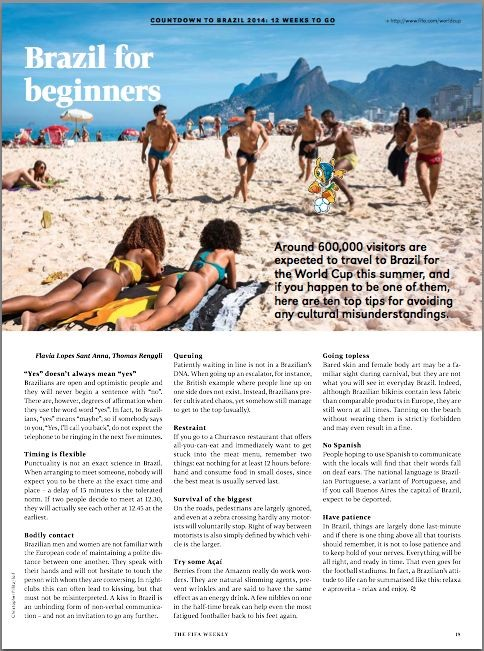

# Bastidores FC

[veja todos os posts](http://globoesporte.globo.com/blogs/especial-blog/bastidores-fc/1.html)

Foi uma semana difícil para a Copa do Mundo de 2014 e seus organizadores, esta que terminou. Após uma série de reuniões na sede da Fifa, em Zurique, só cresceu a desconfiança das pessoas que comandam a entidade com relação à organização do evento no Brasil.

O atraso nas estruturas provisórias em Porto Alegre e São Paulo, o impasse sobre a Fan Fest em Recife e outros temas permanecem sem definições claras - motivo pelo qual o secretário-geral da entidade, Jérôme Valcke, estará no Brasil na próxima semana.

Incomoda e muito a Fifa que ainda não estejam instaladas todas as cadeiras em todos os estádios.

- Como você pode vender todos os ingressos com segurança se não hoje não há como saber exatamente quantos assentos há em cada fileira?, questiona uma pessoa da entidade.

Em termos de organização, o tema "ingressos" foi a maior dor de cabeça da Fifa durante a Copa das Confederações, justamente porque os estádios foram entregues tarde demais.

As insatisfações, quase sempre ouvidas em reuniões reservadas, desta vez foram parar no veículo impresso da entidade, sua revista semanal impressa em quatro idiomas - nenhum deles o português.

Na edição de 21 de março da "Fifa Weekly" há uma página com o título "Brasil para principiantes". Era para ser uma lista engraçadinha, com tópicos manjados como "não diga que a capital deles é Buenos Aires" e "cuidado, eles tocam nas pessoas enquanto falam". Mas há recados bem claros ali também.

Um tópico diz: "Tempo é flexível - Se duas pessoas dizem que vão se encontrar 12h30, eles não verdade vão se ver 'as 12h45, não antes". E o último é ainda mais direto:

- Tenha paciência. No Brasil, as coisas são feitas no último minuto e há uma coisa acima de toas que os turistas precisam lembrar: não perca a paciência e mantenha-se calmo. Tudo vai ficar bem, e pronto a tempo. Isso serve até para estádios de futebol. Na verdade, o comportamento do brasileiro pode ser resumido assim: relaxa e aproveita - relax and enjoy.

---

- **Luiz Filho**

  Aqueles que defendem o PT concordam com os assassinatos que o psicopata maduro está comandando na venezuela... gostam de corrupção e impunidade...defendem bandidos, lambem as botas do Fidel Castro um dos maiores assassinos que a humanidade conheceu... quem defende o PT tem ídolos como o porco fedorento che guevara, como os ditadores-assassinos lênin, stalin e o iraniano apredejador de mulheres, quem defende o PT é contra a família, acha normal menores matando impunemente, acha bom bolsas-esmolas que petrificam a miséria, quem defende o PT é contra o Trabalho e a Recompensa, é contra o Brasil !
