# [How to start your first podcast - equipment, editing, publishing and more](http://www.hanselman.com/blog/HowToStartYourFirstPodcastEquipmentEditingPublishingAndMore.aspx)

Sponsored By

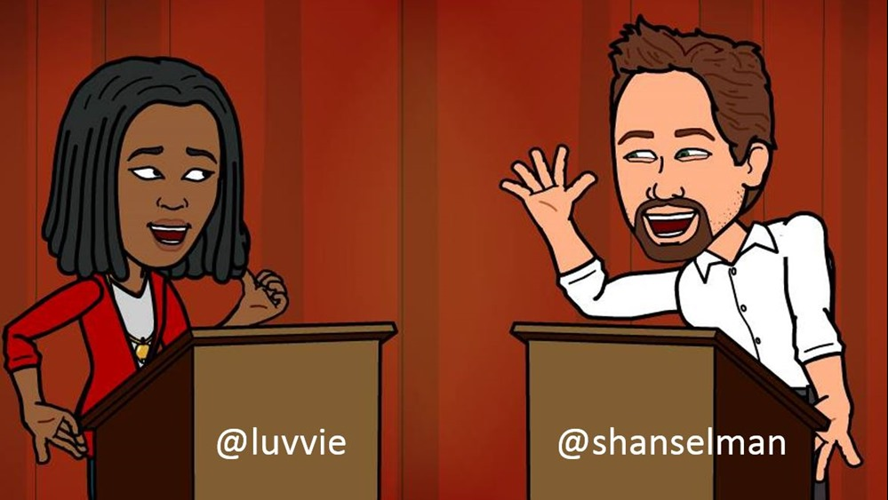

My friend [Luvvie](http://www.awesomelyluvvie.com) and I were speaking at [Blogging While Brown](http://www.bloggingwhilebrown.com) this last weekend in New York City, amongst other things and events. Luvvie and I host a podcast called [Ratchet and The Geek](http://www.ratchetandthegeek.com). I produce [three podcasts](http://www.hanselman.com/podcasts/) - **Hanselminutes**, **This Developer's Life**, and **Ratchet and The Geek**. I do all of these on the side, for fun.

> **Context in NPR terms**: If the [Hanselminutes](http://www.Hanselminutes.com) podcast is "Fresh Air for Developers", then [Ratchet and The Geek](http://www.ratchetandthegeek.com) is "Car Talk for Techies," while [This Developer's Life](http://www.thisdeveloperslife.com) is a loving homage to This American Life.

At the conference, Luvvie and I hosted a one hour talk about "**Taking Your Blog to the Next Level with Podcasting**." All the links to [the equipment we recommend is at this Bit.ly Bundle](http://bitly.com/bwbpodcasting): [bitly.com/bwbpodcasting](http://bitly.com/bwbpodcasting)

We did a [5 minute "mini-podcast" live on stage](http://www.ratchetandthegeek.com/show/12.5-BWBNYC-Live) at the beginning of our talk, then talked about how we produce the show and how it goes from concept to topics to a produced and published MP3.

For this post I'm focusing on what you'll need for a podcast in terms of **Equipment** and **Publishing**. I'm assuming you're able to decide on your own topic/theme and spread the word about your new show.

### 

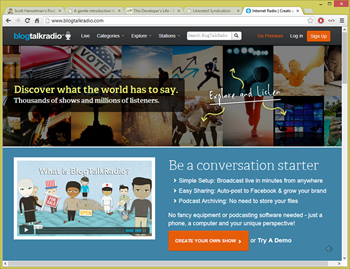

Podcasting Equipment: Good, Better, Best

Let's take a look at your options, ranked from Meh, through Good, Better, and Best.

You could use BlogTalkRadio as a super-quick way to jump-start your podcast, but there are some limitations. The benefits are that there's no software to use. It's basically a recorded conference call. They handle call-ins for guests, archiving, delivery and bandwidth. However, it goes up from Free to $39 a month or more quickly.

If you are serious about the future of your podcast I recommend that you put a little more work into and and you'll have lots more control and flexibility.

If you are going to do Skype-based recordings or online interviews, get yourself a decent USB microphone/headset. These are NOT audiophile or good quality headphones - to be clear - but they are good enough for Skype and they are **guaranteed** to sound better than talking in to your laptop's tiny microphone hole.

Remember, your laptop may have cost $1000 but that tinny microphone hole was only $1 of the price. Have low expectations when using a laptop mic for a podcast.

[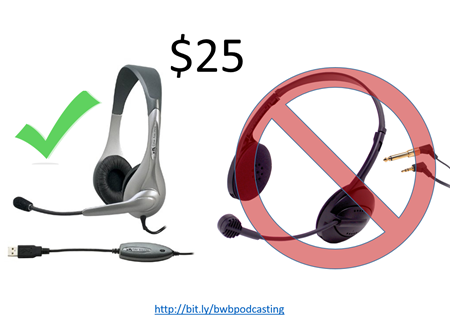](http://bit.ly/bwbpodcasting)

If you get a microphone/headset, get one that's USB to keep the audio digital all the way into the laptop. Don't use 1/8" analog headphone jacks for recording.

For Skype interviews I use [CallBurner](http://www.callburner.com) to record the interviewee. Ideally your guest will also have a good USB microphone. **Even better if your guest records a local file while you also record the Skype call**. More on this technique further down in this post.

[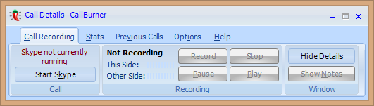](http://www.callburner.com)

#### Better

You may be able to get more flexibility if you move to a portable recorder. You can do interviews with these without carrying your laptop. You can also use your phone or tablet if you like. Ideally you'll want to make WAV files rather than MP3s. If you're editing your podcast later a WAV file will sound better while editing and won't lose quality. An MP3 is already compressed and then will get compressed again when you save your final podcast.

Consider a WAV file like a PNG, RAW file or BITMAP and an MP3 is like a JPEG. Edit in high quality files and export your final as a compressed MP3.S

[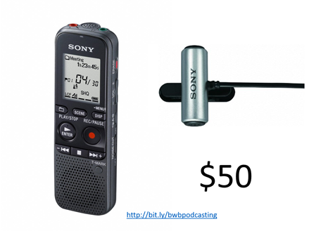](http://bitly.com/bwbpodcasting)

You can also add a small Lavalier (clip on) microphone if you like, then plug it into the portable recorder to better isolate sound for your interviews.

#### Better++

If you've got $80, consider a [Samson C01UCW USB Mic or similar](http://www.amazon.com/gp/product/B000PTF0E2/ref=as_li_ss_tl?ie=UTF8&camp=1789&creative=390957&creativeASIN=B000PTF0E2&linkCode=as2&tag=diabeticbooks). This is an extremely competent mic that plugs directly into your computer's USB port. You can record into [Audacity](http://audacity.sourceforge.net/) or [Adobe Audition](http://www.adobe.com/products/audition.html) or even iMovie or Garage Band directly. For one or two person talk shows this is a great mic to start with.

[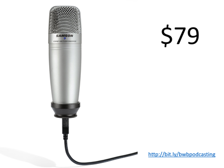](http://www.amazon.com/gp/product/B000PTF0E2/ref=as_li_ss_tl?ie=UTF8&camp=1789&creative=390957&creativeASIN=B000PTF0E2&linkCode=as2&tag=diabeticbooks)

Also consider your room configuration. If you have a square room with stone walls and wood floors, your listeners will be able to hear every bump in that echo-y environment. I use a [Portable Vocal Booth from RealTraps](http://www.realtraps.com/p_pvb.htm) when sound quality really counts. This is useful for screencasts and voice-over work in a noisy environment.

I say "best" but I'm assuming you don't have an actual recording studio available to you. This is the setup that I use on **all my podcasts**. I use a [Zoom H4N](http://bit.ly/14PSZEO?r=bb) portable recorder. It uses an SD card to store the WAV files. It comes with two small mics at the top for starters, but then lets you grow by adding either microphones with 1/4" jacks or studio quality mics with XLR connectors.

[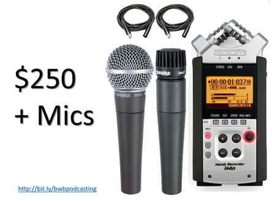](http://bitly.com/bwbpodcasting)

I recommend [Shure microphones](http://www.amazon.com/gp/product/B0000AQRSR/ref=as_li_ss_tl?ie=UTF8&camp=1789&creative=390957&creativeASIN=B0000AQRSR&linkCode=as2&tag=diabeticbooks). Two [Shure PG48-XLRs](http://www.amazon.com/gp/product/B0000AQRSR/ref=as_li_ss_tl?ie=UTF8&camp=1789&creative=390957&creativeASIN=B0000AQRSR&linkCode=as2&tag=diabeticbooks) with cables paired with the [Zoom H4N](http://bit.ly/14PSZEO?r=bb) **will make great sounding podcasts**. All the very best episodes of [This Developer's Life](http://www.thisdeveloperslife.com) were recorded like this. All the episodes of Hanselminutes where the guest wasn't on Skype were recorded in person with this very setup.

The Zoom also has the benefit of improving your YouTube videos. You can mount it directly to a DSLR camera with video capabilities and greatly augment the resulting video's sound quality. Again, the components in a DSLR are optimized for visuals, not audio.

[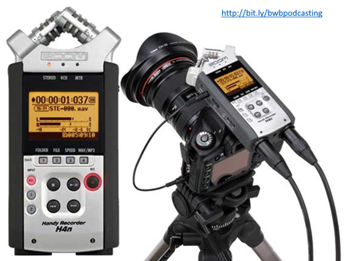](http://bitly.com/bwbpodcasting)

### Editing

Luvvie and I live in different time zones so we record local files with our portable rigs PLUS we Skype each other and record the call with CallBurner. This gives me THREE files.

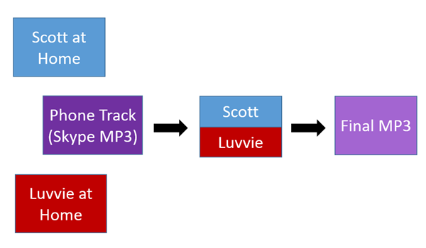

Why three files? Well, one high quality of my recorded locally as a WAV. One of my co-host recorded in high quality as a WAV and one of BOTH of us. The trick is that we **don't use the phone/Skype track.**

The phone track is just for lining up the two other tracks. This makes it sound like my co-host and I are in the same room together. See the three files below. My co-host is on top - notice her track is quiet. I'm on the bottom. The phone track is in the middle. Since these are separate tracks I can adjust Luvvie's track to make it louder and better match my track's volume.

I move our tracks around using the phone/Skype track as a guide. It tells me what we're supposed to sound like and gets our conversation in Sync. When I feel we are in sync, I **mute** the Skype track and listen to us talk.

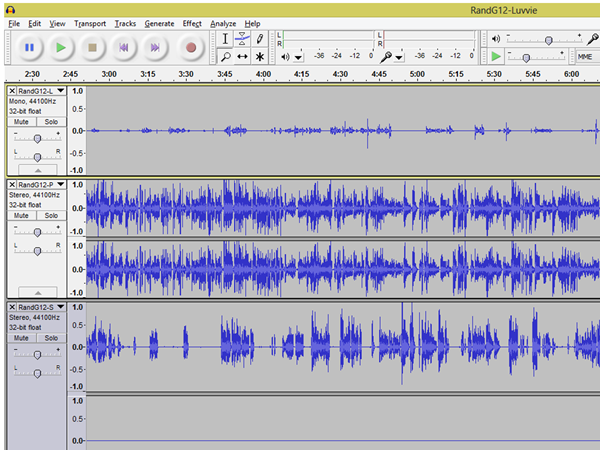

For complex show I'll use Adobe Audition and use the Effects Rack. I use a Speech Volume Leveler and a "Hard Limiter" to keep the voices at a strong, but not overpowering level. There are LOTS of great Tutorials online to show you how to use tools like Audacity and Audition.

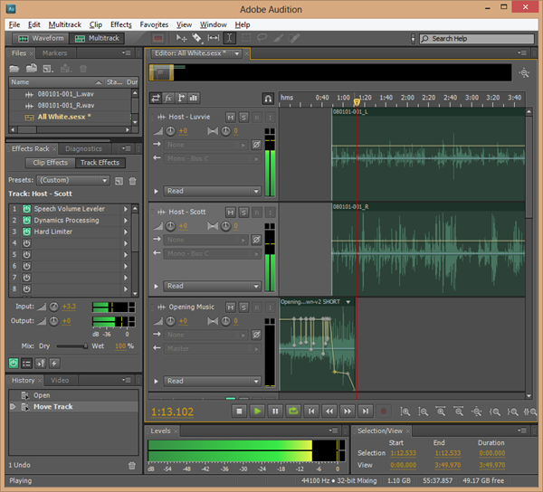

It's like PhotoShop for sound! There are layers and filters and effects. Thinking about it this way greatly helped my mental block.

### Publishing

We recommend using [LibSyn](http://www.libsyn.com) for your hosting and publishing your podcasts. If you are more technical you can certainly use Amazon S3, Azure Blobs or just your own existing host if you like. For shows like Hanselminutes that have almost 30,000 megabytes of shows, we use S3. Both [Ratchet and The Geek](http://www.ratchetandthegeek.com) and [This Developer's Life](http://www.thisdeveloperslife.com) use LibSyn.

LibSyn offers a simple platform for publishing and feed creation. It also has fantastic stats and can even make mobile apps for your shows if you want.

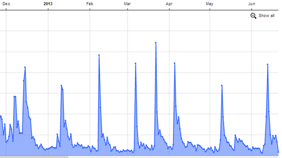

#### Your Feed

Podcast feeds are just like RSS feeds except they also include an "enclosure" tag. Services like FeedBurner and [FeedBlitz](http://www.feedblitz.com) can add this tag for you if your blog doesn't support it directly. While it's unclear how long FeedBurner will last, We use it for its easy podcast creation ability.

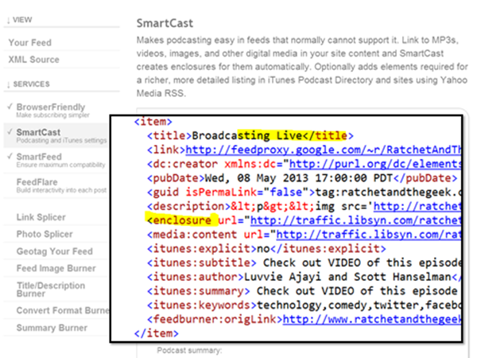

Make sure you submit your Podcast to iTunes and Windows Phone/Zune. I also suggest telling [Rob Greenlee](https://twitter.com/robgreenlee) (the manager of the Windows Phone/Xbox/Zune podcasts) on Twitter about your show).

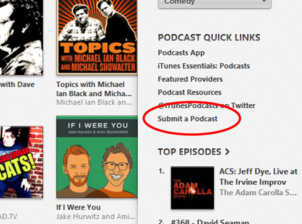

Here are some other podcast directories you should be sure to target:

- **BlackBerry -** You can submit your podcast by going to the[**Podcast submission page**](http://rimpodcast.quickplay.ca/rimpodcasting/login.seam) and creating a RIM podcast account.
- **Stitcher**   
  **Stitcher -** is a radio-like service that allows you to submit your audio podcast to. Submit your audio only podcast at the **[Content Partner page](http://stitcher.com/contentProviders.php)**.
- **Tunein Radio -** You can submit your Podcast to Tunein by sending an email to [**Broadcast Support**](mailto:broadcaster-support@tunein.com).
- **DoubleTwist -** Submit your show by **[emailing Support](mailto:support@doubletwist.com)** with your show's name, RSS, and description.

### Conclusion

Ultimately you need an MP3 that shows up in a feed and a website to promote it. Everything you can do on top of this will only help you! Think about sound quality, topic quality, consistency, website quality, and technical details.

---

**Sponsor:** Big thanks to CodeProject for sponsoring the feed this week! What you can do with 215+ million business records? Dig into the data in the [D&B Developer Challenge and post an article on CodeProject about what you could do with the data](http://bit.ly/11ZEAS7). Over $40,000 in prizes total are up for grabs. [Check it out](http://bit.ly/11ZEAS7)!

#### About Scott

Scott Hanselman is a former professor, former Chief Architect in finance, now speaker, consultant, father, diabetic, and Microsoft employee. I am a failed stand-up comic, a cornrower, and a book author.

[About](http://hanselman.com/about)   [Newsletter](http://www.hanselman.com/newsletter)
