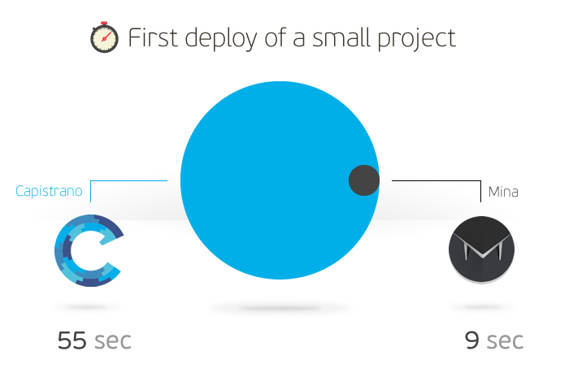
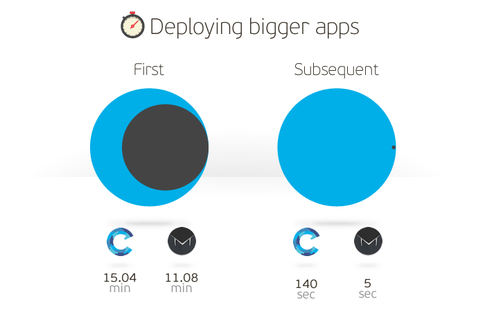

# Faster web application deployments using Mina instead of Capistrano

Every web application needs to be deployed to a server at one point, and there are several ways to do that. If you are running Rails, a VPS/dedicated server, what's the best way to do that?

If you've never operated a VPS or dedicated server and have used a [PaaS](http://en.wikipedia.org/wiki/Platform_as_a_service) solution like [Heroku](https://www.heroku.com/) or [AppFog](https://www.appfog.com/), you probably never had to bother with deploying your application. This is because the PaaS did all the heavy lifting for you.

But, if you ever needed to deploy a Ruby on Rails application to a VPS or dedicated server, I bet you used [Capistrano](http://www.capistranorb.com/), a deployment tool used by many developers around the world. We used it as well, but then we met [Mina](http://nadarei.co/mina/).

## What's wrong with Capistrano?

Maybe you're wondering what's wrong with Capistrano. Doesn't it do the job? Yes, it does, and yes, it's great, but it's also terribly slow.

Capistrano deployments can take up to 3 minutes if, for example, you have a large repository, if you've changed a couple of database columns or made some extensive changes to the applications. If you deploy all day, every day, being slow isn't an option for you.

Well... we deploy every day, and Capistrano just wasn't working for us anymore, so we began to search for a better solution. At that time, the guys from Dwellable wrote an [article](http://www.dwellable.com/blog/Rails-Rumble-Gem-Teardown) about the most recent [RailsRumble](http://railsrumble.com/) event and analyzed the most popular gems used by the competing developers. It turns out that 13% of the competing teams used [Mina](http://nadarei.co/mina/) and that was reason enough for us to check it out.

## Capistrano vs Mina

To show the difference between these deployment tools, we measured their performance on two different projects.

### Capistrano

To see how much it would take for the first deployment, we created a new Rails project. Because we used the new version of Capistrano (v3), we had to add two gems, **gem 'capistrano'** and **gem 'capistrano-rails'**. We also added **require 'capistrano/rails'** in the Capfile and edited the **deploy.rb** file.

Steps we had to perform:

- Add **gem 'capistrano'** and **gem 'capistrano-rails'** to the Gemfile
- Call **cap install**
- Edit the **deploy.rb**, **Capfile** and **production.rb** file
- Call **cap production deploy**

As from version 3 you don't need to call **cap deploy:setup** anymore.

Deploy

```
INFO [07036a87] Running /usr/bin/env mkdir -p /tmp/capistrano/ on capistrano.gabrijelskoro.com
DEBUG [07036a87] Command: /usr/bin/env mkdir -p /tmp/capistrano/
INFO [07036a87] Finished in 1.236 seconds with exit status 0 (successful).
DEBUG Uploading /tmp/capistrano/git-ssh.sh 0.0%
INFO Uploading /tmp/capistrano/git-ssh.sh 100.0%
INFO [b1b91149] Running /usr/bin/env chmod +x /tmp/capistrano/git-ssh.sh on capistrano.gabrijelskoro.com
DEBUG [b1b91149] Command: /usr/bin/env chmod +x /tmp/capistrano/git-ssh.sh
INFO [b1b91149] Finished in 0.172 seconds with exit status 0 (successful).
...
INFO [9a6ef5d6] Running /usr/bin/env echo "Branch master deployed as release 20131206155724 by gabrijelskoro; " >> /var/www/c/capistrano.gabrijelskoro.com/revisions.log on capistrano.gabrijelskoro.com
DEBUG [9a6ef5d6] Command: echo "Branch master deployed as release 20131206155724 by gabrijelskoro; " >> /var/www/c/capistrano.gabrijelskoro.com/revisions.log
INFO [9a6ef5d6] Finished in 0.228 seconds with exit status 0 (successful).
```

Because Capistrano only records the time for every command it runs, we can't see how long the whole deployment takes. Luckily, my trusty phone has a stopwatch, so I recorded the elapsed time on my own. And the result - the deployment process with Capistrano took **180 seconds** of our precious time.

So let's do it again, but this time with Mina.

The first thing that we noticed on Mina website was the title **Really fast deployer and server automation tool**, and that alone put a smile on our faces.

Again, we created a new project and pushed it to a repository. After adding the **gem 'mina'** to the Gemfile, it was very easy to configure the **deploy.rb** file, and, in less than a minute, we were ready to deploy (note that the repository size was around 250 KB).

We performed these steps:

- Add **gem 'mina'** to the Gemfile
- Call **mina init**
- Edit the **deploy.rb** file
- Call **mina setup**
- Call **mina deploy**

Running setup:

```
-----> Setting up /var/www/m/mina.gabrijelskoro.com        

total 16 
drwxrwxr-x 4 www-data www-data 4096 Dec  6 15:15 . 
drwxrwxr-x 3 www-data www-data 4096 Dec  6 15:15 .. 
drwxrwxr-x 2 www-data www-data 4096 Dec  6 15:15 releases 
drwxrwxr-x 2 www-data www-data 4096 Dec  6 15:15 shared 

-----> Done.        
-----> Be sure to edit 'shared/config/database.yml'.        
       Elapsed time: 1.00 seconds
```

It takes only 1 second to create all the necessary directories.

Running first deploy:

```
-----> Creating a temporary build path        
-----> Cloning the Git repository        
       Cloning into bare repository '/var/www/m/mina.gabrijelskoro.com/scm'... 
-----> Using git branch 'master'        
       Cloning into '.'... 
       done. 
-----> Using this git commit        

       Gabrijel Skoro (f78408d): 
       > initial commit

-----> Symlinking shared paths        
-----> Installing gem dependencies using Bundler        
       Fetching gem metadata from https://rubygems.org/.......... 
       Fetching gem metadata from https://rubygems.org/.. 
       Installing rake (10.1.0)  
       Installing i18n (0.6.9)  
       ...
-----> Migrating database        
-----> Precompiling asset files   
-----> Build finished        
-----> Moving build to releases/1        
-----> Updating the current symlink        
-----> Launching        
-----> Done. Deployed v1        
       Elapsed time: 85.00 seconds
```

And only **85 seconds** for the deployment. Indeed, very, very fast.

## Let's see the time after subsequent deploys

But what's the difference between the first and subsequent deploys? It's huge because when you deploy an application for the first time it will run **bundle** and download all the gems, run **assets:precompile** and **db:migrate**. For every subsequent deploy, if you don't change your assets (styles, pictures, videos...), make bigger changes in your database (like create new tables or add new columns) or if you add a new gem, commands **assets:precompile** and **db:migrate** won't be called anymore, and **bundle** will only download the new gem.

So, on both projects I removed the unused gem (**gem 'sdoc'**), and deployed the application again. The results are shown below:



On a small project Mina is 6.8 times faster than Capistrano, so you can imagine how long it would take to deploy a bigger application like our Infinum web with a repository of around 107 MB. You can't? Then let's test it!

I deployed our web application two times with both tools, once to see the difference on the first deploy and once to see the difference on the second deploy. Here are the results:



Now you can see the real power of Mina - it's about 28x faster on the second deploy than Capistrano.

## Why is Mina so much faster?

Capistrano runs each command separately on their own SSH session and that's why it takes so long to deploy an application. Unlike Capistrano, Mina runs only one command which requires only one session. Confused? Don't be. When you call **mina deploy**, it generates the entire procedure as a Bash script, uploads it and runs it on the server. The results of that is drastically reduced deployment time.

## Which to use?

If speed is not important to you, and editing 3 files and bothering with so many different functions just to deploy an app isn't a problem, you can use Capistrano like other 87% of users.

Mina is the choice if you need a really fast deployment tool that's easy to set up and has a clear console output. On the other hand, be ready to sacrifice some functionality like rollback. Mina doesn't support rollback (yet!), but there's an open ticket for this, and I hope rollback will be implemented soon.

To be honest, both tools are great, have functions like multienv, run the rails production console locally, have support for deploying non-rails apps like php., etc. In short, they both make our lives easier, but at the end of the day Mina is so much faster and that's the reason it replaced Capistrano in our development toolset.
