# Mulher Maravilha, a primeira super-heroína dos quadrinhos… #sqn

Por [Poderoso Porco](http://melhoresdomundo.net/author/poderosoporco/ "Posts de Poderoso Porco") em março 7, 2014[@lucas\_ed](http://www.twitter.com/lucas_ed)

Então, cês sabem né, **“Dia Internacional da Mulher”** e coisa e tal. E eu, como estava mexendo com esses lances históricos sobre os quadrinhos de super-heróis, achei que seria interessante fazer um post sobre uma das mais repetidas ~~mentiras~~ enganos da história das histórias em quadrinhos de supers: **a Mulher Maravilha é a primeira super-heroína do mundo!** Potoca esta que é repetida até **pela própria DC**, como mostra a contracapa da edição *The Wonder Woman Chronicles Vol. 1* (para quem não sabe, essa série *Chronicles/Crônicas* reedita as histórias dos personagens em ordem cronológica. Aqui no Brasil saíram os volumes 1 e 2 de Batman e Superman e o volume 1 do Lanterna Verde).

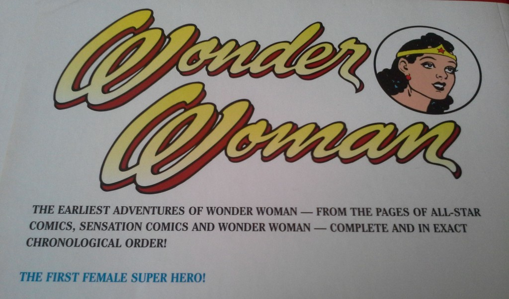

Pois bem, mas por causo de quê que essa história é mentira?  
Primeiro, a gente precisa definir **o que faz um super-herói/super-heroína**. Uniforme? Identidade secreta? Super-poderes? **Todos eles juntos?** O **Superman** é considerado o primeiro super-herói porque, mesmo que vários desses critérios **já tenham rolado antes dele** (para ficar em apenas dois exemplos, identidade secreta e uniforme o **Fantasma**, de Lee Falk, já tinha antes dele; Poderes, o **Mandrake**, também de Lee Falk, de certa forma os tinha, com seus mal explicados **“dons hipnóticos”** – meio telepáticos, isso sim), é no Superman que **tudo aparece junto**: ele tem identidade secreta, super-poderes e um uniforme característico – isso sem contar ter sido o primeiro a surgir naquele novo e surpreendente formato: a revista em quadrinhos de material inédito!

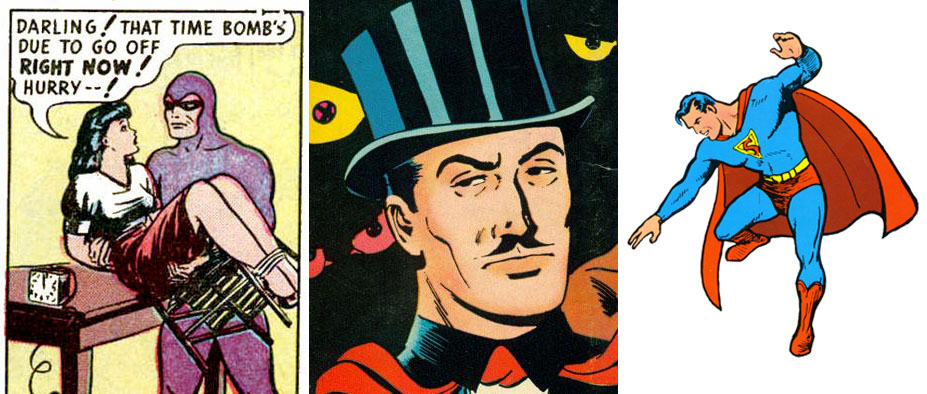

Pois bem, mas antes do Super, como vimos, houveram predecessores – quer no quadrinho, quer em outras mídias como os *pulps* (caso do **Doc Savage**) ou os programas de rádio (**O Sombra**) – pra facilitar a vida, eu vou chamar esses personagens pré-super-heróis simplesmente de **“aventureiros”**. Com as super-heroínas foi a mesma coisa. A primeira mulher aventureira dos quadrinhos foi **Sheena**, (*“Sheena, a pantera loira”* no Brasil), criação de um desconhecido quadrinista chamado **“W. Morgan Thomas”** – na verdade, um pseudônimo de ninguém menos que **Will Eisner** e **Jerry Inger**, donos do *Universal Phoenix Studio*. Tendo estreado apenas três meses depois do Superman (em setembro de 1938), Sheena era praticamente uma adaptação da protagonista do pulp *“She”* (“Ela, a feiticeira”), de H. Rider Haggard (de “As minas do rei Salomão”), publicado em 1886. Diferente do livro de Haggard, Sheena era uma mulher das selvas, uma **Tarzan de saias**. Mas o lance é que, antes de Sheena, nos quadrinhos as mulheres podiam até ser **“ativas”** (olha as aspas!), como Lois Lane e Dale Arden (namoradinha do Flash Gordon que sempre se envolvia em suas aventuras), mas nunca eram protagonistas e, pior, eram ativas por fora e **passivonas por dentro**: eram os seus respectivos mocinhos quem as precisava salvar! Sheena era diferente, era meio [paraíba](http://letras.mus.br/luiz-gonzaga/47095/) – sob o ponto da atividade, era mulher-macho sim senhor. As histórias eram dela e ela quem resolvia as paradas.

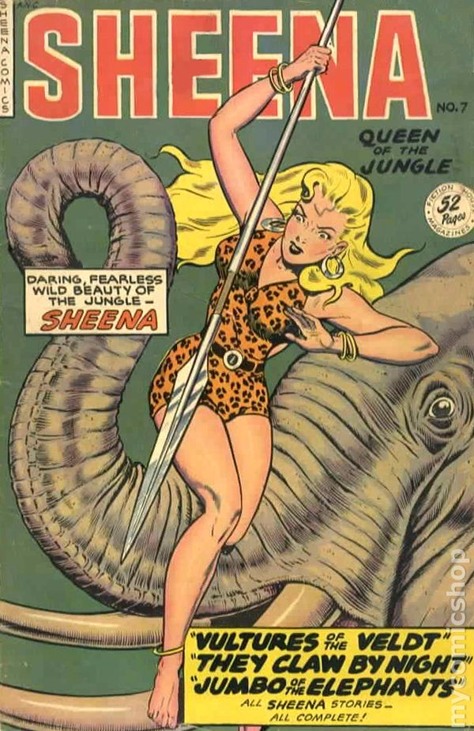

Os super-poderes só entraram no universo das aventureiras femininas quase **dois anos depois**: em fevereiro de 1940, o mundo conhecia **Fantomah, a filha dos faraós** (apesar de ser loira)! Criada por Fletcher Hanks, Fantomah era outra *“jungle girl”* que nem Sheena, uma dama loira que protege as florestas da África, mas com uma diferença: Fantomah tem **incríveis poderes** (quase onipotente, porque eles mudavam conforme a história pedia) que, ao serem usados, transformavam seu cândido rostinho numa terrível **caveira azul**! Apesar de ter os poderes e, de certa forma, um “uniforme”, a filha dos faraós não tinha uma identidade secreta (na verdade, nem um background muito bem construído) e, fosse caveira ou fosse mulher, era Fantomah do mesmo jeito.

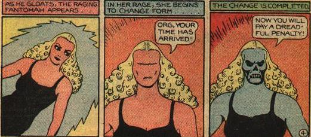

Apesar do surgimento da Fantomah, os criadores de aventureiras deram um passo atrás, e começa a fase das **“Debutantes”**: aventureiras que, a exemplo de playboys como Bruce Wayne/Batman, Britt Reid/Besouro Verde ou Lamont Craston/O Sombra, são damas da alta sociedade, ricas e entediadas que, à noite, vestem um uniforme e uma máscara para combaterem o crime – mas sem nenhum super-poder envolvido. São dessa turminha a *Lady Luck* (Will Eisner outra vez), a *Lady Fantasma* (sim, ela mesma), a *Black Cat* (nada a ver com a Gata Negra do Aranha) e, talvez a mais curiosa do período, a *Black Fury/Miss Fury*, criação de Tarpe Mills, pseudônimo de **June Tarpe Mills**, primeira mulher a criar para os quadrinhos de aventura.

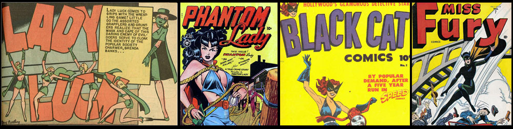

Paralelo a isso, em novembro de 1940, **Ma Hunkel**, uma senhorinha que tinha feito sua estréia em **junho de 1939**, vestiu um ceroulão, uma capa, **pôs uma panela na cabeça** e se tornou a **Tornado Vermelho** original, na verdade uma sátira ao gênero dos heróis fantasiados. Até antes dos **Novos 52**, Ma Hunkel ainda era governanta/zeladora da sede da SJA. Detalhe bizarro? Como Tornado Vermelho, Ma Hunkel **se passava por homem**! (em maio de 1940, tinha estreado a *Madam Fatal*, na verdade um ator que se vestia de mulher pra combater o crime)

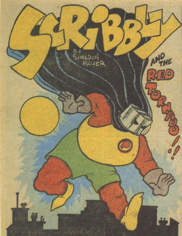

Também participaram da festa desses primeiros anos as *Garotas da Vitória*, aventureiras e vigilantes ligadas diretamente ao conflito que, **naquele momento**, de global só tinha a Eurásia. Era o caso da *War Nurse* (da Harvey Comics) e da *Pat Patriot* (da Lev Gleason Publications). Em comum, elas tinham o patriotismo e o envolvimento na ainda distante guerra contra o Eixo.

Entretanto, assim, sem ninguém se dar conta, em janeiro de 1940 estreava aquela que um ano e meio depois, se tornaria a **primeira super-heroína** dos quadrinhos: ninguém menos que **Shiera Sanders**, a mocinha das histórias do Gavião-Negro! Entre janeiro de 1940 e julho de 1941, ela era uma **mocinha em apuros comum**, como uma Lois da vida. Mas naquele mês de julho… Criada (em 1940) por Gardner Fox e Dennis Neville, foi sob o traço de **Sheldon Moldoff** que ela recebeu um traje “semelhante” ao do namorado, **com asas capazes de fazê-la voar**! Como a **Mulher-Gavião** (*Hawkgirl*), Shiera foi a primeira personagem a aliar poderes sobre humanos (voar), a um uniforme heroico e identidade secreta! Tava nascida a primeira super-heroína dos quadrinhos!

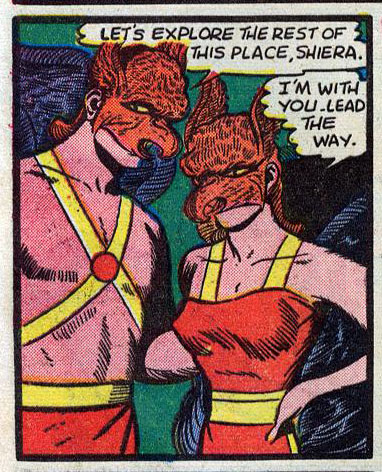

*“Ah, mas ela não passava da versão feminina do Gavião Negro! Não conta!”* pode ser que você, leitor esperto, mimimize.  
Não que eu concorde com a sua opinião ou ache que ela valha qualquer coisa, mas vamos considerá-la, momentaneamente, pro post render mais um pouquinho.

No mês seguinte à Mulher-Gavião cruzar os céus, duas *“Victory Girls”* interessantes surgiram: a *Miss America* e a *Miss Victory*. A primeira, pela Quality Comics, era Joan Dale, uma repórter que, tendo **sonhado com a Estátua da Liberdade ganhando vida** (é sério!), recebeu dela poderes para fazer o bem. Joan podia levitar, transmutar e manipular objetos, entre outras coisas. Entretanto, ela a princípio não tinha **uniforme**: nas primeiras aventuras, limitava-se a transmutar a roupa para dificultar sua identificação, **cada vez numa roupa diferente**. A outra, *Miss Victory* (da Holyoke Comics), era na verdade Joan Wayne, uma estenógrafa cansada de ver os políticos corruptos se dando bem. Munida de um uniforme, ela decide ajudar o FBI a combatê-los. Até aí nada demais, e Miss Victory seria só mais uma “debutante” se não fosse o fato de que, em algumas histórias ela demonstrou ter **super-força** (quebrando paredes a la Capitão América) e **invulnerabilidade** (sobrevivendo a explosões). Se você inviabilizou a candidatura da Mulher-Gavião como primeira super-heroína por ser uma parceira, então, **ZÁZ!** tá aqui a sua candidata.

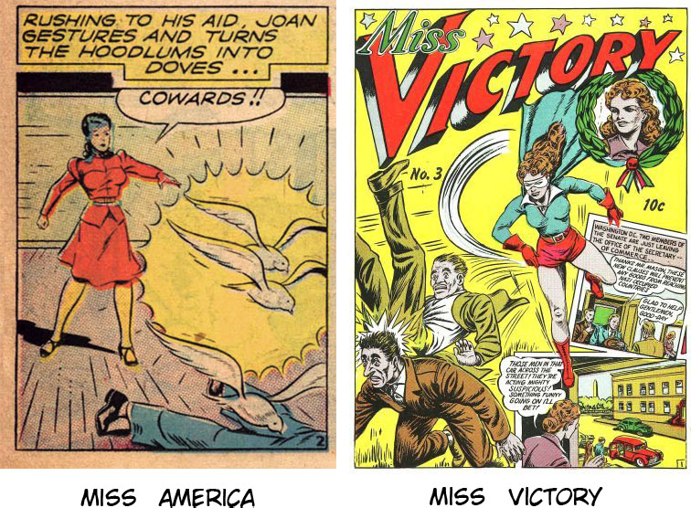

**Tá, mas e a Mulher Maravilha?**

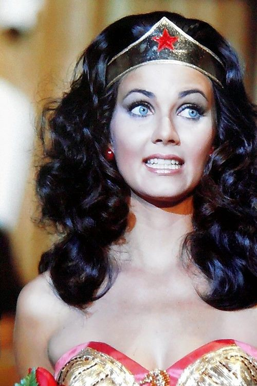

A super-heroína mais conhecida dos quadrinhos fez sua estréia em dezembro de 1941, na edição #8 da *All Star Comics*, da National/DC Comics. Criação máxima de **Charles Moulton** (pseudônimo de William Moulton Marston) e arte de **H. G. Peter**, dividiu a edição de sua primeira aparição com a **Sociedade da Justiça,** os verdadeiros astros da revista. Inicialmente, seu nome seria **“Suprema, the wonder woman”**, mas o editor **Sheldon Mayer** deu uma tamborilada e cortou fora o “Suprema”, que era, evidentemente, uma tentativa de estabelecer uma **relação fonética** com o Último filho de Kripton. Não a toa, em sua primeira aparição no Brasil, no número 2 da revista S.O.S. (Ed. Orbis, década de 1950) a princesa amazona foi chamada de **Super-Mulher**. Na verdade, Moulton tinha a **intenção deliberada** de criar um Superman de saias. Nas palavras dele, a Mulher Maravilha era **“uma personagem feminina com toda a força do Superman além de todo o fascínio de uma mulher bondosa e bonita”**, criada para funcionar como uma “propaganda psicológica” para o tipo de mulher que ele acreditava, deveria governar o mundo. Afinal de contas, Marston acreditava que as mulheres deveriam governar o mundo, pois são mais propensas ao amor e, **somente sob o domínio do amor é que a humanidade poderia ser feliz**. Se isso funcionou ou não, nunca poderemos afirmar com certeza, mas que no fim ele criou aquela que pode até não ser a primeira super-heroína, mas pelo menos **é a mais famosa**, isso ele fez…

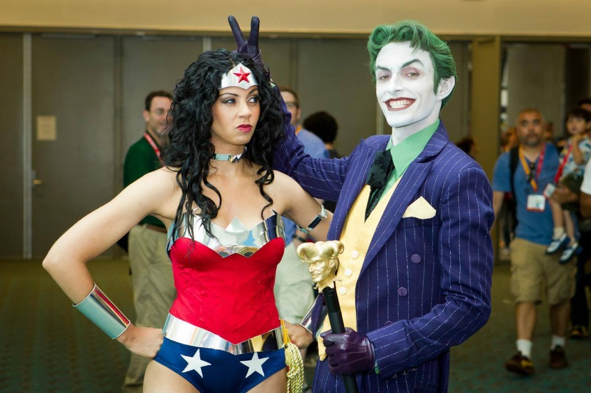

**Ficou curioso?** Quer saber mais? Então tome três sugestões de livros bacanas sobre as super-heroínas, a Mulher Maravilha e as mulheres nos quadrinhos (sim, eu copiei e colei da minha pesquisa essa parte):  
\* Greenberger, R. (2010). **Wonder Woman – Amazon. Hero. Icon.** New York: Universe Publishing.  
\* Madrid, M. (2009). [**Supergirls: the fashion, feminism, fantasy, and the history of comic book heroines.** San Francisco: Exterminating Angel.](http://www.amazon.com.br/The-Supergirls-Fashion-Feminism-Heroines-ebook/dp/B0097D7H4I/ref=sr_1_1?ie=UTF8&qid=1394139402&sr=8-1&keywords=Supergirls%3A+the+fashion%2C+feminism%2C+fantasy%2C+and+the+history+of+comic+book+heroines)  
\* Oliveira, S. (2007). [**Mulher ao Quadrado – As Representações Femininas nos Quadrinhos Norte-Americanos: Permanências e Ressonâncias (1895-1990)** . Brasília: UnB.](http://www.submarino.com.br/produto/6812731/livro-mulher-ao-quadrado?franq=134253) (**Ignorem a metodologia questionável**)

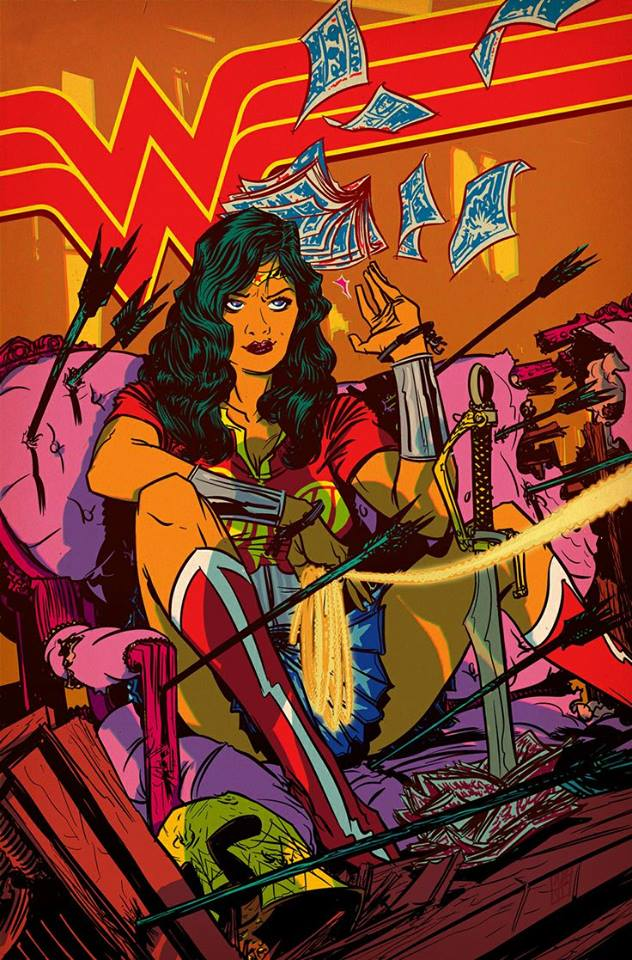

The following two tabs change content below.

#### Poderoso Porco

Poderoso Porco, o herói de milhões (e que também é filantropo, ilustrador, psicólogo social, playboy, digo, leitor da Playboy...)!
