# [ELEVEN YEARS OF MJLO KUNG FU FAMILY! (11 ANOS DE FAMILIA MOY JO LEI OU!)](http://moyfatlei.blogspot.com.br/2014/03/eleven-years-of-mjlo-kung-fu-family-11.html)

Posted by
BLOG DO PEREIRA
Friday, 14 March 2014

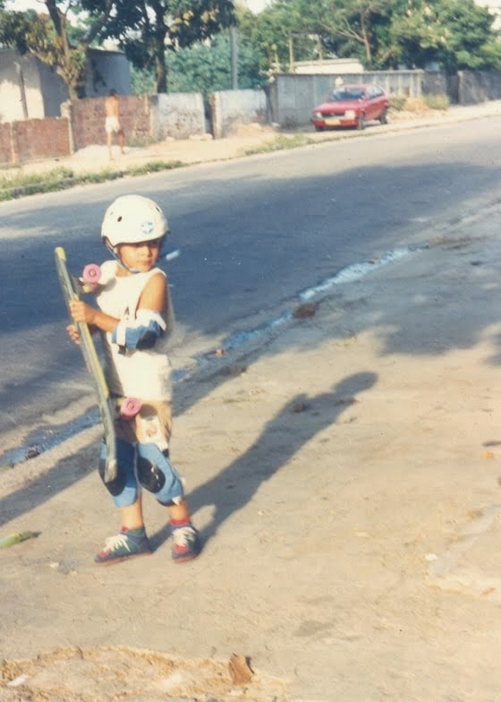

LEIA O POST ABAIXO OUVINDO ESSA MUSICA: ([AQUI](https://www.youtube.com/watch?v=LCRU5dl8lSE))

READ THIS POST LISTENING TO THIS SONG([HERE](https://www.youtube.com/watch?v=LCRU5dl8lSE))

*Você pode não acreditar, mas no dia 12 de Outubro de 1989(foto) eu lembro de ter acordado muito cedo.* 

[**](http://1.bp.blogspot.com/-wIiXZ2B7Gug/TxtZfLPbddI/AAAAAAAAR5o/USJE-llyVfU/s640/DSC_0126.JPG)

*Ainda estava amanhecendo e eu mal podia esperar para ganhar o presente que tanto esperei. Meu pai num momento de brincadeira me disse que não tinha conseguido comprar nada além dos dois bonecos(foto ao lado) do Gordo e o Magro que você apertava e fazia barulho. Olha, eu comecei a chorar com os bonecos na mão apertando-os e fazendo barulho, e ele saiu do espírito de brincadeira e logo trouxe o meu tão sonhado skate com capacete, joelheiras e cotoveleiras.*  
*Descemos imediatamente pra rua para que eu andasse nele. Eu tinha um único plano em mente desde o início de Outubro: Descer minha rua de skate até a casa do meu avô. Assim que saímos pelo portão do 386 da Vieira do Couto em Rocha Miranda. Botei meu skate na rua, sentei em cima e quando ia pegar impulso meu pai saltou como um felino e agarrou meu braço...  Lá ia meu plano por água abaixo...*  
*Chorei bastante porque eu tinha certeza que era completamente viável, descer na contra-mão de uma das ruas mais movimentadas sentado no meu skate com 5 anos. Mas meus pais não entenderam meu plano...*  
*You may not believe , but on October,12. 1989 ( photo ) I remember waking up very early .*  
*It was still dawn and I could not wait to receive the gift that much waited . My father in a moment of jest told me he had not been able to buy anything besides the two dolls ( photo above in the left) Laurel and Hardy wich you pressed and made ​​noise . Man, I started to cry with the dolls in hand squeezing them and making noise , and my dad came out of the spirit of joking on me and soon brought my dreamed skateboard with helmet, knee and elbow pads .*  
*Immediately we went downstairs to the street so I could ride on it . I had one plan in mind from the beginning of October : Ride downstreet on my skate to my grandfather's house . So were there,out of 386 Vieira Couto Street where we used to live, in front of our doors in Rocha Miranda . I put my skateboard on the street, sat on it and when I was read to go my father like a cat jumped and grabbed my arm ... There went my plan down the drain ...*  
  
*I cried a lot because I was sure it was completely feasible , ride down the street to one of the busiest streets sitting on my skateboard. But my parents did not understand my plan ...*

**ANIVERSÁRIO DA FAMÍLIA MOY JO LEI OU**

**MOY JO LEI OU FAMILY ANNIVERSARY**

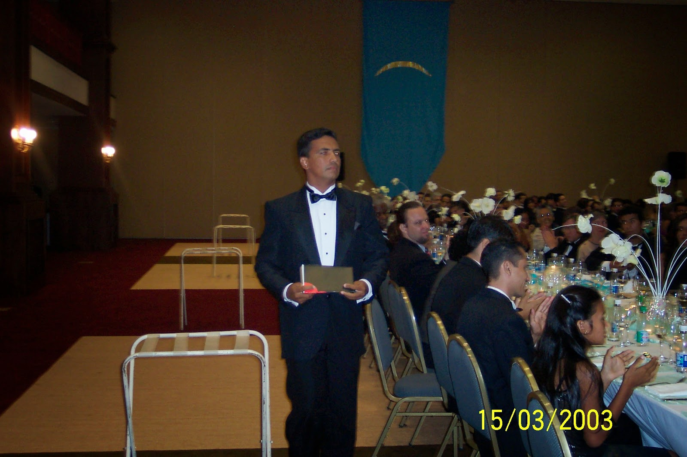

*Eu estava sentado na ponta de uma das enormes mesas com quase 600 convidados que se reuniram de todas as partes do Brasil e do mundo para celebrar o aniversário de 40 anos de Si Gung Leo Imamura, do lançamento do Programa Moy Yat Ving Tsun de Inteligência Marcial e também, para a titulação dos primeiros Mestres Qualificados pela Moy Yat Ving Tsun no Brasil. Dentre eles:*  
*Si Fu(foto).*  
*Ele caminhava com o semblante determinado dele que eu sempre fui acostumado a ver, mas parecia já querer chorar antes mesmo de chegar ao palco onde seus irmãos Kung Fu mais velhos(Si hing)já tinham estado, e seu Si Fu e Si Mo o aguardavam para lhe entregar os elementos de sua qualificação.*  
  
*I was sitting on the edge of one of the huge tables with almost 600 guests who gathered from all parts of Brazil and the world to celebrate the 40th birthday of Si Gung Leo Imamura, the launch of the Moy Yat Ving Tsun Martial Intelligence Program and also, for the Qualification of the first Masters rated by Moy Yat Ving Tsun in Brazil. Among them:*  
*Si Fu (photo above).*  
*He walked with that strong eyes of him that I've always been used to seeing, but he seemed also want to cry before he even get to the stage where his older Kung Fu brothers (Si hing) had already been, and his Si Fu and Si Mo awaited to deliver the elements of his qualification*

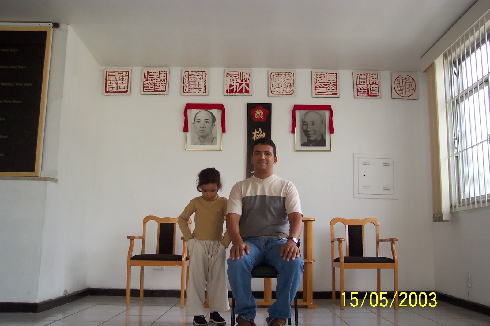

No dia 15 de Maio de 2003, dois meses depois, a ainda pequenininha Jade(foto) tirava a primeira foto oficial "Si Fu-To Dai' com seu pai, o agora Si Fu Julio Camacho. Mas Jade parecia estar mais preocupada em achar algo em seus bolsos. Atrás deles, o Jiu Paai da Família Moy Jo Lei Ou já no Mo Gun.  
  
On May 15, 2003, two months later, the still tiny Jade (photo) took the first official photo "Si Fu-To Dai" with her father, now also Si Fu Julio Camacho. But Jade seemed to be more concerned with finding something in her pockets. Behind them,was the  Jiu Paai of our Family Moy Jo Lei Ou already in Mo Gun.

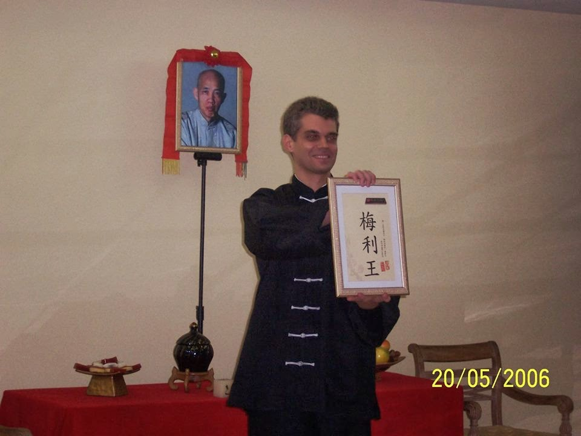

Em 20 de Maio de 2006, três anos depois, o primeiro discípulo da Família Moy Jo Lei Ou a ser aceito por Si Fu: O irmão mais velho dos irmãos mais velhos(Daai Si Hing) de nossa Família Kung Fu: Leonardo Reis... Alguém que não necessita de apresentações e é uma fonte de inspiração técnica para todos.  
  
On May 20, 2006, three years later, the first disciple of Moy Jo Lei Ou Family to be accepted by Si Fu: The older brother of older brothers (Daai Si Hing) of our Kung Fu Family of: Leonardo Reis .. . Someone who needs no introduction and is a source of inspiration for all of us

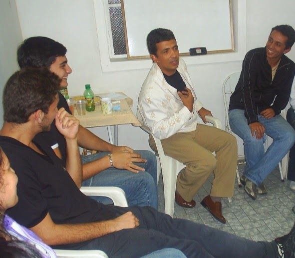

Já em 2008, Si Fu fez sua primeira visita a uma cozinha desativada de uma escola de dança no Méier onde eu prossegui um trabalho iniciado por Si Sok Ursula com o Ving Tsun. Si Fu falou naquele dia para 14 pessoas. Dentre elas a dona do local, responsáveis e praticantes. Todos sob a minha responsabilidade.  
Si Fu pela primeira vez, tinha alguém cuidando de membros e aspirantes a membro de sua Família numa Unidade avançada...  
  
In 2008, Si Fu made ​​his first visit to a disused kitchen of a dance school in Meier neighborhood where I continued the work begun by Si Sok Ursula with the Ving Tsun.  
Si Fu made a lecture that day for 14 people. Among them the owner of the place, and parents and practitioners. All under my responsibility.   
Si Fu for the first time, had someone who was looking out for members and aspiring member of his kung fu family  at an advanced site ...

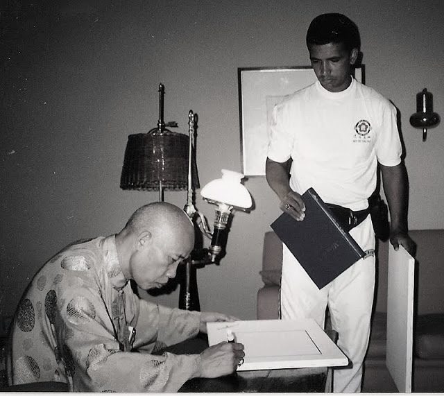

(Si Fu recebendo um presente de Si Taai Gung Moy Yat)

(Si Taai Gung Moy Yat preparing a gift to Si Fu)

Si Taai Gung Moy Yat certa vez deu uma palestra que acabou sendo filmada, e nós tivemos o prazer de assistir em 2012 no Núcleo Méier. Nela, ele falava sobre Siu Nim Tau. O primeiro Domínio do Sistema Ving Tsun. Ele traduzia "Siu Nim Tau" como "*Relembrar o início*"...  Ele disse algo como você sempre preservar a pureza de quando você começou...  Como quando estava no Siu Nim Tau...  
  
Si Taai Gung Moy Yat once gave a lecture that was eventually filmed, and we had the pleasure of watch in 2012 at the MYVT Meier School. In it, he talked about Siu Nim Tau. The first domain of the Ving Tsun system. He translated "Siu Nim Tau" as "Remember the beginning" ... He said something like: you must always preserve the purity of when you started ... Like when you were in Siu Nim Tau...

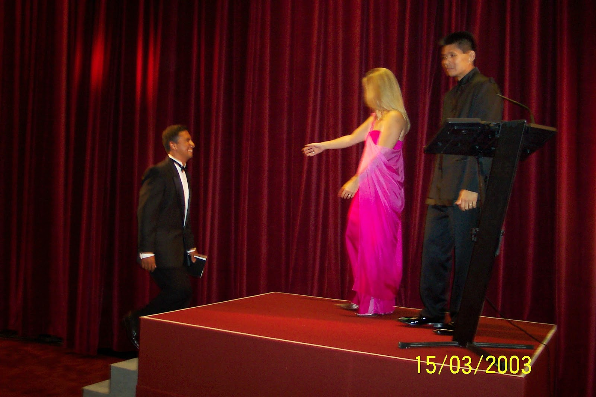

*Todos observaram Si Fu subir ao palco onde Si Taai abriu os braços para recebê-lo. Ele estava com um sorriso no rosto e muito emocionado.*  
*Everyone watched Si Fu onstage where Si Taai opened her arms to welcome him. He was with a smile and very emotional.*

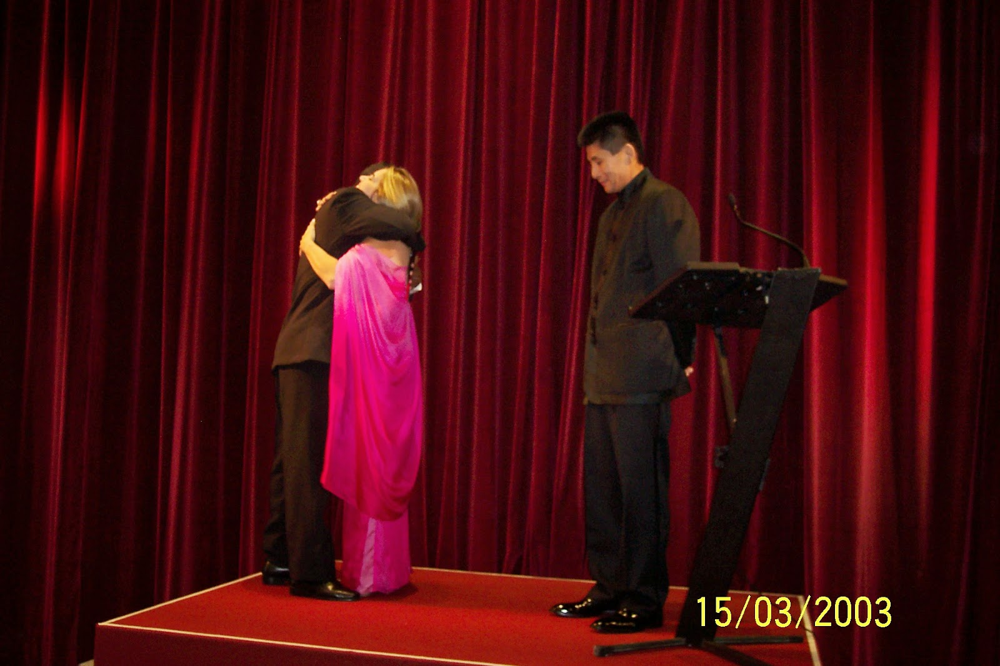

*Si Taai o abraçou forte. Era o fim de uma etapa iniciada em 1992 quando Si Fu foi admitido na*  
*Família Moy Yat Sang. Algumas pessoas do Núcleo Jacarepaguá, que Si Fu dirigia na época já começavam a sentir os olhos marejados..*  
*Si Taai embraced him strongly. It was the end of an era started in 1992 when Si Fu was admitted to the**Moy Yat Sang Family. Some people from the MYVT School that he ran at the time, were with tears in their eyes already...*

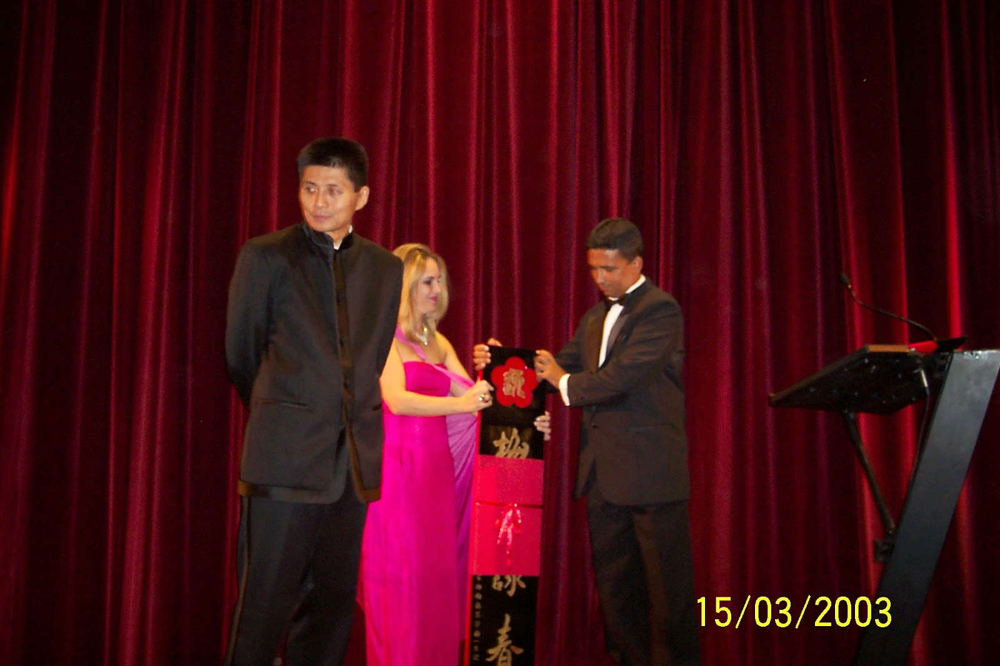

*Das mãos de Si Taai, Si Fu recebeu o Jiu Paai da Família Moy Jo Lei Ou. O símbolo de legitimidade para sua condição como Si Fu reconhecida por Si Gung e por ela própria.*  
*From the Hands of  Si Taai, Si Fu received the Jiu paai for the Moy Jo Lei Ou Family. The symbol of legitimacy for his condition as recognized Si Fu by Si Gung and Si Taai.*

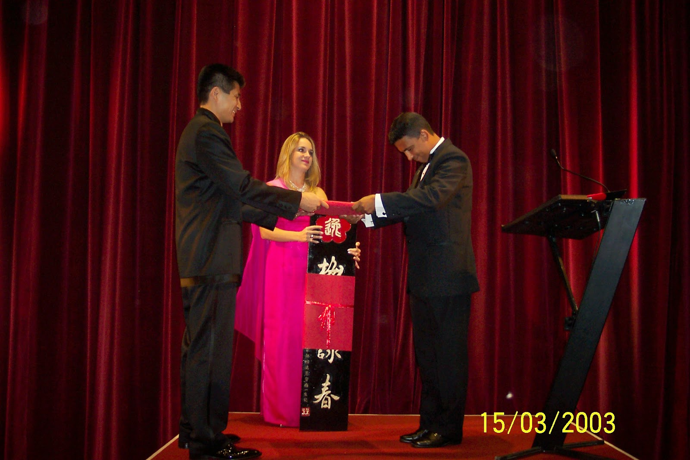

*Das mãos de Si Gung , Si Fu recebeu seu certificado assinado por ele, por Si Taai, por Si Taai Po Helen Moy e algumas das maiores autoridades do Mo Lam dando a anuência para sua qualificação como Mestre...*  
*And from the hands of Si Gung , Si Fu received his certificate signed by him, Si Taai, Si Taai Helen Moy Helen and some of the leading authorities from the Mo Lam giving consent for his qualification as Master ...*

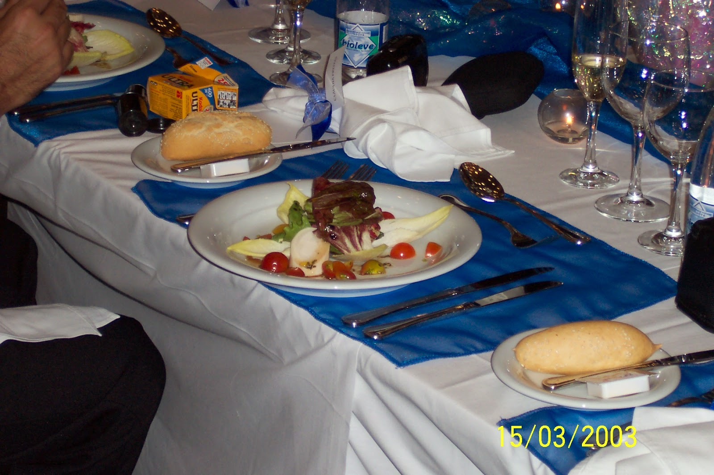

*Eu desviei o olhar pra mesa. O jantar era muito requintado, mas eu estava com muita fome e aqueles vegetais divinamente arrumados no prato, não me encheriam de forma alguma. Então eu abri o pão francês, passei manteiga e coloquei alguns dos vegetais dentro..  Isso deu pra aliviar...*  
*I looked away to the table. The dinner was very fine, but I was very hungry and those vegetables divinely arranged on the plate, does not fill me somehow. Then I opened the  bread, I put some butter and vegetables in. .. This was enough for myself ..*

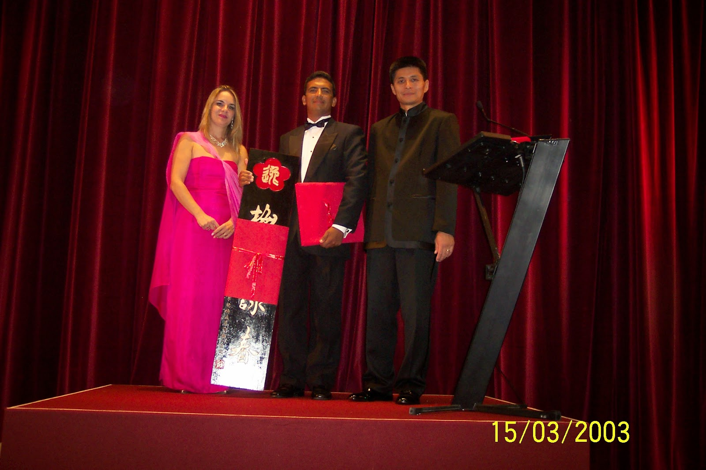

*Quando levantei meu olhar, Si Fu estava posando para a foto oficial daquele momento. Eu estava bem perto. Na época não consegui ver, que aquele momento, era a cristalização de uma longa batalha iniciada muitos anos antes. Na qual só aquelas três pessoas ali em cima do palco sabiam.*   
*Ser um estudante de medicina e residente é socialmente aceitável... Mas ser um estudante de Ving Tsun e levar isso como profissão pode ser uma batalha diária...*  
*When I raised my eyes, Si Fu was posing for the official photo of the moment. I was pretty close. At the time I could not see, that moment was the crystallization of a long battle started many years before. In which only those three people over there on stage knew.*  
  
*Being a medical student and a resident doctor is socially acceptable in Brazil ... But being a student of Ving Tsun and take it as a profession can be a daily battle ...*

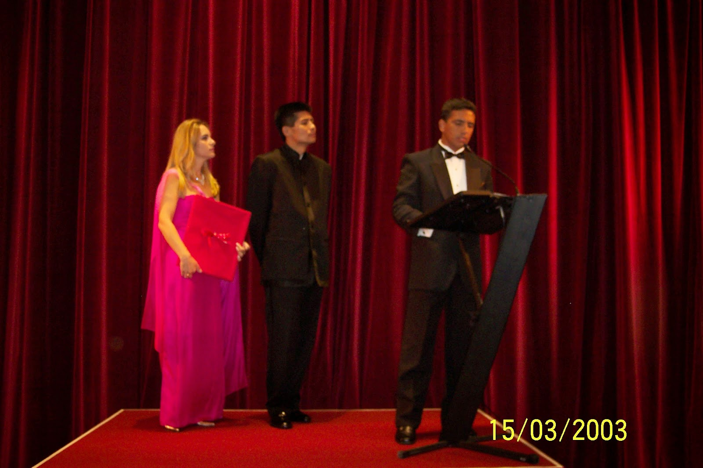

*Honestamente, não lembro de uma palavra sequer que Si Fu disse naquele dia. Mas hoje me pergunto , quantas vezes ele não foi visto como um garotinho sentado num skate achando que era possível descer sua rua na contra-mão até aquele momento... E que se ele não tivesse continuado acreditando que era possível, ele não estaria ali... Porque como disse Si Taai Gung Moy Yat: "É importante lembrar da pureza do início"...*  
*I honestly do not remember a word that Si Fu said that day. But now I wonder, how often he was not seen as a little boy sitting on a skateboard thinking it was possible to go down his street  until that moment ... And if he had not continued believing it was possible, he would not be there Because as I said ... Si Taai Gung Moy Yat said: "It is important to remember the purity of the beginning" ...*

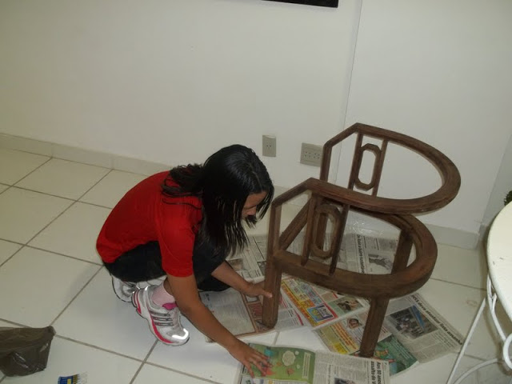

*E quando ele parecia ter alcançado o auge naquele discurso, era só o início de uma nova etapa. Uma etapa onde ele teria que entender como líder de Familia Kung Fu, a como lidar com sua filha Jade(foto) que se tornou também sua To Dai.*  
  
And when he seemed to have reached the pinnacle in that speech, it was only the beginning of a new era: A stage where he would have to understand how leading a Kung Fu Family,and  how to deal with his daughter Jade (photo above) who also became his To Dai.

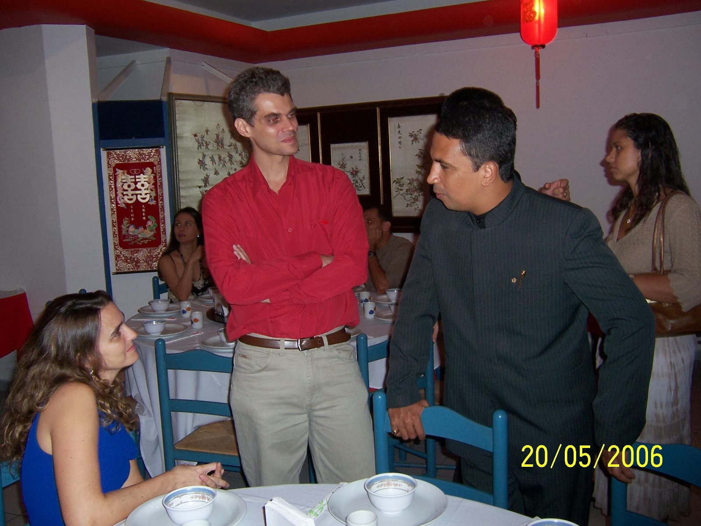

*Criar  vínculos vitalícios com praticantes fora-de-série como Si Hing Leo Reis(foto)  ,um Daai Si Hing desse calibre , além de outros discípulos tão incríveis quanto ele, e fortalecer cada vez mais nossa*  
*Família Kung Fu.*  
*Understand how to Create lifelong bonds with practitioners  as Si Hing Leo Reis (photo), a Daai Si Hing of such caliber, and other disciples so awesome as he is, and increasingly strengthen his*  
  
*Kung Fu Family.*

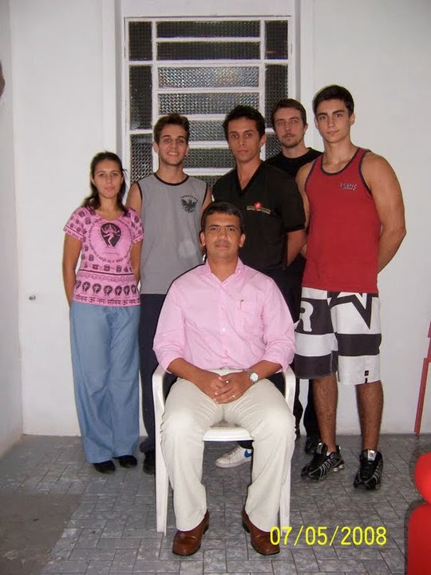

*E de toda vez que chegasse numa cozinha desativada bem pequena e apertada, que ainda tinha um sofá* 

*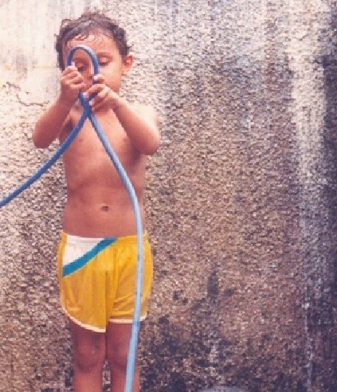*

*enorme dentro(foto acima), onde toda a semana eu coordenava práticas de Ving Tsun em seu lugar. Me fazer lembrar de alguma forma , que assim como quando eu acreditei que com 5 anos era possível descer uma rua sentado num skate, ou que quando eu apertava a saída de água da borracha(foto a esquerda) enquanto tomava banho com a mesma idade , via surgir imediatamente a espada do Jaspion em minhas mãos...  Eu poderia olhar para aquela cozinha....*  
  
And every time he went to that old kitchen very small and tight, wich still had a huge sofa inside (photo above), where I coordinated weekly of practice of Ving Tsun in his place. He had to make me remember somehow that  as when I believed I when I was 5 years old , I could sit down on my skateboard and ride down street, or that when I squeezed the water out of the rubber (photo left) while I was taking a bath at the same age,  for me a sword used to appears in my hands ... I could also look at that kitchen ....

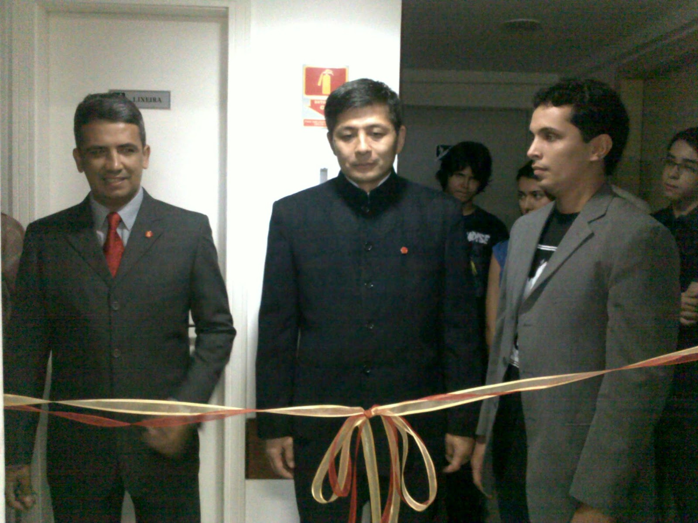

*E ver um Mo Gun da Família Moy Jo Lei Ou nascer no Méier(foto).*  
*Por isso que em 15 de Março de 2014, posso dizer que comemoramos 11 anos de Kung Fu de um homem que acreditou em sua visão. E Onze anos de uma Família Kung Fu liderada por esse mesmo homem, que agora inspira seus seguidores a acreditarem em suas próprias visões... E nunca se esquecerem da pureza de seu início...*  
*And see a Mo Gun of  Moy Jo Lei Ou Family born in Meier neighborhood (photo).*  
  
*So , now March 15, 2014, I can say that we celebrate 11 years of Kung Fu from a man who believed in his vision. And another Eleven years of a Kung Fu Family led by the same man who now inspires his followers to believe in their own views ...and never ever forget the purity of their begining*

**THE DISCIPLE OF MASTER JULIO CAMACHO**  
**Thiago Pereira "Moy Fat Lei"**  
**moyfatlei.myvt@Gmail.com**
