Até a medicina alcançar o ponto que conhecemos hoje, muita coisa foi experimentada. E não é exagiro dizer que tudo era muito bizarro naquela época. Confira alguns destes tratamentos.  

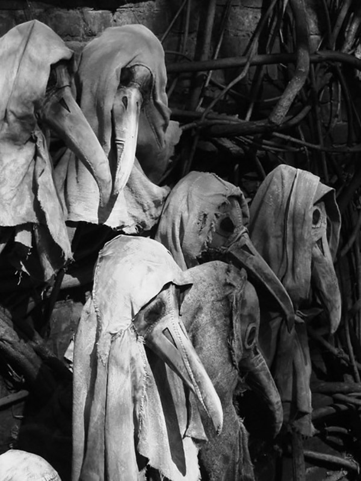

# Médicos usando máscaras contra a Peste Negra. Os bicos serviam para armazenar substâncias aromáticas.

   
   
   
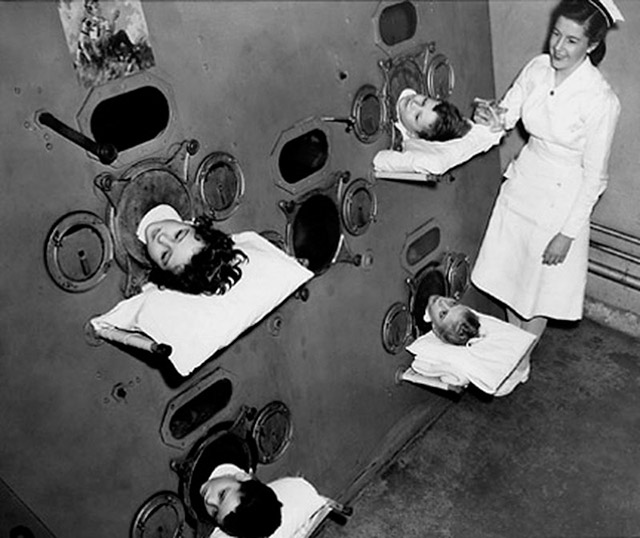

# Crianças em espécie de pulmão de aço para tratamento da poliomielite, em 1937. Naquela época, não existia vacina.

   
   
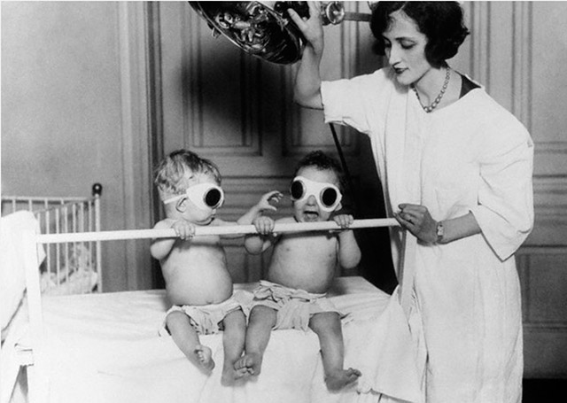

# Aparelho para bronzear bebês e compensar o raquitismo, em 1925.

   
   
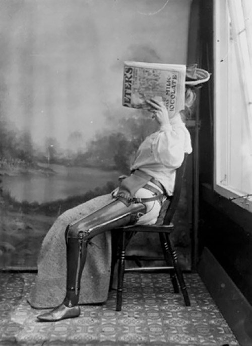

# Perna artificial, em 1890.

   
   
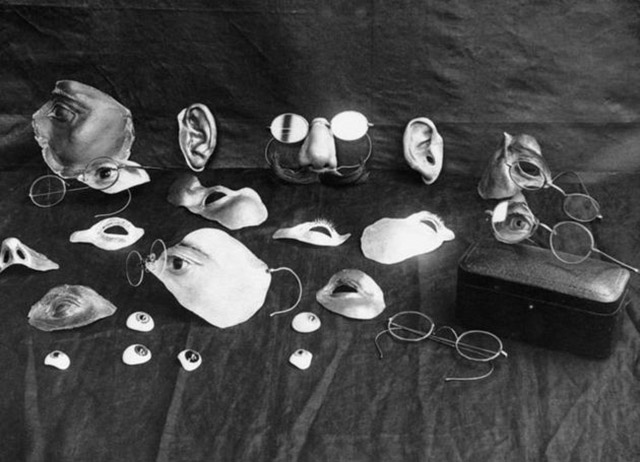

# Peças que disfarçavam lesões faciais.

   
   
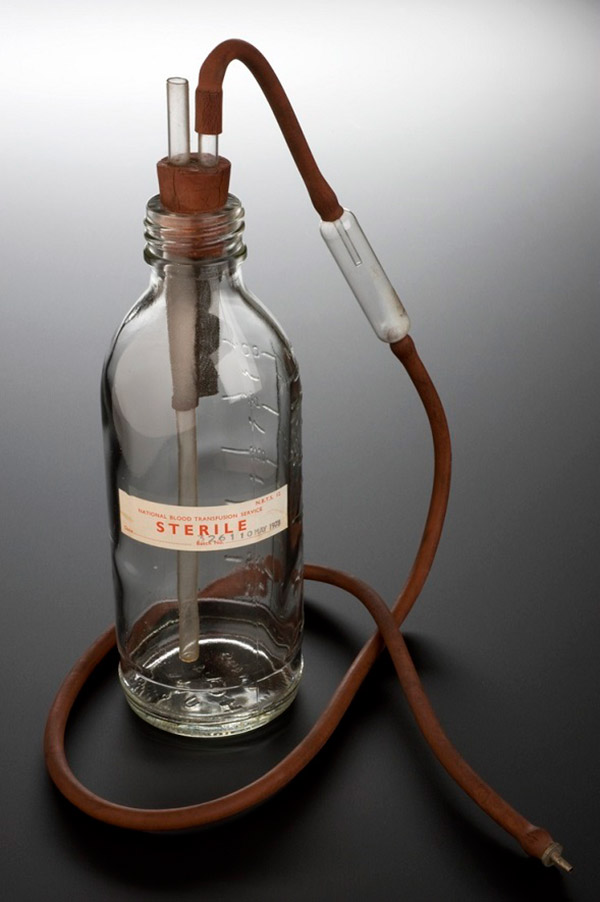

# Aparelho que servia para fazer transfusão de sangue, em 1978.

   
   
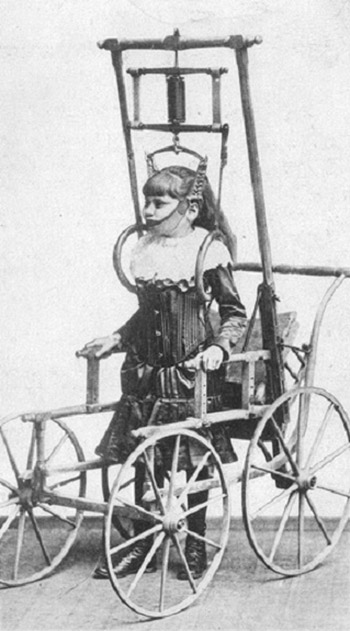

# Equipamento para correção da coluna vertebral, em 1878.

   
   
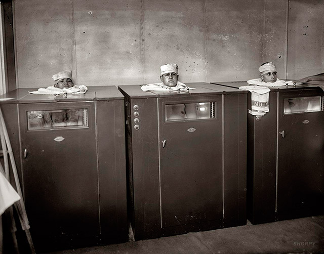

# Equipamento para fisioterapia, nos anos 20.

   
   
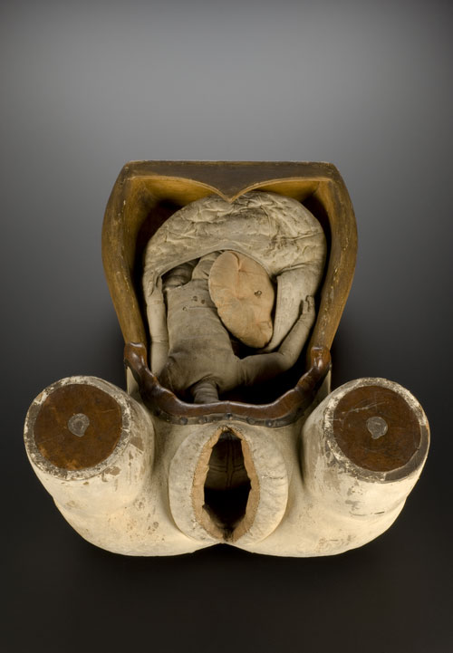

# Manequim usado para ensinar alunos sobre o parto.

   
   
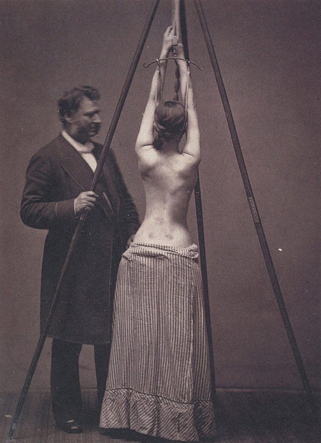

# Tratamento de escoliose.

   
   
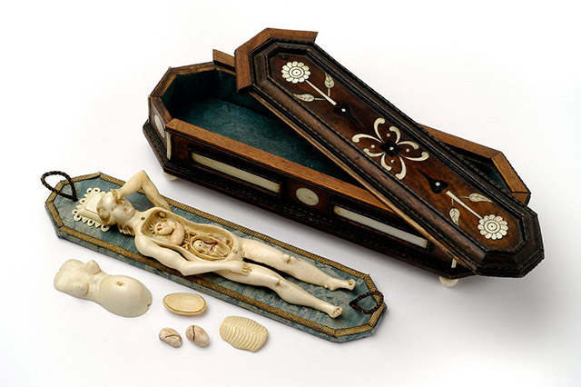

# Modelo para estudo do corpo das mulheres. Naquela época, não podiam tocá-las.

   
   
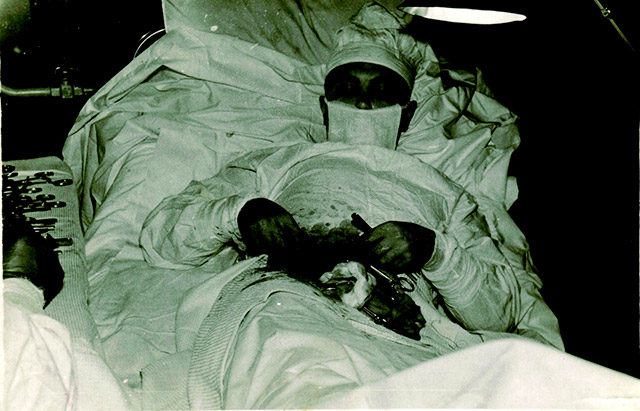

# Leonid Rogozov, o médico que realizou cirurgia nele mesmo, em 1961.

   
   
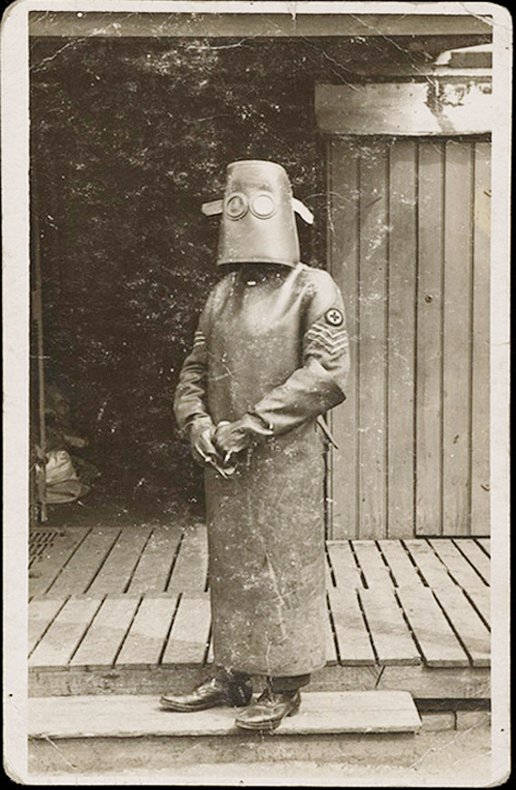

# Roupa de radilogista, em 1918.

   
   
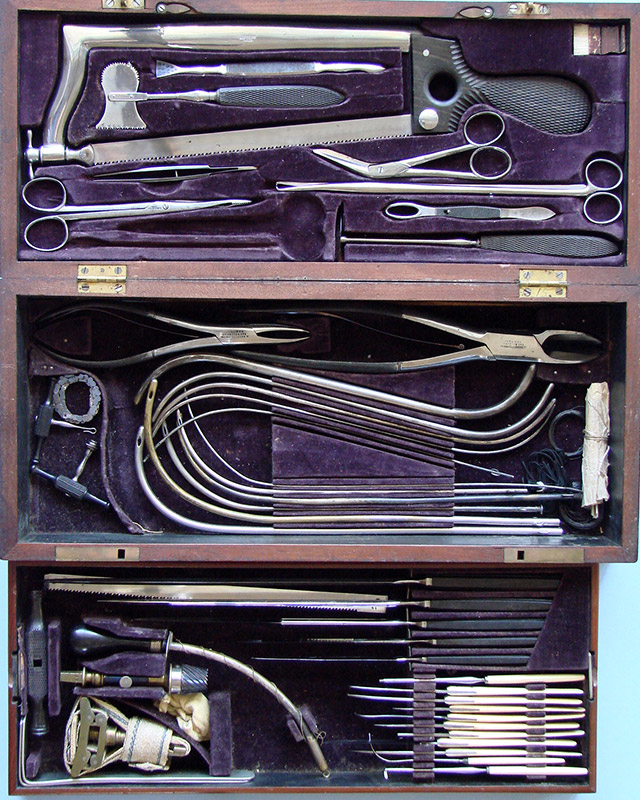

# Kit de cirurgiões da Guerra Civil dos Estados Unidos.
