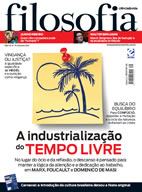

# No Mundo da Mutação

Publicado na revista *Filosofia-Ciência e Vida*, n.79, 2013

Já de início, é difícil falar de um único pensamento chinês; existem, na China, pensamentos, escolas que reinterpretam uma antiga estrutura de pensar. Abordar o mundo da filosofia chinesa fazendo uma análise generalizante seria, portanto, um grande equívoco. Por outro lado, existe um sistema fundador, que alicerça o surgimento das diversas escolas chinesas. É a ele que nos ateremos, hoje, para compreender um pouco melhor os chineses construíram suas formas de pensar.

Não se sabe ao certo quando esse sistema ancestral surgiu; a princípio, ele parece ter sido descrito em torno do século -12, com o surgimento do Tratado das Mutações – o Ijing 易经. Mesmo assim, o Ijing informava que ele havia surgido bem antes, em torno do -3º milênio. Dúvidas a parte, a versão de que dispomos do Ijing é aquela coligida por Confúcio 孔夫子no século -6. Diante da aceitação geral dos pensadores chineses sobre a versão confucionista do Ijing, somos inclinados a pensar que havia certa concordância intelectual e histórica sobre o seu conteúdo e proposições.

E o que propunha essa antiga estrutura de pensar dos chineses? Uma forma de leitura do mundo. O que se apresenta no Ijing, no qual nos basearemos, é uma tentativa de conceber e compreender as leis pelas quais a natureza operava, ajustando-se a elas em busca do equilíbrio. No passado distante, os chineses conceberam uma cosmologia fundadora, sobre a qual as escolas posteriores desenvolveriam suas interpretações e propostas.

I (Yi) **易** - Vivendo no mundo da Mutação

Para os chineses antigos, vivemos num mundo em constante transformação, o mundo ‘material’. Esse mundo é o mundo da mutação, das sensações. Ele é regido por ciclos e padrões. Os ciclos repetem-se notempo (Shi时, séculos, anos, estações dos anos, dias e noites), os padrões repetem-se no espaço e nas coisas (Wu物- espécies animais, vegetais e naturais, morfologia). Todas as coisas têm um ciclo: eles surgem (nascem), existem (vivem), se transformam (desenvolvem) e desaparecem (perecem). Nada é: tudo existe, em constante dinamismo e interação. Contudo, se tudo é mutável, como poderiam existir ciclos e padrões constantes? A mutação é constituída, pois, de uma relação de oposição complementar (Taiji 太极) entre Princípio (Li理) e Matéria (Qi氣).

Li理 – Estrutura, princípio gerador

Para existirem ciclos e padrões, é necessária constância. Li é a ‘lei da natureza’, que determina a existência de um padrão de manifestação. Algo só pode pertencer a uma Categoria X se dispuser de uma série de elementos que a qualifiquem para tal. Esse conjunto de propriedades (‘Ben’本, ou Raiz) é o que determina um tipo X de princípio. Exemplo: determinamos que certa planta pode ser uma árvore por um conjunto de características morfológicas que aproximam a espécie em estudo de outras árvores. Logo, essa planta tem o mesmo Li das árvores, podendo ser classificada como tal. Li, porém, gera outros múltiplos Li’s derivados, que se cruzam gerando coisas novas – tais como cruzar plantas para gerar espécimes novos. Os limites desses cruzamentos são dados pela Matéria (Qi). Como os princípios se manifestam na mutação, ele mantém um certo padrão, mas suas manifestações são sempre diferentes umas das outras. Não há, por exemplo, dois seres iguais, nem mesmo duas pedras iguais. O mundo da mutação é variável, pois é uma propriedade da matéria bruta (Qi) ser plástica, moldável e inconstante.

Qi 氣– Energia, matéria

Qi é o ‘vapor’, a matéria primordial, que em seu estado bruto se encontra na forma de ‘energia’. Ela se condensa de maneiras variadas. As formas básicas pelas quais ela se manifesta são as tendências da natureza (chamadas no Ijing de oito Gua 卦), simbolicamente apresentadas como Céu, Terra, Fogo, Água, Trovão, Lago, Montanha e Vento. Essas tendências são formadas pelas coordenadas Yang 阳 e Yin阴, que designam o que uma coisa está em oposição ao que não está. Elas geram as categorias pelas quais as tendências da natureza podem ser classificadas – no Ijing, representadas pelos hexagramas formados pela combinação dessas coordenadas.[1](https://mail-attachment.googleusercontent.com/attachment/u/0/?view=att&th=13a66db68cd4542f&attid=0.1&disp=vah&realattid=file0&safe=1&zw&saduie=AG9B_P8aZQVoe7kpJupSx02_tN6w&sadet=1394906191622&sads=fq4wiCT90K6KF8q3P3ORajGISxs#0.1_footnote1) Do mesmo modo, Qi se agrega, inicialmente, nos cinco estados da matéria (Wuxing 五行), indicados como madeira, metal, água, fogo e terra.[2](https://mail-attachment.googleusercontent.com/attachment/u/0/?view=att&th=13a66db68cd4542f&attid=0.1&disp=vah&realattid=file0&safe=1&zw&saduie=AG9B_P8aZQVoe7kpJupSx02_tN6w&sadet=1394906191622&sads=fq4wiCT90K6KF8q3P3ORajGISxs#0.1_footnote2) Como se pode notar, Li e Qi formam a oposição complementar geradora das coisas, que se manifestam constituindo o Mundo da Mutação, Yi.

Taiji太极– Oposição Complementar

O sistema de oposição complementar (Taiji) mostra que as coisas se manifestam de modo duplo. Tudo que passa a ‘existir’ (‘estar’, Zai 在) é percebido por algo que se opõe ao que é igualmente percebido. Exemplo: se concebe o claro porque há escuro; se concebe uma cor em contraste com outras cores; o inverno se ‘opõe’ ao verão, etc. As coisas passam a ‘estar’ no mundo da mutação quando são identificadas. De certo modo, pois, tudo já existe; mas certas coisas ainda não ‘estão presentes’, precisando ser descobertas ou concebidas. Taiji representa a articulação entre tempo (ciclo) e espaço (padrão), suas conjugações e alternâncias. Ambos se engendram mutuamente e continuamente. O mundo da mutação busca o ajuste constante entre yang e yin; quando um se excede, o outro o compensa; quando um se eleva, o outro decresce. Isso proporciona uma cosmologia criativa que nunca finda, e que se reproduz incessantemente.

Shi 勢– propensão

Todas as coisas se manifestam pela oposição complementar, e se condensam na matéria em um dos cinco estados (Wuxing 五行). Como cada manifestação é única, cada uma delas possui certa especificidade, que a distingue das outras. Contudo, elas surgem dentro de um padrão que permite identificá-las numa mesma categoria (Bem 本, ou Raiz). A combinação de ambos – princípio e mutação – gera a propensão. Exemplo: a Madeira pode ser talhada, mas não derretida; e a propriedade que torna algo ‘Madeira’ é a impossibilidade de ser derretida, aproximando-a e afastando-a de outras coisas; do mesmo modo, há arvores boas para serem talhadas, e outras mais difíceis; portanto, todas podem ser talhadas, mas variam entre si; por fim, elas podem ser da mesma espécie, tipo, mas variam de qualidade e dimensão. Essa combinação de fatores determina que alguma coisa X tem uma propensão (afinidade) com uma ação Y na mutação. Tal propensão não é determinista ou fatalista; para os chineses, compreender a propensão serve ao ajuste do ritmo (Yun 韵) da existência (‘estar no mundo da mutação’). Quando algo está em seu ritmo natural, ela está em estado de equilíbrio no mundo da Mutação.

He和– Harmonia, equilíbrio

Ao perceber as propensões de algo, pode-se determinar seu ritmo ideal. Compreendendo a propensão e seguindo seu ritmo, aproveita-se ao máximo o potencial de algo em relação às leis da natureza. A preservação da vida é um exemplo: descobrindo-se as propensões físicas de um ser, ele pode definir seu ritmo ideal; fazendo isso, ele se ajusta as condições em que se encontra e atinge o equilíbrio entre seu corpo e a natureza. A Harmonia (He和) é o estado em que as coisas encontram-se devidamente equilibradas em suas tendências yang e yin. Esse equilíbrio é dinâmico: como ele se insere no mundo da mutação, deve igualmente acompanhá-la. Não há estado de harmonia perene ou imutável; o ajuste é constante. O desequilíbrio é causado quando a especificidade (propensão) não se ajusta ao ciclo e aos padrões, perdendo ritmo e incorrendo em ausência ou excesso. A sabedoria (Sheng 聖) é a capacidade de acompanhar as mudanças da natureza e ajustar-se a elas, continuamente. Preservar-se, sem interferir de modo excessivo na natureza, constitui o ritmo perfeito que somente o autoconhecimento e o estudo da Mutação podem trazer. Esse é o atributo do sábio: compreender a si mesmo e o mundo que o cerca, diluindo-se no todo. O sábio só age no mundo quando necessário, educando as pessoas sobre o que constitui o sistema da oposição complementar.

Mudanças

Mas no século -6, a China encontrava-se num profundo processo de crise social e política. Segundo Confúcio 孔夫子 (-551 -479), o principal historiador e pensador dessa época, a crise ocorria em função da não aplicação desse sistema nas questões de governo, de economia e de vida comum. Para tanto, era necessário resgatá-lo – ou, reinterpretá-lo. Foi nesse momento que o mundo chinês viu surgirem diversas escolas de pensamento, discutindo e propondo soluções para essa crise e a conseqüente retomada do equilíbrio natural. Foi nesse momento que se começa a utilização constante do termo Dao (Tao), que se tornaria um conceito fundamental no pensar chinês.

Dao 道 (Tao) – Caminho, via, método

A palavra Dao significa um caminho ou método para restabelecer a Harmonia (He) no mundo da mutação. Ela se populariza a partir do século -6, e cada escola proporá uma abordagem diferente – ou, apresentaria seu próprio Dao. Desse período é que surgirão as principais escolas que hoje conhecemos – confucionistas, daoístas, legistas, moístas, cosmológicos, entre outros -, e que formam o complexo panorama dos pensares chineses, cujo desenvolvimento continuou (e continua) a ocorrer até os dias de hoje. Todas partem dos mesmos elementos – a busca do ajuste, do equilíbrio – calcadas nos conceitos aqui discutidos. Isso levará, igualmente, os pensamentos chineses a certas peculiaridades em relação ao ‘pensamento ocidental’, que vale citarmos aqui para compreendermos as profundas diferenças que se estabeleceriam entre eles.

A ausência do verbo ‘Ser’

Como estamos no mundo da mutação, e a propensão busca o ritmo com os ciclos, nada é, mas tudo está. O princípio de algo (seu Li) dá-lhe o padrão, mas ele se governa por sua especificidade – e por isso, a essência de algo não se sobrepõe. Não há necessariamente um sentido na existência; viver é buscar o ajuste para prolongar a própria vida, por exemplo. A regulação da existência por suas leis visa estender a possibilidade de continuidade. Por isso, a especificidade do ‘Ser’ se dilui no contexto da natureza, no qual o indivíduo tem que buscar se integrar para atingir a Harmonia. A princípio, não se pensa em qualquer tipo de libertação transcendente: os pensares chineses propõe uma adaptação ao imanente, o ajuste à mutação. Isso fez com que o verbo ‘ser’(Shi 是), e toda a carga que ele carrega consigo, fosse praticamente ignorada na linguagem e no pensamento chinês. Não há essencialidade em ‘ser’ alguma coisa. A noção transitória de ‘estar’ (Zai 在) foi preferida, para denotar a manifestação de algo na mutação; para o pensar chinês, as coisas estão de um certo modo no mundo, e se sujeitam a mudança. Mesmo a individualidade é uma condição, mais do que uma carcaterística.

O desinteresse pela metafísica

Sendo assim, não se constrói nenhum interesse mais aprofundado pela transcendência. Não há superação do físico, ou busca do espiritual. São os mecanismos de adaptação à natureza que interessam. Nesse ponto, pode-se afirmar que os pensares chineses são essencialmente materialistas. A discussão metafísica só teria alguma repercussão na China com a chegada do Budismo – mesmo assim, grande parte desse debate somente se desenrolaria depois do século 11, e se deslocaria novamente para outros planos. Para termos uma ideia, a refutação da metafísica levou os chineses a desenvolverem uma filosofia da mente (Xinxue 心學), desenvolvendo toda sua argumentação no plano da imanência e dos fenômenos físicos. Isso levou a que a metafísica fosse associada, na China, à religião, a teologia e a mitologia.

A cosmologia criadora

O sistema de oposição complementar entendia que a criação ocorria continuamente no mundo da mutação. Não havia interesse por uma fundação ou origem primordial (Arkhé). O processo criativo continua a se  desenrolar, indefinidamente. Só apreendemos um momento desse ciclo cósmico: e dele, tentamos extrair as leis que vigoram para buscar o ajuste. O passado, pois, é o arcabouço das experiências, e a referência para discussão; mas não é o determinante fundamental para o ajuste necessário no contexto. Fosse o passado algo perene, não haveria ciclos de alternância; por essa razão, compreender como o ciclo opera, agora, é mais importante do que sua origem. Essa é uma das prováveis razões pela qual os pensadores chineses antigos não tinham qualquer interesse relevante pelos mitos de criação de sua própria civilização, deixando-os de lado na investigação da natureza. O pensar chinês não nasce, portanto, de qualquer embate nítido com os mitos, e se desenvolve numa esfera paralela a da religião.

Conclusão

Construídos a partir de uma estrutura básica comum, as várias formas de pensamentos chineses desenvolveram-se focando aspectos específicos desse mundo da mutação, que julgavam mais apropriados para acessarem uma compreensão dos princípios que nele operam. Ao entender que o processo criativo é dinâmico e nunca se esgota, os chineses aprenderam também a tentar fazer com que seu pensamento acompanhasse as manifestações na mutação, propiciando um contínuo desenvolvimento de suas filosofias. Esse é o cerne de uma mentalidade adaptativa que conseguiu sobreviver aos séculos, e que se impôs como um modelo intelectual e cultural de sucesso numa das maiores e mais antigas civilizações do mundo.

Para ler:

André. O Ausente notável: como a China desenvolveu uma filosofia sem o verbo ‘ser’ In  <http://orientalismo.blogspot.com.br/2008/08/o-ausente-notvel.html>

Cheng, A. A história do pensamento chinês. Petrópolis: Vozes, 2010.

Jullien, F. Figuras da Imanência. São Paulo: Editora 34, 1998

Moore, C. (org.) Filosofia; Oriente, Ocidente. São Paulo: Cultrix-Usp, 1978

Wilhelm, R. (Trad.) I Ching – o livro das mutações. São Paulo: Pensamento, 1989.

**Notas:**

1 A possibilidade de representar tendências da natureza gerou o caráter oracular pelo qual o Ijing é mias conhecido atualmente. Acredita-se que ele possa representar as características de um problema X, demonstrando assim as possibilidades de resolução do mesmo.  
 2 O sistema wuxing não é apresentado no Ijing. A correlação do mesmo com o Ijing será feita posteriormente, na época de Confúcio.
