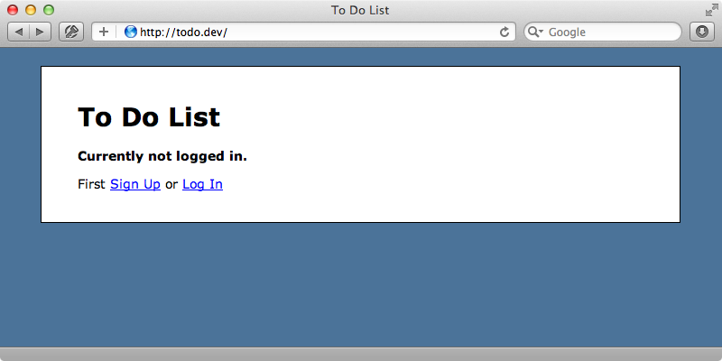

# #356 Dangers of Session Hijacking [☆](http://railscasts.com/stars?episode_id=391)

Jun 08, 2012 | 6 minutes | [Security](http://railscasts.com/?tag_id=5)

If a user's authentication cookie is sent over an insecure connection it is vulnerable to session hijacking, or more specifically, sidejacking. Learn how this is done, and how you can prevent it.

[Click to Play Video ▶](http://railscasts.com/episodes/356-dangers-of-session-hijacking?autoplay=true)

We have a ToDo application where the user can either sign up or log in. Whenever we accept sensitive user information such as passwords it’s important that it’s sent over a secure connection so that it’s encrypted and not sent as plain text. This means that any login or signup forms should use HTTPS.



It’s quite common after signing in a user to switch back to HTTP as we no longer need the users to submit sensitive information. If we do this, however, our application is vulnerable to session hijacking. This technique, also known as sidejacking, was popularized a couple of years ago by a Firefox extension called [Firesheep](http://codebutler.com/firesheep/). With it we can visit a public WiFi location and monitor local network traffic and hijack any users’ sessions that take place over an unsecured connection.

We can demonstrate how a hijacker might hijack a session from a Rails application without using Firesheep. Instead we’ll use the `tcpdump` command. This comes with Mac OS X but similar commands are available for other operating systems. We can use this command to inspect traffic on a network interface, usually `en0`, `en1` or `en2`, but here we’ll use `lo0` to monitor localhost as that’s where the Rails application we’re monitoring is running. We’ll also use the `-A` flag to display the output as ASCII text.

terminal

```
$ sudo tcpdump -i lo0 -A
```

Next we need to go to our Rails application and reload a page a couple of times while we’re signed in to generate some traffic. In the `tcpdump` output we should now see the requests we’ve made and among this will be the session cookie.

terminal

```
Host: todo.dev
User-Agent: Mozilla/5.0 (Macintosh; Intel Mac OS X 10_7_4) AppleWebKit/534.57.2 (KHTML, like Gecko) Version/5.1.7 Safari/534.57.2
Accept: text/css,*/*;q=0.1
If-Modified-Since: Fri, 15 Jun 2012 20:08:50 GMT
Referer: http://todo.dev/
If-None-Match: "12ab47955f6d80ec910edb372bffd425"
Accept-Language: en-gb
Accept-Encoding: gzip, deflate
Cookie: _todo_session=BAh7CEkiD3Nlc3Npb25faWQGOgZFRkkiJWY4MDAwM2ZjNDRiOTZhODY4MzRiYjQ3ZTA0NmM4ZTllBjsAVEkiEF9jc3JmX3Rva2VuBjsARkkiMW5qQmM2NjRYeFVpUlFDam9NL2NhM01zYkhCeWpzYVJibzBXNXNNZkZCbEE9BjsARkkiDHVzZXJfaWQGOwBGaQg%3D--8532435178d7a4e85ddaf4bd5f7170d1b8a9adbe
Connection: keep-alive
```

Now that we have the session cookie we can stop `tcpdump` with CTRL+C. We can use this cookie information with `curl` now to visit the site as that user, even though we don’t know their password. If we visit the homepage with `curl` we’ll see it as user who isn’t logged in would see it.

terminal

```
$ curl http://todo.dev/
...
  <p><strong>Currently not logged in.</strong></p>
...
```

If we pass in the session cookie, however, we’ll see the page as if we were logged in as the user whose session cookie we know.

terminal

```
$ curl http://todo.dev/ -H 'Cookie: _todo_session=BAh7CEkiD3Nlc3Npb25faWQGOgZFRkkiJWY4MDAwM2ZjNDRiOTZhODY4MzRiYjQ3ZTA0NmM4ZTllBjsAVEkiEF9jc3JmX3Rva2VuBjsARkkiMW5qQmM2NjRYeFVpUlFDam9NL2NhM01zYkhCeWpzYVJibzBXNXNNZkZCbEE9BjsARkkiDHVzZXJfaWQGOwBGaQg%3D--8532435178d7a4e85ddaf4bd5f7170d1b8a9adbe'
...
  <p id="logged_in">
    Logged in as <strong>eifion</strong>.
    <a href="/logout">Log Out</a>
  </p>
...
```

### Protecting Our Rails Application

This is rather worrying as it means that anyone on the same network can easily hijack a user’s session unless the site they’re connecting to using HTTPS to encrypt the entire request, including the cookies. How do we enforce this in our Rails app? If we look at our application’s production config file we’ll see a config setting called `force_ssl` that’s commented out. If we uncomment this every request in our Rails application will need to use HTTPS. We’ll enable this setting in development so that we can see its effects.

/config/development.rb

```
config.force_ssl = true
```

After we’ve restarted our app if we visit any page on our application through HTTP we’ll be redirected to the equivalent HTTPS page. It can be difficult to test HTTPS sites in development. We’re using a combination of Nginx and Pow to get this working and we explain how to do this in [this week’s pro episode](http://railscasts.com/episodes/356-dangers-of-session-hijacking?view=asciicast).

The `force_ssl` setting assumes that we want to make every page in our application secure. If we only want to enable SSL on certain parts of our site we shouldn’t use this setting but instead restrict things at the controller level but this will make us more vulnerable to session hijacking as cookies are sent in the clear. One solution to this is to edit the controller where we sign the user in and instead of assigning one cookie here assign two, one of which is secure.

Our app’s login behaviour is defined in a `SessionsController` and a user logs in in its `create` action. When this happens their `id` is stored in the session but we’ll store this value in a cookie too. We’ll make the cookie signed so that the user can’t modify it and we’ll call it `secure_user_id`. We’ll make it secure too so that it’s only passed in a secure connection.

/app/controllers/sessions\_controller.rb

```
def create
  user = User.find_by_name(params[:name])
  if user && user.authenticate(params[:password])
    session[:user_id] = user.id
    cookies.signed[:secure_user_id] = {secure: true, value: "secure#{user.id}"}
    redirect_to(session.delete(:return_to) || root_url)
  else
    flash.now.alert = "Email or password is invalid"
    render "new"
  end
end
```

When the user signs out the `destroy` action is called and we’ll modify this so that the cookie is deleted.

/app/controllers/sessions\_controller.rb

```
def destroy
  session[:user_id] = nil
  cookies.delete[:secure_user_id]
  redirect_to login_url
end
```

We can now check for this extra cookie whenever we fetch the current user. We do this in the `ApplicationController`’s `current_user` method so we’ll modify this method to check that either the current request isn’t over a secure connection or, if it is, that the `secure_user_id` cookie has the correct value.

/app/controllers/application\_controller.rb

```
def current_user
  if !request.ssl? || cookies.signed[:secure_user_id] == "secure#{session[:user_id]}"
    @current_user ||= User.find(session[:user_id]) if session[:user_id]
  end
end
```

With this in place if the session is hijacked the hijacker won’t be able to access the secure pages as that user.

Now when we log in through the application two cookies will be created, one secure and another for the insecure connection. From the users’ perspective when the app switches between HTTP and HTTPS they’re always logged in but now when someone tries to hijack the session all they can fetch is the insecure cookie. This will still allow them to connect as that user to the insecure pages but if they try fetching one of the pages that needs to be viewed over HTTPS the page will say that we’re not logged in as the secure cookie won’t match.

With this technique a hijacker can still act as another user on a normal HTTP request but for HTTPS requests they won’t be allowed access. This means that we should be sure to enforce SSL on pages that we don’t want potential hijackers to access.
