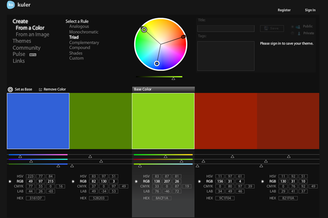
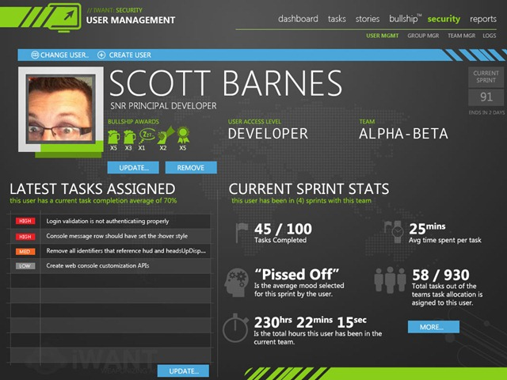
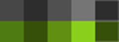
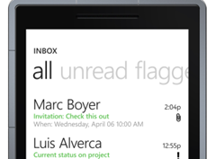

# [5 Things you ought to know when designing metro screens.](http://www.riagenic.com/archives/526 "Permanent Link: 5 Things you ought to know when designing metro screens.")

02 Mar 2011/[17 Comments](http://www.riagenic.com/archives/526#comments "Comment on 5 Things you ought to know when designing metro screens.")/in [Fantasy User Interfaces](http://www.riagenic.com/archives/category/design/fantasy-user-interfaces), [Graphical User Interface (GUI)](http://www.riagenic.com/archives/category/design/graphical-user-interface-gui), [Uncategorized](http://www.riagenic.com/archives/category/uncategorized) /by [Scott Barnes](http://www.riagenic.com/archives/author/admin "Posts by Scott Barnes")

Having recently, gone full METRO lately, I have in turn created what I’d call my 5 things you ought to know going full metro list.  Here are five (5) things you probably might want to know if you head down this path like me?

# 1. Color choice is critical.

The thing that stands out about most "metro" inspired designs is they pretty much settle on around 2-3 primary colors of choice. They also then rely heavily on either black or white (maybe a shade of gray) for their canvas as well.

It’s probably good thing to start by choosing your canvas to paint on upfront. White is great, it gives you more room to play around with and does not come across as obvious in terms of empty space. Black is also great, but keep in mind your empty space may become more obvious if you do not plan your designs as carefully.

Once you have outlined your canvas now comes the choice of a base color, any other accent you choose feeds off this color. Selection of your base color needs to keep one thing in mind; it will haunt you throughout your design.

The base color defines the "chrome" boundaries will give the user the pattern they have made a choice on something. Having often used the base color as both the partial chrome and when it comes to a selection. The reason I do this is in my own warped mind, the selection is part of the chrome, it’s essentially a choice an active one at that so why does it need to be constantly visible in terms of difference? In that I’ve made my choice, I’ve noted the choice is visibly in place, let’s move on please and focus on the parts I haven’t made a choice on, am about to make a choice on and/or need to figure out whether a choice needs to be made?

After you have defined your base color, head on over to [Adobe’s Kuler site](http://kuler.adobe.com/) (that or use the Kuler extension found within Photoshop CS4+).  Inject your base colors into the "create" area, and then decide how your color compliments by selecting an alternative/complimentary color. Kuler is pretty spot on in terms of helping you decide this, as if you choose a bright green; you have many colors to choose.

> Example, one of the designs shown uses a bright blue, at first it seemed quite bright – but then after while of using it (own opinion), becomes a welcome relief from the green.

This alternative or secondary accent in your color, should become the color in which you decorate your buttons or inputs into.

> Example, if you look under the hood of a new car, you will see areas colored yellow whereas the rest is the same color of the engine etc. Car manufacturers do this on purpose, they want you to touch yellow yourself but if it is not yellow and you are not mechanically minded – leave alone.

Having liked this principle and having fused it into designs constantly and personally used the secondary accent color to draw people’s attention to the fact "I’m ok if you touch this, you won’t break anything if you do" thinking. Personally, not entirely sure how popular it is amongst the UX/UI fraternity.  So far, no users have made obvious complaints from this approach.

I have not seen data that contradicts my theory here, but ultimately the data I do see is if the end users are given a breadcrumb trail in terms of pattern recognition, you have won them over – complexity and efficiency formula’s aside.

 One digresses; finally keep your color palette to around four (4) shades in total. It forces you to keep your selection pretty consistent and close to the base as possible.  Having liked this approach, as it prevents color conflicts occurring and again. It also maintains a pattern that is consistent – almost expected.

That is the interpretation of metro and colors so far – personal opinion based off current design style (which is slowly evolving – personal UI journey here).

# 2. Typography consistency is good, focus on that.

Designs shown are an example of how they do not keep typography settings consistent, as they will often fluctuate between 8pt to 30pt text depending on design purpose. These choices made only during the testing out layout composition from wireframes phase. The idea here is to see how it all stacks together inside Photoshop before you take the concept over into Expression Blend.

Once inside Expression Blend – much like HTML/CSS – I settle on a consistent and semantically named theme sizes.  An example would be H1FontSize would be around 30pt, H2FontSize would be around 24pt and so on. The key here is to keep the approach in which you attack your UI consistent in your font size settings – goes without saying.

FontSizes are not the only issue, UpperCase, Camel Case, Lowercase etc. are all equally important.  Do try to keep these consistent to their relative function, in that navigation kept lowercase but headings etc. all uppercase.

Zune team does this with the Zune Desktop, the actual navigation, and nav-headings and maybe category headings are all lowercase. The rest of the text fluctuates between all Uppercase and normal case

Not entirely convinced of a killer formula here as its one of those areas where more experimentation could be done around what can work vs. what cannot.  Typography experts will definitely have an opinion here. Have yet to see one that outlines this. (Ping me if you have any bookmarks in this area of expertise).

Color choice per heading is also something that seems to have a bit of a formula around when it comes to my designs. I’ll often use the base color on labels that I think are important enough to capture the users attention but then use opposite to the canvas colors in order to retain a normal state.

I typically think about this as a case of highs and lows in vocal tones. In that if describing a current screen to someone, one might say, "this is the USER MANAGEMENT screen within the security management area". This is personally, done naturally via voice emphasis the "User Management" vs. "Security Management". As who cares where it lives, it is not the end is it.

Welcome feedback on this approach, but the point is color selection helps carry that forward.

# 3. Text Chrome vs. Text Content balance it out.

This is one of those pet hates I have with the current implementation on Windows Phone 7 – in one way the team decided to abandon chrome artifacts in favor of text, the problem I personally have is switching gears between *"Chrome"* text and *"Content"* text.  I find myself at times pausing and thinking, *"ok, can I touch that..nope..ok what’s touchable here..".*

Overtime, personally, will develop some muscle memory in this space and will soon learn what the differences are but in given the current metro virginity I have, I just noticed this as a pattern which was not obvious (again, let users notice the scent for pattern recognition).   
Would one put heading labels etc. as being the "Chrome" text category? Striking a balance here of too much text is important and again color choice can help you out here. I rely heavily on monochrome filled shapes and text in my current metro style, so for me it’s a demon I’m always trying to wrestle to the ground – keep my text minimal and restrain from too much on the screen, especially if there is allot of data to view.

# 4. Element minimizations are ok, but add some life please.

Over lunch today, a colleague and I were discussing the metro way of life really does not allow too much in the way of gradients or watermark elements – most of the designs I have seen in this space are clean / white.   
Is purity in no element additions bad or good?

I for one cannot honestly answer that as I am the type of guy who often just does not know to back off on the decals, I love a busy UI and it has nothing to do with the user experience it is more of an artistic habit.

Agreed, less is more, but sprinkle in some energy into the user interface. Think about what the end user is supposed to feel or relate to the said User Interface. One screen rather has a lot of fun with the idea that a boring concept like task tracking can take on more of a Bourne Identity / CIA feel.  I then throw in a world map, as hey, all Fantasy User Interface(s) within Movies always have the map of the world behind them when hacking a large mainframe or accessing global data of some kind (it works, I love it, back off).

Point is, don’t be a lemming and follow each other over the pure white cliff, sprinkle in some decals to take the edge of the seriousness of the UI and allow the end user to feel a small connection with the work you’ve put in front of them.

# 5. Fantasy User Interfaces in movies are your best friend.

Having found it difficult to get inspiration sources for metro and instead turning to local train stations etc., but they also have a much-prescribed look and feel throughout Australia.  Often one use Google/Bing images and searches other transit signs etc. to get a pick out of what is out there in the wild – metro style.

The main source however for inspiration, is to watch movies that have kickass user interfaces in them and then pick them apart frame by frame. I analyze them and try to force myself to think outside the box more and how these concepts could relate to real-life user interfaces.

I like what Fantasy UI brings to the table, it creates this nice illusion within a TV Show or Movie that convinces you in under 30seconds that the actor is doing something high tech.  It is obviously not real software, but you forgive it and go "yeah, suppose, I could buy what you’re selling here" for that brief moment.

I think it’s important to call that out, as it’s at the core of probably our reaction to software and it gives off this pure signal of "that works" moment.

Metro can lend itself to simplistic Fantasy UI’s, as often the user interfaces are very basic in their structure. Take the work of [Mark Coleran](http://www.coleran.com) (current geek UI hero); looking at his work, he has kept the UI basic in terms of color choice, composition and decals.  The actual magic comes to live when there is animations etc. on it, but in the end, it is relatively simple in composition. – It works!

This is the only reason I am remotely convinced metro as a style so far (the one I am working towards anyway) might have some legs. It is not entirely rainbows and kisses, but at the same time, it is.

Also, look at HTML/CSS sites within [csselite.com](http://www.csselite.com) galleries for inspiration as well. As these sites typically rely quite heavily on CSS for their design governance – so in a way the metro concept really hails from this if you ask me…

**Tags:** [FUI](http://www.riagenic.com/archives/tag/fui), [Metro](http://www.riagenic.com/archives/tag/metro)
