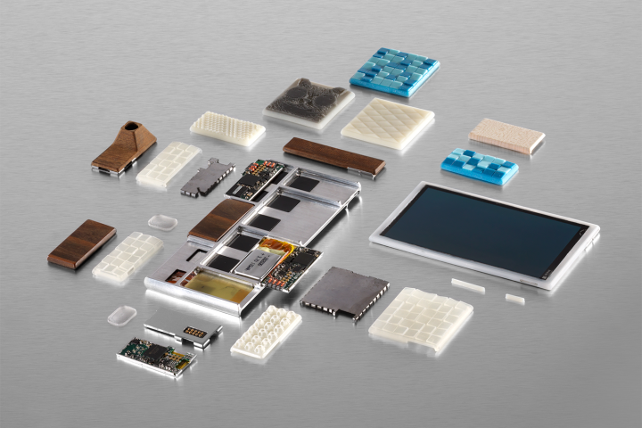
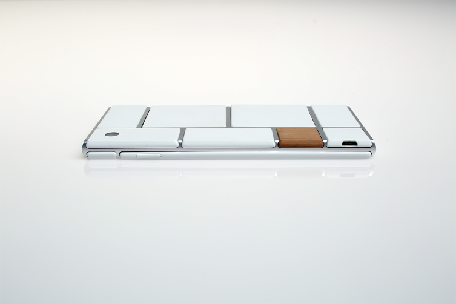
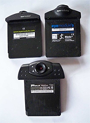
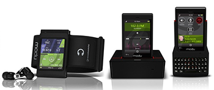
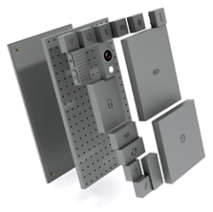
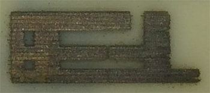
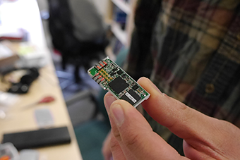
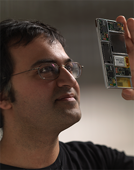
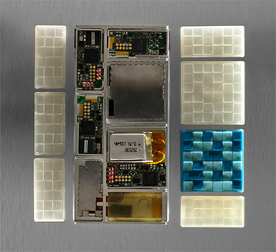
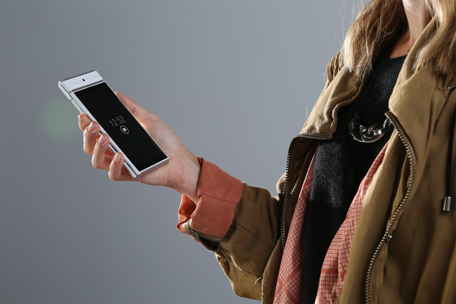

# Project Ara: Inside Google’s Bold Gambit to Make Smartphones Modular

The two-year quest to create the ultimate customizable phone, inside and out.

Google ATAP

Parts of a functional prototype of a Project Ara phone -- still a work in progress -- including the endoskeleton frame, the screen, electrical components and custom 3D-printed module enclosures

On January 29, Google announced that it had agreed to sell Motorola, its phone-manufacturing business, to Chinese electronics giant Lenovo. Thus concluded the company’s brief, unprofitable foray into smartphone hardware, which began when it revealed plans to acquire Motorola Mobility in August, 2011.

Except that it didn’t really end there. It turned out that Google was holding onto one organization within Motorola: the Advanced Technology and Projects (ATAP) group. Headed by Regina Dugan, the former director of the U.S. Defense Department’s fabled [Defense Advanced Research Projects Agency](http://en.wikipedia.org/wiki/DARPA) (DARPA), ATAP aims to bring the same approach to mobile-gadget innovation that DARPA used to kickstart the Internet, satellite navigation, stealth fighters and other technologies that started small and eventually mattered a lot.

In retrospect, it’s completely logical that Google would choose to retain ATAP. The technologies and projects it specializes in are the wildly audacious ideas Google likes to call [moonshots](http://content.time.com/time/subscriber/article/0,33009,2152422,00.html). The company already has another group devoted to such efforts — Google X, which is working on [Google Glass](http://techland.time.com/2013/10/29/new-google-glass-photos-revealed/ "New Google Glass Photos Revealed"), [self-driving cars](http://techland.time.com/2012/08/10/googles-self-driving-cars-300000-miles-zero-accidents/ "Google’s Self-Driving Cars: 300,000 Miles, Zero Accidents"), [broadband balloons](https://www.google.com/loon/) and more — but it’s hard to imagine it handing off any moonshots in progress to Lenovo or anyone else.

Among the ATAP initiatives that have been announced, one in particular is quintessentially Google-y. It’s Project Ara, which aims to reinvent the smartphone by breaking it down into modules that can be assembled and customized in a limitless number of configurations. The company first disclosed that the project existed on October 29 of last year, when it released some intriguing photos but little in the way of concrete details. Today, it’s lifting the veil further as it prepares for [an Ara developer conference](http://www.projectara.com) it’s holding at Silicon Valley’s Computer History Museum on April 15-16. A year or so from now, it hopes to have a product on the market.

Google ATAP

The back side of a modular Ara phone

Right now, if you buy a smartphone, the odds are that you’ll get something that one of a handful of large companies designed to appeal to tens of millions of people. And as gobsmackingly capable as modern phones are, that dynamic leads to a certain sameness.

Even Motorola’s much-ballyhooed program that lets consumers order [custom Moto X phones](http://techland.time.com/2013/08/01/first-look-the-moto-x-is-a-customizable-motorola-phone-with-google-dna/ "First Look: The Moto X Is a Customizable Motorola Phone with Google DNA") assembled at a Texas plant involves superficial factors such as case colors and materials, not unique features. By allowing for features to be implemented as user-installable modules, Project Ara’s creators hope to make smartphones a whole lot more interesting.

“The question was basically, could we do for hardware what Android and other platforms have done for software?” says Paul Eremenko, the DARPA alumnus who leads the effort. “Which means lower the barrier to entry to such a degree that you could have tens of thousands or hundreds of thousands of developers as opposed to just five or six big [manufacturers] that could participate in the hardware space.”

It’s a big, improbable dream; even based on what little information Google has disclosed to date, pundits have been busy [pointing out the pitfalls](http://www.fiercewireless.com/story/i-love-motorolas-project-ara-modular-phones-i-just-dont-think-it-will-work/2013-10-29). But if Ara works as advertised and large numbers of phone buyers buy into the proposition, they could get something that contrasts sharply with the traditional breed of off-the-shelf phones released on a yearly schedule.

For instance, when Samsung announced the [Galaxy S5](http://techland.time.com/2014/02/24/samsung-galaxy-s5/ "Samsung Unveils Galaxy S5 Smartphone") this week, its headline improvements included a better camera, a fingerprint scanner and a heart-rate monitor. In a world of modular phones, you might be able to pick any or all of those features and add them to the phone you already have. You’d even be able to pick among multiple cameras, or choose quirky features not meant for the masses. (Eremenko’s playful example: an on-phone incense burner.)

Ara also speaks to an overarching issue near to Google’s heart: the need to help get another five billion people on the Internet, by bringing it to individuals in developing nations in affordable forms tailored to their needs. The first expression of the modular concept Ara’s creators are focusing on is a smartphone with a target price of $50 that’s so basic it comes with only Wi-Fi, not a cellular connection. Unlike the bargain-basement “feature phones” such a handset would replace, this wouldn’t be a technological anachronism. As its owner’s needs evolved and budget permitted, new modules would make it better and better and better.

Wikipedia

Cameras for use with Handspring’s Springboard slot

The notion that a pocket-sized device might provide modular expansion for capabilities designed by third parties is hardly new. Fifteen years ago, the [Handspring Visor](http://en.wikipedia.org/wiki/Handspring_(company)#Visor_series) — a PDA created by the inventors of the PalmPilot — made a splash with a feature called [Springboard](http://en.wikipedia.org/wiki/Springboard_Expansion_Slot). A slot on the device’s backside accommodated modules that expanded the phone’s capabilities, even turning it into a proto-smartphone with an add-on called the VisorPhone.

The Springboard slot generated lots of excitement for a time, but it made for a portly PDA in an era when rivals were emphasizing slim design And “most modules were single purpose — there was a camera, memory, a modem, GPS, the phone,” remembers Handspring product manager Greg Shirai. “Some people liked to carry a bandolier of modules and swap them in and out. It was geeky and fun. But at some point, a lot of people didn’t.”

When Handspring turned its efforts to the Treo smartphone, says Shirai, “we decided we had our hands full just trying to build a great phone.” And the Springboard slot was relegated to the dustbin of gadget history.

Modu

The Modu T phone and some of its special-purpose jackets

The modularity concept resurfaced in 2008 with phones from Modu, an Israeli startup that made a credit card-sized micro-handset you could slip into different cases for different purposes — one sported a five-megapixel camera, another a BlackBerry-esque keyboard. But the idea didn’t catch on, and Modu folded. (It ended up selling its patents to — wait for it — Google, suggesting that someone at the company was intrigued by modular phones at least as early as 2011.)

Meanwhile, the most influential smartphone of all time, Apple’s iPhone, was leading the entire industry in a distinctly non-modular direction: Even the battery was sealed into the case, and there was no memory-card slot for storage expansion. So last September, when Dave Hakkens, an industrial-design student from the Netherlands, proposed a snap-together smartphone system he called [Phonebloks](http://techland.time.com/2013/09/12/iphone-i-could-quit-you-for-phonebloks-a-lego-like-smartphone-concept-that-sounds-way-smarter/ "iPhone, I Could Quit You for Phonebloks, a LEGO-like Smartphone Concept that Sounds Way Smarter"), the very notion felt as contrarian as it did futuristic.

Phonebloks

Dave Hakkens’ Phonebloks concept

Hakkens was motivated mostly by the ecological implications of a culture that has tech enthusiasts using a smartphone for only a year or two before dumping it and moving onto something newer and shinier. After all, “If you have a bike and you get a flat tire,” he reasoned, “you don’t throw it away and buy a new bike.” His noble, seemingly far-fetched goal was to spark enough interest in Phonebloks that the industry would embrace the concept and make it happen.

For starters, he made an engaging video and set out to find 500 supporters on “crowd-speaking” site [Thunderclap](https://www.thunderclap.it/projects/2931-phonebloks). Instead, nearly a million signed up, and the video went on to rack up 19 million YouTube views.

But even if Phonebloks was an instant phenomenon, it remained a vision of a phone from a possibly distant future, as far as Hakkens knew. “Maybe it’ll take us ten or twenty years, but it’s not impossible,” he remembers thinking.

Motorola, startled by the sudden surge of enthusiasm for something so similar to the effort it had been secretly toiling on for months, moved its announcement of Project Ara up by a month. It also partnered with Hakkens, whose [Phonebloks site](http://www.phonebloks.com) now serves as a community where enthusiasts can brainstorm Ara-related ideas. (Hakkens stresses that he’s an equal-opportunity supporter of modularity: He’s also pleased about the [Eco-Mobius](http://www.theverge.com/2014/1/8/5289998/zte-shows-off-eco-mobius-modular-smartphone-concept), a concept phone with user-replaceable components that Chinese manufacturer ZTE showed off at last month’s CES conference.)

Exuberant though the support for Phonebloks was, Hakkens’ campaign also proved that an awful lot of people just didn’t buy the idea of a modular phone. *Fast Company*’s John Brownlee, for instance, [called it](http://www.fastcodesign.com/3017409/why-lego-design-principles-dont-work-on-smartphones) “a pipe dream,” while Colin Lecher of *Popular Science* [ventured](http://www.popsci.com/article/gadgets/why-lego-style-phonebloks-concept-will-fall-apart) that it would “fall apart faster than a Lego castle in the path of a toddler.” A [whole Reddit thread](http://www.reddit.com/comments/1md46o) was devoted to knowledgeable people helpfully explaining why build-it-yourself smartphones were a technological non-starter.

Project Ara aims to prove the naysayers wrong, and to do so more quickly than you might think possible. The earliest explorations of the concept started in the fall of 2012, and work got underway in earnest on April 1, 2013. Eremenko says that ATAP is finishing up work on a functioning prototype, which will be ready within weeks, with a version ready for commercial release in the first quarter of 2015.

DARPA

Project Ara head Paul Eremenko, in a photo taken during his days at the U.S. Department of Defense’s DARPA

Google has made so much headway on Ara in so little time because of the lean, speedy approach to invention that Dugan, Eremenko and other DARPA defectors brought with them when they joined Motorola. ATAP is applying it to a variety of projects: Besides Project Ara, efforts underway include [Project Tango](http://techland.time.com/2014/02/21/project-tango-googles-3d-tracking-phone-means-more-for-wearables/), an experimental smartphone that can map the world around it. Plus, presumably, other efforts that remain undisclosed.

The DARPA/ATAP way involves small in-house teams — just three people in the case of Ara — being given about two years to tackle an ambitious challenge. That schedule is meant to be a little scary: “Generally, time is not your friend,” says Eremenko. “Innovation under time pressure is generally higher-quality innovation.”

Much of the heavy lifting is done by “external performers” — individuals, companies or universities that contribute to the project on a contractual basis as necessary, either briefly or for the long haul. In the case of Project Ara, one key external performer is NK Labs, a small outfit sandwiched in between a towing company and a fencing center in an industrial section of Cambridge, Massachusetts. NK’s founders, Seth Newburg and Ara Knaian, are overseeing the electrical, mechanical and software engineering required to make modular phones a reality, heading up a team of around fifteen people.

“They’re absolute superstars in their field,” Eremenko says. “Creative, out-of-the-box, do-anything kind of guys. I could never, ever get them to work [for Google] full time, move across the country, et cetera, et cetera. There was no way in the traditional model to capture that mindshare.”

(In case you’re wondering: Yes, Project Ara’s moniker is a nod to Ara Knaian, both to acknowledge his contributions and because he happened to have a name that sounded cool. Google hasn’t decided what all this stuff will be called when it becomes a commercial offering.)

Google ATAP

An experimental 3D-printed antenna

Another vital contributor to the effort is [3D Systems](http://www.3dsystems.com), the major maker of 3D-printing equipment. It’s developing a new high-speed continuous 3D printer capable of cranking out enclosures for Ara modules in volume, allowing for phones to be both mass-produced and custom-designed in a way that’s new for any consumer product. Eventually, even electrical elements such as the antennas might be printed rather than manufactured by conventional means.

“If this is successful, it could become one of those watershed moments for 3D printing,” says 3D Systems CEO Avi Reichental. “All of us passionately share the vision of what this could become, and the passion to do our best to make it happen.”

Though ATAP now falls into the part of Google responsible for Android and Chrome, headed by Senior Vice President Sundar Pichai, it hasn’t exactly been subsumed into the Google machine. After the Motorola sale was announced, the Ara team decamped to a tiny sublet office at an office park with a 1980s vibe, seven miles from Google’s Mountain View, Calif. headquarters. The downside: Staffers don’t get any of that fabulous free food that other Google employees feast on. But they do get to sidestep big-company burdens such as dealing with the mothership’s security apparatus and legal department.

What the Ara team and its outside collaborators have created is a platform that supports three sizes of phone: mini (rather basic), medium (mainstream) and jumbo (an oversized, phablet-style variant). The size of each is determined by its endoskeleton, or endo for short — the one component of an Ara phone that will be Google-branded, as opposed to being devised by a third-party company.

The endo is an aluminum frame that contains a bit of networking circuitry so the modules can talk to each other, a tiny back-up battery and not much else. Everything from the screen to the processor to the battery is provided in the form of a module — the medium-sized endo has space for ten of them — which you slide into place to form a phone. In the first prototype, the modules use retractable pins to connect to the endo’s network; later this year, Google plans to replace that approach with more space-efficient capacitive connections.

Doug Aamoth / TIME

A prototype Project Ara module, without its enclosure

Like the expansion slots on a desktop PC’s motherboard, each compartment on the endo is designed to handle any module of the correct size, regardless of its function. Though basic technical issues are sometimes a factor — an antenna can’t just go anywhere on a phone’s body, for instance — the general idea is to design the phone so that you can swap modules in and out at will. If you never take photos with your phone but worry about running out of power, for instance, you might choose to do without a camera module, freeing up room for a second battery.

Furthermore, the Ara platform is designed to permit hot-swapping of modules, without requiring you to power down the phone — which means that you could slide out the camera and replace it with a battery whenever you needed a little extra juice.

Many modules would offer features that every conventional smartphone offers as standard equipment, such as cameras, speakers and various sensors. But Eremenko says that breaking them out into modules will allow a consumer to make a phone more personal, choosing speakers optimized for NPR-type content, for instance, or ones meant for rap. Rather than everything being dependent on a component maker’s skill at landing contracts with big handset manufacturers, phone buyers would call the shots. “If it turns out that consumers really care about megapixels in cameras, then your bajillion-megapixel camera is going to sell,” he says. “And if it turns out that consumers don’t, then it won’t.”

Google ATAP

Ara Knaian, lead mechanical engineer on Project Ara, with the phone in its current functional prototype form

Other modules could offer more specialized capabilities. Based in part on lessons learned last summer from [MAKEwithMOTO](http://makewithmoto.squarespace.com) — a tour that involved visiting universities and Maker Faires in a Velcro-covered van outfitted with existing Motorola phones modded to encourage hacking — Eremenko thinks that two particularly hot categories will be health and personal transportation. Texas A&M students, for example, rigged up a camera attachment and depth sensor that gives a phone [the ability to conduct eye exams](http://makewithmoto.squarespace.com/texasam/). Another team designed an add-on for skateboarders that captured data about terrain, then relayed it to other skaters. In the future, either idea could be an Ara module.

Ara handles one common concern about modular phones — what’s to keep them from falling apart in your pocket or when they slip out of your hand? — in two different ways. The modules on the front of the endo are secured with latches. Those on the back use electropermanent magnets. In both cases, you use an app to lock everything in place. Eremenko says that the phone will be as resistant to water and other environmental threats as conventional models, although some tests — including one that simulates the phone being jostled around in a crowded purse — will need to wait until ATAP has a functioning prototype.

As neat as all this sounds, modularity has some obvious downsides. When Apple designs an iPhone, it can cram in parts in the tightest possible manner, as if each new model were a one-of-a-kind jigsaw puzzle. Breaking out hardware features into modules loses that advantage.

“A big challenge on this project was that a cell phone is one of the most integrated things that’s made today, and we’re trying to separate it into modular pieces,” says Knaian. “And so the challenge was how to fit everything in an efficient way, so that people could have the ability at home to add and remove modules and have a lot of flexibility about what modules they put in, but not to have too much added weight or too much added cost by doing that.”

Keeping the size reasonable was crucial. “When people say ‘modular phone,’” explains Eremenko, “the first thing that jumps to mind is, like, Legos — a big, blocky thing. And so we had to overcome that with the industrial design. That was the first mental hurdle to overcome.”

Ara’s masterminds have managed to design a platform that doesn’t suffer from the elephantiasis many have declared an unavoidable side effect of modularity. The modules are 4mm thick — tiles, really, rather than blocks. (The proportions of the smallest ones remind me of [an Andes thin mint](http://www.tootsie.com/products.php?pid=105), though the modules are thinner than the mints.)

Inserted into an endoskeleton, the modules form a phone that’s 9.7mm thick in its current prototype form. Later this year, as the design progresses, the designers may allow that to slip to 10mm or so to make room for beefier batteries. That would be noticeably chunkier than the 7.6mm iPhone 5s or 8.1mm Galaxy S5, but only a skosh more so than the 9.3mm HTC One.

At least in the design model I got to see in person, the Ara phone is surprisingly elegant-looking. When you slide the modules into the endo, the result is less like Lego, and more like a [Mondrian painting](http://en.wikipedia.org/wiki/Piet_Mondrian#Paris_.281919.E2.80.931938.29) rendered in 3D.

Google ATAP

A work-in-progress functional prototype of an Ara phone, flanked by 3D-printed module enclosures

Google is also keen to let consumers specify an Ara phone’s aesthetics as well as its capabilities, which is where 3D Systems’ next-generation 3D printer comes in. It will be able to print 600-dpi color images on module enclosures made out of multiple types of materials, which will be user-swappable. The printer will even be able to treat the enclosure as a surface for one-of-a-kind sculptures: Among Ara’s prototypes is an enclosure bedecked with dozens of microscopic soccer balls.

“We want not just to create something that’s custom, and not even just something that’s unique, but actually something that’s expressive so that people can use this as a canvas to tell a story,” says Eremenko. “So that you can set your phone down at dinner on the table next to you, and it becomes a topic of conversation for the first fifteen minutes of dinner.”

Between a hardware ecosystem that Google hopes will eventually offer thousands of modules and the infinite opportunity for exterior modifications, configuring an Ara phone will involve a lot of decisions. Gadget geeks would revel in the opportunity, but a lot of folks might react the same way that new-car buyers do when confronted with the responsibility of choosing between multiple options for everything from engines to wheels to floormats.

And Google is adamant that it’s not targeting geeks. It wants people who have never even used the Internet to be comfy with the prospect of buying and using an Ara phone — “the alpaca farmer in Peru who might not even have a feature phone today,” as Eremenko describes a typical customer. So the company is developing Android apps that will expedite the configuration process by pinpointing a different set of features and designs for each shopper.

When phones are ready for sale, the company plans to get them to consumers in three ways. There will be what Ara’s creators are calling a “grayphone” — that $50 bare-bones version, designed to be sold at convenience stores and running an app that will let buyers begin the process of customizing the phone with additional modules and aesthetic modifications. People will also be able to use the customization app on a friend’s Ara phone to order a handset of their own; Google’s research indicates that choosing a model will be easier if you’ve got a pal helping out.

The fullest expression of the Ara sales experience will happen at mobile kiosks, which Google is designing to fit into industry-standard shipping containers for easy transportation to wherever on Earth they’re needed. (A towering wooden frame matching the dimensions of such a container dominates Project Ara’s office space.) The company is still figuring out where they’ll show up first, though it’s likely that phones will be available in one geographic region before any global rollout.

Eremenko describes a scenario in which visitors to a kiosk might choose a phone with the help of a special tablet capable of measuring galvanic skin response, sub-voluntary muscle movements, pupil dilation, heart rate and other factors that suggest “whether you’re happy to be configuring your Ara phone, or whether you’re stressed, frustrated, impatient, et cetera.” It would then use that assessment of your mood to steer its recommendations.

Another part of the phone-picking process could involve suggestions based on an automated examination of your Facebook or Google+ activity. If your updates show that you’re a frequent traveler, for example, you might be advised to go for a big battery and a wireless carrier with service in the destinations you frequent. Someone whose photos get lots of positive feedback from friends could be pointed towards a serious camera module; if those photos tend to be taken at dusk, it might be a camera with good low-light performance.

Eremenko emphasizes that all of this would be optional and done only with the customer’s full knowledge and consent, and that buyers would be able to review and overrule any recommendations. If you’re still creeped out by the prospect of Google poking around in your social networks to that degree — let alone trying determine if you’re sweaty or fidgety — it’s understandable. But don’t fret too much just yet: At launch, it’s likely that not all of the more out-there elements will be ready. And Google isn’t saying when it might start marketing Ara phones in the U.S.

Google ATAP

A front view of an assembled Ara prototype

For all the progress Project Ara has already made, some basic issues remain on the to-do list. For instance, the team hasn’t yet managed to grind the cost for the grayphone down to a $50 price point. Nor is it clear how regulatory agencies such as the Federal Communications Commission, which test and certify new phones to confirm they don’t interfere with other devices, will deal with a smartphone that contains components that consumers can rearrange to their liking. (Eremenko says that the FCC has been encouraging so far: “They see this as good for American industry…this says that, hey, your competitive advantage can be innovation, as opposed to making the same fricking phone a few dollars cheaper.”)

Still, the overriding issue with Ara, like any truly new idea, is whether real people will care. Eremenko thinks that when Google can show a working Ara phone, it’ll be its own best advocate. Will the argument that the whole concept is hopelessly naïve fade away? “I think it has to, if you show it and everybody agrees that it’s beautiful, and delightful to the consumer, and it actually works. I’m certain that some level of skepticism will remain: If I drop it, will the modules scatter all over the train platform? And those kinds of things. But the proof is in the demo.”

It’s a core tenet of ATAP’s philosophy that projects have a two-year window. So assuming that Ara is viable a year from now, Eremenko and the rest of the team will be winding down their involvement and handing off responsibility to others within Google. At that point, it’ll be a business, not a project. Maybe a huge one someday, if enough people buy Ara phones running Google search, Gmail, Google Maps and other advertising-supported Google services.

For the record, Eremenko says that he’s had the luxury of focusing on making sure Ara is great, not profitable: ”This is potentially the only thing out there that could turn into a five-billion-unit kind of device. The fact that that will accrue benefits to Google downstream is so obvious that I don’t have to make a business case.” Even if everything goes swimmingly from here on out, addressing a market with billions of potential customers will take a long time — but it may not be all that long until Ara’s prospects are clear enough that the modular-phone doubters are either having the last laugh or eating crow.

*TIME Tech editor Doug Aamoth contributed to this report.*
